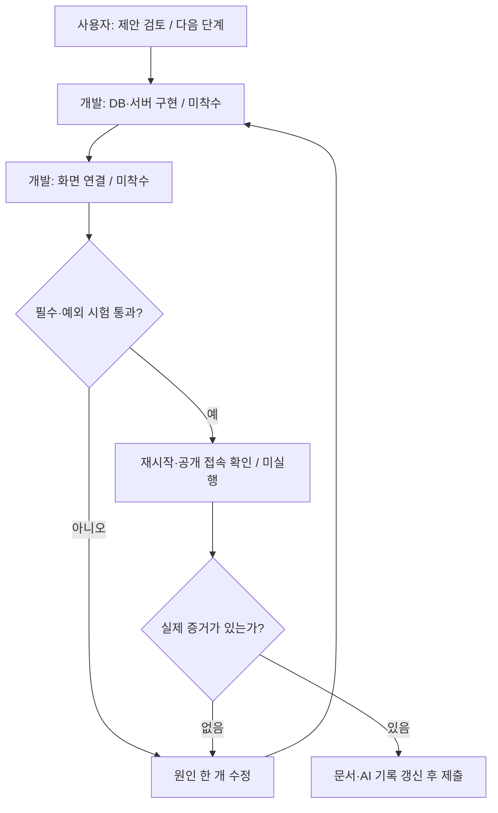
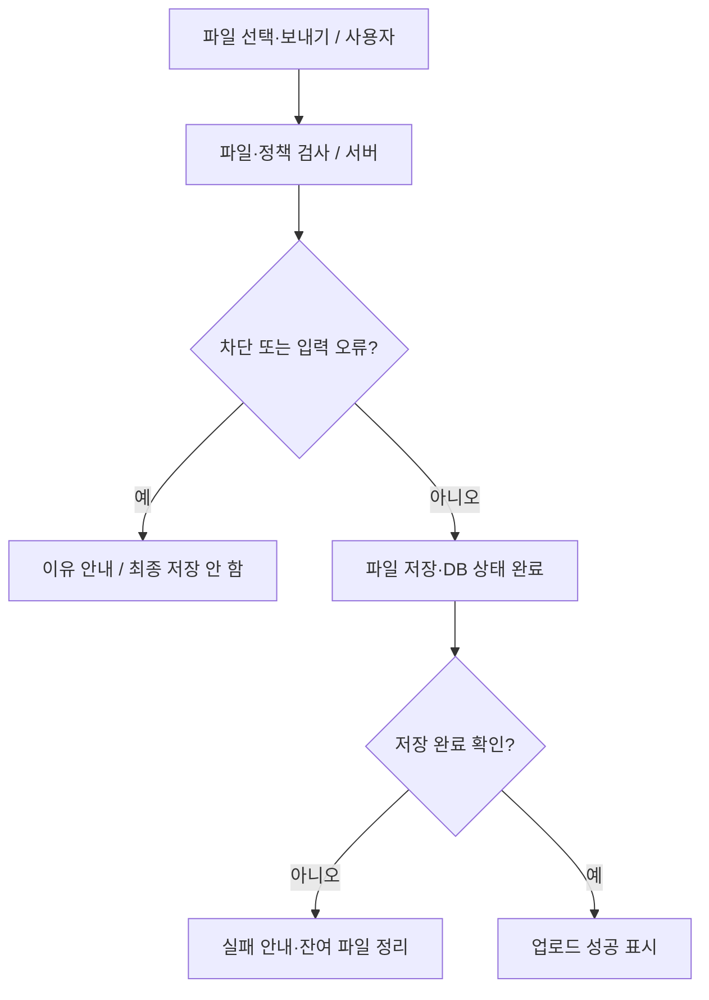
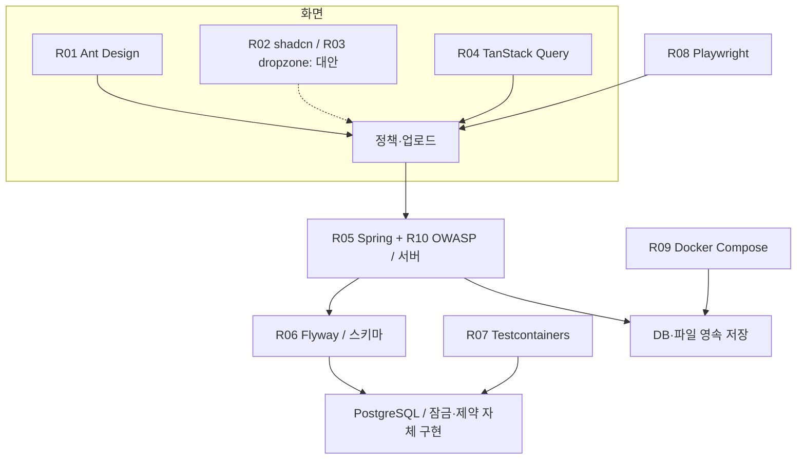

# 쉬운판: 파일 업로드 화면과 레퍼런스

작성일: 2026-10-23 · 문서 ID: flow-ui-research-20261023-105551

> 최종 목표: 과제 조건을 지키는 화면과 오픈소스를 고르고 구현·검증 순서를 확인한다.

**핵심 한 줄:** Ant Design 중심 화면을 제안하고 안전한 저장·데이터 일치·재시작 검증을 각각의 참고 자료와 연결합니다.

다음 행동 하나: 정책 선택 → 서버 저장 → 새로고침 유지의 첫 기능을 연결합니다.

## 3줄 줄거리

1. 고정 7종 미선택과 커스텀 20자·200개 조건을 먼저 지킵니다.
2. 자료 10개에서 가져올 부분과 수정·제외할 부분을 구분합니다.
3. 예상 화면을 확인하고 실제 구현·28개 시험·증거 기록으로 이어갑니다.

> 집계 정정: 이전 답변의 123개는 재등장한 번호를 포함한 집계였으며, 고유 점검 항목은 108개입니다. 28개 시험 계획은 변동 없습니다.

## 현재 위치와 가설 검증

4개 파트는 ① 화면 선택 ② 시스템 연결 ③ 실제 시험 ④ 기록·제출입니다. 이번에 깊게 본 파트는 **① 정책·업로드 화면 선택**입니다. 다른 파트는 기존 108개 점검 항목에 참고 자료와 다음 검증을 연결했습니다.

확인: 저장소에는 문서가 있고 앱 소스는 없습니다. 공식 저장소 10개와 관련 자료를 확인했습니다.

아직 모르는 것: 이 구성이 실제 개발 시간을 줄이고 실수 없이 쓰기 쉬운지.

확인하는 방법: 첫 기능에서 저장 실패·새로고침·키보드·좁은 화면을 시험합니다. 시간·성능·번들 용량 개선은 측정하지 않았습니다.

## 효율성·안정성·심미성 비교

| 후보 | 효율성 관점 | 안정성 관점 | 심미성 관점 | 판정 |
|---|---|---|---|---|
| Ant Design | 선택·입력·태그·업로드·안내를 한 구성으로 조합 | 상태와 접근성 동작 참고; 서버 검증은 별도 | 색·간격을 한 기준으로 맞춤 | 우선 제안 |
| shadcn/ui | 필요한 소스를 직접 조합·수정 | 코드 소유에 따른 업데이트·검수 책임 | 여백·테두리·선택 표시를 세밀히 조정 | 대안·디자인 참고 |
| react-dropzone | 별도 드롭존이 필요할 때만 사용 | 전송·DB 정책을 제공하지 않음 | 사용자가 직접 모양 구성 | 초기 보류 / 중복 도입 회피 |

위 판정은 이 과제에 대한 설계 의견입니다. 패키지 설치·호환·성능·사용성 시험은 아직 하지 않았습니다. 유사 기능의 UI 패키지를 중복 설치하지 않는 방향을 권장합니다.

## 화면 요소와 과제 조건

| 요소 | 지킬 조건 | 상태 | 배치 |
|---|---|---|---|
| 고정 선택 | 처음 7개 모두 미선택 | 저장 중 / 완료 / 실패 | 정책 카드 상단 |
| 커스텀 추가 | 20자·200개·중복 방지 | 입력값 유지·근처 오류 | 현재 개수 / 200과 추가 버튼 |
| 파일 선택 | 고르기와 보내기 구분 | 미선택 / 선택 / 전송 중 | 업로드 카드 |
| 업로드 결과 | 서버 저장 완료 뒤 성공 | 성공 / 차단 / 저장 실패 | 색과 문구 함께 사용 |
| 충돌 | 오래된 정책 저장 거부 | 최신 규칙 다시 보기 | 기존 입력 보존 |
| 모바일·키보드 | 읽기·초점 순서 유지 | 정책 다음 업로드 | 본문 16px 이상·버튼 44px 제안 |

## 해결 진행 플로우차트

개발·앱 시험은 앞으로 할 계획입니다.

## 예상 서비스의 업로드 흐름

개발·앱 시험은 앞으로 할 계획입니다.

## 레퍼런스 관계도

개발·앱 시험은 앞으로 할 계획입니다.

## 번호별 행동 지도

### ① 화면 구성

현재 위치: 전체 목표 → 화면과 시스템 연결 → ① 화면 구성.

현재 문제: 선택·추가·파일 보내기를 찾기 어렵거나 규칙 저장 상태가 불명확합니다.

내가 할 일: 7개 모두 비어 있는지 보고 하나를 선택한 뒤 새로고침해 확인합니다.

도우미에게 부탁할 말: “7개 모두 비어 있는지 보고 하나를 선택한 뒤 새로고침해 확인합니다. 실패한 경우도 보여주고 실제 저장 결과를 확인해줘.”

끝났는지 확인: 초기 미선택·새로고침 유지·입력 오류·키보드 사용 결과.

실패하면: 저장 완료 표시를 멈추고 실패한 입력 또는 요청 한 개부터 확인합니다.

참고: [R01 ant-design/ant-design](https://github.com/ant-design/ant-design), [R02 shadcn-ui/ui](https://github.com/shadcn-ui/ui), [R03 react-dropzone/react-dropzone](https://github.com/react-dropzone/react-dropzone)

### ② 저장 상태 맞추기

현재 위치: 전체 목표 → 화면과 시스템 연결 → ② 저장 상태 맞추기.

현재 문제: 저장에 실패했는데 체크 표시만 바뀌면 화면과 실제 규칙이 달라집니다.

내가 할 일: 저장 중에는 기다리고 실패하면 이전 선택과 입력이 남는지 확인합니다.

도우미에게 부탁할 말: “저장 중에는 기다리고 실패하면 이전 선택과 입력이 남는지 확인합니다. 실패한 경우도 보여주고 실제 저장 결과를 확인해줘.”

끝났는지 확인: 로딩·실패·완료·다른 탭 충돌에서 화면과 실제 DB 비교.

실패하면: 전송을 반복하기 전에 실제 반영 여부를 조회합니다.

참고: [R04 TanStack/query](https://github.com/TanStack/query)

### ③ 서버 검증

현재 위치: 전체 목표 → 화면과 시스템 연결 → ③ 서버 검증.

현재 문제: 화면에서만 막으면 직접 보낸 요청이 차단을 우회할 수 있습니다.

내가 할 일: 차단 파일은 이유를 보여주고 허용 파일은 실제 보관되는지 확인합니다.

도우미에게 부탁할 말: “차단 파일은 이유를 보여주고 허용 파일은 실제 보관되는지 확인합니다. 실패한 경우도 보여주고 실제 저장 결과를 확인해줘.”

끝났는지 확인: 직접 요청 차단·정상 파일 저장·경로 조작 거부·재시작 유지.

실패하면: 201 응답을 멈추고 임시 파일과 DB 저장 상태를 대조합니다.

참고: [R05 spring-guides/gs-uploading-files](https://github.com/spring-guides/gs-uploading-files), [R10 OWASP/CheatSheetSeries](https://github.com/OWASP/CheatSheetSeries)

### ④ 데이터 일치

현재 위치: 전체 목표 → 화면과 시스템 연결 → ④ 데이터 일치.

현재 문제: 목록이 199개일 때 요청 두 개가 동시에 오면 201개가 될 수 있습니다.

내가 할 일: 같은 값은 한 개만 남고 동시에 추가해도 200개를 넘지 않는지 확인합니다.

도우미에게 부탁할 말: “같은 값은 한 개만 남고 동시에 추가해도 200개를 넘지 않는지 확인합니다. 실패한 경우도 보여주고 실제 저장 결과를 확인해줘.”

끝났는지 확인: 초기값·중복 한 건·최종 200개·롤백·충돌의 실제 DB 결과.

실패하면: 문제 요청을 롤백하고 모든 쓰기가 같은 잠금 순서를 따르는지 확인합니다.

참고: [R06 flyway/flyway](https://github.com/flyway/flyway), [R07 testcontainers/testcontainers-java](https://github.com/testcontainers/testcontainers-java)

### ⑤ 배포와 화면 시험

현재 위치: 전체 목표 → 화면과 시스템 연결 → ⑤ 배포와 화면 시험.

현재 문제: 예쁜 화면이어도 재시작 후 파일이 사라지거나 실제 차단이 실패할 수 있습니다.

내가 할 일: 재시작 뒤 선택과 파일이 남는지 보고 성공·차단·실패 화면을 확인합니다.

도우미에게 부탁할 말: “재시작 뒤 선택과 파일이 남는지 보고 성공·차단·실패 화면을 확인합니다. 실패한 경우도 보여주고 실제 저장 결과를 확인해줘.”

끝났는지 확인: 재생성 전후 DB·파일 비교, 실제 시험 명령·커밋, 공개 URL 결과.

실패하면: 새 배포 전환을 멈추고 기존 데이터와 이전 이미지를 보존합니다.

참고: [R08 microsoft/playwright](https://github.com/microsoft/playwright), [R09 docker/awesome-compose](https://github.com/docker/awesome-compose)

## 오픈소스 레퍼런스 10개

| 번호·자료 | 어디에 쓸까 | 선택 상태 | 사용 조건 표기 |
|---|---|---|---|
| [R01 ant-design/ant-design](https://github.com/ant-design/ant-design) | 체크칸·추가칸·파일 보내기·오류 안내를 같은 모양으로 만듭니다. | 도입 권장 | MIT |
| [R02 shadcn-ui/ui](https://github.com/shadcn-ui/ui) | 여백과 선택 표시가 또렷한 화면을 만드는 비교 자료입니다. | 대안·디자인 참고 | MIT |
| [R03 react-dropzone/react-dropzone](https://github.com/react-dropzone/react-dropzone) | 파일을 끌어 놓는 칸을 만들지만 저장이나 차단은 대신하지 않습니다. | 초기 도입 보류 | MIT |
| [R04 TanStack/query](https://github.com/TanStack/query) | 저장이 끝난 뒤 최신 목록을 다시 받아 화면과 실제 값을 맞춥니다. | 상태 관리 도입 후보 | MIT |
| [R05 spring-guides/gs-uploading-files](https://github.com/spring-guides/gs-uploading-files) | 파일을 받는 부분과 보관하는 부분을 나누는 참고 자료입니다. | 구조만 수정 적용 | Apache-2.0 |
| [R06 flyway/flyway](https://github.com/flyway/flyway) | 처음 필요한 저장 칸을 만들고 이후 변경을 순서대로 남깁니다. | 마이그레이션 도입 후보 | Apache-2.0 |
| [R07 testcontainers/testcontainers-java](https://github.com/testcontainers/testcontainers-java) | 여러 사람이 동시에 바꿔도 목록이 어긋나지 않는지 시험합니다. | 통합 시험 도입 후보 | MIT |
| [R08 microsoft/playwright](https://github.com/microsoft/playwright) | 버튼과 파일 선택이 예상대로 보이는지 브라우저에서 확인합니다. | 화면 시험 도입 후보 | Apache-2.0 |
| [R09 docker/awesome-compose](https://github.com/docker/awesome-compose) | 화면·서버·저장소를 함께 켜고 다시 켜도 자료가 남도록 준비합니다. | 구성 수정 적용 | CC0-1.0 |
| [R10 OWASP/CheatSheetSeries](https://github.com/OWASP/CheatSheetSeries) | 이름만 확인하는 것 외에 크기와 보관 방법도 함께 점검합니다. | 보안 점검 근거 | CC-BY-SA-4.0 |

## 그대로 가져오지 않을 부분

| 자료 | 문제 | 과제 적용 |
|---|---|---|
| Spring 예제 | 시작 시 보관 폴더 전체 삭제 | 시작 때 삭제하지 않고 UUID 기반 보관으로 변경 |
| Ant Design 예제 | 외부 데모 주소·복수 파일 필드 | 우리 서버·단일 file 필드로 변경 |
| Ant Design 예제 | HTTP 오류 응답도 성공으로 보일 수 있는 처리 | 상태 코드와 서버 저장 완료를 확인 |
| Docker 예제 | 태그 없는 postgres·예시 비밀 파일 | 지원 버전 고정·비밀값 별도 주입·업로드 볼륨 추가 |
| 실제 DB 시험 예제 | 오래된 DB 태그 | 운영과 맞는 지원 버전 선택 |
| 중복 UI 도구 | 유사 기능 패키지 여러 개 조합 | Ant Design 중심으로 먼저 범위 축소 |

확장자 차단은 보안의 한 부분입니다. 파일명·크기·보관 위치·권한도 함께 확인하며, 내용·악성코드 검사는 별도 범위로 구분합니다. 과제의 차단목록을 허용목록으로 몰래 바꾸지 않습니다.

## Before / After: 실제 캡처가 아닌 예상 모형

Before는 앱이 없는 현재를 설명하는 간단한 구성도입니다. After는 정책 카드와 업로드 카드를 나란히 놓은 개선 예상 화면입니다. 좁은 화면에서는 위아래로 바뀝니다.

After 최초 상태는 고정 7종 모두 미선택·커스텀 0/200·파일 미선택입니다. 선택된 화면은 사용자가 exe·scr를 선택하고 sh를 추가한 뒤 setup.exe가 차단되는 예시입니다. 자동으로 켜지는 기본값이 아닙니다.

HTML에는 GUI(Graphical User Interface, 눈으로 보고 누르는 화면)를 직접 그렸습니다. 저장·업로드 기능이 없는 모형입니다.

| 상태 | 조건 | 보여줄 문구 |
|---|---|---|
| 기본 상태 | 고정 7개 미선택 · 커스텀 0/200 · 파일 없음 | 보낼 파일을 선택하세요. |
| 저장 중 | 선택 요청 처리 중·중복 클릭 제한 | 규칙을 저장하고 있습니다. |
| 저장 실패 | 이전 선택과 입력값 유지 | 저장하지 못했습니다. 연결을 확인하고 다시 시도하세요. |
| 중복·최대 개수 | 같은 값·201번째 입력 거부 | 이미 추가한 값입니다. / 최대 200개까지 추가할 수 있습니다. |
| 차단 예시 | 사용자가 exe를 선택한 뒤 setup.exe 전송 | 현재 규칙에서 exe 확장자를 차단하고 있습니다. |
| 성공 예시 | 허용된 파일이 실제 저장 완료 | 업로드가 완료되었습니다. |
| 다른 탭 충돌 | 이전 버전으로 수정한 요청 거부 | 다른 화면에서 규칙이 바뀌었습니다. 최신 규칙을 확인하세요. |

흰 바탕·짙은 글자·보라색 주요 동작·일정한 여백을 제안합니다. 상태는 색만으로 구분하지 않고 문구를 함께 씁니다. 본문 16px 이상, 입력·버튼 높이 44px, 간격 8·16·24px를 디자인 기준으로 제안합니다. 접근성 적합성은 실제 구현 뒤 검증합니다.

## 뒤돌아보기

- 알아낸 사실: UI와 업로드 예제를 합치는 것만으로 실제 정책·DB 정합성·영속성은 완성되지 않습니다.
- 아직 모르는 것: 버전 호환·실제 개발 시간·사용성·번들 용량·성능.
- 버린 가정: UI 또는 캐시 도구가 서버 검증·200개 제한까지 해결한다는 가정.
- 다음 검증 하나: 미선택 7종 → 선택 저장 성공·실패 → 새로고침 유지의 실제 동작 확인.

## 완료·미확인

| 구분 | 현재 상태 |
|---|---|
| 조사·문서 | 공식 자료 10개 확인, 108개 항목 연결, 가이드 갱신 |
| 예상 화면 | 초기·사용자 변경 후·성공·실패·충돌 모형 작성 |
| 실제 구현 | 미착수. 예정 파일은 구현된 파일이 아님 |
| 앱 시험·배포 | 28개 시험 모두 미실행, 실제 앱 배포 없음 |
| 효과 | 시간·성능·사용성 개선 효과 미측정 |
| Telegram | 기존 연결·수신 경로 미확인으로 발송하지 않음 |

## 사용한 스킬과 출처

- [easy-guide](https://github.com/feed-mina/mina-gpt-config/blob/main/skills/easy-guide/SKILL.md): 코드 없는 행동·완료 확인·관계도·모형.
- [fix-guide](https://github.com/feed-mina/mina-gpt-config/blob/main/skills/fix-guide/SKILL.md): 근거·예정 파일·예외·검증·요청문.
- [기존 과제 가이드](https://github.com/feed-mina/flow_fileupload_AI/blob/main/docs/IMPLEMENTATION_GUIDE.md): 108개 점검·28개 시험 기준.
- [R01 ant-design/ant-design](https://github.com/ant-design/ant-design): 체크칸·추가칸·파일 보내기·오류 안내를 같은 모양으로 만듭니다.
- [R02 shadcn-ui/ui](https://github.com/shadcn-ui/ui): 여백과 선택 표시가 또렷한 화면을 만드는 비교 자료입니다.
- [R03 react-dropzone/react-dropzone](https://github.com/react-dropzone/react-dropzone): 파일을 끌어 놓는 칸을 만들지만 저장이나 차단은 대신하지 않습니다.
- [R04 TanStack/query](https://github.com/TanStack/query): 저장이 끝난 뒤 최신 목록을 다시 받아 화면과 실제 값을 맞춥니다.
- [R05 spring-guides/gs-uploading-files](https://github.com/spring-guides/gs-uploading-files): 파일을 받는 부분과 보관하는 부분을 나누는 참고 자료입니다.
- [R06 flyway/flyway](https://github.com/flyway/flyway): 처음 필요한 저장 칸을 만들고 이후 변경을 순서대로 남깁니다.
- [R07 testcontainers/testcontainers-java](https://github.com/testcontainers/testcontainers-java): 여러 사람이 동시에 바꿔도 목록이 어긋나지 않는지 시험합니다.
- [R08 microsoft/playwright](https://github.com/microsoft/playwright): 버튼과 파일 선택이 예상대로 보이는지 브라우저에서 확인합니다.
- [R09 docker/awesome-compose](https://github.com/docker/awesome-compose): 화면·서버·저장소를 함께 켜고 다시 켜도 자료가 남도록 준비합니다.
- [R10 OWASP/CheatSheetSeries](https://github.com/OWASP/CheatSheetSeries): 이름만 확인하는 것 외에 크기와 보관 방법도 함께 점검합니다.

[보고서 검수 결과](flow-ui-research-20261023-105551-qa.md)
