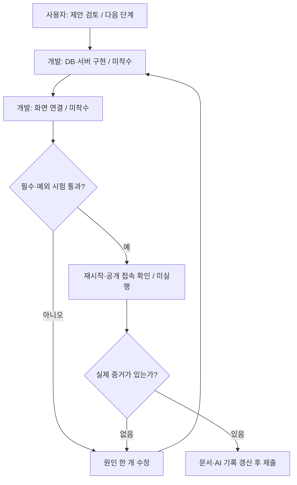
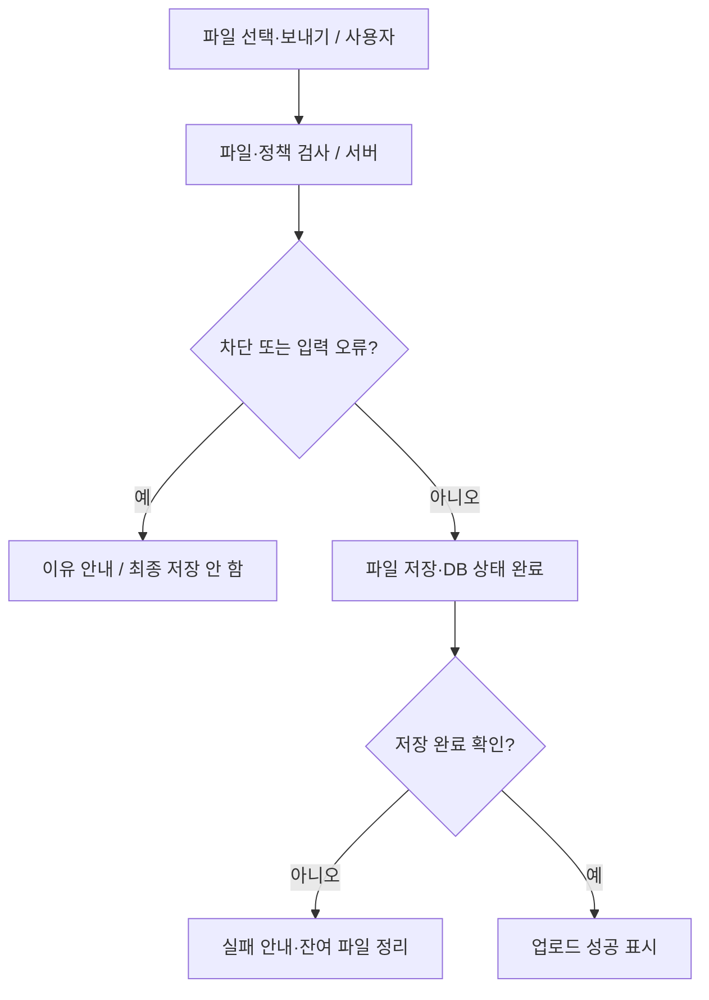
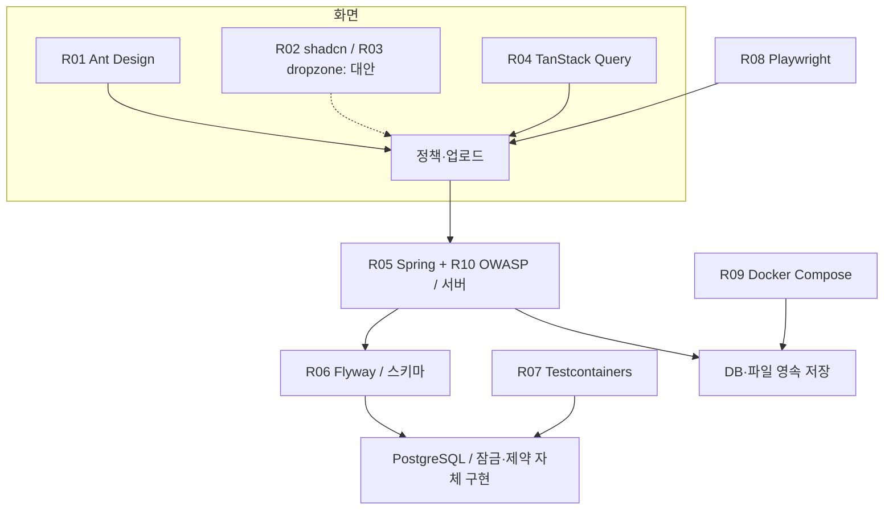
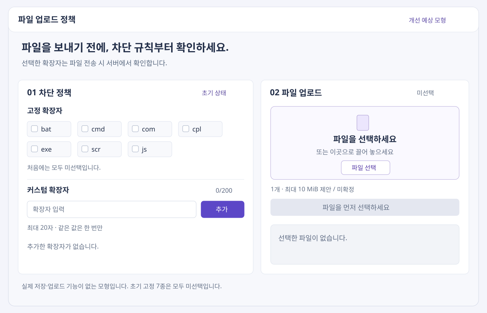
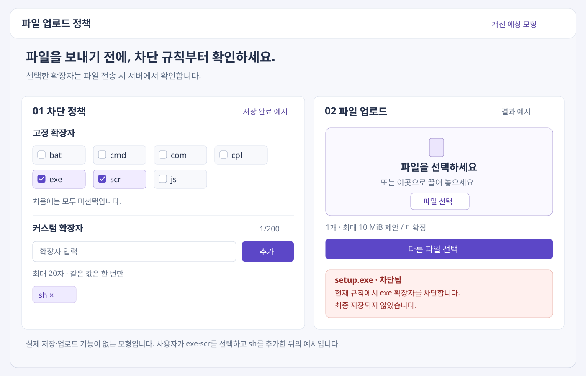

# 상세판: UI 리서치와 오픈소스 적용 설계

작성일: 2026-10-23 · 문서 ID: flow-ui-research-20261023-105551

> 최종 목표: 과제 조건을 지키는 화면과 오픈소스를 고르고 구현·검증 순서를 확인한다.

**핵심 한 줄:** Ant Design 중심 화면을 제안하고 안전한 저장·데이터 일치·재시작 검증을 각각의 참고 자료와 연결합니다.

다음 행동 하나: 정책 선택 → 서버 저장 → 새로고침 유지의 첫 기능을 연결합니다.

## 3줄 줄거리

1. 고정 7종 미선택과 커스텀 20자·200개 조건을 먼저 지킵니다.
2. 자료 10개에서 가져올 부분과 수정·제외할 부분을 구분합니다.
3. 예상 화면을 확인하고 실제 구현·28개 시험·증거 기록으로 이어갑니다.

> 집계 정정: 이전 답변의 123개는 재등장한 번호를 포함한 집계였으며, 고유 점검 항목은 108개입니다. 28개 시험 계획은 변동 없습니다.

## 현재 위치와 가설 검증

4개 파트는 ① 화면 선택 ② 시스템 연결 ③ 실제 시험 ④ 기록·제출입니다. 이번에 깊게 본 파트는 **① 정책·업로드 화면 선택**입니다. 다른 파트는 기존 108개 점검 항목에 참고 자료와 다음 검증을 연결했습니다.

확인: 저장소에는 문서가 있고 앱 소스는 없습니다. 공식 저장소 10개와 관련 자료를 확인했습니다.

아직 모르는 것: 이 구성이 실제 개발 시간을 줄이고 실수 없이 쓰기 쉬운지.

확인하는 방법: 첫 기능에서 저장 실패·새로고침·키보드·좁은 화면을 시험합니다. 시간·성능·번들 용량 개선은 측정하지 않았습니다.

## 효율성·안정성·심미성 비교

| 후보 | 효율성 관점 | 안정성 관점 | 심미성 관점 | 판정 |
|---|---|---|---|---|
| Ant Design | 선택·입력·태그·업로드·안내를 한 구성으로 조합 | 상태와 접근성 동작 참고; 서버 검증은 별도 | 색·간격을 한 기준으로 맞춤 | 우선 제안 |
| shadcn/ui | 필요한 소스를 직접 조합·수정 | 코드 소유에 따른 업데이트·검수 책임 | 여백·테두리·선택 표시를 세밀히 조정 | 대안·디자인 참고 |
| react-dropzone | 별도 드롭존이 필요할 때만 사용 | 전송·DB 정책을 제공하지 않음 | 사용자가 직접 모양 구성 | 초기 보류 / 중복 도입 회피 |

위 판정은 이 과제에 대한 설계 의견입니다. 패키지 설치·호환·성능·사용성 시험은 아직 하지 않았습니다. 유사 기능의 UI 패키지를 중복 설치하지 않는 방향을 권장합니다.

## 화면 요소와 과제 조건

| 요소 | 지킬 조건 | 상태 | 배치 | 가이드 연결 |
|---|---|---|---|---|
| 고정 선택 | 처음 7개 모두 미선택 | 저장 중 / 완료 / 실패 | 정책 카드 상단 | REQ-01~04, FE-U01~03 |
| 커스텀 추가 | 20자·200개·중복 방지 | 입력값 유지·근처 오류 | 현재 개수 / 200과 추가 버튼 | REQ-05~09 |
| 파일 선택 | 고르기와 보내기 구분 | 미선택 / 선택 / 전송 중 | 업로드 카드 | FE-S03, BE-S01 |
| 업로드 결과 | 서버 저장 완료 뒤 성공 | 성공 / 차단 / 저장 실패 | 색과 문구 함께 사용 | REQ-10~11 |
| 충돌 | 오래된 정책 저장 거부 | 최신 규칙 다시 보기 | 기존 입력 보존 | DB-P05, FE-P03 |
| 모바일·키보드 | 읽기·초점 순서 유지 | 정책 다음 업로드 | 본문 16px 이상·버튼 44px 제안 | FE-U07, FE-O05 |

## 해결 진행 플로우차트

개발·앱 시험은 앞으로 할 계획입니다.

## 예상 서비스의 업로드 흐름

개발·앱 시험은 앞으로 할 계획입니다.

## 레퍼런스 관계도

개발·앱 시험은 앞으로 할 계획입니다.

## 번호별 행동 지도

### ① 화면 구성

현재 위치: 전체 목표 → 화면과 시스템 연결 → ① 화면 구성.

현재 문제: 선택·추가·파일 보내기를 찾기 어렵거나 규칙 저장 상태가 불명확합니다.

내가 할 일: 지금 직접 할 일 없음. Ant Design 우선 제안의 채택 여부를 검토합니다.

도우미에게 부탁할 말: “정책 카드와 업로드 카드를 구현해줘. 고정 7종은 처음 모두 미선택이고 커스텀은 20자·200개·중복 방지를 지켜줘. Ant Design 예제의 외부 전송 주소와 복수 파일 필드를 교체하고 HTTP 오류를 성공으로 표시하지 마. 키보드·좁은 화면·저장 실패 증거를 제출해줘.”

끝났는지 확인: 초기 미선택·새로고침 유지·입력 오류·키보드 사용 결과.

실패하면: 저장 완료 표시를 멈추고 실패한 입력 또는 요청 한 개부터 확인합니다.

예정 파일: frontend/src/features/policy/PolicyPage.tsx · features/upload/UploadPanel.tsx. 아직 존재하는 앱 파일이 아닙니다.

연결 시험: T01~03, T09~13, T20, T26 / 현재 미실행.

참고: [R01 ant-design/ant-design](https://github.com/ant-design/ant-design), [R02 shadcn-ui/ui](https://github.com/shadcn-ui/ui), [R03 react-dropzone/react-dropzone](https://github.com/react-dropzone/react-dropzone)

### ② 저장 상태 맞추기

현재 위치: 전체 목표 → 화면과 시스템 연결 → ② 저장 상태 맞추기.

현재 문제: 저장에 실패했는데 체크 표시만 바뀌면 화면과 실제 규칙이 달라집니다.

내가 할 일: 지금 직접 할 일 없음. 성공 응답 뒤 확정하는 상태 관리를 구현하도록 요청합니다.

도우미에게 부탁할 말: “사용자 입력과 서버 확정 상태를 분리해줘. 수정 성공 뒤 정책을 재조회하고 실패하면 이전 표시를 유지해줘. 정책 버전 충돌이면 최신 값을 확인하도록 안내하되 입력을 몰래 버리지 마. 변경과 업로드를 무조건 자동 재시도하지 말고 응답 역전을 방지해줘.”

끝났는지 확인: 로딩·실패·완료·다른 탭 충돌에서 화면과 실제 DB 비교.

실패하면: 전송을 반복하기 전에 실제 반영 여부를 조회합니다.

예정 파일: frontend/src/features/policy/usePolicy.ts · frontend/src/lib/api.ts. 아직 존재하는 앱 파일이 아닙니다.

연결 시험: T20~22 / 현재 미실행.

참고: [R04 TanStack/query](https://github.com/TanStack/query)

### ③ 서버 검증

현재 위치: 전체 목표 → 화면과 시스템 연결 → ③ 서버 검증.

현재 문제: 화면에서만 막으면 직접 보낸 요청이 차단을 우회할 수 있습니다.

내가 할 일: 지금 직접 할 일 없음. 무해한 시험 파일만 사용합니다.

도우미에게 부탁할 말: “Spring 예제의 받기·저장 계층 분리만 참고해줘. 시작 시 업로드 폴더 삭제는 제외하고 UUID 저장 키를 사용해줘. 파일명·크기·개수·DB 정책을 서버에서 검증하고 적용 버전과 오류 코드를 남겨줘. 내용 검사 미구현을 안전하다고 표현하지 마.”

끝났는지 확인: 직접 요청 차단·정상 파일 저장·경로 조작 거부·재시작 유지.

실패하면: 201 응답을 멈추고 임시 파일과 DB 저장 상태를 대조합니다.

예정 파일: backend/.../UploadController.java · FileValidationService.java · FileStorageService.java. 아직 존재하는 앱 파일이 아닙니다.

연결 시험: T11~19, T23~25 / 현재 미실행.

참고: [R05 spring-guides/gs-uploading-files](https://github.com/spring-guides/gs-uploading-files), [R10 OWASP/CheatSheetSeries](https://github.com/OWASP/CheatSheetSeries)

### ④ 데이터 일치

현재 위치: 전체 목표 → 화면과 시스템 연결 → ④ 데이터 일치.

현재 문제: 목록이 199개일 때 요청 두 개가 동시에 오면 201개가 될 수 있습니다.

내가 할 일: 지금 직접 할 일 없음. 초기값·최대 개수·중복 규칙을 검토합니다.

도우미에게 부탁할 말: “고정 7종 false를 버전 SQL로 관리해줘. PostgreSQL의 공통 부모 행 잠금과 중복 제약·버전 비교를 구현해줘. Testcontainers로 199개에서 서로 다른 두 항목을 동시에 추가하고 최종 200개임을 검증해줘. 예제의 오래된 DB 태그를 복사하지 마.”

끝났는지 확인: 초기값·중복 한 건·최종 200개·롤백·충돌의 실제 DB 결과.

실패하면: 문제 요청을 롤백하고 모든 쓰기가 같은 잠금 순서를 따르는지 확인합니다.

예정 파일: backend/.../db/migration/ · PolicyService.java · PolicyConcurrencyTest.java. 아직 존재하는 앱 파일이 아닙니다.

연결 시험: T01, T03~08, T20~22 / 현재 미실행.

참고: [R06 flyway/flyway](https://github.com/flyway/flyway), [R07 testcontainers/testcontainers-java](https://github.com/testcontainers/testcontainers-java)

### ⑤ 배포와 화면 시험

현재 위치: 전체 목표 → 화면과 시스템 연결 → ⑤ 배포와 화면 시험.

현재 문제: 예쁜 화면이어도 재시작 후 파일이 사라지거나 실제 차단이 실패할 수 있습니다.

내가 할 일: 호스팅은 결정대기입니다. 나머지는 지금 직접 할 일 없음.

도우미에게 부탁할 말: “Compose의 DB 연결 구조를 참고하되 이미지 버전·준비 검사·업로드 볼륨·React 프록시를 추가해줘. 실제 비밀값은 커밋하지 마. Playwright로 파일 선택·실패·새로고침·키보드·좁은 화면을 시험해줘. 화면 시험·DB 시험·공개 배포 시험의 실제 증거를 구분해 제출해줘.”

끝났는지 확인: 재생성 전후 DB·파일 비교, 실제 시험 명령·커밋, 공개 URL 결과.

실패하면: 새 배포 전환을 멈추고 기존 데이터와 이전 이미지를 보존합니다.

예정 파일: compose.yaml · infra/nginx.conf · frontend/e2e/policy-upload.spec.ts. 아직 존재하는 앱 파일이 아닙니다.

연결 시험: T02, T20, T23~28 / 현재 미실행.

참고: [R08 microsoft/playwright](https://github.com/microsoft/playwright), [R09 docker/awesome-compose](https://github.com/docker/awesome-compose)

## 오픈소스 레퍼런스 10개

| 번호·자료 | 역할·판정 | 가져올 부분 | 수정할 부분 | 항목·시험 |
|---|---|---|---|---|
| [R01 ant-design/ant-design](https://github.com/ant-design/ant-design) | 화면 구성·수동 업로드 / 도입 권장 | Checkbox·Input·Tag·Upload·Alert·Button을 한 UI 체계로 구성 | 예시의 외부 전송 주소·복수 파일 필드·HTTP 오류 처리·성공 판단을 교체 | FE-U01~07, FE-P01~05, BE-S01 / T02, T09~13, T20, T26 |
| [R02 shadcn-ui/ui](https://github.com/shadcn-ui/ui) | 소유형 UI 구성 / 대안·디자인 참고 | 카드·간격·입력 테두리·선택 상태와 포커스 처리 참고 | Ant Design과 섞어 UI 라이브러리를 두 개 설치하지 않음 | FE-U07, FE-O05 / T26 및 모바일·키보드 |
| [R03 react-dropzone/react-dropzone](https://github.com/react-dropzone/react-dropzone) | 끌어 놓기 입력 / 초기 도입 보류 | 나중에 별도 드롭존이 꼭 필요할 때 입력 기능만 비교 | Ant Upload와 중복 설치하지 않고 전송·보안 검증은 서버에 둠 | FE-S03, BE-S01, BE-S08 / T13, T18 |
| [R04 TanStack/query](https://github.com/TanStack/query) | 서버 상태 동기화 / 상태 관리 도입 후보 | 저장 완료 후 정책 재조회·로딩·실패 상태 관리 | 처음에는 낙관적 갱신 없이 성공 응답을 기준으로 확정; 변경 자동 재시도 비활성 정책 검토 | FE-U02~06, FE-P03~05, FE-O04 / T20~22 |
| [R05 spring-guides/gs-uploading-files](https://github.com/spring-guides/gs-uploading-files) | multipart·저장 계층 / 구조만 수정 적용 | 컨트롤러와 저장 서비스 분리·스트림 복사·경로 검증 구조 | 시작 시 전체 삭제 제거, 원본 이름 저장·덮어쓰기를 UUID·독립 저장소로 교체 | BE-S01~10, BE-O01~04, DP-P02 / T11~18, T23~25 |
| [R06 flyway/flyway](https://github.com/flyway/flyway) | 스키마 버전 관리 / 마이그레이션 도입 후보 | 정책 테이블과 고정 7종 false 초기 데이터를 버전 SQL로 관리 | 실행 시마다 초기화하지 않고 적용된 변경을 추적; Boot와 PostgreSQL 모듈 호환 확인 | DB-U01, DB-O01~02, GH-P02 / T01, T03, T28 |
| [R07 testcontainers/testcontainers-java](https://github.com/testcontainers/testcontainers-java) | 실제 PostgreSQL 시험 / 통합 시험 도입 후보 | 같은 PostgreSQL 환경에서 중복·200개 동시 추가·롤백 검증 | 예제의 오래된 DB 태그를 운영과 맞는 지원 버전으로 교체 | DB-P01~05, DB-U02~04, GH-O01 / T05~08, T20~22 |
| [R08 microsoft/playwright](https://github.com/microsoft/playwright) | 브라우저 시나리오 시험 / 화면 시험 도입 후보 | 파일 선택·새로고침·저장 실패·키보드·좁은 화면 재현 | 무해한 메모리 파일과 격리된 시험 정책 사용, 기대와 실제 결과 분리 | FE-U01~07, FE-O01~05, GH-O01~03 / T02, T09~13, T20, T26~28 |
| [R09 docker/awesome-compose](https://github.com/docker/awesome-compose) | Spring·PostgreSQL 연결 / 구성 수정 적용 | 서비스 네트워크·DB 볼륨·비밀값 파일 구조 참고 | 이미지 태그 고정·healthcheck·uploads 볼륨·React 프록시·운영 비밀 관리 보완 | DP-S01~06, DP-P01~05, DP-O01~06 / T23~25, T27~28 |
| [R10 OWASP/CheatSheetSeries](https://github.com/OWASP/CheatSheetSeries) | 다층 파일 방어 원칙 / 보안 점검 근거 | 파일명·크기·저장 위치·권한·내용 검사의 한계 점검 | 과제의 차단목록 요구는 유지하고 허용목록·악성코드 검사는 별도 결정으로 구분 | BE-S01~12, DB-S01~04, DP-S01~06 / T13~19, T23~26 |

### 확인한 원본과 적용 예정 위치

| 번호 | 원본·확인 줄 | blob SHA | 사용 조건 | 적용 예정 위치 |
|---|---|---|---|---|
| R01 | [components/upload/demo/upload-manually.tsx](https://github.com/ant-design/ant-design/blob/master/components/upload/demo/upload-manually.tsx) / 1–78 | 2fd66e8bdb3642b0dc7f2e9a8c24ea52d37df872 | MIT | frontend/src/features/policy/PolicyPage.tsx · frontend/src/features/upload/UploadPanel.tsx |
| R02 | [apps/v4/registry/new-york-v4/ui/checkbox.tsx](https://github.com/shadcn-ui/ui/blob/main/apps/v4/registry/new-york-v4/ui/checkbox.tsx) / 1–37 | 9aaa1baace43e42aba6ee7c3b04adb8ff7e99ea2 | MIT | frontend/src/styles/theme.css |
| R03 | [README.md](https://github.com/react-dropzone/react-dropzone/blob/master/README.md) / 20–63, 285–320 | ae33456713f593d071a8dac0abcb82ae9e4e1e32 | MIT | frontend/src/features/upload/UploadPanel.tsx (선택) |
| R04 | [docs/framework/react/guides/invalidations-from-mutations.md](https://github.com/TanStack/query/blob/main/docs/framework/react/guides/invalidations-from-mutations.md) / 1–52 | c3ccc1032be2510bdf30868e418d4432393cf7ae | MIT | frontend/src/features/policy/usePolicy.ts |
| R05 | [complete/src/main/java/com/example/uploadingfiles/storage/FileSystemStorageService.java](https://github.com/spring-guides/gs-uploading-files/blob/main/complete/src/main/java/com/example/uploadingfiles/storage/FileSystemStorageService.java) / 33–57; 별도 시작 클래스 19–25 | 7c24addca34a6ffd1acba0213ac533e1c43ac858 | Apache-2.0 | backend/.../UploadController.java · FileStorageService.java (예정) |
| R06 | [flyway-database/flyway-database-postgresql/pom.xml](https://github.com/flyway/flyway/blob/main/flyway-database/flyway-database-postgresql/pom.xml) / 1–31 | 3517f38c09327a1c660c9bddba252cac22d57cac | Apache-2.0 | backend/src/main/resources/db/migration/V1__policy_schema.sql |
| R07 | [modules/postgresql/src/test/java/org/testcontainers/postgresql/PostgreSQLContainerTest.java](https://github.com/testcontainers/testcontainers-java/blob/main/modules/postgresql/src/test/java/org/testcontainers/postgresql/PostgreSQLContainerTest.java) / 18–34 | beefa3776b1148186c73854b848cf31f03c13b2b | MIT | backend/src/test/.../PolicyConcurrencyTest.java |
| R08 | [docs/src/input.md](https://github.com/microsoft/playwright/blob/main/docs/src/input.md) / 540–563 | c7c834d579b8a44d2789005eac4bea6bc66c63f7 | Apache-2.0 | frontend/e2e/policy-upload.spec.ts |
| R09 | [spring-postgres/compose.yaml](https://github.com/docker/awesome-compose/blob/master/spring-postgres/compose.yaml) / 1–32 | 6d98f75d21a22335173088e04d9ad253a45ead48 | CC0-1.0 | compose.yaml · infra/nginx.conf · backend/Dockerfile |
| R10 | [cheatsheets/File_Upload_Cheat_Sheet.md](https://github.com/OWASP/CheatSheetSeries/blob/master/cheatsheets/File_Upload_Cheat_Sheet.md) / 1–100 | 7539234b18fb9938fe95f5845eecb909c13fc702 | CC-BY-SA-4.0 | CONSIDERATIONS.md · FileValidationService.java (예정) |

줄 범위는 조회 시점 기준입니다. 브랜치 이동에 대비해 blob SHA를 기록했습니다. 라이선스 표기는 공식 저장소 메타데이터 기준이며 주요 LICENSE도 대조했습니다. 복사 시 해당 파일의 저작권·라이선스·NOTICE 및 의존성 조건을 보존하고, 에디션별 범위도 확인합니다. 코드를 통째로 복사한 상태는 아닙니다.

## 그대로 가져오지 않을 부분

| 자료 | 문제 | 과제 적용 |
|---|---|---|
| Spring 예제 | 시작 시 보관 폴더 전체 삭제 | 시작 때 삭제하지 않고 UUID 기반 보관으로 변경 |
| Ant Design 예제 | 외부 데모 주소·복수 파일 필드 | 우리 서버·단일 file 필드로 변경 |
| Ant Design 예제 | HTTP 오류 응답도 성공으로 보일 수 있는 처리 | 상태 코드와 서버 저장 완료를 확인 |
| Docker 예제 | 태그 없는 postgres·예시 비밀 파일 | 지원 버전 고정·비밀값 별도 주입·업로드 볼륨 추가 |
| 실제 DB 시험 예제 | 오래된 DB 태그 | 운영과 맞는 지원 버전 선택 |
| 중복 UI 도구 | 유사 기능 패키지 여러 개 조합 | Ant Design 중심으로 먼저 범위 축소 |

확장자 차단은 보안의 한 부분입니다. 파일명·크기·보관 위치·권한도 함께 확인하며, 내용·악성코드 검사는 별도 범위로 구분합니다. 과제의 차단목록을 허용목록으로 몰래 바꾸지 않습니다.

추가 근거: [Spring 시작 클래스](https://github.com/spring-guides/gs-uploading-files/blob/main/complete/src/main/java/com/example/uploadingfiles/UploadingFilesApplication.java) 19~25줄에서 시작 시 삭제를 확인했고, [Ant Design 수동 업로드 예제](https://github.com/ant-design/ant-design/blob/master/components/upload/demo/upload-manually.tsx)에서 외부 데모 주소·복수 파일 필드·HTTP 상태 미확인 처리를 확인했습니다. 예제는 구조를 배우는 출발점이며 과제 완성본이 아닙니다.

## Before / After: 실제 캡처가 아닌 예상 모형

Before는 앱이 없는 현재를 설명하는 간단한 구성도입니다. After는 정책 카드와 업로드 카드를 나란히 놓은 개선 예상 화면입니다. 좁은 화면에서는 위아래로 바뀝니다.

After 최초 상태는 고정 7종 모두 미선택·커스텀 0/200·파일 미선택입니다. 선택된 화면은 사용자가 exe·scr를 선택하고 sh를 추가한 뒤 setup.exe가 차단되는 예시입니다. 자동으로 켜지는 기본값이 아닙니다.

HTML에는 GUI(Graphical User Interface, 눈으로 보고 누르는 화면)를 직접 그렸습니다. 저장·업로드 기능이 없는 모형입니다.

| 상태 | 조건 | 보여줄 문구 |
|---|---|---|
| 기본 상태 | 고정 7개 미선택 · 커스텀 0/200 · 파일 없음 | 보낼 파일을 선택하세요. |
| 저장 중 | 선택 요청 처리 중·중복 클릭 제한 | 규칙을 저장하고 있습니다. |
| 저장 실패 | 이전 선택과 입력값 유지 | 저장하지 못했습니다. 연결을 확인하고 다시 시도하세요. |
| 중복·최대 개수 | 같은 값·201번째 입력 거부 | 이미 추가한 값입니다. / 최대 200개까지 추가할 수 있습니다. |
| 차단 예시 | 사용자가 exe를 선택한 뒤 setup.exe 전송 | 현재 규칙에서 exe 확장자를 차단하고 있습니다. |
| 성공 예시 | 허용된 파일이 실제 저장 완료 | 업로드가 완료되었습니다. |
| 다른 탭 충돌 | 이전 버전으로 수정한 요청 거부 | 다른 화면에서 규칙이 바뀌었습니다. 최신 규칙을 확인하세요. |

흰 바탕·짙은 글자·보라색 주요 동작·일정한 여백을 제안합니다. 상태는 색만으로 구분하지 않고 문구를 함께 씁니다. 본문 16px 이상, 입력·버튼 높이 44px, 간격 8·16·24px를 디자인 기준으로 제안합니다. 접근성 적합성은 실제 구현 뒤 검증합니다.

## 뒤돌아보기

- 알아낸 사실: UI와 업로드 예제를 합치는 것만으로 실제 정책·DB 정합성·영속성은 완성되지 않습니다.
- 아직 모르는 것: 버전 호환·실제 개발 시간·사용성·번들 용량·성능.
- 버린 가정: UI 또는 캐시 도구가 서버 검증·200개 제한까지 해결한다는 가정.
- 다음 검증 하나: 미선택 7종 → 선택 저장 성공·실패 → 새로고침 유지의 실제 동작 확인.

## 기존 108개 항목별 적용 지도

아래는 조사 근거와 수정 위치의 연결입니다. 해당 기능이 오픈소스에 모두 구현되어 있다는 뜻은 아닙니다. 모든 앱 구현·시험은 미착수입니다.

| 점검 ID | 가장 작은 고려요소 | 레퍼런스 | 예정 위치 | 직접 구현·확인 범위 |
|---|---|---|---|---|
| DB-U01 | 첫 실행에 고정 행이 없음 | R06·R07 | backend/.../PolicyService.java | 초기값·롤백은 직접 구현 |
| DB-U02 | 화면 저장 뒤 DB 반영 실패 | R06·R07 | backend/.../PolicyService.java | 초기값·롤백은 직접 구현 |
| DB-U03 | 삭제한 항목을 다시 삭제 | R06·R07 | backend/.../PolicyService.java | 초기값·롤백은 직접 구현 |
| DB-U04 | 여러 표의 일부만 저장 | R06·R07 | backend/.../PolicyService.java | 초기값·롤백은 직접 구현 |
| DB-S01 | 빈 값·NULL 저장 | R07·R10 | backend/.../db/migration/ | DB 제약·권한은 직접 설계 |
| DB-S02 | 대문자·특수문자 우회 | R07·R10 | backend/.../db/migration/ | DB 제약·권한은 직접 설계 |
| DB-S03 | SQL 문자열 조립 | R07·R10 | backend/.../db/migration/ | DB 제약·권한은 직접 설계 |
| DB-S04 | 앱 계정 과다 권한 | R07·R10 | backend/.../db/migration/ | DB 제약·권한은 직접 설계 |
| DB-P01 | sh 중복 저장 | R06·R07 | backend/.../PolicyRepository.java | 잠금·200개·버전 비교는 직접 구현 |
| DB-P02 | 200개 계산 대상 | R06·R07 | backend/.../PolicyRepository.java | 잠금·200개·버전 비교는 직접 구현 |
| DB-P03 | 199개에서 동시 추가 | R06·R07 | backend/.../PolicyRepository.java | 잠금·200개·버전 비교는 직접 구현 |
| DB-P04 | 고정 행 삭제·이름 변경 | R06·R07 | backend/.../PolicyRepository.java | 잠금·200개·버전 비교는 직접 구현 |
| DB-P05 | 오래된 화면의 덮어쓰기 | R06·R07 | backend/.../PolicyRepository.java | 잠금·200개·버전 비교는 직접 구현 |
| DB-P06 | 최대 200개 조회 성능 | R06·R07 | backend/.../PolicyRepository.java | 잠금·200개·버전 비교는 직접 구현 |
| DB-O01 | 서버 시작 시 기존 선택값 초기화 | R06·R09 | docs/DEPLOYMENT.md | 감사·백업·보관 기간은 자체 정책 |
| DB-O02 | 스키마 변경 재현 | R06·R09 | docs/DEPLOYMENT.md | 감사·백업·보관 기간은 자체 정책 |
| DB-O03 | DB와 파일의 복원 시점 차이 | R06·R09 | docs/DEPLOYMENT.md | 감사·백업·보관 기간은 자체 정책 |
| DB-O04 | 변경 주체·시각 감사 | R06·R09 | docs/DEPLOYMENT.md | 감사·백업·보관 기간은 자체 정책 |
| DB-O05 | 로그·이력 무한 증가 | R06·R09 | docs/DEPLOYMENT.md | 감사·백업·보관 기간은 자체 정책 |
| BE-U01 | 차단 이유 표시 | R05·R08 | backend/.../ApiExceptionHandler.java | 응답 계약·실패 판정은 직접 구현 |
| BE-U02 | 잘못된 정책 입력 | R05·R08 | backend/.../ApiExceptionHandler.java | 응답 계약·실패 판정은 직접 구현 |
| BE-U03 | 최대 개수 초과 | R05·R08 | backend/.../ApiExceptionHandler.java | 응답 계약·실패 판정은 직접 구현 |
| BE-U04 | 프록시·서버 크기 초과 | R05·R08 | backend/.../ApiExceptionHandler.java | 응답 계약·실패 판정은 직접 구현 |
| BE-U05 | 저장 처리 중 내부 오류 | R05·R08 | backend/.../ApiExceptionHandler.java | 응답 계약·실패 판정은 직접 구현 |
| BE-U06 | 성공 여부 불명확한 타임아웃 | R05·R08 | backend/.../ApiExceptionHandler.java | 응답 계약·실패 판정은 직접 구현 |
| BE-S01 | 화면 검증 우회 | R05·R10 | backend/.../FileValidationService.java | 정책·파일 검증은 직접 구현 |
| BE-S02 | 확장자 입력 정규화 | R05·R10 | backend/.../FileValidationService.java | 정책·파일 검증은 직접 구현 |
| BE-S03 | 파일명 경로 구분자 | R05·R10 | backend/.../FileValidationService.java | 정책·파일 검증은 직접 구현 |
| BE-S04 | 저장 경로 탈출 | R05·R10 | backend/.../FileValidationService.java | 정책·파일 검증은 직접 구현 |
| BE-S05 | MIME 위조 | R05·R10 | backend/.../FileValidationService.java | 정책·파일 검증은 직접 구현 |
| BE-S06 | 실제 내용·확장자 불일치 | R05·R10 | backend/.../FileValidationService.java | 정책·파일 검증은 직접 구현 |
| BE-S07 | 파일 크기 | R05·R10 | backend/.../FileValidationService.java | 정책·파일 검증은 직접 구현 |
| BE-S08 | 파일 개수 | R05·R10 | backend/.../FileValidationService.java | 정책·파일 검증은 직접 구현 |
| BE-S09 | 빈 파일·누락된 파일 | R05·R10 | backend/.../FileValidationService.java | 정책·파일 검증은 직접 구현 |
| BE-S10 | 업로드 파일의 실행·노출 | R05·R10 | backend/.../FileValidationService.java | 정책·파일 검증은 직접 구현 |
| BE-S11 | 정책 변경 권한 | R05·R10 | backend/.../FileValidationService.java | 정책·파일 검증은 직접 구현 |
| BE-S12 | 교차 출처·세션 위조 | R05·R10 | backend/.../FileValidationService.java | 정책·파일 검증은 직접 구현 |
| BE-P01 | 고정 선택·해제 저장 | R05·R07 | backend/.../PolicyService.java | 적용 시점·정규화·충돌은 자체 설계 |
| BE-P02 | 커스텀 고정 이름 충돌 | R05·R07 | backend/.../PolicyService.java | 적용 시점·정규화·충돌은 자체 설계 |
| BE-P03 | 중복과 개수 초과 동시 발생 | R05·R07 | backend/.../PolicyService.java | 적용 시점·정규화·충돌은 자체 설계 |
| BE-P04 | 다른 API의 잠금 누락 | R05·R07 | backend/.../PolicyService.java | 적용 시점·정규화·충돌은 자체 설계 |
| BE-P05 | 업로드와 정책 변경 경합 | R05·R07 | backend/.../PolicyService.java | 적용 시점·정규화·충돌은 자체 설계 |
| BE-P06 | 한글·긴 파일명 | R05·R07 | backend/.../PolicyService.java | 적용 시점·정규화·충돌은 자체 설계 |
| BE-O01 | 파일 저장·DB 저장의 비원자성 | R05·R09·R10 | backend/.../FileStorageService.java | 보상·정리·모니터링은 자체 구성 |
| BE-O02 | 강제 종료로 남는 임시 파일 | R05·R09·R10 | backend/.../FileStorageService.java | 보상·정리·모니터링은 자체 구성 |
| BE-O03 | 정책 DB 조회 실패 | R05·R09·R10 | backend/.../FileStorageService.java | 보상·정리·모니터링은 자체 구성 |
| BE-O04 | 파일 전체 메모리 적재 | R05·R09·R10 | backend/.../FileStorageService.java | 보상·정리·모니터링은 자체 구성 |
| BE-O05 | 로그에 민감정보 노출 | R05·R09·R10 | backend/.../FileStorageService.java | 보상·정리·모니터링은 자체 구성 |
| BE-O06 | 남용·과부하 | R05·R09·R10 | backend/.../FileStorageService.java | 보상·정리·모니터링은 자체 구성 |
| BE-O07 | 장애 상태 식별 | R05·R09·R10 | backend/.../FileStorageService.java | 보상·정리·모니터링은 자체 구성 |
| FE-U01 | 최초 고정 체크박스 표시 | R01·R04·R08 | frontend/src/features/policy/PolicyPage.tsx | 저장·실패·접근성 연결 |
| FE-U02 | 체크 저장 중 재클릭 | R01·R04·R08 | frontend/src/features/policy/PolicyPage.tsx | 저장·실패·접근성 연결 |
| FE-U03 | 저장 실패 시 체크 표시 | R01·R04·R08 | frontend/src/features/policy/PolicyPage.tsx | 저장·실패·접근성 연결 |
| FE-U04 | 추가 실패 시 입력 유실 | R01·R04·R08 | frontend/src/features/policy/PolicyPage.tsx | 저장·실패·접근성 연결 |
| FE-U05 | X 삭제 반영 | R01·R04·R08 | frontend/src/features/policy/PolicyPage.tsx | 저장·실패·접근성 연결 |
| FE-U06 | 목록 없음·로딩·실패 혼동 | R01·R04·R08 | frontend/src/features/policy/PolicyPage.tsx | 저장·실패·접근성 연결 |
| FE-U07 | 키보드·읽기 도구 | R01·R04·R08 | frontend/src/features/policy/PolicyPage.tsx | 저장·실패·접근성 연결 |
| FE-S01 | 20자 초과 입력 | R01·R08·R10 | frontend/src/features/upload/UploadPanel.tsx | 입력 편의와 서버 보안을 분리 |
| FE-S02 | 파일 이름을 HTML로 표시 | R01·R08·R10 | frontend/src/features/upload/UploadPanel.tsx | 입력 편의와 서버 보안을 분리 |
| FE-S03 | 파일 선택기 accept 신뢰 | R01·R08·R10 | frontend/src/features/upload/UploadPanel.tsx | 입력 편의와 서버 보안을 분리 |
| FE-S04 | 브라우저에 비밀값 포함 | R01·R08·R10 | frontend/src/features/upload/UploadPanel.tsx | 입력 편의와 서버 보안을 분리 |
| FE-P01 | 고정과 커스텀 목록 구분 | R01·R04 | frontend/src/features/policy/usePolicy.ts | 서버 확정 상태와 화면 연결 |
| FE-P02 | 커스텀 개수 표시 | R01·R04 | frontend/src/features/policy/usePolicy.ts | 서버 확정 상태와 화면 연결 |
| FE-P03 | 화면 오래 열어둠 | R01·R04 | frontend/src/features/policy/usePolicy.ts | 서버 확정 상태와 화면 연결 |
| FE-P04 | 변경 전 정책으로 사전 안내 | R01·R04 | frontend/src/features/policy/usePolicy.ts | 서버 확정 상태와 화면 연결 |
| FE-P05 | 요청값·응답값 혼용 | R01·R04 | frontend/src/features/policy/usePolicy.ts | 서버 확정 상태와 화면 연결 |
| FE-O01 | 개발·운영 API 주소 차이 | R01·R04·R08 | frontend/src/lib/api.ts | 응답 순서·재시도·환경별 설정 |
| FE-O02 | 서버 연결 실패 | R01·R04·R08 | frontend/src/lib/api.ts | 응답 순서·재시도·환경별 설정 |
| FE-O03 | 파일 업로드 연속 실행 | R01·R04·R08 | frontend/src/lib/api.ts | 응답 순서·재시도·환경별 설정 |
| FE-O04 | 오래된 응답이 최신 상태 덮음 | R01·R04·R08 | frontend/src/lib/api.ts | 응답 순서·재시도·환경별 설정 |
| FE-O05 | 모바일에서 200개 태그 표시 | R01·R04·R08 | frontend/src/lib/api.ts | 응답 순서·재시도·환경별 설정 |
| DP-U01 | 평가자가 접속할 URL 없음 | R09·R08 | infra/nginx.conf | 호스팅·공개 주소·SPA 직접 구성 |
| DP-U02 | 무료 서버 잠자기·첫 응답 지연 | R09·R08 | infra/nginx.conf | 호스팅·공개 주소·SPA 직접 구성 |
| DP-U03 | 앱 시작 전 프록시 연결 | R09·R08 | infra/nginx.conf | 호스팅·공개 주소·SPA 직접 구성 |
| DP-U04 | React 하위 경로 새로고침 실패 | R09·R08 | infra/nginx.conf | 호스팅·공개 주소·SPA 직접 구성 |
| DP-S01 | DB 포트 인터넷 노출 | R09·R10 | compose.yaml | 비밀값·권한·HTTPS 직접 구성 |
| DP-S02 | 컨테이너 관리자 권한 | R09·R10 | compose.yaml | 비밀값·권한·HTTPS 직접 구성 |
| DP-S03 | 이미지에 비밀번호 포함 | R09·R10 | compose.yaml | 비밀값·권한·HTTPS 직접 구성 |
| DP-S04 | 전송 구간 노출 | R09·R10 | compose.yaml | 비밀값·권한·HTTPS 직접 구성 |
| DP-S05 | 관리 엔드포인트 노출 | R09·R10 | compose.yaml | 비밀값·권한·HTTPS 직접 구성 |
| DP-S06 | 여러 단계의 크기 제한 불일치 | R09·R10 | compose.yaml | 비밀값·권한·HTTPS 직접 구성 |
| DP-P01 | 재배포 후 정책 사라짐 | R09 | compose.yaml | DB·파일 영속 저장 직접 검증 |
| DP-P02 | 재배포 후 파일 사라짐 | R09 | compose.yaml | DB·파일 영속 저장 직접 검증 |
| DP-P03 | DB·파일 볼륨 혼동 | R09 | compose.yaml | DB·파일 영속 저장 직접 검증 |
| DP-P04 | 환경별 설정 섞임 | R09 | compose.yaml | DB·파일 영속 저장 직접 검증 |
| DP-P05 | 호스팅의 임시 디스크 | R09 | compose.yaml | DB·파일 영속 저장 직접 검증 |
| DP-O01 | 실행 순서만 맞고 DB는 준비 안 됨 | R09·R08 | docs/DEPLOYMENT.md | 준비·용량·복원 시험 추가 |
| DP-O02 | 무제한 로그·업로드로 디스크 고갈 | R09·R08 | docs/DEPLOYMENT.md | 준비·용량·복원 시험 추가 |
| DP-O03 | 버전 없는 이미지 재현 실패 | R09·R08 | docs/DEPLOYMENT.md | 준비·용량·복원 시험 추가 |
| DP-O04 | 실패 배포 복구 | R09·R08 | docs/DEPLOYMENT.md | 준비·용량·복원 시험 추가 |
| DP-O05 | 볼륨을 백업으로 오해 | R09·R08 | docs/DEPLOYMENT.md | 준비·용량·복원 시험 추가 |
| DP-O06 | 면접 당일 서비스 중단 | R09·R08 | docs/DEPLOYMENT.md | 준비·용량·복원 시험 추가 |
| GH-U01 | 처음 보는 사람이 실행 못 함 | R08·R09 | README.md | 실행·제출 안내 직접 작성 |
| GH-U02 | 개발 오류와 사용자 오류 혼동 | R08·R09 | README.md | 실행·제출 안내 직접 작성 |
| GH-U03 | 제출 링크 누락 | R08·R09 | README.md | 실행·제출 안내 직접 작성 |
| GH-S01 | 비밀값 커밋 | R09·R10 | .gitignore · .github/workflows/ci.yml | 비밀·라이선스·권한 직접 점검 |
| GH-S02 | 업로드·개인정보 커밋 | R09·R10 | .gitignore · .github/workflows/ci.yml | 비밀·라이선스·권한 직접 점검 |
| GH-S03 | 자동화에 배포 비밀 노출 | R09·R10 | .gitignore · .github/workflows/ci.yml | 비밀·라이선스·권한 직접 점검 |
| GH-S04 | 의존성·외부 코드 무검토 수용 | R09·R10 | .gitignore · .github/workflows/ci.yml | 비밀·라이선스·권한 직접 점검 |
| GH-P01 | 큰 변경에 판단 추적 불가 | R06·R07·R08 | CONSIDERATIONS.md · PROMPT_LOG.md | 본인 판단·AI 기록 직접 작성 |
| GH-P02 | 스키마 문서 누락 | R06·R07·R08 | CONSIDERATIONS.md · PROMPT_LOG.md | 본인 판단·AI 기록 직접 작성 |
| GH-P03 | AI 입력만 있고 의도 없음 | R06·R07·R08 | CONSIDERATIONS.md · PROMPT_LOG.md | 본인 판단·AI 기록 직접 작성 |
| GH-P04 | 실제 사용 안 한 도구 기입 | R06·R07·R08 | CONSIDERATIONS.md · PROMPT_LOG.md | 본인 판단·AI 기록 직접 작성 |
| GH-P05 | 회고가 전부 AI의 자기평가 | R06·R07·R08 | CONSIDERATIONS.md · PROMPT_LOG.md | 본인 판단·AI 기록 직접 작성 |
| GH-O01 | 시험 안 된 코드 배포 | R07·R08·R09 | .github/workflows/ci.yml | 검사 커밋·이미지·배포 연결 |
| GH-O02 | 시험과 다른 커밋 배포 | R07·R08·R09 | .github/workflows/ci.yml | 검사 커밋·이미지·배포 연결 |
| GH-O03 | 시험 계획을 성공 결과로 기록 | R07·R08·R09 | .github/workflows/ci.yml | 검사 커밋·이미지·배포 연결 |
| GH-O04 | 제출 이후 변경 추적 | R07·R08·R09 | .github/workflows/ci.yml | 검사 커밋·이미지·배포 연결 |

## 완료·미확인

| 구분 | 현재 상태 |
|---|---|
| 조사·문서 | 공식 자료 10개 확인, 108개 항목 연결, 가이드 갱신 |
| 예상 화면 | 초기·사용자 변경 후·성공·실패·충돌 모형 작성 |
| 실제 구현 | 미착수. 예정 파일은 구현된 파일이 아님 |
| 앱 시험·배포 | 28개 시험 모두 미실행, 실제 앱 배포 없음 |
| 효과 | 시간·성능·사용성 개선 효과 미측정 |
| Telegram | 기존 연결·수신 경로 미확인으로 발송하지 않음 |

## 사용한 스킬과 출처

- [easy-guide](https://github.com/feed-mina/mina-gpt-config/blob/main/skills/easy-guide/SKILL.md): 코드 없는 행동·완료 확인·관계도·모형.
- [fix-guide](https://github.com/feed-mina/mina-gpt-config/blob/main/skills/fix-guide/SKILL.md): 근거·예정 파일·예외·검증·요청문.
- [기존 과제 가이드](https://github.com/feed-mina/flow_fileupload_AI/blob/main/docs/IMPLEMENTATION_GUIDE.md): 108개 점검·28개 시험 기준.
- [R01 ant-design/ant-design](https://github.com/ant-design/ant-design): 체크칸·추가칸·파일 보내기·오류 안내를 같은 모양으로 만듭니다.
- [R02 shadcn-ui/ui](https://github.com/shadcn-ui/ui): 여백과 선택 표시가 또렷한 화면을 만드는 비교 자료입니다.
- [R03 react-dropzone/react-dropzone](https://github.com/react-dropzone/react-dropzone): 파일을 끌어 놓는 칸을 만들지만 저장이나 차단은 대신하지 않습니다.
- [R04 TanStack/query](https://github.com/TanStack/query): 저장이 끝난 뒤 최신 목록을 다시 받아 화면과 실제 값을 맞춥니다.
- [R05 spring-guides/gs-uploading-files](https://github.com/spring-guides/gs-uploading-files): 파일을 받는 부분과 보관하는 부분을 나누는 참고 자료입니다.
- [R06 flyway/flyway](https://github.com/flyway/flyway): 처음 필요한 저장 칸을 만들고 이후 변경을 순서대로 남깁니다.
- [R07 testcontainers/testcontainers-java](https://github.com/testcontainers/testcontainers-java): 여러 사람이 동시에 바꿔도 목록이 어긋나지 않는지 시험합니다.
- [R08 microsoft/playwright](https://github.com/microsoft/playwright): 버튼과 파일 선택이 예상대로 보이는지 브라우저에서 확인합니다.
- [R09 docker/awesome-compose](https://github.com/docker/awesome-compose): 화면·서버·저장소를 함께 켜고 다시 켜도 자료가 남도록 준비합니다.
- [R10 OWASP/CheatSheetSeries](https://github.com/OWASP/CheatSheetSeries): 이름만 확인하는 것 외에 크기와 보관 방법도 함께 점검합니다.

[보고서 검수 결과](flow-ui-research-20261023-105551-qa.md)
