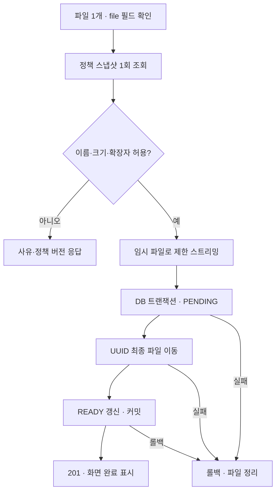

# 검증·보안 DEC 권장초안 적용

사용자 요청(2026-10-23): 기획/개발 고려사항의 3-1 검증·보안 DEC 권장초안을 참고하여 과제를 진행하고 PR을 생성한다. 기존 가이드 4절 DEC-01~13 및 서버 검증·보안 항목을 실행 기준으로 삼는다.

**핵심: 서버가 업로드 파일명·크기·선택된 확장자 정책을 검사하고, UUID 파일과 적용 정책 버전을 저장한 뒤에만 성공을 응답한다.**

## DEC 적용 상태

| DEC | 채택한 기준 | 구현·한계 |
|---|---|---|
| 01 | 로컬 단일 공용 정책 | loopback 노출 유지. 공개 편집 권한·방문자 격리 미결정으로 공개 배포 제외 |
| 02 | trim → 선행 점 1개 제거 → 소문자 → ASCII 영숫자 1~20자 | 기존 서버 공통 정책 입력 함수 유지. 내부 공백·복합 확장자 거부 |
| 03 | 고정 이름은 고정 영역 안내 | 409, 자동 선택 없음 |
| 04 | 마지막 점 뒤만 비교 | report.exe.txt → txt |
| 05 | 복합명도 마지막 확장자 | archive.tar.gz → gz, 커스텀 tar.gz 입력 거부 |
| 06 | 특수 이름별 거부 | 확장자 없음, 단독 숨김 이름, 끝 점 각각 다른 오류. 경로 구분자·콜론·제어문자도 거부 |
| 07 | 요청당 파일 1개, 파일 10 MiB, 전체 multipart 12 MiB | Servlet·실제 읽은 바이트·Nginx 제한. 다른 필드에 숨긴 두 번째 파일도 검사 |
| 08 | 0바이트 거부, 이름 최대 255 UTF-8바이트 | 누락·빈 파일 구분, 한글 바이트 검사 |
| 09 | 원본명은 표시 메타데이터, 실제 키 UUID | 정적 웹 루트 밖 `.bin` 파일. 경로 검사, 기존 이름 덮어쓰기 방지, 직접 URL 미제공 |
| 10 | 업로드 검증 시작 때 읽은 커밋된 정책 스냅샷 적용 | 요청당 1회 조회. 저장 결과·업무 거부에 policyVersion 기록. multipart 파싱 실패·파일 누락 등 스냅샷 이전 오류에는 버전 없음 |
| 11 | 1차는 확장자 정책·안전한 저장 | MIME을 안전성 근거로 쓰지 않음. 내용·악성코드 검사는 확장으로 제외 |
| 12 | 기존 구체 버전·잠금파일 유지 | 추가 런타임 의존성 없음 |
| 13 | 공개 전 보관 기간·전체 총량·초기화 확정 | 초안에 숫자가 없으므로 임의 확정하지 않음. 로컬 수동 관리, 공개 배포 차단 항목으로 유지 |

이번 요청에 따라 02~11은 위 값으로 구현 기준을 채택한다. 01·13의 공개 운영 정책은 보류한다. 기존 POLICY_SLICE의 ‘임시’ 표시는 PR #1 시점 기록이며 현재 채택 상태는 이 문서를 따른다.

입력칸은 선택적 선행 점 1개를 위한 1자를 추가로 받아 `.aaaaaaaaaaaaaaaaaaaa`도 입력할 수 있다. 실제 확장자 한도는 서버 정규화 후 20자다. 점 없는 영숫자 21자는 서버에서 거부한다.

소문자 변환 전에 원래 확장자가 ASCII 영문·숫자인지도 확인한다. 따라서 유니코드 `K`가 변환 중 `k`가 되는 경우에도 입력을 거부한다. 파일명 앞부분의 한글은 허용하지만 마지막 확장자는 같은 ASCII 규칙을 적용한다.

## API

| 요청 | 성공 | 주요 실패 |
|---|---|---|
| DELETE `/api/policy/custom/{id}`, 최신 If-Match | 200, 변경 후 정책 전체 | 404 대상 없음, 412 오래된 버전, 428 버전 누락 |
| POST `/api/uploads`, multipart `file` 1개 | 201, id/originalName/extension/sizeBytes/policyVersion/state=READY | 400 이름·누락·빈 파일·개수, 413 크기, 422 EXTENSION_BLOCKED, 500 저장 실패, 503 정책·DB 장애 |

업로드는 이름·원본 MIME을 바꿔도 서버에서 다시 검사한다. 고정값이 모두 미선택이면 exe를 포함해 확장자 정책 때문에 차단하지 않는다. 파일명·크기 규칙은 별도 적용한다. 거부된 파일의 최종 저장본은 만들지 않는다.

브라우저 쓰기 요청의 Origin이 같은 출처와 다르거나 Sec-Fetch-Site가 cross-site이면 403이다. 프록시는 원래 Host를 전달한다. Origin 없는 직접 API 요청은 허용하므로 이 필터는 인증·인가를 대체하지 않는다. 쿠키 인증은 아직 사용하지 않는다.

개발 프록시도 `changeOrigin: false`를 명시해 브라우저 Origin과 Host를 일치시킨다. Vite의 문자열 프록시 축약 설정은 Host를 대상 서버로 바꾸므로 같은 출처 검사와 충돌한다. 운영 Nginx는 `proxy_set_header Host $http_host`를 사용한다.

## 저장·오류 흐름

DB와 디스크는 분산 트랜잭션이 아니다. `TransactionTemplate.execute()`가 커밋 후 반환하므로 실패한 커밋을 201로 표시하지 않는다. 알려진 롤백에서는 최종 파일을 정리하고, 임시 파일은 finally에서 정리한다. 프로세스 강제 종료·커밋 결과 불명은 파일/DB 대조가 필요하며 자동 삭제하지 않는다.

## 장애 후 대조 절차

1. 백엔드 업로드를 중지하고 DB·업로드 볼륨을 함께 백업한다.
2. `SELECT id, state, size_bytes FROM upload_record` 결과를 UUID `.bin` 목록·실제 바이트 길이와 대조한다.
3. 남은 `pending-*.tmp`, DB 없는 `.bin`, 파일 없는 READY, PENDING 상태를 구분한다. 바로 삭제하지 않고 별도 격리·원인 확인 후 복구·삭제를 결정한다.
4. 보관 기간·총량 정책이 확정되기 전 자동 만료 삭제는 실행하지 않는다. Docker `down -v`는 DB와 업로드를 모두 지우므로 일반 재시작에 사용하지 않는다.

## 시험 범위

- 기존 T01~T04 회귀 시험, 정책 길이·삭제·200개 한도·199개 경쟁 추가.
- 실제 PostgreSQL과 파일 저장: 차단/허용, 특수명·경로·UTF-8 바이트, 누락/빈 파일/복수 파일, 실제 HTTP 10 MiB 경계.
- 파일 이동 실패와 READY DB 갱신 실패를 주입하여 201 미응답·DB 롤백·파일 정리 확인.
- 파일 복사 도중 정책 변경을 주입해 기존 버전 적용 및 다음 요청의 새 버전 차단 확인.
- 정책 DB 실패 시 파일 생성 전 중단, 실제 읽은 바이트 초과 방지.
- 브라우저 EXE 차단 → 선택 해제 → 업로드 성공 → 커스텀 삭제·새로고침 유지.

실행된 검사·수정 이력은 TEST_RESULTS를, 최종 커밋의 실행 URL과 판정은 PR #2 본문·Checks를 따른다. 실제 Docker 빌드·기동, 공개 사이트 시험, 강제 종료 복구·자동 보관 정책은 별도로 구분한다.

크기 초과 응답의 연결 끊김은 Tomcat의 유한한 `max-swallow-size: 12MB` 설정으로 보완했다. 무제한 소비는 허용하지 않는다. 참고: [Tomcat HTTP Connector](https://tomcat.apache.org/tomcat-10.1-doc/config/http.html), [Spring Boot 3.5 속성](https://docs.spring.io/spring-boot/3.5/appendix/application-properties/index.html). Vite Host 변경은 [공식 프록시 소스](https://github.com/vitejs/vite/blob/v8.3.5/packages/vite/src/node/server/middlewares/proxy.ts)의 문자열 축약 동작을 확인해 수정했다.

CI는 ubuntu-24.04에 기본 제공되는 Chrome을 버전 출력 후 `PLAYWRIGHT_CHANNEL=chrome`으로 실행한다. 외부 시스템·폰트 패키지 다운로드 지연을 줄이되 시험 5개는 그대로 유지한다. 로컬 기본값은 Playwright Chromium이다. 근거: [공식 runner 이미지 목록](https://github.com/actions/runner-images/blob/main/images/ubuntu/Ubuntu2404-Readme.md), [Playwright Chrome 채널 지원](https://playwright.dev/docs/browsers).
