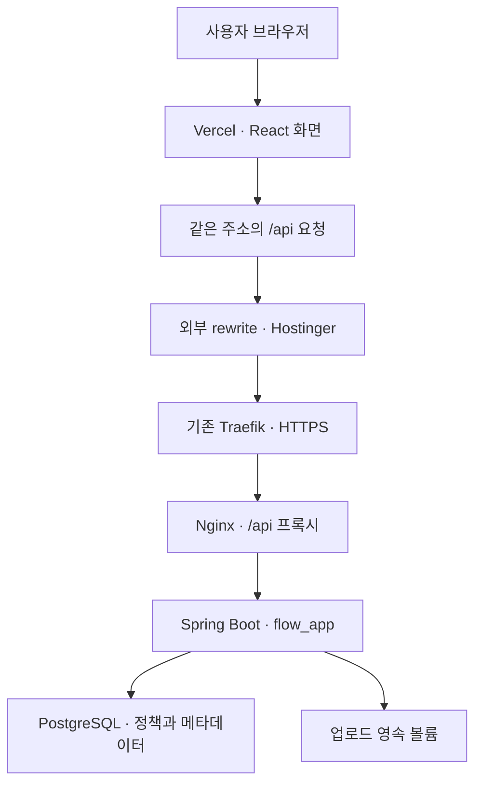

# Hostinger·Vercel 실제 배포 진행 기록

작성일: 2026-10-23 (한국 시간)  
저장소: [feed-mina/flow_fileupload_AI](https://github.com/feed-mina/flow_fileupload_AI)

> **후속 검증 추가:** 최초 배포 이후 실제 Vercel 공개 브라우저 시험 11개가 통과했습니다. 아래 1~9절은 최초 배포 시점 기록이며, 최신 검증 결과는 마지막 10절과 [배포 후 점검 보고서](POST_DEPLOYMENT_CHECKS.md)를 따릅니다.

> Hostinger의 앱 실행과 HTTPS·정책 조회 API는 확인했다. Vercel의 프론트엔드 배포 성공도 확인했다. 다만 Vercel 화면에서 정책 저장·파일 업로드가 정상 동작하는지는 아직 확인하지 못했다. 서버의 Vercel 출처 허용 설정은 명령어를 안내한 상태이며, 실행 완료 증거는 없다.

## 1. 배포 주소와 구성

| 구분 | 위치 | 확인 상태 |
|---|---|---|
| 프론트엔드 | https://flow-fileupload-ai.vercel.app/ | Vercel 배포 성공 화면과 Visit Deployment 링크 확인 |
| 기존 Hostinger 화면·API 진입점 | https://flow.srv1869569.hstgr.cloud/ | HTTPS 루트 요청 200 확인 |
| 정책 조회 API | https://flow.srv1869569.hstgr.cloud/api/policy | 200, version=0, 고정 확장자 7개 확인 |
| Vercel 프로젝트 관리 | https://vercel.com/yerinfeedminas-projects/flow-fileupload-ai | 프로젝트 생성·배포 성공 확인 |
| 백엔드 | Hostinger VPS의 Spring Boot 컨테이너 | 컨테이너 실행 확인 |
| 데이터베이스 | 같은 VPS의 PostgreSQL 컨테이너 | healthy 확인 |
| 파일 저장 | 백엔드의 /app/uploads에 연결된 Docker 영속 볼륨 | 볼륨 구성 적용; 실제 업로드·복구 시험 미확인 |

현재 Vercel은 화면을 제공하고, API 요청은 외부 rewrite(주소를 바꾸지 않고 다른 서버로 전달하는 설정)를 통해 Hostinger로 전달하도록 구성했다. 프론트엔드는 DB에 직접 접속하지 않는다.



그림은 적용한 라우팅 설정을 나타낸다. Vercel에서 시작하는 쓰기 요청까지 실제 검증을 끝냈다는 의미는 아니다.

## 2. Hostinger 배포 과정

1. 로그인된 Hostinger VPS Docker 관리자와 웹 콘솔을 확인했다.
2. 기존 서비스·Docker 네트워크·프록시를 확인했다. 기존 Traefik이 HTTPS를 처리하고 있어 별도 Caddy를 80/443에 추가하지 않았다.
3. 서버에 저장소를 내려받았다.
   - 경로: `/docker/flow-fileupload-ai`
   - 당시 소스 커밋: `bbb930ef05e4fd556f75709ee6f0f23ca7cb6531`
4. `.env`를 서버에서 생성했다.
   - 관리자 DB 계정: `flow_admin`
   - 앱 DB 계정: `flow_app`
   - 관리자·앱 DB 암호는 서로 다른 무작위 값으로 생성했다.
   - 환경 파일 권한은 `600`으로 설정했다.
   - 실제 암호와 환경 파일 내용은 GitHub에 올리지 않았다.
5. 기존 `compose.yml`에 서버 전용 `compose.vps-live.yml`을 함께 적용했다.
   - Compose 프로젝트 이름: `flow-fileupload`
   - 화면 로컬 포트: `127.0.0.1:18081 → 컨테이너 80`
   - DB와 백엔드의 포트는 외부에 직접 공개하지 않았다.
   - 백엔드·프론트 이미지 태그는 소스 전체 커밋으로 지정했다.
   - DB·백엔드·프론트엔드에 `restart: unless-stopped`를 적용했다.
6. Docker 빌드·기동을 실행했다.
7. DB healthy, 일회성 migrate의 정상 종료, backend/frontend 실행을 확인했다.
8. HTTPS 루트 요청과 정책 조회 API를 확인했다.

### 실제 실행한 배포 명령

아래 명령은 서버에서 환경 파일과 추가 Compose 파일을 준비한 뒤 실행했다.

```bash
cd /docker/flow-fileupload-ai

docker compose -p flow-fileupload \
  -f compose.yml -f compose.vps-live.yml config --quiet

nohup docker compose -p flow-fileupload \
  -f compose.yml -f compose.vps-live.yml up --build -d \
  > /tmp/flow-fileupload-deploy.log 2>&1 &
```

빌드 로그는 `/tmp`에 있어 영구 보관 파일이 아니다.

### 서버에 생성한 추가 Compose 구성

다음 파일은 서버에서 생성했다. 이 기록 시점에 GitHub 소스 파일로 추가하지는 않았다. 저장소에 있는 `compose.hostinger.yml`의 Caddy 구성으로 배포한 것이 아니다.

```yaml
services:
  db:
    restart: unless-stopped
  backend:
    restart: unless-stopped
  frontend:
    image: flow-policy-frontend:${APP_VERSION:?Exact source commit required}
    restart: unless-stopped
    labels:
      traefik.enable: "true"
      traefik.docker.network: flow-fileupload_default
      traefik.http.routers.flow-fileupload.rule: Host(`flow.srv1869569.hstgr.cloud`)
      traefik.http.routers.flow-fileupload.entrypoints: websecure
      traefik.http.routers.flow-fileupload.tls: "true"
      traefik.http.routers.flow-fileupload.tls.certresolver: letsencrypt
      traefik.http.services.flow-fileupload.loadbalancer.server.port: "80"
```

DB 데이터와 업로드 파일은 기본 Compose의 `policy_data`, `upload_data` 볼륨으로 보관한다. 볼륨이 있다는 사실과 백업·복원 시험이 완료됐다는 사실은 구분해야 한다.

## 3. Vercel 프론트엔드 배포 과정

1. 사용자가 지정한 `yerinfeedminas-projects` 계정에서 프로젝트 생성을 진행했다.
2. `frontend/vercel.json`에 API 외부 rewrite를 추가했다.
   - 변경 커밋: [c888541](https://github.com/feed-mina/flow_fileupload_AI/commit/c888541b67008da275b28dd974ecc144c18b8e08)
3. 처음에는 Vercel GitHub 연결이 해당 저장소에 접근할 수 없어 배포가 거부됐다.
4. GitHub가 권한 설정 접근 전에 본인 인증을 요구했다.
5. 사용자가 본인 인증과 저장소 권한 추가를 완료했다고 알렸다.
6. 새로고침 후 Vercel 가져오기 목록에서 `flow_fileupload_AI`가 표시되는 것을 확인했다.
7. 기존 저장소를 가져와 배포했다. 별도 복제 저장소는 만들지 않았다.
8. Vercel 성공 화면과 프로덕션 주소를 확인했다.

| 항목 | 적용 내용 |
|---|---|
| 프로젝트 이름 | flow-fileupload-ai |
| 계정/팀 | yerinfeedminas-projects |
| 저장소 | feed-mina/flow_fileupload_AI |
| 브랜치 | main |
| 루트 폴더 | frontend |
| 프레임워크 | Vite |
| 빌드 | Vite 기본 빌드 · npm run build |
| 결과 폴더 | Vite 기본 출력 · dist |
| API 주소 방식 | 상대 경로 /api + Vercel 외부 rewrite |
| DB 암호 | Vercel에 추가하지 않음 |

GitHub 저장소를 연결해 배포했으므로 후속 소스 변경을 자동 배포하는 구성이지만, 이후 push를 통한 두 번째 자동 배포는 이번 과정에서 별도로 시험하지 않았다.

### 적용한 vercel.json

```json
{
  "rewrites": [
    {
      "source": "/api/:path*",
      "destination": "https://flow.srv1869569.hstgr.cloud/api/:path*"
    },
    {
      "source": "/(.*)",
      "destination": "/index.html"
    }
  ]
}
```

API 규칙을 화면 fallback보다 먼저 둔다. 이 구성에서는 `VITE_API_BASE_URL`을 Hostinger 절대 주소로 설정하지 않고, 기본 상대 경로를 사용한다.

## 4. 실제 확인 결과와 미확인 항목

| 항목 | 결과 | 근거·한계 |
|---|---|---|
| Hostinger Docker 빌드 | 완료 | 이미지 빌드 및 컨테이너 생성 로그 확인 |
| PostgreSQL 기동 | 정상 | 컨테이너 healthy |
| DB 마이그레이션 | 정상 종료 | migrate Exited (0) |
| backend/frontend 기동 | 실행 중 | Compose ps -a 출력 확인 |
| Hostinger HTTPS 루트 | 통과 | curl HTTPS_STATUS=200 |
| Hostinger 정책 조회 | 통과 | curl POLICY_STATUS=200, version=0, fixed=7 |
| Vercel 저장소 권한 | 연결 확인 | 가져오기 목록에 저장소 표시 |
| Vercel 배포 | 성공 | Congratulations 및 프로덕션 링크 확인 |
| Vercel 화면 렌더링 | 미확인 | 실제 주소를 열려던 단계에서 브라우저 확장 프로그램 차단 |
| Vercel 경유 정책 조회·저장 | 미확인 | 서버 허용 출처 설정·브라우저 시험 필요 |
| Vercel 경유 세션·CSRF | 미확인 | 쿠키 전달과 변경 요청을 실제로 시험해야 함 |
| 파일 업로드·상태 재조회 | 미확인 | 실제 파일 전송 시험 미실시 |
| 10 MiB 및 초과 업로드 | 미확인 | 프록시 포함 크기 경계 시험 필요 |
| 컨테이너 재생성 후 데이터 유지 | 미확인 | 볼륨 구성은 적용했으나 재생성 시험 미실시 |
| DB·파일 동시 백업 및 복원 | 미구현/미실행 | 후속 운영 작업 |
| cron 감사·로그 예약 | 미설치 | 기존 안내서만 제공 |

Vercel의 배포 성공은 화면 코드가 배포됐다는 뜻이다. API·저장·업로드가 전부 정상이라는 판정으로 확대하지 않는다.

## 5. 중간 오류와 대응

| 문제 | 진행한 대응 | 결과 |
|---|---|---|
| 로컬 Git clone의 네트워크 오류 | Hostinger 웹 콘솔에서 직접 clone | 서버에 소스 확보 |
| 브라우저 연결 시간 초과·분리 | 사용자 재연결 후 새 콘솔 사용 | Hostinger 배포 및 Vercel 배포 재개 |
| 웹 콘솔 여러 줄 입력이 한 줄로 합쳐짐 | 해당 세션에서 실행 완료로 보지 않고 새 콘솔에서 파일 존재 여부 확인, 한 줄 명령으로 재작성 | .env 미생성 확인 후 정상 생성 |
| Vercel의 GitHub integration 접근 거부 | 본인 인증·대상 저장소 권한 추가를 사용자에게 요청 | 이후 저장소 가져오기·배포 성공 |
| 확장 프로그램 UI로 최종 화면 조작 차단 | 추가 완료 주장 없이 미확인 범위를 기록하고 서버 명령 안내 | 화면·쓰기 시험은 보류 |

최초 여러 줄 입력 시도는 성공한 배포 명령으로 기록하지 않았다. 이후 새 콘솔의 `ENV_NOT_CREATED` 확인과 `ENV_READY` 출력, 빌드 로그를 근거로 정상 진행 여부를 구분했다.

## 6. 남은 서버 연결 설정

다음 명령은 사용자에게 안내했지만 실행 완료가 확인되지 않았다. 현재 서버의 허용 출처는 초기 배포 시 Hostinger 주소만 지정했다. 브라우저의 Origin이 백엔드까지 전달될 때 Vercel 주소가 허용되지 않으면 요청이 거부될 수 있다.

서버의 기존 허용 출처를 확인한 뒤 Vercel 프로덕션 주소를 추가한다. 아래 변경 명령은 다른 기존 출처를 유지하며 필요한 주소만 추가한다.

**실행 위치: Windows PowerShell이 아니라 Hostinger VPS 웹 콘솔.**

```bash
cd /docker/flow-fileupload-ai

grep '^APP_ALLOWED_ORIGINS=' .env

python3 -c 'from pathlib import Path; p=Path(".env"); lines=p.read_text().splitlines(); key="APP_ALLOWED_ORIGINS="; old=next((s[len(key):] for s in lines if s.startswith(key)), ""); origins=list(dict.fromkeys([s.strip() for s in old.split(",") if s.strip()]+["https://flow-fileupload-ai.vercel.app"])); lines=[s for s in lines if not s.startswith(key)]; lines.append(key+",".join(origins)); p.write_text(chr(10).join(lines)+chr(10))'

docker compose -p flow-fileupload \
  -f compose.yml -f compose.vps-live.yml up -d --no-deps backend

docker compose -p flow-fileupload \
  -f compose.yml -f compose.vps-live.yml restart frontend
```

백엔드를 재생성한 뒤 기존 Nginx 프록시가 변경된 컨테이너 주소를 다시 조회하도록 frontend도 재시작한다. 이 명령으로 DB와 업로드 볼륨을 삭제하지 않는다.

## 7. 실행 상태·로그 점검 명령

```bash
cd /docker/flow-fileupload-ai

docker compose -p flow-fileupload \
  -f compose.yml -f compose.vps-live.yml ps -a

docker compose -p flow-fileupload \
  -f compose.yml -f compose.vps-live.yml logs --tail=100 backend frontend

tail -n 50 /tmp/flow-fileupload-deploy.log

curl -i https://flow.srv1869569.hstgr.cloud/api/policy

curl -i \
  -H 'Origin: https://flow-fileupload-ai.vercel.app' \
  https://flow.srv1869569.hstgr.cloud/api/policy

curl -i https://flow-fileupload-ai.vercel.app/api/policy
```

정책 API는 JSON과 200을 확인한다. Vercel 경유 요청에서 HTML이 나오면 rewrite 적용 여부를 확인한다. 403이면 허용 출처·세션·CSRF를 구분하고, 502이면 백엔드 기동과 Nginx 연결부터 확인한다.

일회성 `migrate`는 `Exited (0)`이 정상이며 계속 실행될 필요가 없다. `down -v`는 데이터 볼륨을 삭제하므로 단순 재시작에 사용하지 않는다.

## 8. 다음 실제 시험 순서

1. Vercel 화면에서 고정 7개·커스텀 개수를 조회한다.
2. 고정 항목 하나의 현재 값을 기록한 뒤 변경·새로고침·원래 값 복원을 확인한다.
3. 커스텀 확장자를 추가·조회·삭제한다.
4. GET /api/session의 세션 쿠키와 CSRF 토큰을 확인한다. CSRF 없는 변경 요청 거부와 정상 토큰 요청 성공을 각각 확인한다.
5. 허용·차단 파일을 각각 전송하고 UUID 저장 결과·상태 조회를 확인한다.
6. Vercel 외부 rewrite를 포함해 10 MiB 파일과 초과 파일의 실제 응답을 확인한다.
7. 별도 시험 환경에서 컨테이너 재생성·데이터 유지와 백업·복원을 시험한다.

## 9. 기존 문서와 차이

- [배포 준비 보고서](HOSTINGER_VERCEL_DEPLOYMENT.md)는 배포 전 설계와 예시를 기록한다.
- 실제 배포에서는 이미 운영 중인 Traefik을 재사용했다.
- 실제 Vercel 구성은 별도 API 절대 주소를 빌드에 넣는 방식 대신 외부 rewrite를 적용했다.
- 이번 기록은 배포 진행·확인 결과이며, 기존 기능 전체의 재시험 결과를 대체하지 않는다.
- [운영 예약 안내서](OPERATIONS_SCHEDULE_GUIDE.md)의 cron은 설치하지 않았다.

## 10. 후속 공개 검증 — PR #6

2026-10-23 **17:47~17:48 한국 시간**에 GitHub Actions의 별도 Chromium이 실제 공개 주소를 호출했다. 최초 기록에서 미확인이었던 화면·변경·업로드를 이번에 시험했다.

| 후속 시험 | 실제 결과 |
|---|---|
| Vercel HTML·React 화면·고정 7개 | 통과 |
| Vercel /api/policy rewrite | 200 JSON, 시험 시작 version=0·커스텀0 |
| Vercel Origin 포함 세션 요청 | 200; 세션 쿠키가 Vercel 주소에 저장됨 |
| 쿠키 속성 | HttpOnly=true, Secure=true, SameSite=Lax |
| CSRF 없는 변경 요청 | 403 CSRF_INVALID |
| 정상 토큰 정책 변경·새로고침·원복 | 통과 |
| 고유 커스텀 추가·차단·삭제 | 통과; 차단 업로드 422 EXTENSION_BLOCKED |
| 허용 파일 화면 업로드·상태 조회 | 201 READY·조회200 |
| 10MiB−1 / 정확히10MiB | 각 201 READY·상태 조회 성공 |
| 10MiB+1 | 413 UPLOAD_SIZE_LIMIT |
| 화면의 크기 초과 안내 | 통과 |

**11개 검사 전부 PASS.** [실행](https://github.com/feed-mina/flow_fileupload_AI/actions/runs/39927104812) · [영구 결과 JSON](evidence/public-deployment-2026-10-23.json) · [6개 항목 보고서](POST_DEPLOYMENT_CHECKS.md)

이로써 실제 브라우저 경로의 출처·세션·쓰기 동작을 확인했다. 서버 .env를 직접 열어 현재 APP_ALLOWED_ORIGINS 문자열을 조회한 것은 아니므로 어떤 서버 명령이 언제 실행됐는지까지 추정하지 않는다. 데모 로그인은 loginAvailable=false였으며 로그인 성공 시험으로 확대하지 않는다.

exe의 값은 원복했고 시험 커스텀은 삭제했다. 정책 버전과 감사 이력은 정상 변경 이력으로 남는다. 허용 시험 파일3개, 총 **20,971,548바이트**는 정상 저장됐으며 삭제 API가 없어 그대로 남겼다. 실제 파일 내용을 Git에 올리지 않았으며 요청 번호·파일 ID만 증거에 기록했다.

컨테이너 재생성 영속성·DB/파일 백업·복원 시험은 이번 사용자 지정으로 제외했다. 서버 이미지 ID 확인과 실제 이전 버전 복귀는 수행하지 않았다. 기존 미설치 cron과 운영 정책 보류도 유지한다.
