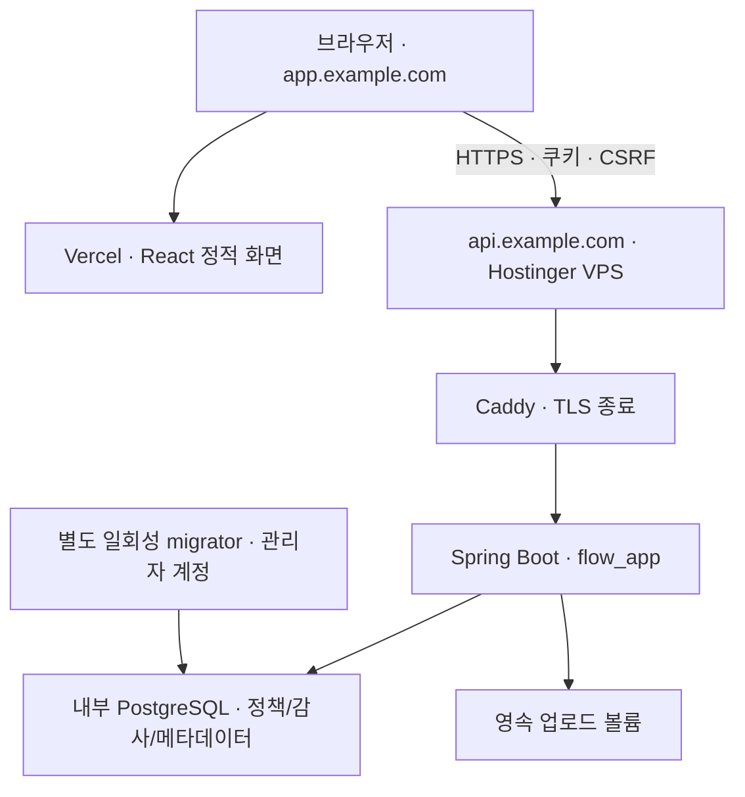

# Hostinger 서버·PostgreSQL / Vercel 프론트 배포 준비 보고서

> 이 문서는 배포 전 준비 기록입니다. 이후 실제 Hostinger·Vercel 배포를 진행했습니다. 현재 적용한 구성, 확인 결과 및 미완료 항목은 [2026-10-23 실제 배포 진행 기록](DEPLOYMENT_PROGRESS_2026-10-23.md)을 먼저 확인하세요. 실제 배포는 기존 Traefik과 Vercel 외부 rewrite를 사용했으며, 아래 Caddy·직접 API 주소 구성은 당시 계획입니다.


작성일: 2026-10-23. **구성·코드·시험 준비이며 실제 호스팅 구매·DNS 변경·공개 배포는 하지 않았다.** VPS(Virtual Private Server, 가상 전용 서버)·도메인·비밀값은 사용자가 사용할 환경에서 설정한다.

## 전체 연결



`example.com`은 실제 주소가 아닌 설명용 값이다. Vercel에는 DB 비밀번호·관리자 비밀값을 넣지 않는다. `VITE_API_BASE_URL`은 공개 API 주소로, 브라우저 번들에 보여도 되는 값이다.

Hostinger의 일반 웹호스팅과 VPS는 구분해야 한다. Java·Docker·PostgreSQL을 직접 운영하는 이 구성은 **Docker를 실행할 수 있는 VPS 기준**이다. 실제 요금제·메모리·디스크·백업 조건을 확인해야 한다. [Hostinger PostgreSQL VPS 안내](https://www.hostinger.com/applications/postgresql), [VPS 관리 화면](https://www.hostinger.com/support/5726606-how-to-use-the-vps-dashboard-in-hostinger/).

## 서로 다른 방문자: 사용자 ID와 IP의 차이 — DEC-01

| 식별 방법 | 가능한 일 | 해결하지 못하는 문제 |
|---|---|---|
| 로그인한 사용자 ID | 서버가 인증한 사용자에 정책 소유권을 연결할 수 있음 | 단지 ID를 기록하는 것만으로는 분리되지 않음. 조회·쓰기·업로드 판정에 같은 policy_id/소유권 검사가 필요 |
| 서버 발급 익명 방문 세션 | 로그인 없이 방문자별 임시 데모 공간을 만드는 후보 | 쿠키 삭제·다른 기기에서는 다른 방문자가 됨. 현재 구현은 세션/CSRF만 제공하며 정책 격리는 없음 |
| IP 주소 | 남용 제한의 보조 신호 | 공유기·회사·통신사 NAT에서 여러 사람이 같은 IP 사용, 변경·VPN·프록시 가능. 정책 소유자의 인증 근거로 쓰기 부적절 |

현재 정책 스키마에는 `policy_scope.id=1` 제약이 있어 모든 방문자가 하나의 정책을 공유한다. IP/사용자 ID 컬럼만 추가해 해결되는 문제가 아니다. 향후 인증된 ID → 정책 소유권 매핑 → 서버의 범위별 조회/쓰기/업로드 적용 → 범위별 UNIQUE·잠금·시험 순서로 변경해야 한다. **이번에 DEC-01의 분리 기능이나 BE-S11 편집 권한은 추가하지 않는다.**

같은 정책을 여러 탭에서 편집할 때의 충돌은 별개다. If-Match 버전 검사·412와 재조회로 보호한다. 다른 방문자별 정책 분리와 같은 정책의 동시 편집 제어를 구분한다.

## 쿠키 로그인·CSRF — BE-S12와 BE-S11의 경계

- 서버 발급 세션 쿠키는 HttpOnly, 기본 SameSite=Lax이며 HTTPS 환경에서는 Secure=true로 설정한다.
- `GET /api/session`으로 CSRF(Cross-Site Request Forgery, 사용자의 로그인 상태를 악용한 요청 위조) 방지 토큰을 받고 모든 변경 요청에 `X-CSRF-TOKEN`을 보낸다. 로그인·로그아웃도 보호하고 로그인 시 세션 ID를 교체한다.
- `DEMO_AUTH_USER`와 12자 이상 비밀번호를 설정하면 데모 쿠키 로그인이 가능하다. 계정을 설정하지 않으면 임의 기본 계정 없이 로그인 비활성 상태다.
- **로그인은 세션 인증 기능이고, 정책 API 편집 권한/사용자별 격리는 별도다.** 사용자 요청에 따라 정책 API에 로그인 필수·역할별 편집 제한을 적용하지 않았다. 따라서 로그인 기능이 있어도 공개 방문자의 정책 변경을 막는 서비스가 아니다.

권장 도메인은 `app.실제도메인`(Vercel)과 `api.같은실제도메인`(Hostinger)이다. 같은 사이트이지만 출처는 다르므로 정확한 CORS(Cross-Origin Resource Sharing, 다른 출처 요청 허용 설정)·credentials 설정이 필요하다. `APP_ALLOWED_ORIGINS`에는 정확한 화면 주소만 등록하고 `*`를 사용하지 않는다.

Vercel 기본 `*.vercel.app`과 다른 사이트의 API를 직접 연결하면 SameSite=None; Secure가 필요할 수 있고 브라우저의 제3자 쿠키 차단 때문에 실패할 수 있다. 같은 기본 도메인의 하위 도메인 방식을 우선한다. 외부 rewrite 프록시도 대안이지만 쿠키·10 MiB 업로드·시간제한을 실제 플랫폼에서 검증해야 한다. Vercel Function을 업로드 중계로 추가하지 않는다. [Vercel 외부 rewrite](https://vercel.com/docs/routing/rewrites), [Vercel 제한](https://vercel.com/docs/limits), [Spring Security CSRF](https://docs.spring.io/spring-security/reference/6.5/servlet/exploits/csrf.html).

## 실행 전 준비 순서

1. VPS의 Docker 지원·리전·디스크·백업·고정 주소를 확인한다. API용 도메인을 VPS에 연결한다.
2. `.env.example`을 참고해 서버 전용 환경 파일을 만들고 관리자/앱 DB 암호를 다르게 설정한다. 실제 파일은 Git에 올리지 않는다. API_HOST, APP_ALLOWED_ORIGINS, Secure 쿠키도 설정한다.
3. 새 DB는 초기화 스크립트로 `flow_app`을 만든다. 관리자 자격은 일회성 migrator 컨테이너에만 전달하고, 실행 서버는 앱 자격만 받는다. V4 GRANT가 필요한 테이블·컬럼·시퀀스 권한을 부여한다.
4. 기존 DB 볼륨에서는 초기화 스크립트가 재실행되지 않는다. 기존 관리자 이름·백업을 확인하고 관리 연결로 앱 역할을 먼저 생성한다. V4가 이미 적용된 DB에 역할을 나중에 만들었다면 해당 GRANT를 관리자가 재적용해야 한다. 볼륨을 삭제해 초기화하지 않는다.
5. Vercel 프로젝트의 루트를 `frontend`, 빌드를 `npm run build`, 결과 디렉터리를 `dist`로 설정한다. `VITE_API_BASE_URL=https://api.실제도메인`으로 빌드한다. SPA(Single Page Application) 하위 경로 fallback은 `frontend/vercel.json`을 사용한다.
6. 실제 배포 후 브라우저 개발자 도구에서 쿠키 Secure/HttpOnly/SameSite, 정확한 CORS, CSRF 누락 403·정상 변경 성공을 확인한다. 프론트에서 DB에 직접 연결하지 않는다.

배포 시 사용할 명령 형식(이번에는 실행하지 않음):

```sh
# VPS에서 비밀값·도메인을 설정한 다음 실행할 예시
docker compose -p flow -f compose.hostinger.yml config --quiet
docker compose -p flow -f compose.hostinger.yml up --build -d
docker compose -p flow -f compose.hostinger.yml ps
```

위 명령 전에 `APP_VERSION`을 실제 checkout의 전체 Git 커밋으로 설정한다. 배포용 구성은 `local/latest` 같은 기본 태그로 실행하지 않도록 이 값을 필수로 받는다. 빌드 후 실제 이미지 ID도 배포 기록에 남긴다.

변경된 환경변수·볼륨은 실제 Hostinger 환경에서 점검해야 한다. DB 5432와 앱 8080을 인터넷에 직접 공개하지 않고 gateway의 80/443만 연다. SSH는 관리 IP/키로 제한한다. Caddy는 실제 DNS·80/443 접근이 가능해야 인증서를 발급받을 수 있다.

## 백업은 호스팅 선정 뒤 구현해도 되는가 — DB-O03

**가능하다.** 백업 저장 위치·볼륨 접근·Hostinger 상품의 스냅샷 기능에 따라 실행 방법이 달라진다. 지금은 DB와 파일을 같은 상태로 묶는 절차와 복구 기준을 정하고, 실제 스크립트·주기·보관 일수·외부 저장소는 호스팅 선정 후 구현한다.

PostgreSQL dump와 파일 복사는 자동으로 하나의 트랜잭션이 되지 않는다. 작은 과제에서는 업로드/정책 쓰기를 잠시 중지하고 진행 중 요청을 마친 뒤, 동일한 백업 작업 ID로 DB dump와 업로드 볼륨 복사·파일 목록/해시를 묶는 방법이 단순하다. 별도 위치로 복제하고 임시 DB/볼륨에 복원해 READY 행과 UUID.bin의 존재·크기를 비교한다.

VPS 스냅샷은 서버 전체 복구 수단이며, 앱 차원의 DB/파일 정합성 확인을 대신하지 않는다. 스냅샷 복원은 현재 내용을 덮어쓸 수 있으므로 복원 대상·복구 시점을 확인한다. [Hostinger VPS 백업/스냅샷](https://www.hostinger.com/support/1583232-how-to-back-up-or-restore-a-vps-at-hostinger/), [PostgreSQL pg_dump](https://www.postgresql.org/docs/17/app-pgdump.html).

## 임시 파일 자동 정리와 정상 파일 보관의 차이

BE-O02는 강제 종료로 남은 `pending-*.tmp` 중 24시간이 지난 일반 파일을 1회 최대 100개, 시작 후 60초·이후 1시간 간격으로 정리한다. 현재 프로세스가 사용 중인 파일과 심볼릭 링크, 정상 `.bin` 파일은 삭제하지 않는다. 기본값은 임시 처리 잔여물의 정리 기준이다.

단일 백엔드·단일 저장 루트 기준이다. 여러 백엔드가 같은 루트를 쓰는 환경에는 분산 잠금/활성 업로드 기록이 추가로 필요하다. DB 커밋 결과가 불명확한 UUID.bin·READY/PENDING DB 불일치는 자동으로 지우지 않고 기존 대조 절차를 따른다. **정상 파일 보관 기간·저장 총량(DEC-13)은 미구현 유지**다.

## 장애 대응 안내 — BE-O07 신규 기능 구현 제외

| 증상 | 확인할 것 | 대응 |
|---|---|---|
| 503 / DB 연결 실패 | DB 컨테이너 상태·접속 계정·V4 권한·용량 | 앱 암호와 관리자 암호를 혼동하지 않았는지 확인. 권한 오류를 앱 superuser 승격으로 해결하지 않음 |
| 403 CSRF_INVALID | 세션 쿠키·Origin·토큰·HTTPS·SameSite | 새 세션/토큰을 조회하고 입력을 검토한 뒤 수동 재시도. CSRF 검사를 끄지 않음 |
| 429 REQUEST_LIMIT_REACHED / UPLOAD_BUSY | Retry-After·동시 업로드 수·신뢰한 프록시의 원격 주소 | 화면의 60초 안내 후 수동 재시도. 다중 인스턴스에는 공유 제한기가 필요 |
| 413 크기 초과 | Caddy·앱·요청 크기와 10/12 MiB | 각 계층 설정과 실제 HTTP 시험을 비교 |
| 파일 저장 실패 / 미확인 업로드 | 오류 추적 ID·GET 상태 조회·DB/파일 대조 | 자동 POST 재전송 금지. 완료 여부가 불명확한 정상 파일은 삭제하지 않음 |
| 디스크 부족 | PostgreSQL·업로드·Docker 로그의 각각의 용량 | 새 업로드 중지 후 원인 확인. 정상 파일 임의 삭제 대신 운영 보관/총량 결정이 필요 |

기존 health 설정을 새 readiness/자동 복구 기능으로 확장하지 않았다. Hostinger 모니터링과 수동 점검부터 연결하고, 알람 임계값·자동 재시작/복구는 별도 운영 결정으로 남긴다. [Spring Boot Actuator](https://docs.spring.io/spring-boot/3.5/reference/actuator/endpoints.html).

DB 감사·로그의 매일 02시/일요일 03시 예약 **안내만**은 [운영 예약 안내서](OPERATIONS_SCHEDULE_GUIDE.md)를 따른다.
