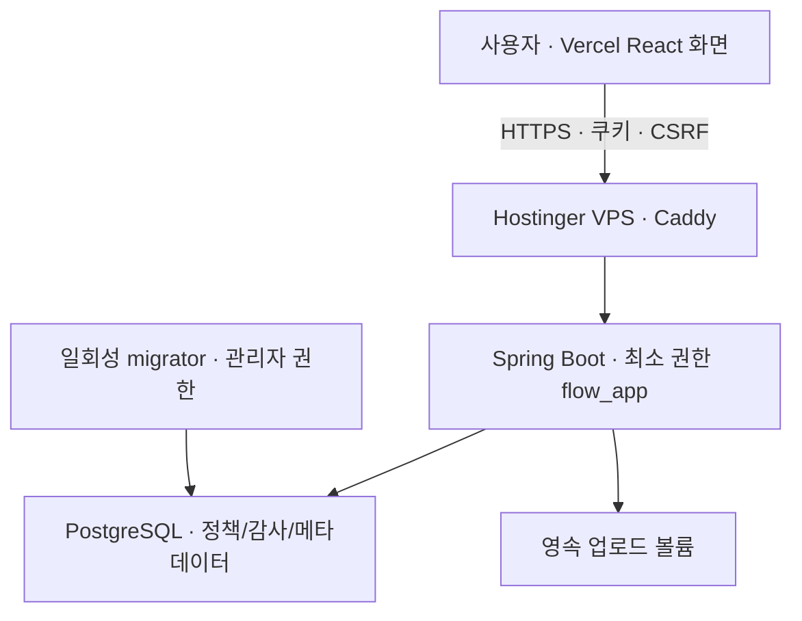

# 파일 업로드 과제 수행 가이드

작성일: 2026-10-23 · 대상 저장소: [feed-mina/flow_fileupload_AI](https://github.com/feed-mina/flow_fileupload_AI)

> **과제 핵심 한 줄:** 확장자 차단 정책을 데이터베이스에 저장하고 실제 파일 업로드에 서버가 강제 적용하는 서비스를 배포하며, 보안·예외·운영 판단과 AI 활용·검증 과정을 근거로 남긴다.

이 문서는 **구현 전 설계·점검 가이드**다. 체크 항목은 구현 완료나 시험 통과를 의미하지 않는다. 기준 문서는 사용자 제공 `과제_파일업로드_AI개발.md` 전체다. 최초 작성 시점에는 앱 소스가 없었다. 현재 main에는 정책·업로드·UX 구현이 있으며, 항목별 현재 상태는 이 주석판의 상태 열을 따른다.


> **주석판 안내:** 원본을 보존한 새 파일이다. 사용자가 말한 RQ는 원본의 요구사항 ID인 **REQ**로 표기한다. 아래 주석은 기존 항목의 위치와 연결을 설명하며 새로운 기능 채택이나 구현 완료를 선언하지 않는다. 초기 설계 기록은 과거 기록으로 구분하며, 현재 상태는 이 문서의 main 구현 현황과 각 행의 상태 열을 따른다. 이후 채택 근거는 원문 21·22절 및 연결된 구현 문서에서도 확인한다.
>
> **관련 REQ 읽기:** ‘직접’은 과제에 명시된 요구, ‘연관’은 그 요구를 지원하는 설계 판단이다. REQ-14의 고려사항 기록 의무가 모든 권장 기능의 구현 의무를 뜻하지는 않는다. DEC 번호와 REQ 번호가 일대일로 대응하는 것은 아니다.


## main 반영용 구현 현황 — Hostinger·Vercel 준비 업데이트

**기준 코드:** [5259b80](https://github.com/feed-mina/flow_fileupload_AI/commit/5259b8023f1361d34727229f9a8d4b3263008b27). 기존 원문 위치 링크는 이전 원문을, 이번 변경 근거 링크는 위 코드 스냅샷을 가리킨다. 이 문서의 기존 행은 과제/초안이고 마지막 상태·근거 열이 현재 구현 경계다. REQ(Requirement)는 요구사항, DEC(Decision)는 설계 결정이다.

| 표시 | 읽는 방법 |
|---|---|
| 구현 | 코드/구성/문서가 있다. 검증된 환경·범위는 옆 열과 아래 실행 기록을 확인한다. |
| 부분 구현 | 일부 기능/검증이 남았거나, 의도적으로 일부만 구현했다. |
| 미구현 | 기능/운영 자동화가 없다. 사용자 요청에 따른 보류도 이유에 명시한다. |
| 범위 제외 | FE-U07의 신규 완료 판정은 기존 사용자 결정대로 제외한다. |

**실제 실행:** 로컬 Node API 10개 통과. 새 서버/DB/브라우저 CI 검증 진행 중이며 아래 상태는 코드/시험 작성 범위를 나타낸다. 공개 배포는 미실행.

공개 배포·도메인 변경·호스팅 결제·실서버 백업·cron 설치는 하지 않았다. Hostinger는 Docker 가능한 VPS 기준, Vercel은 React 정적 화면 기준이며 다음 [23절](#23-hostingervercel-배포-준비와-사용자-결정-반영)에 결정별 결과를 정리했다.

| 묶음 | 구현 | 부분 구현 | 미구현 | 범위 제외 | 합계 |
|---|---:|---:|---:|---:|---:|
| REQ | 13 | 2 | 0 | 0 | 15 |
| DEC | 11 | 1 | 1 | 0 | 13 |
| 영역별 고려사항 | 78 | 19 | 10 | 1 | 108 |
| 시험 시나리오 | 19 | 6 | 3 | 0 | 28 |

묶음 간 항목은 서로 연결/중첩되므로 합쳐서 기능 완료율로 계산하지 않는다.

## 주석 찾아보기 — 요청하신 3-2 정책·데이터 / 3-4 운영 관점

원본의 현재 목차에서 3절은 REQ 표이고, 관점별 상세 항목은 6~10절에 나뉘어 있다. 요청하신 관점 이름을 기준으로 아래와 같이 연결한다. 위치 링크는 확인한 원본 커밋에 고정했다.

| 주석 | 요청한 고려사항 | 관련 DEC | 관련 REQ와 성격 | 기존 가이드에서 찾은 위치 |
|---|---|---|---|---|
| [P-01](#note-p-01) | 고정 정책 확장자와 커스텀 확장자가 겹칠 때 | DEC-03 직접, DEC-02 정규화 연관 | REQ-04·09 직접 | [7.3 BE-P02](https://github.com/feed-mina/flow_fileupload_AI/blob/42f6681a2a43b25b14d168a5368ccb96c4c34f7c/docs/IMPLEMENTATION_GUIDE.md#L173) · [8.3 FE-P01](https://github.com/feed-mina/flow_fileupload_AI/blob/42f6681a2a43b25b14d168a5368ccb96c4c34f7c/docs/IMPLEMENTATION_GUIDE.md#L218) · [11절 UNIQUE·CHECK](https://github.com/feed-mina/flow_fileupload_AI/blob/42f6681a2a43b25b14d168a5368ccb96c4c34f7c/docs/IMPLEMENTATION_GUIDE.md#L346) |
| [P-02](#note-p-02) | 정책 변경 이력 / 감사 필요 여부 | 전용 DEC 없음. DEC-01 주체·범위, DEC-10 버전 연관 | REQ-14 설계 판단, REQ-13 스키마 연관; 감사 기능 자체의 독립 필수 REQ는 없음 | [6.1 DB-U04](https://github.com/feed-mina/flow_fileupload_AI/blob/42f6681a2a43b25b14d168a5368ccb96c4c34f7c/docs/IMPLEMENTATION_GUIDE.md#L106) · [6.4 DB-O04·05](https://github.com/feed-mina/flow_fileupload_AI/blob/42f6681a2a43b25b14d168a5368ccb96c4c34f7c/docs/IMPLEMENTATION_GUIDE.md#L135) · [11절 policy_audit](https://github.com/feed-mina/flow_fileupload_AI/blob/42f6681a2a43b25b14d168a5368ccb96c4c34f7c/docs/IMPLEMENTATION_GUIDE.md#L343) · [22절 이후 채택 상태](https://github.com/feed-mina/flow_fileupload_AI/blob/42f6681a2a43b25b14d168a5368ccb96c4c34f7c/docs/IMPLEMENTATION_GUIDE.md#L649) |
| [P-03](#note-p-03) | 200개 / 20자 제한 근거와 초과 UX | DEC-02 길이·정규화; 200개 전용 DEC 없음 | REQ-05 최대 20자, REQ-07 최대 200개 직접; REQ-09 중복 연관 | [3절 REQ-05·07](https://github.com/feed-mina/flow_fileupload_AI/blob/42f6681a2a43b25b14d168a5368ccb96c4c34f7c/docs/IMPLEMENTATION_GUIDE.md#L48) · [6.3 DB-P02·03](https://github.com/feed-mina/flow_fileupload_AI/blob/42f6681a2a43b25b14d168a5368ccb96c4c34f7c/docs/IMPLEMENTATION_GUIDE.md#L122) · [7.1 BE-U02·03](https://github.com/feed-mina/flow_fileupload_AI/blob/42f6681a2a43b25b14d168a5368ccb96c4c34f7c/docs/IMPLEMENTATION_GUIDE.md#L145) · [7.3 BE-P03](https://github.com/feed-mina/flow_fileupload_AI/blob/42f6681a2a43b25b14d168a5368ccb96c4c34f7c/docs/IMPLEMENTATION_GUIDE.md#L174) · [8.1 FE-U04](https://github.com/feed-mina/flow_fileupload_AI/blob/42f6681a2a43b25b14d168a5368ccb96c4c34f7c/docs/IMPLEMENTATION_GUIDE.md#L200) · [8.2 FE-S01](https://github.com/feed-mina/flow_fileupload_AI/blob/42f6681a2a43b25b14d168a5368ccb96c4c34f7c/docs/IMPLEMENTATION_GUIDE.md#L209) · [8.3 FE-P02](https://github.com/feed-mina/flow_fileupload_AI/blob/42f6681a2a43b25b14d168a5368ccb96c4c34f7c/docs/IMPLEMENTATION_GUIDE.md#L219) · [13절 T06~08](https://github.com/feed-mina/flow_fileupload_AI/blob/42f6681a2a43b25b14d168a5368ccb96c4c34f7c/docs/IMPLEMENTATION_GUIDE.md#L412) |
| [P-04](#note-p-04) | 수백 개 조회 / 저장 성능·인덱스 | 전용 DEC 없음. DEC-01 범위·DEC-02 정규형이 키 구성에 연관 | REQ-13 스키마·인덱스, REQ-14 검토 직접; REQ-06·07·09 저장·개수·중복 연관 | [6.3 DB-P01·03·06](https://github.com/feed-mina/flow_fileupload_AI/blob/42f6681a2a43b25b14d168a5368ccb96c4c34f7c/docs/IMPLEMENTATION_GUIDE.md#L126) · [7.3 BE-P04](https://github.com/feed-mina/flow_fileupload_AI/blob/42f6681a2a43b25b14d168a5368ccb96c4c34f7c/docs/IMPLEMENTATION_GUIDE.md#L175) · [8.4 FE-O05](https://github.com/feed-mina/flow_fileupload_AI/blob/42f6681a2a43b25b14d168a5368ccb96c4c34f7c/docs/IMPLEMENTATION_GUIDE.md#L232) · [11절 잠금·제약](https://github.com/feed-mina/flow_fileupload_AI/blob/42f6681a2a43b25b14d168a5368ccb96c4c34f7c/docs/IMPLEMENTATION_GUIDE.md#L353) |
| [O-01](#note-o-01) | 새로고침 / 동시 편집 정합성 | DEC-01 공유 범위, DEC-10 업로드 적용 시점 연관; 편집 충돌 전용 DEC 없음 | REQ-03 새로고침·재시작 유지 직접; REQ-06~09 쓰기 정합성, REQ-10 정책 적용 연관 | [6.3 DB-P03·05](https://github.com/feed-mina/flow_fileupload_AI/blob/42f6681a2a43b25b14d168a5368ccb96c4c34f7c/docs/IMPLEMENTATION_GUIDE.md#L125) · [6.4 DB-O01](https://github.com/feed-mina/flow_fileupload_AI/blob/42f6681a2a43b25b14d168a5368ccb96c4c34f7c/docs/IMPLEMENTATION_GUIDE.md#L132) · [7.3 BE-P01·04·05](https://github.com/feed-mina/flow_fileupload_AI/blob/42f6681a2a43b25b14d168a5368ccb96c4c34f7c/docs/IMPLEMENTATION_GUIDE.md#L175) · [8.3 FE-P03·04](https://github.com/feed-mina/flow_fileupload_AI/blob/42f6681a2a43b25b14d168a5368ccb96c4c34f7c/docs/IMPLEMENTATION_GUIDE.md#L220) · [8.4 FE-O04](https://github.com/feed-mina/flow_fileupload_AI/blob/42f6681a2a43b25b14d168a5368ccb96c4c34f7c/docs/IMPLEMENTATION_GUIDE.md#L231) · [12절 If-Match 계약](https://github.com/feed-mina/flow_fileupload_AI/blob/42f6681a2a43b25b14d168a5368ccb96c4c34f7c/docs/IMPLEMENTATION_GUIDE.md#L371) |
| [O-02](#note-o-02) | 로그 / 모니터링에 남길 내용 | 전용 DEC 없음. DEC-10 적용 버전, DEC-13 파일 보관·총량 연관 | REQ-14 운영 판단 직접, REQ-12 공개 운영 연관; REQ-15는 AI 활용 기록으로 별개 | [6.4 DB-O04·05](https://github.com/feed-mina/flow_fileupload_AI/blob/42f6681a2a43b25b14d168a5368ccb96c4c34f7c/docs/IMPLEMENTATION_GUIDE.md#L136) · [7.4 BE-O05·07](https://github.com/feed-mina/flow_fileupload_AI/blob/42f6681a2a43b25b14d168a5368ccb96c4c34f7c/docs/IMPLEMENTATION_GUIDE.md#L187) · [9.4 DP-O02·06](https://github.com/feed-mina/flow_fileupload_AI/blob/42f6681a2a43b25b14d168a5368ccb96c4c34f7c/docs/IMPLEMENTATION_GUIDE.md#L271) |
| [O-03](#note-o-03) | 향후 사용자별 정책 / 화이트리스트 전환 | 사용자별 범위는 DEC-01. 화이트리스트 전환은 기존 DEC 없음 | REQ-14 확장·보류 판단, REQ-10 정책 적용 연관; 두 확장 기능의 직접 필수 REQ 없음 | [4절 DEC-01](https://github.com/feed-mina/flow_fileupload_AI/blob/42f6681a2a43b25b14d168a5368ccb96c4c34f7c/docs/IMPLEMENTATION_GUIDE.md#L66) · [7.2 BE-S11·12](https://github.com/feed-mina/flow_fileupload_AI/blob/42f6681a2a43b25b14d168a5368ccb96c4c34f7c/docs/IMPLEMENTATION_GUIDE.md#L165) · [11절 policy_scope·policy_id](https://github.com/feed-mina/flow_fileupload_AI/blob/42f6681a2a43b25b14d168a5368ccb96c4c34f7c/docs/IMPLEMENTATION_GUIDE.md#L325) · [12절 공개 인증·격리 보류](https://github.com/feed-mina/flow_fileupload_AI/blob/42f6681a2a43b25b14d168a5368ccb96c4c34f7c/docs/IMPLEMENTATION_GUIDE.md#L382) · [19절 R10 허용목록 별도 결정](https://github.com/feed-mina/flow_fileupload_AI/blob/42f6681a2a43b25b14d168a5368ccb96c4c34f7c/docs/IMPLEMENTATION_GUIDE.md#L572) |

## 1. 확정 기술 스택과 사용 방법

| 담당 영역 | 사용자가 확정한 기술 | 과제에서 맡을 일 |
|---|---|---|
| 백엔드 | Java / Spring Boot | 정책 조회·수정, 확장자 정규화, 업로드 검증, 오류 응답, 파일 저장 처리 |
| 프론트엔드 | React | 고정 체크박스, 커스텀 입력·목록·삭제, 파일 선택, 저장·업로드 상태 표시 |
| 데이터베이스 | PostgreSQL | 정책·버전과 파일 메타데이터 저장, 중복 제약, 동시 요청 제어 |
| 실행·배포 | Docker | 화면·서버·데이터베이스 실행 환경 재현, 데이터 영속 저장 구성 |
| 변경 이력 | Git | 코드와 설계·프롬프트·시험 결과의 변경 기록 |
| 원격 저장소 | GitHub | 위 Git 저장소 공유, 검토, 자동 검사, 제출 자료 제공 |

**기술 스택 사용 방법 — 세 줄**
1. React에서 정책을 편집하고 파일을 전송하면 Spring Boot가 입력값과 실제 업로드를 검증한다.
2. PostgreSQL에 차단 정책·버전·파일 메타데이터를 저장하고, 파일 본문은 Docker의 별도 영속 저장 공간에 둔다.
3. Docker로 실행 환경을 재현하고 Git·GitHub에 코드·스키마·판단 근거·AI 사용 기록·실제 시험 결과를 관리한다.

Docker는 실행·패키징 도구다. 외부에서 접속할 주소를 제공할 **호스팅 서비스나 서버는 별도로 선택**해야 한다.
Git은 변경 이력을 관리하는 도구이고 GitHub는 그 저장소를 공유하는 서비스다.
Spring Boot와 React는 사용자의 이번 과제 선택이며 회사 전체의 실제 운영 조합으로 단정하지 않는다.

## 2. 항목을 읽는 방법

- **필수:** 과제에 명시된 동작·제출 요구. 완료해야 한다.
- **권장:** 이 가이드의 설계 제안. 채택 또는 제외 이유를 기록한다.
- **확장:** 작은 과제에서 범위를 넘으면 구현을 미루고 한계와 후속 계획을 쓴다.
- **결정대기:** 아직 사용자가 확정하지 않은 제품 정책·운영값.
- **검증 방법:** 최초 설계 당시 작성한 시험 계획이다. 현재 실행 여부는 각 행의 상태·근거 열과 13절을 따른다.

한 항목은 가능한 한 **입력 하나 / 판단 하나 / 상태 변화 하나 / 기대 결과 하나**로 분리했다.
예: “동시성 처리”를 “199개에서 두 요청 도착 → 공통 정책 행 잠금 → 한 요청 추가 → 다른 요청 재확인 → 최종 200개”로 나눠 확인한다.

## 3. 과제 요구와 완료 기준

| 요구 ID | 과제의 필수 내용 | 완료를 판단하는 증거 | main 구현 상태 | 근거·검증 범위·남은 작업 |
|---|---|---|---|---|
| REQ-01 | 고정 확장자 bat, cmd, com, cpl, exe, scr, js | 정확히 7종 표시 | 구현 | 고정 7종 초기화·표시, 초기 상태 통합 시험 통과. [V1__policy_schema.sql](https://github.com/feed-mina/flow_fileupload_AI/blob/707064d7df65118394147a227a15fb44e14c2cec/backend/src/main/resources/db/migration/V1__policy_schema.sql) · [App.jsx](https://github.com/feed-mina/flow_fileupload_AI/blob/707064d7df65118394147a227a15fb44e14c2cec/frontend/src/App.jsx) · [PolicyApiTest.java](https://github.com/feed-mina/flow_fileupload_AI/blob/707064d7df65118394147a227a15fb44e14c2cec/backend/src/test/java/dev/mina/flow/policy/PolicyApiTest.java#L50) |
| REQ-02 | 처음에는 모두 미선택 | 새 데이터베이스에서 7개 모두 false | 구현 | 초기 false, 새 DB 시험 통과. [V1__policy_schema.sql](https://github.com/feed-mina/flow_fileupload_AI/blob/707064d7df65118394147a227a15fb44e14c2cec/backend/src/main/resources/db/migration/V1__policy_schema.sql) · [PolicyApiTest.java](https://github.com/feed-mina/flow_fileupload_AI/blob/707064d7df65118394147a227a15fb44e14c2cec/backend/src/test/java/dev/mina/flow/policy/PolicyApiTest.java#L50) |
| REQ-03 | 선택·해제를 DB에 저장 | 선택 후 새로고침·서버 재시작에도 유지 | 구현 | DB 저장·새로고침·실제 두 Java 프로세스 재시작 시험 통과. [PolicyService.java](https://github.com/feed-mina/flow_fileupload_AI/blob/707064d7df65118394147a227a15fb44e14c2cec/backend/src/main/java/dev/mina/flow/policy/PolicyService.java#L21) · [verify-restart.mjs](https://github.com/feed-mina/flow_fileupload_AI/blob/707064d7df65118394147a227a15fb44e14c2cec/scripts/verify-restart.mjs) · [policy.spec.js](https://github.com/feed-mina/flow_fileupload_AI/blob/707064d7df65118394147a227a15fb44e14c2cec/frontend/e2e/policy.spec.js) |
| REQ-04 | 고정 확장자를 커스텀 목록에 표시하지 않음 | 두 영역 목록이 겹치지 않음 | 구현 | 고정 이름 커스텀 추가 거부·목록 분리. [PolicyService.java](https://github.com/feed-mina/flow_fileupload_AI/blob/707064d7df65118394147a227a15fb44e14c2cec/backend/src/main/java/dev/mina/flow/policy/PolicyService.java#L37) · [V1__policy_schema.sql](https://github.com/feed-mina/flow_fileupload_AI/blob/707064d7df65118394147a227a15fb44e14c2cec/backend/src/main/resources/db/migration/V1__policy_schema.sql#L16) · [App.jsx](https://github.com/feed-mina/flow_fileupload_AI/blob/707064d7df65118394147a227a15fb44e14c2cec/frontend/src/App.jsx) |
| REQ-05 | 커스텀 확장자 최대 20자 | 20자 성공·21자 거부 | 구현 | 정규화 후 최대 20자, 20/21자 통합 시험. [PolicyService.java](https://github.com/feed-mina/flow_fileupload_AI/blob/707064d7df65118394147a227a15fb44e14c2cec/backend/src/main/java/dev/mina/flow/policy/PolicyService.java#L68) · [PolicyApiTest.java](https://github.com/feed-mina/flow_fileupload_AI/blob/707064d7df65118394147a227a15fb44e14c2cec/backend/src/test/java/dev/mina/flow/policy/PolicyApiTest.java#L116) · [PolicyApiTest.java](https://github.com/feed-mina/flow_fileupload_AI/blob/707064d7df65118394147a227a15fb44e14c2cec/backend/src/test/java/dev/mina/flow/policy/PolicyApiTest.java#L106) |
| REQ-06 | 커스텀 추가 후 저장·목록 표시 | 재조회해 동일 항목 확인 | 구현 | 추가 후 DB·서버 응답으로 목록 확정. [PolicyService.java](https://github.com/feed-mina/flow_fileupload_AI/blob/707064d7df65118394147a227a15fb44e14c2cec/backend/src/main/java/dev/mina/flow/policy/PolicyService.java#L33) · [usePolicy.js](https://github.com/feed-mina/flow_fileupload_AI/blob/707064d7df65118394147a227a15fb44e14c2cec/frontend/src/usePolicy.js) · [PolicyApiTest.java](https://github.com/feed-mina/flow_fileupload_AI/blob/707064d7df65118394147a227a15fb44e14c2cec/backend/src/test/java/dev/mina/flow/policy/PolicyApiTest.java#L77) |
| REQ-07 | 커스텀 최대 200개 | 200번째 성공·201번째 거부 | 구현 | CUSTOM 200개 제한·부모 잠금·199개 경쟁 시험. [PolicyService.java](https://github.com/feed-mina/flow_fileupload_AI/blob/707064d7df65118394147a227a15fb44e14c2cec/backend/src/main/java/dev/mina/flow/policy/PolicyService.java#L42) · [PolicyApiTest.java](https://github.com/feed-mina/flow_fileupload_AI/blob/707064d7df65118394147a227a15fb44e14c2cec/backend/src/test/java/dev/mina/flow/policy/PolicyApiTest.java#L131) |
| REQ-08 | X 클릭 시 DB에서 삭제 | 삭제 후 재조회·새로고침에도 없음 | 구현 | 삭제·재조회·실서버 브라우저 회귀 시험. [PolicyService.java](https://github.com/feed-mina/flow_fileupload_AI/blob/707064d7df65118394147a227a15fb44e14c2cec/backend/src/main/java/dev/mina/flow/policy/PolicyService.java#L52) · [policy.spec.js](https://github.com/feed-mina/flow_fileupload_AI/blob/707064d7df65118394147a227a15fb44e14c2cec/frontend/e2e/policy.spec.js#L158) |
| REQ-09 | 중복 추가 방지 | 같은 정규화 값이 DB에 한 건만 존재 | 구현 | 정규화·UNIQUE·중복 오류. 같은 버전의 경쟁 쓰기는 412도 가능. [V1__policy_schema.sql](https://github.com/feed-mina/flow_fileupload_AI/blob/707064d7df65118394147a227a15fb44e14c2cec/backend/src/main/resources/db/migration/V1__policy_schema.sql#L15) · [PolicyService.java](https://github.com/feed-mina/flow_fileupload_AI/blob/707064d7df65118394147a227a15fb44e14c2cec/backend/src/main/java/dev/mina/flow/policy/PolicyService.java#L39) · [PolicyApiTest.java](https://github.com/feed-mina/flow_fileupload_AI/blob/707064d7df65118394147a227a15fb44e14c2cec/backend/src/test/java/dev/mina/flow/policy/PolicyApiTest.java#L96) |
| REQ-10 | 실제 파일 업로드에 정책 적용 | 직접 API 호출도 차단·허용이 동일 | 구현 | 서버가 저장 정책 스냅샷으로 직접 API도 차단. [UploadService.java](https://github.com/feed-mina/flow_fileupload_AI/blob/707064d7df65118394147a227a15fb44e14c2cec/backend/src/main/java/dev/mina/flow/upload/UploadService.java#L44) · [UploadApiTest.java](https://github.com/feed-mina/flow_fileupload_AI/blob/707064d7df65118394147a227a15fb44e14c2cec/backend/src/test/java/dev/mina/flow/upload/UploadApiTest.java#L117) |
| REQ-11 | 차단 이유와 정상 업로드 성공 표시 | 실패 사유와 실제 파일 저장 증거 | 구현 | 차단 사유·정책 버전·READY 성공 표시와 실제 파일 저장 시험. [UploadPanel.jsx](https://github.com/feed-mina/flow_fileupload_AI/blob/707064d7df65118394147a227a15fb44e14c2cec/frontend/src/UploadPanel.jsx) · [UploadApiTest.java](https://github.com/feed-mina/flow_fileupload_AI/blob/707064d7df65118394147a227a15fb44e14c2cec/backend/src/test/java/dev/mina/flow/upload/UploadApiTest.java#L61) |
| REQ-12 | GitHub·공개 배포 주소 제출 | 다른 브라우저에서 접속·동작 확인 | 부분 구현 | GitHub 제출·문서는 존재. 공개 호스팅·배포 주소·외부 접속 검증 미완료. [README.md](https://github.com/feed-mina/flow_fileupload_AI/blob/707064d7df65118394147a227a15fb44e14c2cec/README.md#L7) · [README.md](https://github.com/feed-mina/flow_fileupload_AI/blob/707064d7df65118394147a227a15fb44e14c2cec/docs/reports/README.md) |
| REQ-13 | 테이블 스키마·README 제출 | 컬럼·타입·제약·인덱스 및 실행법 존재 | 구현 | V1~V3 SQL·제약/인덱스·실행 README 존재. CI 새 DB 마이그레이션 통과. [V1__policy_schema.sql](https://github.com/feed-mina/flow_fileupload_AI/blob/707064d7df65118394147a227a15fb44e14c2cec/backend/src/main/resources/db/migration/V1__policy_schema.sql) · [V2__upload_metadata.sql](https://github.com/feed-mina/flow_fileupload_AI/blob/707064d7df65118394147a227a15fb44e14c2cec/backend/src/main/resources/db/migration/V2__upload_metadata.sql) · [V3__ux_audit_and_upload_lookup.sql](https://github.com/feed-mina/flow_fileupload_AI/blob/707064d7df65118394147a227a15fb44e14c2cec/backend/src/main/resources/db/migration/V3__ux_audit_and_upload_lookup.sql) · [README.md](https://github.com/feed-mina/flow_fileupload_AI/blob/707064d7df65118394147a227a15fb44e14c2cec/README.md) |
| REQ-14 | 고려사항 문서 제출 | 각 관점의 채택·제외 이유 확인 | 구현 | 가이드·DEC·UX 채택/한계 문서 존재. 모든 권장 기능의 구현 완료를 뜻하지 않음. [DEC_IMPLEMENTATION.md](https://github.com/feed-mina/flow_fileupload_AI/blob/707064d7df65118394147a227a15fb44e14c2cec/docs/DEC_IMPLEMENTATION.md) · [UX_IMPLEMENTATION.md](https://github.com/feed-mina/flow_fileupload_AI/blob/707064d7df65118394147a227a15fb44e14c2cec/docs/UX_IMPLEMENTATION.md) |
| REQ-15 | AI 활용 기록 제출 | 입력·의도·검증·수정·도구·회고 확인 | 부분 구현 | 요청·의도·수정·도구·검증 기록 존재. 지원자 본인의 최종 회고·제출본 점검은 남음. [PROMPT_LOG.md](https://github.com/feed-mina/flow_fileupload_AI/blob/707064d7df65118394147a227a15fb44e14c2cec/docs/PROMPT_LOG.md) |

## 4. 구현 전 결정할 제안

아래 값은 **확정 요건이 아닌 권장 초안**이다. 변경하면 서버·화면·문서·시험을 함께 수정한다.

| 결정 ID | 항목 | 권장 초안 | 이유·한계 | 관련 REQ | main 구현 상태 | 근거·검증 범위·남은 작업 |
|---|---|---|---|---|---|---|
| DEC-01 | 정책 범위 | 로컬은 단일 정책으로 시작. 공개 전 공유 정책의 편집 권한 또는 방문자별 데모 격리 방식 확정 | 서로 다른 방문자의 변경 충돌과 시험 오염을 통제해야 함 | REQ-12·14(연관: 공개 정책 범위·권한 결정) | 부분 구현 | 공유 단일 정책 유지. 사용자 ID는 인증·소유권 매핑·범위별 조회/잠금까지 적용해야 분리된다. IP는 공유/변경 가능해 소유권 기준으로 부적절. 이번에는 설명만 보완. [HOSTINGER_VERCEL_DEPLOYMENT.md](https://github.com/feed-mina/flow_fileupload_AI/blob/5259b8023f1361d34727229f9a8d4b3263008b27/docs/HOSTINGER_VERCEL_DEPLOYMENT.md) |
| DEC-02 | 확장자 입력 | 앞뒤 공백 제거 → 선행 점 한 개 제거 → 소문자화 → ASCII 영문·숫자 1~20자만 허용 | .PDF와 pdf를 동일하게 처리. 공백·점·유니코드를 조용히 삭제하지 않고 거부 | REQ-05·09(직접: 길이·중복), REQ-14(정규화 판단) | 구현 | 실제 순서는 공백·선행 점 제거 → 원문 ASCII 검사 → 소문자화. 유니코드 우회 방지를 위해 초안 순서를 보완. [PolicyService.java](https://github.com/feed-mina/flow_fileupload_AI/blob/707064d7df65118394147a227a15fb44e14c2cec/backend/src/main/java/dev/mina/flow/policy/PolicyService.java#L63) · [PolicyApiTest.java](https://github.com/feed-mina/flow_fileupload_AI/blob/707064d7df65118394147a227a15fb44e14c2cec/backend/src/test/java/dev/mina/flow/policy/PolicyApiTest.java#L106) |
| DEC-03 | 고정 이름 충돌 | 커스텀에 exe 등을 추가하면 고정 영역에서 선택하도록 안내 | 미선택 고정 확장자를 커스텀으로 몰래 활성화하지 않음 | REQ-04·09(직접: 고정/커스텀 분리·중복) | 구현 | 고정 이름은 409 안내, 자동 활성화 없음. [PolicyService.java](https://github.com/feed-mina/flow_fileupload_AI/blob/707064d7df65118394147a227a15fb44e14c2cec/backend/src/main/java/dev/mina/flow/policy/PolicyService.java#L37) · [PolicyApiTest.java](https://github.com/feed-mina/flow_fileupload_AI/blob/707064d7df65118394147a227a15fb44e14c2cec/backend/src/test/java/dev/mina/flow/policy/PolicyApiTest.java#L96) |
| DEC-04 | 이중 확장자 | 마지막 점 뒤의 확장자만 정책과 비교 | report.exe.txt는 txt로 판단. 중간 exe가 실행 위험을 없앤다는 의미는 아님 | REQ-10·11(연관: 판정·결과 안내), REQ-14(파싱 규칙) | 구현 | lastIndexOf로 마지막 확장자 사용, 통합 시험. [FilenameRules.java](https://github.com/feed-mina/flow_fileupload_AI/blob/707064d7df65118394147a227a15fb44e14c2cec/backend/src/main/java/dev/mina/flow/upload/FilenameRules.java#L15) · [UploadApiTest.java](https://github.com/feed-mina/flow_fileupload_AI/blob/707064d7df65118394147a227a15fb44e14c2cec/backend/src/test/java/dev/mina/flow/upload/UploadApiTest.java#L137) |
| DEC-05 | 복합 확장자 | tar.gz는 gz로 판단, 커스텀 tar.gz는 입력 규칙상 거부 | 복합 확장자 지원은 별도 정책으로 확장 | REQ-05·10(연관: 입력·판정), REQ-14(복합 확장자 처리) | 구현 | tar.gz 업로드는 gz, 커스텀 tar.gz는 입력 거부. [FilenameRules.java](https://github.com/feed-mina/flow_fileupload_AI/blob/707064d7df65118394147a227a15fb44e14c2cec/backend/src/main/java/dev/mina/flow/upload/FilenameRules.java) · [PolicyService.java](https://github.com/feed-mina/flow_fileupload_AI/blob/707064d7df65118394147a227a15fb44e14c2cec/backend/src/main/java/dev/mina/flow/policy/PolicyService.java#L68) · [UploadApiTest.java](https://github.com/feed-mina/flow_fileupload_AI/blob/707064d7df65118394147a227a15fb44e14c2cec/backend/src/test/java/dev/mina/flow/upload/UploadApiTest.java#L137) |
| DEC-06 | 특수 파일명 | 확장자 없음·.env 같은 단독 숨김 이름·끝이 점인 이름은 사유를 나눠 거부 | 과제 필수 규칙이 아닌 파일명 정책 제안 | REQ-10·11(연관: 검증·오류 안내), REQ-14(추가 파일명 규칙) | 구현 | 확장자 없음·숨김 이름·끝 점 등 코드 분리. [FilenameRules.java](https://github.com/feed-mina/flow_fileupload_AI/blob/707064d7df65118394147a227a15fb44e14c2cec/backend/src/main/java/dev/mina/flow/upload/FilenameRules.java) · [UploadApiTest.java](https://github.com/feed-mina/flow_fileupload_AI/blob/707064d7df65118394147a227a15fb44e14c2cec/backend/src/test/java/dev/mina/flow/upload/UploadApiTest.java#L132) |
| DEC-07 | 파일 개수·크기 | 요청당 1개, 파일당 10 MiB, multipart 요청 전체 12 MiB | 10 MiB = 10 × 1024 × 1024바이트. 실행 환경과 함께 최종 확정 | REQ-10·11(연관: 업로드·초과 안내), REQ-14(크기·개수 제안값) | 구현 | 1개·10 MiB·전체 12 MiB 설정, 앱 경계 및 실제 Nginx 413 시험 통과. 전체 Compose 기동은 미검증. [UploadController.java](https://github.com/feed-mina/flow_fileupload_AI/blob/707064d7df65118394147a227a15fb44e14c2cec/backend/src/main/java/dev/mina/flow/upload/UploadController.java#L27) · [application.yml](https://github.com/feed-mina/flow_fileupload_AI/blob/707064d7df65118394147a227a15fb44e14c2cec/backend/src/main/resources/application.yml) · [nginx.conf](https://github.com/feed-mina/flow_fileupload_AI/blob/707064d7df65118394147a227a15fb44e14c2cec/frontend/nginx.conf) · [verify-proxy.mjs](https://github.com/feed-mina/flow_fileupload_AI/blob/707064d7df65118394147a227a15fb44e14c2cec/scripts/verify-proxy.mjs) |
| DEC-08 | 빈 파일·파일명 | 0바이트 거부, 파일명 최대 255 UTF-8바이트 제안 | 화면 글자 수와 바이트 길이의 차이를 안내 | REQ-10·11(연관: 검증·오류 안내), REQ-14(빈 파일·이름 한도) | 구현 | 0바이트·파일명 UTF-8 255바이트 한도와 경계 시험. [FilenameRules.java](https://github.com/feed-mina/flow_fileupload_AI/blob/707064d7df65118394147a227a15fb44e14c2cec/backend/src/main/java/dev/mina/flow/upload/FilenameRules.java#L13) · [UploadService.java](https://github.com/feed-mina/flow_fileupload_AI/blob/707064d7df65118394147a227a15fb44e14c2cec/backend/src/main/java/dev/mina/flow/upload/UploadService.java#L49) · [UploadApiTest.java](https://github.com/feed-mina/flow_fileupload_AI/blob/707064d7df65118394147a227a15fb44e14c2cec/backend/src/test/java/dev/mina/flow/upload/UploadApiTest.java#L137) |
| DEC-09 | 저장 방식 | 원본 이름은 표시용 메타데이터, 실제 저장 키는 서버 UUID | 같은 이름 덮어쓰기·경로 조작을 피함 | REQ-10·11·13(연관: 실제 저장·증거·스키마), REQ-14(저장 설계) | 구현 | UUID.bin·독립 저장 루트·메타데이터, 파일 내용/키 시험. [UploadStorage.java](https://github.com/feed-mina/flow_fileupload_AI/blob/707064d7df65118394147a227a15fb44e14c2cec/backend/src/main/java/dev/mina/flow/upload/UploadStorage.java#L21) · [UploadService.java](https://github.com/feed-mina/flow_fileupload_AI/blob/707064d7df65118394147a227a15fb44e14c2cec/backend/src/main/java/dev/mina/flow/upload/UploadService.java) · [UploadApiTest.java](https://github.com/feed-mina/flow_fileupload_AI/blob/707064d7df65118394147a227a15fb44e14c2cec/backend/src/test/java/dev/mina/flow/upload/UploadApiTest.java#L61) |
| DEC-10 | 정책 적용 시점 | 업로드 검증 시작 때 읽은 커밋된 정책 버전을 해당 요청에 적용 | 이후 정책 수정은 다음 검증부터 적용. 이미 허용된 파일을 소급 취소하지 않음 | REQ-03·10·11(연관: 저장된 정책·적용·결과), REQ-14(적용 시점) | 구현 | REPEATABLE_READ 스냅샷 1회·적용 버전 응답, 복사 중 정책 변경 시험 통과. [PolicyService.java](https://github.com/feed-mina/flow_fileupload_AI/blob/707064d7df65118394147a227a15fb44e14c2cec/backend/src/main/java/dev/mina/flow/policy/PolicyService.java#L17) · [UploadService.java](https://github.com/feed-mina/flow_fileupload_AI/blob/707064d7df65118394147a227a15fb44e14c2cec/backend/src/main/java/dev/mina/flow/upload/UploadService.java) · [UploadApiTest.java](https://github.com/feed-mina/flow_fileupload_AI/blob/707064d7df65118394147a227a15fb44e14c2cec/backend/src/test/java/dev/mina/flow/upload/UploadApiTest.java#L183) |
| DEC-11 | 내용 검사 | 1차는 확장자 정책과 안전한 저장을 완성. 형식별 내용 검사·악성코드 검사는 확장으로 구분 | 확장자 차단만으로 안전한 파일임을 보장하지 못함 | REQ-10(연관: 확장자 정책 적용), REQ-14(내용 검사 범위) | 구현 | 확장자 정책·안전한 저장으로 범위를 제한한 결정 적용. 내용 검사·악성코드 검사 기능은 미구현. [UploadService.java](https://github.com/feed-mina/flow_fileupload_AI/blob/707064d7df65118394147a227a15fb44e14c2cec/backend/src/main/java/dev/mina/flow/upload/UploadService.java) · [UploadPanel.jsx](https://github.com/feed-mina/flow_fileupload_AI/blob/707064d7df65118394147a227a15fb44e14c2cec/frontend/src/UploadPanel.jsx#L65) |
| DEC-12 | 저장소·버전 | 지원 중인 안정 버전을 골라 빌드·잠금 파일·이미지 태그에 고정 | 구체적인 Java·Spring Boot·React·PostgreSQL 버전은 구현 착수 시 확정 | REQ-12·13·14(연관: 배포·재현·버전 선택 기록) | 구현 | 실제 레지스트리에서 확인한 6개 이미지 digest로 기본 이미지·DB·프록시를 불변 고정. 배포 앱 이미지는 정확한 Git 커밋 APP_VERSION을 필수로 받고 이미지 ID도 기록한다. [image-lock.json](https://github.com/feed-mina/flow_fileupload_AI/blob/5259b8023f1361d34727229f9a8d4b3263008b27/deploy/image-lock.json) · [compose.hostinger.yml](https://github.com/feed-mina/flow_fileupload_AI/blob/5259b8023f1361d34727229f9a8d4b3263008b27/compose.hostinger.yml) · [ci.yml](https://github.com/feed-mina/flow_fileupload_AI/blob/5259b8023f1361d34727229f9a8d4b3263008b27/.github/workflows/ci.yml) |
| DEC-13 | 보관 기간·총량 | 공개 배포 전에 파일 보관 기간·전체 저장 한도·초기화 방식을 확정 | 파일당 제한만으로 디스크 고갈을 막을 수 없음 | REQ-12·14(연관: 공개 운영·보관/총량 판단) | 미구현 | 사용자 결정: 정상 업로드 파일 보관 기간·전체 총량·초기화 정책은 운영 항목으로 미구현 유지. 임시 처리 잔여물 청소와 구분. [HOSTINGER_VERCEL_DEPLOYMENT.md](https://github.com/feed-mina/flow_fileupload_AI/blob/5259b8023f1361d34727229f9a8d4b3263008b27/docs/HOSTINGER_VERCEL_DEPLOYMENT.md) |

정책이 모두 미선택이면 **확장자 정책 때문에 차단되는 항목은 없어야 한다.**
파일 크기·파일명 검증 등 독립적인 규칙은 별도 오류로 안내한다. exe를 사용자 선택과 무관하게 항상 차단하는 숨은 규칙을 추가하지 않는다.

## 5. 전체 책임과 흐름

| 단계 | 책임 영역 | 입력 | 처리 | 결과 |
|---|---|---|---|---|
| 1 | React | 사용자 선택·문자열 | 입력 안내, 저장 요청 | 확장자·활성값·예상 정책 버전 |
| 2 | Spring Boot | API 요청 | 규칙 검증, 권한 확인, 트랜잭션 | 저장 요청 또는 오류 |
| 3 | PostgreSQL | 정규화된 값 | 중복·버전·개수 정합성 보호 | 최신 정책과 버전 |
| 4 | React | 선택한 파일 | 업로드 진행 표시 | multipart/form-data 요청 |
| 5 | Spring Boot | 파일·최신 정책 | 이름·크기·정책 확인, 임시 저장 관리 | 거부 사유 또는 저장 결과 |
| 6 | 파일 저장소 + DB | 파일 본문 + 메타데이터 | UUID 저장, 상태 기록, 실패 정리 | 성공 파일 ID와 적용 정책 버전 |
| 7 | Docker / GitHub | 코드·설정·시험 결과 | 재현·배포·이력 보존 | 평가자가 호출할 수 있는 서비스 |

**화면의 사전 검사보다 서버의 검사가 최종 기준**이다. 파일 본문을 PostgreSQL에 넣는 방식도 가능하지만, 이 초안에서는 본문과 메타데이터를 분리한다.

## 6. 데이터베이스 — PostgreSQL

### 6.1 UX·예외 관점

| ID | 구분 | 가장 작은 고려요소 | 처리 제안 | 검증 방법 | main 구현 상태 | 근거·검증 범위·남은 작업 |
|---|---|---|---|---|---|---|
| DB-U01 | 필수 | 첫 실행에 고정 행이 없음 | 7개를 false로 생성하는 초기 마이그레이션 | 빈 DB 실행 후 7행 확인 | 구현 | V1 false 7행, 초기 DB 시험. [V1__policy_schema.sql](https://github.com/feed-mina/flow_fileupload_AI/blob/707064d7df65118394147a227a15fb44e14c2cec/backend/src/main/resources/db/migration/V1__policy_schema.sql) · [PolicyApiTest.java](https://github.com/feed-mina/flow_fileupload_AI/blob/707064d7df65118394147a227a15fb44e14c2cec/backend/src/test/java/dev/mina/flow/policy/PolicyApiTest.java#L50) |
| DB-U02 | 권장 | 화면 저장 뒤 DB 반영 실패 | 롤백하고 성공 응답을 보내지 않음 | 연결 실패를 주입해 값 불변 확인 | 구현 | 버전/감사 실패 시 전체 롤백·503, 오류 주입 시험. [PolicyService.java](https://github.com/feed-mina/flow_fileupload_AI/blob/707064d7df65118394147a227a15fb44e14c2cec/backend/src/main/java/dev/mina/flow/policy/PolicyService.java) · [PolicyApiTest.java](https://github.com/feed-mina/flow_fileupload_AI/blob/707064d7df65118394147a227a15fb44e14c2cec/backend/src/test/java/dev/mina/flow/policy/PolicyApiTest.java#L154) · [PolicyApiTest.java](https://github.com/feed-mina/flow_fileupload_AI/blob/707064d7df65118394147a227a15fb44e14c2cec/backend/src/test/java/dev/mina/flow/policy/PolicyApiTest.java#L175) |
| DB-U03 | 권장 | 삭제한 항목을 다시 삭제 | 대상 없음과 이미 반영됨을 계약에 정의 | 같은 ID를 두 번 삭제 | 구현 | 최신 버전 재삭제 404, 감사·버전 추가 변경 없음. [PolicyService.java](https://github.com/feed-mina/flow_fileupload_AI/blob/707064d7df65118394147a227a15fb44e14c2cec/backend/src/main/java/dev/mina/flow/policy/PolicyService.java#L52) · [PolicyApiTest.java](https://github.com/feed-mina/flow_fileupload_AI/blob/707064d7df65118394147a227a15fb44e14c2cec/backend/src/test/java/dev/mina/flow/policy/PolicyApiTest.java#L142) |
| DB-U04 | 권장 | 여러 표의 일부만 저장 | 정책 수정·버전 증가·감사를 한 트랜잭션으로 묶음 | 중간 오류 후 전체 롤백 확인 | 구현 | 정책·버전·policy_change를 동일 트랜잭션으로 저장, 롤백 시험. [PolicyService.java](https://github.com/feed-mina/flow_fileupload_AI/blob/707064d7df65118394147a227a15fb44e14c2cec/backend/src/main/java/dev/mina/flow/policy/PolicyService.java) · [V3__ux_audit_and_upload_lookup.sql](https://github.com/feed-mina/flow_fileupload_AI/blob/707064d7df65118394147a227a15fb44e14c2cec/backend/src/main/resources/db/migration/V3__ux_audit_and_upload_lookup.sql) · [PolicyApiTest.java](https://github.com/feed-mina/flow_fileupload_AI/blob/707064d7df65118394147a227a15fb44e14c2cec/backend/src/test/java/dev/mina/flow/policy/PolicyApiTest.java#L154) |

### 6.2 검증·보안 관점

| ID | 구분 | 가장 작은 고려요소 | 처리 제안 | 검증 방법 | main 구현 상태 | 근거·검증 범위·남은 작업 |
|---|---|---|---|---|---|---|
| DB-S01 | 권장 | 빈 값·NULL 저장 | extension NOT NULL 및 길이 CHECK | 직접 잘못된 INSERT 거부 | 구현 | NOT NULL·VARCHAR(20)·정규식 CHECK 존재. 직접 잘못된 INSERT별 독립 시험은 미확인. [V1__policy_schema.sql](https://github.com/feed-mina/flow_fileupload_AI/blob/707064d7df65118394147a227a15fb44e14c2cec/backend/src/main/resources/db/migration/V1__policy_schema.sql#L10) |
| DB-S02 | 권장 | 대문자·특수문자 우회 | 정규형 ASCII 소문자·숫자 CHECK | SH·공백·점 포함 값 거부 | 구현 | 소문자 ASCII/숫자 CHECK. 입력 우회 API 시험 존재; 직접 SQL 전수 시험과 구분. [V1__policy_schema.sql](https://github.com/feed-mina/flow_fileupload_AI/blob/707064d7df65118394147a227a15fb44e14c2cec/backend/src/main/resources/db/migration/V1__policy_schema.sql#L10) · [PolicyApiTest.java](https://github.com/feed-mina/flow_fileupload_AI/blob/707064d7df65118394147a227a15fb44e14c2cec/backend/src/test/java/dev/mina/flow/policy/PolicyApiTest.java#L106) |
| DB-S03 | 권장 | SQL 문자열 조립 | 바인딩 파라미터를 사용하는 저장 계층 | 인용부호 입력이 쿼리로 실행되지 않음 | 구현 | JdbcTemplate 바인딩 파라미터 사용. SQL 주입 전용 시험은 미확인. [PolicyRepository.java](https://github.com/feed-mina/flow_fileupload_AI/blob/707064d7df65118394147a227a15fb44e14c2cec/backend/src/main/java/dev/mina/flow/policy/PolicyRepository.java#L25) · [UploadService.java](https://github.com/feed-mina/flow_fileupload_AI/blob/707064d7df65118394147a227a15fb44e14c2cec/backend/src/main/java/dev/mina/flow/upload/UploadService.java#L72) |
| DB-S04 | 권장 | 앱 계정 과다 권한 | 앱 실행 계정에 필요한 테이블 권한만 부여 | 관리자 기능 접근 제한 확인 | 구현 | 관리자·flow_app 분리와 V4 GRANT. 관리자 자격은 일회성 migrator에만 제공; 실행 앱에는 DML 최소 권한만 부여. DDL/역할 생성/감사 수정·삭제 거부 시험. [V4__least_privilege_application_role.sql](https://github.com/feed-mina/flow_fileupload_AI/blob/5259b8023f1361d34727229f9a8d4b3263008b27/backend/src/main/resources/db/migration/V4__least_privilege_application_role.sql) · [FlowPolicyApplication.java](https://github.com/feed-mina/flow_fileupload_AI/blob/5259b8023f1361d34727229f9a8d4b3263008b27/backend/src/main/java/dev/mina/flow/FlowPolicyApplication.java) · [compose.hostinger.yml](https://github.com/feed-mina/flow_fileupload_AI/blob/5259b8023f1361d34727229f9a8d4b3263008b27/compose.hostinger.yml) · [DatabaseOperationsTest.java](https://github.com/feed-mina/flow_fileupload_AI/blob/5259b8023f1361d34727229f9a8d4b3263008b27/backend/src/test/java/dev/mina/flow/policy/DatabaseOperationsTest.java) |

### 6.3 정책·데이터 관점

| ID | 구분 | 가장 작은 고려요소 | 처리 제안 | 검증 방법 | main 구현 상태 | 근거·검증 범위·남은 작업 |
|---|---|---|---|---|---|---|
| DB-P01 | 필수 | sh 중복 저장 | 정책 범위 + 정규 확장자에 UNIQUE | 동시에 sh 추가해 한 행만 존재 | 구현 | UNIQUE(policy_id, extension)·중복 검사. API 동일 버전 경합에는 버전 충돌도 적용. [V1__policy_schema.sql](https://github.com/feed-mina/flow_fileupload_AI/blob/707064d7df65118394147a227a15fb44e14c2cec/backend/src/main/resources/db/migration/V1__policy_schema.sql#L15) · [PolicyService.java](https://github.com/feed-mina/flow_fileupload_AI/blob/707064d7df65118394147a227a15fb44e14c2cec/backend/src/main/java/dev/mina/flow/policy/PolicyService.java#L39) |
| DB-P02 | 필수 | 200개 계산 대상 | kind=CUSTOM만 계산, 고정 7개 제외 | 고정 7 + 커스텀 200 허용 | 구현 | CUSTOM만 COUNT, 200개 한도 시험. [PolicyRepository.java](https://github.com/feed-mina/flow_fileupload_AI/blob/707064d7df65118394147a227a15fb44e14c2cec/backend/src/main/java/dev/mina/flow/policy/PolicyRepository.java#L39) · [PolicyApiTest.java](https://github.com/feed-mina/flow_fileupload_AI/blob/707064d7df65118394147a227a15fb44e14c2cec/backend/src/test/java/dev/mina/flow/policy/PolicyApiTest.java#L116) |
| DB-P03 | 권장 | 199개에서 동시 추가 | 동일한 정책 부모 행을 잠근 뒤 개수 확인·추가 | 다른 두 확장자 동시 추가 후 200개 | 구현 | 부모 행 FOR UPDATE 뒤 개수 검사, 199개 경쟁 201/412·최종 200 시험. [PolicyRepository.java](https://github.com/feed-mina/flow_fileupload_AI/blob/707064d7df65118394147a227a15fb44e14c2cec/backend/src/main/java/dev/mina/flow/policy/PolicyRepository.java#L14) · [PolicyApiTest.java](https://github.com/feed-mina/flow_fileupload_AI/blob/707064d7df65118394147a227a15fb44e14c2cec/backend/src/test/java/dev/mina/flow/policy/PolicyApiTest.java#L131) |
| DB-P04 | 권장 | 고정 행 삭제·이름 변경 | 고정 종류와 허용 이름 조합을 제약하고 수정 API 제한 | 고정 삭제·이름 변경 거부 | 구현 | FIXED/CUSTOM CHECK·고정 수정 API는 enabled만 변경. DB 직접 DML 권한 제한은 DB-S04 미구현. [V1__policy_schema.sql](https://github.com/feed-mina/flow_fileupload_AI/blob/707064d7df65118394147a227a15fb44e14c2cec/backend/src/main/resources/db/migration/V1__policy_schema.sql#L16) · [PolicyRepository.java](https://github.com/feed-mina/flow_fileupload_AI/blob/707064d7df65118394147a227a15fb44e14c2cec/backend/src/main/java/dev/mina/flow/policy/PolicyRepository.java#L29) |
| DB-P05 | 권장 | 오래된 화면의 덮어쓰기 | 부모 정책 버전을 비교하고 충돌 시 저장 거부 | 같은 버전으로 수정 두 번 시 두 번째 충돌 | 구현 | If-Match 버전 비교·412, 서버 계약 시험. [PolicyService.java](https://github.com/feed-mina/flow_fileupload_AI/blob/707064d7df65118394147a227a15fb44e14c2cec/backend/src/main/java/dev/mina/flow/policy/PolicyService.java#L25) · [PolicyApiTest.java](https://github.com/feed-mina/flow_fileupload_AI/blob/707064d7df65118394147a227a15fb44e14c2cec/backend/src/test/java/dev/mina/flow/policy/PolicyApiTest.java#L88) |
| DB-P06 | 권장 | 최대 200개 조회 성능 | 범위·확장자 복합 UNIQUE 인덱스 활용 | 조회 계획 확인, 별도 검색 엔진 제외 | 구현 | 실제 PostgreSQL 0/50/200개 목록, 각 읽기 200회·동시 쓰기 4개/총 40회 측정. p50/p95/p99·처리량·EXPLAIN ANALYZE/BUFFERS 기록. 작은 테이블의 Seq Scan을 실패로 간주하지 않음. Hostinger 실서비스 측정은 별도. [DatabaseOperationsTest.java](https://github.com/feed-mina/flow_fileupload_AI/blob/5259b8023f1361d34727229f9a8d4b3263008b27/backend/src/test/java/dev/mina/flow/policy/DatabaseOperationsTest.java) |

<a id="note-p-04"></a>

> **main 구현 상태: 구현.** PostgreSQL 0/50/200개 조회/쓰기 지연·처리량·실행 계획과 모바일 200개 표시/삭제 지연을 실제 CI에서 측정. 결과와 환경을 구분. [DatabaseOperationsTest.java](https://github.com/feed-mina/flow_fileupload_AI/blob/5259b8023f1361d34727229f9a8d4b3263008b27/backend/src/test/java/dev/mina/flow/policy/DatabaseOperationsTest.java) · [policy.spec.js](https://github.com/feed-mina/flow_fileupload_AI/blob/5259b8023f1361d34727229f9a8d4b3263008b27/frontend/e2e/policy.spec.js)
>
> **주석 P-04** — **정책·데이터 — 조회·저장 성능과 인덱스:** 직접 위치는 DB-P06의 범위·확장자 복합 UNIQUE 인덱스와 조회 계획 확인이다. DB-P01 및 11절은 같은 키의 중복 방지도 설명한다. REQ-13은 인덱스를 포함한 스키마 문서, REQ-14는 선택 근거이며 별도의 응답시간 목표나 성능 전용 DEC는 원문에 없다. 저장에서는 DB-P03·BE-P04·11절의 부모 행 잠금 → 버전/중복/개수 검사 → 추가·버전 증가 순서가 중요하다. UNIQUE 인덱스만으로 200개 제한을 보장하지 않는다. 인덱스 추가는 실제 범위·kind 필터의 조회 계획을 확인해 판단하며 이 주석은 성능 측정 완료를 뜻하지 않는다. 화면 수백 개 태그의 줄바꿈·스크롤·삭제 터치 영역은 FE-O05에 있다.

### 6.4 운영 관점

| ID | 구분 | 가장 작은 고려요소 | 처리 제안 | 검증 방법 | main 구현 상태 | 근거·검증 범위·남은 작업 |
|---|---|---|---|---|---|---|
| DB-O01 | 권장 | 서버 시작 시 기존 선택값 초기화 | 초기 데이터는 한 번만 생성, 시작마다 덮어쓰지 않음 | exe 선택 후 서버 재시작 | 구현 | Flyway 1회 초기화, 실제 Java 재시작 유지 시험. [V1__policy_schema.sql](https://github.com/feed-mina/flow_fileupload_AI/blob/707064d7df65118394147a227a15fb44e14c2cec/backend/src/main/resources/db/migration/V1__policy_schema.sql) · [application.yml](https://github.com/feed-mina/flow_fileupload_AI/blob/707064d7df65118394147a227a15fb44e14c2cec/backend/src/main/resources/application.yml#L10) · [verify-restart.mjs](https://github.com/feed-mina/flow_fileupload_AI/blob/707064d7df65118394147a227a15fb44e14c2cec/scripts/verify-restart.mjs) |
| DB-O02 | 권장 | 스키마 변경 재현 | Flyway 같은 마이그레이션 도구 후보, 도입 여부 기록 | 새 DB에 동일 스키마 생성 | 구현 | V1~V3 마이그레이션·새 PostgreSQL 생성 CI. [V1__policy_schema.sql](https://github.com/feed-mina/flow_fileupload_AI/blob/707064d7df65118394147a227a15fb44e14c2cec/backend/src/main/resources/db/migration/V1__policy_schema.sql) · [V2__upload_metadata.sql](https://github.com/feed-mina/flow_fileupload_AI/blob/707064d7df65118394147a227a15fb44e14c2cec/backend/src/main/resources/db/migration/V2__upload_metadata.sql) · [V3__ux_audit_and_upload_lookup.sql](https://github.com/feed-mina/flow_fileupload_AI/blob/707064d7df65118394147a227a15fb44e14c2cec/backend/src/main/resources/db/migration/V3__ux_audit_and_upload_lookup.sql) · [ci.yml](https://github.com/feed-mina/flow_fileupload_AI/blob/707064d7df65118394147a227a15fb44e14c2cec/.github/workflows/ci.yml) |
| DB-O03 | 권장 | DB와 파일의 복원 시점 차이 | DB 백업과 파일 백업의 연결 방법 기록 | 별도 환경에 복원 후 누락 대조 | 부분 구현 | Hostinger 상품·볼륨/외부 백업 위치 선정 후 실행 자동화 가능. 쓰기 중지·진행 요청 종료 뒤 DB dump/파일 목록·해시를 같은 작업 ID로 묶는 절차를 작성. 실제 백업/복원 미실행. [HOSTINGER_VERCEL_DEPLOYMENT.md](https://github.com/feed-mina/flow_fileupload_AI/blob/5259b8023f1361d34727229f9a8d4b3263008b27/docs/HOSTINGER_VERCEL_DEPLOYMENT.md) |
| DB-O04 | 확장 | 변경 주체·시각 감사 | 인증 주체·변경 전후·정책 버전·시각 기록 | 변경 이력에서 전후 비교 | 부분 구현 | policy_change에 변경 후 값·버전·동작·시각 기록. 인증 주체·명시적 before 값·감사 조회 화면/API 없음. [V3__ux_audit_and_upload_lookup.sql](https://github.com/feed-mina/flow_fileupload_AI/blob/707064d7df65118394147a227a15fb44e14c2cec/backend/src/main/resources/db/migration/V3__ux_audit_and_upload_lookup.sql#L1) · [PolicyRepository.java](https://github.com/feed-mina/flow_fileupload_AI/blob/707064d7df65118394147a227a15fb44e14c2cec/backend/src/main/java/dev/mina/flow/policy/PolicyRepository.java#L59) · [UX_IMPLEMENTATION.md](https://github.com/feed-mina/flow_fileupload_AI/blob/707064d7df65118394147a227a15fb44e14c2cec/docs/UX_IMPLEMENTATION.md#L31) |
| DB-O05 | 권장 | 로그·이력 무한 증가 | 보관 기간·삭제 작업·용량 지표 정의 | 만료 데이터 정리 후 최신 이력 유지 | 미구현 | 사용자 결정: cron 설치·감사/로그 자동 삭제는 하지 않음. 매일 02:00·일요일 03:00 KST 및 UTC 환산, dry-run→소량 정리→주간 점검 안내서만 작성. [OPERATIONS_SCHEDULE_GUIDE.md](https://github.com/feed-mina/flow_fileupload_AI/blob/5259b8023f1361d34727229f9a8d4b3263008b27/docs/OPERATIONS_SCHEDULE_GUIDE.md) |

<a id="note-p-02"></a>

> **main 구현 상태: 부분 구현.** 감사 원자성은 구현. 인증 주체·명시적 before 값·감사 조회 화면은 추가하지 않음. DB-O05 cron은 안내서만 작성. [OPERATIONS_SCHEDULE_GUIDE.md](https://github.com/feed-mina/flow_fileupload_AI/blob/5259b8023f1361d34727229f9a8d4b3263008b27/docs/OPERATIONS_SCHEDULE_GUIDE.md)
>
> **주석 P-02** — **정책·데이터 — 감사 필요 여부:** 감사 전용 DEC나 직접 필수 REQ는 없다. 원문 6.4 DB-O04는 **확장**, 11절 `policy_audit`는 **선택**으로 제시되었으며 채택·제외 근거는 REQ-14, 스키마 기록은 REQ-13과 연결된다. DB-U04는 감사 채택 시 정책·버전·감사의 원자성을 제안한다. 이후 원문 22절은 PR3에서 감사 이력의 원자적 저장을 채택했다고 명시하므로 초기 ‘확장/선택’과 이후 채택 상태를 구별한다. DEC-01의 인증 주체·정책 범위, DEC-10의 적용 버전은 연관 설계다. 변경 전후 값·버전·시각·주체를 추적하되 인증하지 않은 사용자의 신원을 확인된 주체처럼 기록할 수는 없다.

## 7. 서버 — Spring Boot

### 7.1 UX·예외 관점

| ID | 구분 | 가장 작은 고려요소 | 처리 제안 | 검증 방법 | main 구현 상태 | 근거·검증 범위·남은 작업 |
|---|---|---|---|---|---|---|
| BE-U01 | 필수 | 차단 이유 표시 | EXTENSION_BLOCKED와 판단 확장자 제공 | EXE 업로드 오류 내용 확인 | 구현 | 422·차단 확장자·적용 버전 제공, 실서버/브라우저 시험. [UploadService.java](https://github.com/feed-mina/flow_fileupload_AI/blob/707064d7df65118394147a227a15fb44e14c2cec/backend/src/main/java/dev/mina/flow/upload/UploadService.java#L52) · [UploadApiTest.java](https://github.com/feed-mina/flow_fileupload_AI/blob/707064d7df65118394147a227a15fb44e14c2cec/backend/src/test/java/dev/mina/flow/upload/UploadApiTest.java#L117) |
| BE-U02 | 권장 | 잘못된 정책 입력 | INVALID_EXTENSION으로 필드·허용 규칙 안내 | 공백만 입력해 400 확인 | 구현 | 400 INVALID_EXTENSION·field=extension·입력 규칙, 공백 입력 시험. [PolicyService.java](https://github.com/feed-mina/flow_fileupload_AI/blob/707064d7df65118394147a227a15fb44e14c2cec/backend/src/main/java/dev/mina/flow/policy/PolicyService.java#L64) · [PolicyApiTest.java](https://github.com/feed-mina/flow_fileupload_AI/blob/707064d7df65118394147a227a15fb44e14c2cec/backend/src/test/java/dev/mina/flow/policy/PolicyApiTest.java#L175) |
| BE-U03 | 권장 | 최대 개수 초과 | CUSTOM_LIMIT_REACHED로 409 응답 제안 | 201번째 추가 | 구현 | 201번째 409 CUSTOM_LIMIT_REACHED, 경계 시험. [PolicyService.java](https://github.com/feed-mina/flow_fileupload_AI/blob/707064d7df65118394147a227a15fb44e14c2cec/backend/src/main/java/dev/mina/flow/policy/PolicyService.java#L43) · [PolicyApiTest.java](https://github.com/feed-mina/flow_fileupload_AI/blob/707064d7df65118394147a227a15fb44e14c2cec/backend/src/test/java/dev/mina/flow/policy/PolicyApiTest.java#L116) |
| BE-U04 | 권장 | 프록시·서버 크기 초과 | 413과 화면에서 읽을 수 있는 일반 안내 통일 | 프록시 차단과 앱 차단 각각 시험 | 구현 | Nginx/앱 413 JSON과 프론트 일반 안내, 실제 경계 시험. [nginx.conf](https://github.com/feed-mina/flow_fileupload_AI/blob/707064d7df65118394147a227a15fb44e14c2cec/frontend/nginx.conf) · [ApiExceptionHandler.java](https://github.com/feed-mina/flow_fileupload_AI/blob/707064d7df65118394147a227a15fb44e14c2cec/backend/src/main/java/dev/mina/flow/policy/ApiExceptionHandler.java#L53) · [api.test.js](https://github.com/feed-mina/flow_fileupload_AI/blob/707064d7df65118394147a227a15fb44e14c2cec/frontend/src/lib/api.test.js#L30) · [verify-proxy.mjs](https://github.com/feed-mina/flow_fileupload_AI/blob/707064d7df65118394147a227a15fb44e14c2cec/scripts/verify-proxy.mjs) |
| BE-U05 | 권장 | 저장 처리 중 내부 오류 | 요청 추적 ID만 공개, 내부 경로·스택 숨김 | 저장 권한 오류 응답 확인 | 구현 | 클라이언트에는 일반 문구/추적 ID, 파일·DB 내부정보 비노출 시험. 서버 로그 최소화는 BE-O05 별도. [ApiExceptionHandler.java](https://github.com/feed-mina/flow_fileupload_AI/blob/707064d7df65118394147a227a15fb44e14c2cec/backend/src/main/java/dev/mina/flow/policy/ApiExceptionHandler.java) · [UploadApiTest.java](https://github.com/feed-mina/flow_fileupload_AI/blob/707064d7df65118394147a227a15fb44e14c2cec/backend/src/test/java/dev/mina/flow/upload/UploadApiTest.java#L85) · [PolicyApiTest.java](https://github.com/feed-mina/flow_fileupload_AI/blob/707064d7df65118394147a227a15fb44e14c2cec/backend/src/test/java/dev/mina/flow/policy/PolicyApiTest.java#L154) |
| BE-U06 | 권장 | 성공 여부 불명확한 타임아웃 | 조회로 상태 확인, 업로드 자동 재전송 금지 | 응답 유실 상황에서 중복 저장 점검 | 구현 | 클라이언트 요청 UUID·15초 제한·GET 상태 조회·재전송 금지. 실제 저장 후 응답 유실 시험. [api.js](https://github.com/feed-mina/flow_fileupload_AI/blob/707064d7df65118394147a227a15fb44e14c2cec/frontend/src/lib/api.js) · [UploadController.java](https://github.com/feed-mina/flow_fileupload_AI/blob/707064d7df65118394147a227a15fb44e14c2cec/backend/src/main/java/dev/mina/flow/upload/UploadController.java#L32) · [UploadPanel.jsx](https://github.com/feed-mina/flow_fileupload_AI/blob/707064d7df65118394147a227a15fb44e14c2cec/frontend/src/UploadPanel.jsx) · [policy.spec.js](https://github.com/feed-mina/flow_fileupload_AI/blob/707064d7df65118394147a227a15fb44e14c2cec/frontend/e2e/policy.spec.js#L115) |

### 7.2 검증·보안 관점

| ID | 구분 | 가장 작은 고려요소 | 처리 제안 | 검증 방법 | main 구현 상태 | 근거·검증 범위·남은 작업 |
|---|---|---|---|---|---|---|
| BE-S01 | 필수 | 화면 검증 우회 | 모든 규칙을 서버에서 다시 검사 | HTTP 도구로 직접 요청 | 구현 | 서버 정책·이름·크기 재검사, 직접 API 시험. [PolicyService.java](https://github.com/feed-mina/flow_fileupload_AI/blob/707064d7df65118394147a227a15fb44e14c2cec/backend/src/main/java/dev/mina/flow/policy/PolicyService.java) · [UploadService.java](https://github.com/feed-mina/flow_fileupload_AI/blob/707064d7df65118394147a227a15fb44e14c2cec/backend/src/main/java/dev/mina/flow/upload/UploadService.java) · [UploadApiTest.java](https://github.com/feed-mina/flow_fileupload_AI/blob/707064d7df65118394147a227a15fb44e14c2cec/backend/src/test/java/dev/mina/flow/upload/UploadApiTest.java#L117) |
| BE-S02 | 권장 | 확장자 입력 정규화 | DEC-02의 순서로 공통 함수에서 처리 | .SH·sh·내부 공백 입력 | 구현 | 공통 normalize 함수. 실제는 ASCII 검사 후 소문자화로 초안 순서 보완. [PolicyService.java](https://github.com/feed-mina/flow_fileupload_AI/blob/707064d7df65118394147a227a15fb44e14c2cec/backend/src/main/java/dev/mina/flow/policy/PolicyService.java#L63) · [PolicyApiTest.java](https://github.com/feed-mina/flow_fileupload_AI/blob/707064d7df65118394147a227a15fb44e14c2cec/backend/src/test/java/dev/mina/flow/policy/PolicyApiTest.java#L106) |
| BE-S03 | 권장 | 파일명 경로 구분자 | /·역슬래시·제어문자 포함 파일명 거부 | ../a.txt와 윈도 경로 입력 | 구현 | 경로 구분자·콜론·제어문자 거부. [FilenameRules.java](https://github.com/feed-mina/flow_fileupload_AI/blob/707064d7df65118394147a227a15fb44e14c2cec/backend/src/main/java/dev/mina/flow/upload/FilenameRules.java#L12) · [UploadApiTest.java](https://github.com/feed-mina/flow_fileupload_AI/blob/707064d7df65118394147a227a15fb44e14c2cec/backend/src/test/java/dev/mina/flow/upload/UploadApiTest.java#L132) |
| BE-S04 | 권장 | 저장 경로 탈출 | UUID 기반 경로를 만들고 저장 루트 내부인지 확인 | 조작된 이름에도 외부 경로 미생성 | 구현 | UUID 경로·루트 부모 확인, 안전한 파일명/저장 시험. [UploadStorage.java](https://github.com/feed-mina/flow_fileupload_AI/blob/707064d7df65118394147a227a15fb44e14c2cec/backend/src/main/java/dev/mina/flow/upload/UploadStorage.java#L23) · [FilenameRules.java](https://github.com/feed-mina/flow_fileupload_AI/blob/707064d7df65118394147a227a15fb44e14c2cec/backend/src/main/java/dev/mina/flow/upload/FilenameRules.java) · [UploadApiTest.java](https://github.com/feed-mina/flow_fileupload_AI/blob/707064d7df65118394147a227a15fb44e14c2cec/backend/src/test/java/dev/mina/flow/upload/UploadApiTest.java) |
| BE-S05 | 권장 | MIME 위조 | 클라이언트 Content-Type을 안전성 증명으로 사용하지 않음 | 실행형 내용을 image/jpeg로 전송 | 구현 | Content-Type을 허용 근거로 사용하지 않음. MIME 위조 전용 조합 시험은 미확인. [UploadController.java](https://github.com/feed-mina/flow_fileupload_AI/blob/707064d7df65118394147a227a15fb44e14c2cec/backend/src/main/java/dev/mina/flow/upload/UploadController.java) · [UploadService.java](https://github.com/feed-mina/flow_fileupload_AI/blob/707064d7df65118394147a227a15fb44e14c2cec/backend/src/main/java/dev/mina/flow/upload/UploadService.java) · [DEC_IMPLEMENTATION.md](https://github.com/feed-mina/flow_fileupload_AI/blob/707064d7df65118394147a227a15fb44e14c2cec/docs/DEC_IMPLEMENTATION.md#L21) |
| BE-S06 | 확장 | 실제 내용·확장자 불일치 | 지원 형식만 내용 검사; 판독 불가·불일치 기준 문서화 | 이름만 jpg로 바꾼 샘플 검사 | 부분 구현 | PDF/PNG/GIF 내용 일치·이름 변경 불일치 진단 및 고정7+커스텀200 이름 시험. 모든 임의 확장자의 형식을 증명할 수 없어 미등록/모호한 텍스트는 UNVERIFIABLE. 운영 업로드 차단·악성코드 검사는 추가하지 않음. [ContentExtensionMatrixTest.java](https://github.com/feed-mina/flow_fileupload_AI/blob/5259b8023f1361d34727229f9a8d4b3263008b27/backend/src/test/java/dev/mina/flow/upload/ContentExtensionMatrixTest.java) · [HOSTINGER_VERCEL_DEPLOYMENT.md](https://github.com/feed-mina/flow_fileupload_AI/blob/5259b8023f1361d34727229f9a8d4b3263008b27/docs/HOSTINGER_VERCEL_DEPLOYMENT.md) |
| BE-S07 | 권장 | 파일 크기 | multipart 제한과 실제 읽은 바이트 한도를 함께 설계 | 한도 바로 아래·정확히·바로 위 | 구현 | multipart 설정·실제 스트림 바이트 한도, HTTP ±1 경계 시험. [application.yml](https://github.com/feed-mina/flow_fileupload_AI/blob/707064d7df65118394147a227a15fb44e14c2cec/backend/src/main/resources/application.yml) · [UploadStorage.java](https://github.com/feed-mina/flow_fileupload_AI/blob/707064d7df65118394147a227a15fb44e14c2cec/backend/src/main/java/dev/mina/flow/upload/UploadStorage.java#L32) · [UploadApiTest.java](https://github.com/feed-mina/flow_fileupload_AI/blob/707064d7df65118394147a227a15fb44e14c2cec/backend/src/test/java/dev/mina/flow/upload/UploadApiTest.java#L159) · [UploadServiceTest.java](https://github.com/feed-mina/flow_fileupload_AI/blob/707064d7df65118394147a227a15fb44e14c2cec/backend/src/test/java/dev/mina/flow/upload/UploadServiceTest.java#L25) |
| BE-S08 | 권장 | 파일 개수 | 단일 파일 필드라도 다른 이름의 추가 파트까지 검사 | 두 파일을 서로 다른 필드로 전송 | 구현 | 모든 multipart Part 검사·추가 파일/필드 거부 시험. [UploadController.java](https://github.com/feed-mina/flow_fileupload_AI/blob/707064d7df65118394147a227a15fb44e14c2cec/backend/src/main/java/dev/mina/flow/upload/UploadController.java#L24) · [UploadApiTest.java](https://github.com/feed-mina/flow_fileupload_AI/blob/707064d7df65118394147a227a15fb44e14c2cec/backend/src/test/java/dev/mina/flow/upload/UploadApiTest.java#L148) |
| BE-S09 | 권장 | 빈 파일·누락된 파일 | 필드 누락과 0바이트를 구분 | 없는 file 필드·빈 파일 각각 시험 | 구현 | 누락·0바이트·잘못된 필드 코드 구분 시험. [UploadController.java](https://github.com/feed-mina/flow_fileupload_AI/blob/707064d7df65118394147a227a15fb44e14c2cec/backend/src/main/java/dev/mina/flow/upload/UploadController.java#L26) · [UploadService.java](https://github.com/feed-mina/flow_fileupload_AI/blob/707064d7df65118394147a227a15fb44e14c2cec/backend/src/main/java/dev/mina/flow/upload/UploadService.java#L49) · [UploadApiTest.java](https://github.com/feed-mina/flow_fileupload_AI/blob/707064d7df65118394147a227a15fb44e14c2cec/backend/src/test/java/dev/mina/flow/upload/UploadApiTest.java#L148) |
| BE-S10 | 권장 | 업로드 파일의 실행·노출 | 웹 정적 경로 밖에 저장하고 원본 직접 URL 미제공 | 저장 파일을 웹 경로로 요청 | 구현 | 정적 루트 밖 uploads·UUID.bin, 다운로드/직접 URL 기능 없음. 공개 호스트 검증 미실행. [UploadStorage.java](https://github.com/feed-mina/flow_fileupload_AI/blob/707064d7df65118394147a227a15fb44e14c2cec/backend/src/main/java/dev/mina/flow/upload/UploadStorage.java) · [nginx.conf](https://github.com/feed-mina/flow_fileupload_AI/blob/707064d7df65118394147a227a15fb44e14c2cec/frontend/nginx.conf) · [README.md](https://github.com/feed-mina/flow_fileupload_AI/blob/707064d7df65118394147a227a15fb44e14c2cec/README.md#L76) |
| BE-S11 | 권장 | 정책 변경 권한 | 공개 전 인증·인가 또는 데모 격리 중 선택 | 다른 방문자가 정책을 바꾸는 범위 확인 | 미구현 | 사용자 결정: 정책 편집 인가·사용자별 격리는 실행하지 않음. BE-S12 데모 쿠키 로그인이 있어도 정책 API는 공유/permitAll이며 공개 편집 권한 보호 완료로 보지 않는다. [SessionSecurity.java](https://github.com/feed-mina/flow_fileupload_AI/blob/5259b8023f1361d34727229f9a8d4b3263008b27/backend/src/main/java/dev/mina/flow/security/SessionSecurity.java) · [HOSTINGER_VERCEL_DEPLOYMENT.md](https://github.com/feed-mina/flow_fileupload_AI/blob/5259b8023f1361d34727229f9a8d4b3263008b27/docs/HOSTINGER_VERCEL_DEPLOYMENT.md) |
| BE-S12 | 권장 | 교차 출처·세션 위조 | 같은 출처 구성을 우선. 쿠키 인증 도입 시 CSRF 보호 결정 | 허용되지 않은 출처와 변경 요청 시험 | 구현 | HttpOnly 세션 쿠키·옵션 데모 로그인/로그아웃·로그인 세션 ID 교체·CSRF 토큰 검증. 정확한 출처와 credentials CORS 구성. Secure/SameSite·실제 배포 쿠키 시험은 Hostinger/Vercel 도메인 설정 후 수행. [SessionSecurity.java](https://github.com/feed-mina/flow_fileupload_AI/blob/5259b8023f1361d34727229f9a8d4b3263008b27/backend/src/main/java/dev/mina/flow/security/SessionSecurity.java) · [SessionController.java](https://github.com/feed-mina/flow_fileupload_AI/blob/5259b8023f1361d34727229f9a8d4b3263008b27/backend/src/main/java/dev/mina/flow/security/SessionController.java) · [SessionSecurityTest.java](https://github.com/feed-mina/flow_fileupload_AI/blob/5259b8023f1361d34727229f9a8d4b3263008b27/backend/src/test/java/dev/mina/flow/security/SessionSecurityTest.java) · [HOSTINGER_VERCEL_DEPLOYMENT.md](https://github.com/feed-mina/flow_fileupload_AI/blob/5259b8023f1361d34727229f9a8d4b3263008b27/docs/HOSTINGER_VERCEL_DEPLOYMENT.md) |

### 7.3 정책·데이터 관점

| ID | 구분 | 가장 작은 고려요소 | 처리 제안 | 검증 방법 | main 구현 상태 | 근거·검증 범위·남은 작업 |
|---|---|---|---|---|---|---|
| BE-P01 | 필수 | 고정 선택·해제 저장 | toggle 명령 대신 원하는 enabled 값을 PUT | 같은 true 요청 반복에도 true | 구현 | enabled 원하는 값으로 PUT. 반복 true는 상태 유지하지만 버전·감사는 증가. [PolicyService.java](https://github.com/feed-mina/flow_fileupload_AI/blob/707064d7df65118394147a227a15fb44e14c2cec/backend/src/main/java/dev/mina/flow/policy/PolicyService.java#L21) · [PolicyRepository.java](https://github.com/feed-mina/flow_fileupload_AI/blob/707064d7df65118394147a227a15fb44e14c2cec/backend/src/main/java/dev/mina/flow/policy/PolicyRepository.java#L29) · [PolicyApiTest.java](https://github.com/feed-mina/flow_fileupload_AI/blob/707064d7df65118394147a227a15fb44e14c2cec/backend/src/test/java/dev/mina/flow/policy/PolicyApiTest.java#L66) |
| BE-P02 | 필수 | 커스텀 고정 이름 충돌 | CUSTOM_FIXED_CONFLICT, 고정 영역 사용 안내 | 미선택 exe를 커스텀에 추가 | 구현 | 409 CUSTOM_FIXED_CONFLICT·고정 영역 안내. [PolicyService.java](https://github.com/feed-mina/flow_fileupload_AI/blob/707064d7df65118394147a227a15fb44e14c2cec/backend/src/main/java/dev/mina/flow/policy/PolicyService.java#L37) · [PolicyApiTest.java](https://github.com/feed-mina/flow_fileupload_AI/blob/707064d7df65118394147a227a15fb44e14c2cec/backend/src/test/java/dev/mina/flow/policy/PolicyApiTest.java#L96) |
| BE-P03 | 권장 | 중복과 개수 초과 동시 발생 | 중복 확인을 개수 검사보다 앞에 수행 | 200개 상태에서 기존 sh 재추가 | 구현 | 고정 충돌·중복을 개수 검사보다 먼저 검사, 상한 중복 시험. [PolicyService.java](https://github.com/feed-mina/flow_fileupload_AI/blob/707064d7df65118394147a227a15fb44e14c2cec/backend/src/main/java/dev/mina/flow/policy/PolicyService.java#L39) · [PolicyApiTest.java](https://github.com/feed-mina/flow_fileupload_AI/blob/707064d7df65118394147a227a15fb44e14c2cec/backend/src/test/java/dev/mina/flow/policy/PolicyApiTest.java#L116) |
| BE-P04 | 권장 | 다른 API의 잠금 누락 | 모든 정책 쓰기가 같은 부모 행 잠금·버전 규칙 사용 | 추가·삭제·고정 변경 동시 요청 | 구현 | 추가·삭제·고정 변경 모두 부모 잠금·버전 검사. 모든 API 조합의 동시 실행 시험은 미확인. [PolicyService.java](https://github.com/feed-mina/flow_fileupload_AI/blob/707064d7df65118394147a227a15fb44e14c2cec/backend/src/main/java/dev/mina/flow/policy/PolicyService.java) · [PolicyRepository.java](https://github.com/feed-mina/flow_fileupload_AI/blob/707064d7df65118394147a227a15fb44e14c2cec/backend/src/main/java/dev/mina/flow/policy/PolicyRepository.java#L13) · [PolicyApiTest.java](https://github.com/feed-mina/flow_fileupload_AI/blob/707064d7df65118394147a227a15fb44e14c2cec/backend/src/test/java/dev/mina/flow/policy/PolicyApiTest.java#L131) |
| BE-P05 | 권장 | 업로드와 정책 변경 경합 | 읽은 정책 버전을 성공·거부 결과에 기록 | 업로드 중 정책 변경 후 적용 버전 확인 | 구현 | 성공/업무 거부에 policyVersion. 파싱 등 스냅샷 전 오류는 버전 없음. 정책 경합 시험. [UploadService.java](https://github.com/feed-mina/flow_fileupload_AI/blob/707064d7df65118394147a227a15fb44e14c2cec/backend/src/main/java/dev/mina/flow/upload/UploadService.java) · [ApiExceptionHandler.java](https://github.com/feed-mina/flow_fileupload_AI/blob/707064d7df65118394147a227a15fb44e14c2cec/backend/src/main/java/dev/mina/flow/policy/ApiExceptionHandler.java#L49) · [UploadApiTest.java](https://github.com/feed-mina/flow_fileupload_AI/blob/707064d7df65118394147a227a15fb44e14c2cec/backend/src/test/java/dev/mina/flow/upload/UploadApiTest.java#L183) |
| BE-P06 | 권장 | 한글·긴 파일명 | 파일명은 표시용 보관, 길이는 UTF-8바이트로 검사 | 같은 글자 수의 영문·한글 비교 | 구현 | 원본명 메타데이터·UTF-8 255바이트 검사, 한글 경계 시험. [FilenameRules.java](https://github.com/feed-mina/flow_fileupload_AI/blob/707064d7df65118394147a227a15fb44e14c2cec/backend/src/main/java/dev/mina/flow/upload/FilenameRules.java#L13) · [V2__upload_metadata.sql](https://github.com/feed-mina/flow_fileupload_AI/blob/707064d7df65118394147a227a15fb44e14c2cec/backend/src/main/resources/db/migration/V2__upload_metadata.sql) · [UploadApiTest.java](https://github.com/feed-mina/flow_fileupload_AI/blob/707064d7df65118394147a227a15fb44e14c2cec/backend/src/test/java/dev/mina/flow/upload/UploadApiTest.java#L137) |

<a id="note-p-01"></a>

> **main 구현 상태: 구현.** 고정/커스텀 충돌·정규화·분리·DB 제약은 기존 구현 유지. [V4__least_privilege_application_role.sql](https://github.com/feed-mina/flow_fileupload_AI/blob/5259b8023f1361d34727229f9a8d4b3263008b27/backend/src/main/resources/db/migration/V4__least_privilege_application_role.sql)
>
> **주석 P-01** — **정책·데이터 — 고정/커스텀 충돌:** DEC-03 → REQ-04·09. 원문 BE-P02는 `CUSTOM_FIXED_CONFLICT`로 고정 영역 사용을 안내하고, FE-P01은 두 목록을 분리한다. 11절의 `UNIQUE(policy_id, extension)`와 CUSTOM의 고정 7종 금지 CHECK가 저장 단계도 보호한다. 고정 exe가 미선택이어도 커스텀으로 우회 추가하거나 자동 선택하지 않는 것이 초안의 선택이다. 정규화는 DEC-02와 함께 검토한다.

### 7.4 운영 관점

| ID | 구분 | 가장 작은 고려요소 | 처리 제안 | 검증 방법 | main 구현 상태 | 근거·검증 범위·남은 작업 |
|---|---|---|---|---|---|---|
| BE-O01 | 권장 | 파일 저장·DB 저장의 비원자성 | PENDING → READY 상태, 실패 시 파일 정리 | 파일 이동 실패·DB 완료 실패 주입 | 구현 | PENDING→READY·커밋 후 응답, 이동/DB 갱신 장애 롤백·파일 정리 시험. [UploadService.java](https://github.com/feed-mina/flow_fileupload_AI/blob/707064d7df65118394147a227a15fb44e14c2cec/backend/src/main/java/dev/mina/flow/upload/UploadService.java) · [UploadApiTest.java](https://github.com/feed-mina/flow_fileupload_AI/blob/707064d7df65118394147a227a15fb44e14c2cec/backend/src/test/java/dev/mina/flow/upload/UploadApiTest.java#L171) · [UploadApiTest.java](https://github.com/feed-mina/flow_fileupload_AI/blob/707064d7df65118394147a227a15fb44e14c2cec/backend/src/test/java/dev/mina/flow/upload/UploadApiTest.java#L177) |
| BE-O02 | 권장 | 강제 종료로 남는 임시 파일 | 만료 임시 파일·PENDING·고아 파일 대조 절차 작성 | 중간 종료 후 재시작·정리 | 구현 | 단일 인스턴스 기준 만료 pending-*.tmp 자동 정리(24시간·시간당·최대100개). 활성 파일·심볼릭 링크·정상 .bin 제외. 실제 자식 Java 프로세스 강제 종료 후 새 인스턴스 만료 정리 시험. DB/정상 파일 불일치는 수동 대조. [TemporaryUploadJanitor.java](https://github.com/feed-mina/flow_fileupload_AI/blob/5259b8023f1361d34727229f9a8d4b3263008b27/backend/src/main/java/dev/mina/flow/operations/TemporaryUploadJanitor.java) · [UploadStorage.java](https://github.com/feed-mina/flow_fileupload_AI/blob/5259b8023f1361d34727229f9a8d4b3263008b27/backend/src/main/java/dev/mina/flow/upload/UploadStorage.java) · [OperationsTest.java](https://github.com/feed-mina/flow_fileupload_AI/blob/5259b8023f1361d34727229f9a8d4b3263008b27/backend/src/test/java/dev/mina/flow/operations/OperationsTest.java) |
| BE-O03 | 권장 | 정책 DB 조회 실패 | 허용으로 간주하지 않고 503 실패 처리 | DB 중지 상태 업로드 거부 | 구현 | 정책 DB 실패 시 파일 생성 전 503, 오류 주입 단위 시험. 실제 DB 중지 실험과 구분. [ApiExceptionHandler.java](https://github.com/feed-mina/flow_fileupload_AI/blob/707064d7df65118394147a227a15fb44e14c2cec/backend/src/main/java/dev/mina/flow/policy/ApiExceptionHandler.java#L33) · [UploadServiceTest.java](https://github.com/feed-mina/flow_fileupload_AI/blob/707064d7df65118394147a227a15fb44e14c2cec/backend/src/test/java/dev/mina/flow/upload/UploadServiceTest.java#L17) |
| BE-O04 | 권장 | 파일 전체 메모리 적재 | 스트림·임시 파일로 처리, 무제한 byte 배열 회피 | 동시 업로드 시 메모리 관찰 | 구현 | 8 KiB 버퍼 스트리밍·multipart 디스크 임시 저장. 동시 부하 메모리 측정은 미실행. [UploadStorage.java](https://github.com/feed-mina/flow_fileupload_AI/blob/707064d7df65118394147a227a15fb44e14c2cec/backend/src/main/java/dev/mina/flow/upload/UploadStorage.java#L29) · [application.yml](https://github.com/feed-mina/flow_fileupload_AI/blob/707064d7df65118394147a227a15fb44e14c2cec/backend/src/main/resources/application.yml#L19) |
| BE-O05 | 권장 | 로그에 민감정보 노출 | 요청 ID·결과 코드·정책 버전·크기·처리시간 중심 | 파일 본문·토큰·개인 파일명 미기록 확인 | 구현 | JSON 구조화 요청 로그: 추적 ID·분류된 경로·메서드·상태/결과·정책 버전·크기·처리시간. 원문 파일명/IP/쿠키/토큰/쿼리 비기록, 앱 예외 로그는 유형만 기록. 보관/순환 자동화는 DB-O05 제외 범위. [RequestLogFilter.java](https://github.com/feed-mina/flow_fileupload_AI/blob/5259b8023f1361d34727229f9a8d4b3263008b27/backend/src/main/java/dev/mina/flow/operations/RequestLogFilter.java) · [OperationsTest.java](https://github.com/feed-mina/flow_fileupload_AI/blob/5259b8023f1361d34727229f9a8d4b3263008b27/backend/src/test/java/dev/mina/flow/operations/OperationsTest.java) |
| BE-O06 | 확장 | 남용·과부하 | 요청 빈도·동시 업로드·총 저장량 제한 | 제한 초과 시 429·정의된 응답 | 부분 구현 | 기본 연결 주소당 변경 120회/분·동시 업로드4개, 429/Retry-After와 화면 수동 재시도 안내/시험. 단일 인스턴스 메모리 제한기. 정상 저장 파일 총량은 DEC-13 결정에 따라 미구현. [TrafficGuard.java](https://github.com/feed-mina/flow_fileupload_AI/blob/5259b8023f1361d34727229f9a8d4b3263008b27/backend/src/main/java/dev/mina/flow/operations/TrafficGuard.java) · [UploadPanel.jsx](https://github.com/feed-mina/flow_fileupload_AI/blob/5259b8023f1361d34727229f9a8d4b3263008b27/frontend/src/UploadPanel.jsx) · [OperationsTest.java](https://github.com/feed-mina/flow_fileupload_AI/blob/5259b8023f1361d34727229f9a8d4b3263008b27/backend/src/test/java/dev/mina/flow/operations/OperationsTest.java) · [HOSTINGER_VERCEL_DEPLOYMENT.md](https://github.com/feed-mina/flow_fileupload_AI/blob/5259b8023f1361d34727229f9a8d4b3263008b27/docs/HOSTINGER_VERCEL_DEPLOYMENT.md) |
| BE-O07 | 권장 | 장애 상태 식별 | health로 준비 여부 확인, 민감한 관리 정보 비공개 | DB 불통 시 준비 실패 확인 | 부분 구현 | 기존 health 설정만 유지. 사용자 결정에 따라 신규 readiness/자동 복구는 구현하지 않고 DB·403·429·413·저장/디스크 장애 확인·대응 안내를 작성. [HOSTINGER_VERCEL_DEPLOYMENT.md](https://github.com/feed-mina/flow_fileupload_AI/blob/5259b8023f1361d34727229f9a8d4b3263008b27/docs/HOSTINGER_VERCEL_DEPLOYMENT.md) |

<a id="note-o-02"></a>

> **main 구현 상태: 부분 구현.** 구조화 로그·임시 만료 정리·요청 제한은 구현. 감사/로그 보관 cron은 안내만, 신규 readiness/자동 복구는 구현 제외. [RequestLogFilter.java](https://github.com/feed-mina/flow_fileupload_AI/blob/5259b8023f1361d34727229f9a8d4b3263008b27/backend/src/main/java/dev/mina/flow/operations/RequestLogFilter.java) · [OPERATIONS_SCHEDULE_GUIDE.md](https://github.com/feed-mina/flow_fileupload_AI/blob/5259b8023f1361d34727229f9a8d4b3263008b27/docs/OPERATIONS_SCHEDULE_GUIDE.md) · [HOSTINGER_VERCEL_DEPLOYMENT.md](https://github.com/feed-mina/flow_fileupload_AI/blob/5259b8023f1361d34727229f9a8d4b3263008b27/docs/HOSTINGER_VERCEL_DEPLOYMENT.md)
>
> **주석 O-02** — **운영 — 로그·모니터링:** BE-O05의 기존 기록 후보는 **요청 ID·결과 코드·정책 버전·크기·처리시간**이다. 파일 본문·토큰·개인 파일명은 로그에 남기지 않는 것을 검증한다. 정책 감사의 변경 주체·전후 값·버전·시각은 DB-O04, 보관 기간·삭제·용량 지표는 DB-O05, 준비 상태는 BE-O07, 로그 순환·업로드 총량·잔여 디스크는 DP-O02, 재배포 후 기본 점검은 DP-O06에서 찾는다. 운영 로그 전용 DEC는 없고 DEC-10의 정책 버전, DEC-13의 **업로드 파일** 보관·총량과 연관된다. DEC-13을 로그 보관 기간까지 확정한 결정으로 해석하지 않는다. REQ-14로 운영 판단을 기록하며, REQ-15의 AI 활용 기록과 서비스 운영 로그는 구분한다. 수치형 알람 임계값·로그 보관 일수는 원문에 확정값이 없다.

## 8. 프론트엔드 — React

### 8.1 UX·예외 관점

| ID | 구분 | 가장 작은 고려요소 | 처리 제안 | 검증 방법 | main 구현 상태 | 근거·검증 범위·남은 작업 |
|---|---|---|---|---|---|---|
| FE-U01 | 필수 | 최초 고정 체크박스 표시 | DB 조회 결과 사용. 조회 중 임의 상태로 편집 허용하지 않음 | 초기 true 저장값이 false로 깜박이며 덮어써지지 않음 | 구현 | 조회 전 편집 차단·true 값 그대로 표시, 지연 응답 시험. [App.jsx](https://github.com/feed-mina/flow_fileupload_AI/blob/707064d7df65118394147a227a15fb44e14c2cec/frontend/src/App.jsx) · [usePolicy.js](https://github.com/feed-mina/flow_fileupload_AI/blob/707064d7df65118394147a227a15fb44e14c2cec/frontend/src/usePolicy.js) · [policy.spec.js](https://github.com/feed-mina/flow_fileupload_AI/blob/707064d7df65118394147a227a15fb44e14c2cec/frontend/e2e/policy.spec.js#L69) |
| FE-U02 | 권장 | 체크 저장 중 재클릭 | 해당 항목 비활성화·저장 중 안내 | 빠른 두 번 클릭 | 구현 | pending·writing 잠금·저장 안내, 재클릭 요청 1회 시험. [usePolicy.js](https://github.com/feed-mina/flow_fileupload_AI/blob/707064d7df65118394147a227a15fb44e14c2cec/frontend/src/usePolicy.js#L45) · [App.jsx](https://github.com/feed-mina/flow_fileupload_AI/blob/707064d7df65118394147a227a15fb44e14c2cec/frontend/src/App.jsx) · [policy.spec.js](https://github.com/feed-mina/flow_fileupload_AI/blob/707064d7df65118394147a227a15fb44e14c2cec/frontend/e2e/policy.spec.js#L82) |
| FE-U03 | 권장 | 저장 실패 시 체크 표시 | 성공 응답 후 값 확정, 실패는 이전 값 유지 | 서버 오류 후 실제 DB와 일치 | 구현 | 응답 후만 정책 확정, 실패 이전 값 유지·재조회. [usePolicy.js](https://github.com/feed-mina/flow_fileupload_AI/blob/707064d7df65118394147a227a15fb44e14c2cec/frontend/src/usePolicy.js#L26) · [policy.spec.js](https://github.com/feed-mina/flow_fileupload_AI/blob/707064d7df65118394147a227a15fb44e14c2cec/frontend/e2e/policy.spec.js#L43) |
| FE-U04 | 권장 | 추가 실패 시 입력 유실 | 실패하면 입력값 유지·오류를 입력 근처에 표시 | 네트워크 차단 후 sh 입력 유지 | 구현 | 실패 시 입력 보존·필드 근처 오류, 모킹 화면 시험. [App.jsx](https://github.com/feed-mina/flow_fileupload_AI/blob/707064d7df65118394147a227a15fb44e14c2cec/frontend/src/App.jsx#L7) · [usePolicy.js](https://github.com/feed-mina/flow_fileupload_AI/blob/707064d7df65118394147a227a15fb44e14c2cec/frontend/src/usePolicy.js) · [policy.spec.js](https://github.com/feed-mina/flow_fileupload_AI/blob/707064d7df65118394147a227a15fb44e14c2cec/frontend/e2e/policy.spec.js#L56) |
| FE-U05 | 필수 | X 삭제 반영 | 성공 후 목록 제거, 실패 시 항목 유지 | 삭제 실패 응답 주입 | 구현 | 성공 후 목록 갱신·실패 태그/개수 유지, 모킹 및 실서버 시험. [usePolicy.js](https://github.com/feed-mina/flow_fileupload_AI/blob/707064d7df65118394147a227a15fb44e14c2cec/frontend/src/usePolicy.js#L75) · [policy.spec.js](https://github.com/feed-mina/flow_fileupload_AI/blob/707064d7df65118394147a227a15fb44e14c2cec/frontend/e2e/policy.spec.js#L93) · [policy.spec.js](https://github.com/feed-mina/flow_fileupload_AI/blob/707064d7df65118394147a227a15fb44e14c2cec/frontend/e2e/policy.spec.js#L158) |
| FE-U06 | 권장 | 목록 없음·로딩·실패 혼동 | 세 상태를 다른 문구와 재시도 동작으로 구분 | 빈 목록과 조회 실패 비교 | 구현 | 로딩·조회 실패·빈 목록 구분과 재시도, 화면 시험. [App.jsx](https://github.com/feed-mina/flow_fileupload_AI/blob/707064d7df65118394147a227a15fb44e14c2cec/frontend/src/App.jsx) · [policy.spec.js](https://github.com/feed-mina/flow_fileupload_AI/blob/707064d7df65118394147a227a15fb44e14c2cec/frontend/e2e/policy.spec.js#L105) |
| FE-U07 | 권장 | 키보드·읽기 도구 | label 연결, X 버튼의 구체적 이름, 오류 알림 | Tab·Enter·화면 읽기 점검 | 범위 제외 | 사용자 지정 제외 유지. 기존 label·삭제 이름·기본 키보드 회귀는 존재하나 신규 접근성/읽기 도구 완료 판정은 하지 않음. [UX_IMPLEMENTATION.md](https://github.com/feed-mina/flow_fileupload_AI/blob/707064d7df65118394147a227a15fb44e14c2cec/docs/UX_IMPLEMENTATION.md#L3) · [App.jsx](https://github.com/feed-mina/flow_fileupload_AI/blob/707064d7df65118394147a227a15fb44e14c2cec/frontend/src/App.jsx) · [policy.spec.js](https://github.com/feed-mina/flow_fileupload_AI/blob/707064d7df65118394147a227a15fb44e14c2cec/frontend/e2e/policy.spec.js#L142) |

### 8.2 검증·보안 관점

| ID | 구분 | 가장 작은 고려요소 | 처리 제안 | 검증 방법 | main 구현 상태 | 근거·검증 범위·남은 작업 |
|---|---|---|---|---|---|---|
| FE-S01 | 필수 | 20자 초과 입력 | 길이 안내와 서버 오류 모두 처리 | 붙여넣기·직접 API 비교 | 구현 | 20자 안내·21자 입력 서버 거부·필드 오류. UI는 선행 점용 1자를 추가 수용; 붙여넣기 전용 E2E는 미확인. [App.jsx](https://github.com/feed-mina/flow_fileupload_AI/blob/707064d7df65118394147a227a15fb44e14c2cec/frontend/src/App.jsx#L44) · [PolicyService.java](https://github.com/feed-mina/flow_fileupload_AI/blob/707064d7df65118394147a227a15fb44e14c2cec/backend/src/main/java/dev/mina/flow/policy/PolicyService.java#L68) · [PolicyApiTest.java](https://github.com/feed-mina/flow_fileupload_AI/blob/707064d7df65118394147a227a15fb44e14c2cec/backend/src/test/java/dev/mina/flow/policy/PolicyApiTest.java#L106) |
| FE-S02 | 권장 | 파일 이름을 HTML로 표시 | 일반 텍스트로 렌더링, HTML 삽입 API 미사용 | 태그처럼 생긴 파일명 표시 | 구현 | 파일명은 JSX 텍스트로 렌더링. 태그 모양 파일명 전용 브라우저 검증은 미확인. [UploadPanel.jsx](https://github.com/feed-mina/flow_fileupload_AI/blob/707064d7df65118394147a227a15fb44e14c2cec/frontend/src/UploadPanel.jsx#L64) |
| FE-S03 | 권장 | 파일 선택기 accept 신뢰 | 편의 기능으로만 사용, 서버 최종 판정 | 선택 제한을 우회해 전송 | 구현 | 선택기 accept 제한에 의존하지 않고 서버 최종 판정. [UploadPanel.jsx](https://github.com/feed-mina/flow_fileupload_AI/blob/707064d7df65118394147a227a15fb44e14c2cec/frontend/src/UploadPanel.jsx#L58) · [UploadService.java](https://github.com/feed-mina/flow_fileupload_AI/blob/707064d7df65118394147a227a15fb44e14c2cec/backend/src/main/java/dev/mina/flow/upload/UploadService.java) · [UploadApiTest.java](https://github.com/feed-mina/flow_fileupload_AI/blob/707064d7df65118394147a227a15fb44e14c2cec/backend/src/test/java/dev/mina/flow/upload/UploadApiTest.java#L117) |
| FE-S04 | 권장 | 브라우저에 비밀값 포함 | DB 비밀번호·관리 토큰을 프론트 환경변수에 넣지 않음 | 배포된 JS 내용 검사 | 구현 | 프론트 코드에 DB 비밀번호/관리 토큰 주입 없음, /api 상대 주소. 공개 배포 번들 검사 미실행. [api.js](https://github.com/feed-mina/flow_fileupload_AI/blob/707064d7df65118394147a227a15fb44e14c2cec/frontend/src/lib/api.js) · [Dockerfile](https://github.com/feed-mina/flow_fileupload_AI/blob/707064d7df65118394147a227a15fb44e14c2cec/frontend/Dockerfile) · [compose.yml](https://github.com/feed-mina/flow_fileupload_AI/blob/707064d7df65118394147a227a15fb44e14c2cec/compose.yml) |

<a id="note-p-03"></a>

> **main 구현 상태: 구현.** 20자·200개는 기존 과제 요구 유지. 새 BE-O06의 분당/동시 처리 한도와 정상 파일 총량 보류는 별도. [TrafficGuard.java](https://github.com/feed-mina/flow_fileupload_AI/blob/5259b8023f1361d34727229f9a8d4b3263008b27/backend/src/main/java/dev/mina/flow/operations/TrafficGuard.java)
>
> **주석 P-03** — **정책·데이터 — 제한의 근거·초과 UX:** 최대 **20자는 REQ-05**, 최대 **200개는 REQ-07**에 명시된 과제 조건이다. 성능 측정으로 새로 정한 수치가 아니다. DEC-02는 이 길이 조건에 정규화·문자 규칙을 더한 결정이며 200개만의 DEC는 없다. DB-P02는 고정 7종을 제외한 CUSTOM만 세고, DB-P03은 199개에서의 동시 추가를 보호한다. BE-U02/FE-S01은 잘못된 입력·길이를 안내하고, BE-U03은 개수 초과에 `CUSTOM_LIMIT_REACHED`·409를 제안한다. FE-U04는 실패 입력을 유지하고 FE-P02는 서버 확정 `customCount / 200`을 표시한다. BE-P03에 따라 200개에서 기존 항목을 재추가하면 중복을 먼저 안내한다. 경계 검증 위치는 T06(20/21자), T07(동시 추가), T08(상한에서 중복)이다. DEC-07의 파일 크기·개수, DEC-08의 파일명 바이트 한도와는 별도 조건이다.

### 8.3 정책·데이터 관점

| ID | 구분 | 가장 작은 고려요소 | 처리 제안 | 검증 방법 | main 구현 상태 | 근거·검증 범위·남은 작업 |
|---|---|---|---|---|---|---|
| FE-P01 | 필수 | 고정과 커스텀 목록 구분 | 서버 kind 기준으로 별도 렌더링 | 고정 항목이 커스텀 영역에 없음 | 구현 | 서버 fixed/custom 배열 별도 렌더링. [App.jsx](https://github.com/feed-mina/flow_fileupload_AI/blob/707064d7df65118394147a227a15fb44e14c2cec/frontend/src/App.jsx#L31) · [App.jsx](https://github.com/feed-mina/flow_fileupload_AI/blob/707064d7df65118394147a227a15fb44e14c2cec/frontend/src/App.jsx#L49) · [PolicyService.java](https://github.com/feed-mina/flow_fileupload_AI/blob/707064d7df65118394147a227a15fb44e14c2cec/backend/src/main/java/dev/mina/flow/policy/PolicyService.java#L37) |
| FE-P02 | 필수 | 커스텀 개수 표시 | 저장 완료된 customCount / 200 사용 | 추가·삭제 후 개수 확인 | 구현 | 응답 customCount/maxCount 표시, 추가·삭제 후 갱신. [App.jsx](https://github.com/feed-mina/flow_fileupload_AI/blob/707064d7df65118394147a227a15fb44e14c2cec/frontend/src/App.jsx#L40) · [usePolicy.js](https://github.com/feed-mina/flow_fileupload_AI/blob/707064d7df65118394147a227a15fb44e14c2cec/frontend/src/usePolicy.js) |
| FE-P03 | 권장 | 화면 오래 열어둠 | 버전 충돌 시 최신 정책 재조회·다시 검토 안내 | 두 탭의 이전 버전 수정 | 구현 | 보이는 화면 60초 경과 시 자동 재조회, 숨긴 화면은 재노출/포커스 시 60초 이상 오래되었으면 재조회. 412/428은 자동 재조회 후 입력 검토 안내, 쓰기는 자동 재전송하지 않음. 초안 보존·실제 두 탭 경합 시험. [usePolicy.js](https://github.com/feed-mina/flow_fileupload_AI/blob/5259b8023f1361d34727229f9a8d4b3263008b27/frontend/src/usePolicy.js) · [policy.spec.js](https://github.com/feed-mina/flow_fileupload_AI/blob/5259b8023f1361d34727229f9a8d4b3263008b27/frontend/e2e/policy.spec.js) |
| FE-P04 | 권장 | 변경 전 정책으로 사전 안내 | 안내임을 명시, 실제 결과는 서버 응답 사용 | 다른 탭에서 정책 변경 후 업로드 | 구현 | 선택 파일의 마지막 확장자·현재 정책 버전·차단 예상과 서버 최종 판단 문구 표시. 사전 안내로 전송을 강제 차단하지 않고 실제 서버 결과 사용. [UploadPanel.jsx](https://github.com/feed-mina/flow_fileupload_AI/blob/5259b8023f1361d34727229f9a8d4b3263008b27/frontend/src/UploadPanel.jsx) · [policy.spec.js](https://github.com/feed-mina/flow_fileupload_AI/blob/5259b8023f1361d34727229f9a8d4b3263008b27/frontend/e2e/policy.spec.js) |
| FE-P05 | 권장 | 요청값·응답값 혼용 | 입력 초안과 서버 확정 상태를 분리 | 정규화 전 .PDF가 저장 후 pdf로 표시 | 구현 | 입력 초안과 policy 응답 분리, 성공 후 초기화·정규화 목록 표시. [App.jsx](https://github.com/feed-mina/flow_fileupload_AI/blob/707064d7df65118394147a227a15fb44e14c2cec/frontend/src/App.jsx#L1) · [usePolicy.js](https://github.com/feed-mina/flow_fileupload_AI/blob/707064d7df65118394147a227a15fb44e14c2cec/frontend/src/usePolicy.js) · [PolicyService.java](https://github.com/feed-mina/flow_fileupload_AI/blob/707064d7df65118394147a227a15fb44e14c2cec/backend/src/main/java/dev/mina/flow/policy/PolicyService.java#L34) |

<a id="note-o-01"></a>

> **main 구현 상태: 구현.** 기존 DB 잠금·버전과 함께 60초/포커스 재조회·412 자동 재조회·실제 두 탭 시험을 추가. 방문자별 정책 격리는 여전히 미구현. [usePolicy.js](https://github.com/feed-mina/flow_fileupload_AI/blob/5259b8023f1361d34727229f9a8d4b3263008b27/frontend/src/usePolicy.js) · [policy.spec.js](https://github.com/feed-mina/flow_fileupload_AI/blob/5259b8023f1361d34727229f9a8d4b3263008b27/frontend/e2e/policy.spec.js) · [HOSTINGER_VERCEL_DEPLOYMENT.md](https://github.com/feed-mina/flow_fileupload_AI/blob/5259b8023f1361d34727229f9a8d4b3263008b27/docs/HOSTINGER_VERCEL_DEPLOYMENT.md)
>
> **주석 O-01** — **운영 — 새로고침·동시 편집 정합성:** REQ-03은 저장값의 새로고침·재시작 유지 요구다. DB-O01·DP-P01은 초기값 덮어쓰기 방지와 DB 영속 저장, FE-U01은 조회 중 임의 상태 저장 방지를 다룬다. 동시 편집은 DB-P05·BE-P04·FE-P03 및 12절 `If-Match`/412 계약에 분산되어 있다. 오래된 버전의 쓰기를 거부하고 최신 정책 재조회 후 다시 검토하도록 안내하며, FE-O04는 늦은 조회 응답이 최신 상태를 덮어쓰는 문제를 다룬다. DEC-01은 공유 범위, DEC-10·BE-P05·FE-P04는 **업로드 검증에 적용한 정책 버전**에 해당한다. DEC-10 하나가 편집 잠금·새로고침 문제 전체를 정의하는 것은 아니다.

### 8.4 운영 관점

| ID | 구분 | 가장 작은 고려요소 | 처리 제안 | 검증 방법 | main 구현 상태 | 근거·검증 범위·남은 작업 |
|---|---|---|---|---|---|---|
| FE-O01 | 권장 | 개발·운영 API 주소 차이 | 환경별 주소 또는 같은 출처 /api 사용 | 운영 번들에 localhost 없음 | 구현 | 상대 /api·동일 출처 Nginx/Vite 프록시. 실제 공개 호스트 검증은 미실행. [api.js](https://github.com/feed-mina/flow_fileupload_AI/blob/707064d7df65118394147a227a15fb44e14c2cec/frontend/src/lib/api.js) · [nginx.conf](https://github.com/feed-mina/flow_fileupload_AI/blob/707064d7df65118394147a227a15fb44e14c2cec/frontend/nginx.conf) · [Dockerfile](https://github.com/feed-mina/flow_fileupload_AI/blob/707064d7df65118394147a227a15fb44e14c2cec/frontend/Dockerfile) |
| FE-O02 | 권장 | 서버 연결 실패 | 재시도 버튼 제공, 실패를 업로드 성공으로 표시하지 않음 | 서버 중지 후 전송 | 구현 | 정책 재조회·업로드 결과 GET 재조회·실패/미확인 구분, 재전송 금지 시험. [App.jsx](https://github.com/feed-mina/flow_fileupload_AI/blob/707064d7df65118394147a227a15fb44e14c2cec/frontend/src/App.jsx) · [UploadPanel.jsx](https://github.com/feed-mina/flow_fileupload_AI/blob/707064d7df65118394147a227a15fb44e14c2cec/frontend/src/UploadPanel.jsx) · [policy.spec.js](https://github.com/feed-mina/flow_fileupload_AI/blob/707064d7df65118394147a227a15fb44e14c2cec/frontend/e2e/policy.spec.js#L128) |
| FE-O03 | 권장 | 파일 업로드 연속 실행 | 전송 중 버튼 비활성화, 완료 후 파일 입력 초기화 | 같은 파일을 재선택해 시험 | 구현 | 정상 POST/결과 조회 성공 시 file 상태와 DOM 입력 value를 함께 초기화. 실제 브라우저 파일 입력 빈 값/파일 개수0 시험. 불확실한 요청은 GET 조회 유지. [UploadPanel.jsx](https://github.com/feed-mina/flow_fileupload_AI/blob/5259b8023f1361d34727229f9a8d4b3263008b27/frontend/src/UploadPanel.jsx) · [policy.spec.js](https://github.com/feed-mina/flow_fileupload_AI/blob/5259b8023f1361d34727229f9a8d4b3263008b27/frontend/e2e/policy.spec.js) |
| FE-O04 | 권장 | 오래된 응답이 최신 상태 덮음 | 요청 취소·순번 또는 재조회로 응답 순서 제어 | 느린 첫 조회와 빠른 두 번째 조회 | 구현 | AbortController로 이전 조회 취소·aborted 응답 무시. 느린 두 조회 순서의 전용 시험은 미확인. [usePolicy.js](https://github.com/feed-mina/flow_fileupload_AI/blob/707064d7df65118394147a227a15fb44e14c2cec/frontend/src/usePolicy.js#L16) · [usePolicy.js](https://github.com/feed-mina/flow_fileupload_AI/blob/707064d7df65118394147a227a15fb44e14c2cec/frontend/src/usePolicy.js#L25) |
| FE-O05 | 권장 | 모바일에서 200개 태그 표시 | 줄바꿈·스크롤·삭제 버튼 터치 영역 점검 | 좁은 화면에서 200개 목록 확인 | 구현 | 390px·20자 이름의 200개 태그, 3회 렌더 지연·p95, 가로폭·44px 삭제 영역·199개 갱신 시험과 증거. API는 모킹하여 UI 성능을 측정했으며 실제 호스팅 지연/실기기 성능으로 해석하지 않음. [policy.spec.js](https://github.com/feed-mina/flow_fileupload_AI/blob/5259b8023f1361d34727229f9a8d4b3263008b27/frontend/e2e/policy.spec.js) |

## 9. 배포 — Docker와 실제 호스팅

### 9.1 UX·예외 관점

| ID | 구분 | 가장 작은 고려요소 | 처리 제안 | 검증 방법 | main 구현 상태 | 근거·검증 범위·남은 작업 |
|---|---|---|---|---|---|---|
| DP-U01 | 필수 | 평가자가 접속할 URL 없음 | 호스팅 선정 후 공개 주소를 README에 기입 | 로그인하지 않은 다른 브라우저 접속 | 미구현 | 공개 호스트·주소 없음, README는 localhost 실행만 제공. [README.md](https://github.com/feed-mina/flow_fileupload_AI/blob/707064d7df65118394147a227a15fb44e14c2cec/README.md#L19) |
| DP-U02 | 권장 | 무료 서버 잠자기·첫 응답 지연 | 실제 서비스 정책을 확인하고 첫 로딩 안내 | 일정 시간 미접속 후 재호출 | 미구현 | 호스팅 미선정으로 휴면/콜드 스타트 정책 확인·전용 안내·실제 시험 없음. [README.md](https://github.com/feed-mina/flow_fileupload_AI/blob/707064d7df65118394147a227a15fb44e14c2cec/README.md#L7) |
| DP-U03 | 권장 | 앱 시작 전 프록시 연결 | readiness 이후 요청 전달 | 새 배포 직후 응답 점검 | 미구현 | frontend depends_on은 시작 순서만 지정. backend readiness/health 조건으로 프록시 전달 제어 없음. [compose.yml](https://github.com/feed-mina/flow_fileupload_AI/blob/707064d7df65118394147a227a15fb44e14c2cec/compose.yml#L27) |
| DP-U04 | 권장 | React 하위 경로 새로고침 실패 | 정적 서버의 SPA fallback 설정 | 하위 주소 직접 접속·새로고침 | 구현 | Nginx SPA fallback 구성. 하위 경로 새로고침 전용 배포 시험은 미실행. [nginx.conf](https://github.com/feed-mina/flow_fileupload_AI/blob/707064d7df65118394147a227a15fb44e14c2cec/frontend/nginx.conf#L14) |

### 9.2 검증·보안 관점

| ID | 구분 | 가장 작은 고려요소 | 처리 제안 | 검증 방법 | main 구현 상태 | 근거·검증 범위·남은 작업 |
|---|---|---|---|---|---|---|
| DP-S01 | 권장 | DB 포트 인터넷 노출 | 내부 네트워크만 연결, 외부 publish 제외 | 외부에서 DB 접속 실패 | 구현 | Compose DB ports 미공개·내부 통신. 실제 배포 외부 접속 차단 검증은 미실행. [compose.yml](https://github.com/feed-mina/flow_fileupload_AI/blob/707064d7df65118394147a227a15fb44e14c2cec/compose.yml) |
| DP-S02 | 권장 | 컨테이너 관리자 권한 | 앱은 비관리자 사용자로 실행 | 컨테이너 UID·쓰기 권한 확인 | 부분 구현 | 백엔드 USER flow. 프론트 Nginx 컨테이너 전체 비루트 구성/실제 UID·권한 시험은 미완료. [Dockerfile](https://github.com/feed-mina/flow_fileupload_AI/blob/707064d7df65118394147a227a15fb44e14c2cec/backend/Dockerfile#L11) · [Dockerfile](https://github.com/feed-mina/flow_fileupload_AI/blob/707064d7df65118394147a227a15fb44e14c2cec/frontend/Dockerfile) |
| DP-S03 | 권장 | 이미지에 비밀번호 포함 | 런타임 비밀값 주입, .dockerignore로 .env 제외 | 이미지·빌드 로그 검사 | 구현 | 앱에는 flow_app 자격만, 관리자 비밀은 일회성 migrator만 사용. 런타임 환경변수·.dockerignore 유지. 실제 Hostinger 이미지/비밀 주입 점검은 배포 후 수행. [compose.hostinger.yml](https://github.com/feed-mina/flow_fileupload_AI/blob/5259b8023f1361d34727229f9a8d4b3263008b27/compose.hostinger.yml) · [FlowPolicyApplication.java](https://github.com/feed-mina/flow_fileupload_AI/blob/5259b8023f1361d34727229f9a8d4b3263008b27/backend/src/main/java/dev/mina/flow/FlowPolicyApplication.java) |
| DP-S04 | 권장 | 전송 구간 노출 | 호스팅에서 HTTPS 구성 | 브라우저에서 HTTPS 업로드 성공 | 부분 구현 | Hostinger Caddy TLS 구성과 Vercel/동일 사이트 하위 도메인 연결 절차 작성. 실제 도메인·인증서 발급·공개 HTTPS 업로드 미실행. [compose.hostinger.yml](https://github.com/feed-mina/flow_fileupload_AI/blob/5259b8023f1361d34727229f9a8d4b3263008b27/compose.hostinger.yml) · [HOSTINGER_VERCEL_DEPLOYMENT.md](https://github.com/feed-mina/flow_fileupload_AI/blob/5259b8023f1361d34727229f9a8d4b3263008b27/docs/HOSTINGER_VERCEL_DEPLOYMENT.md) |
| DP-S05 | 권장 | 관리 엔드포인트 노출 | 필요한 health만 제한 노출 | env·heapdump 외부 접근 거부 | 구현 | Actuator health만 노출·상세 숨김. 공개 호스트 env/heapdump 접근 시험 미실행. [application.yml](https://github.com/feed-mina/flow_fileupload_AI/blob/707064d7df65118394147a227a15fb44e14c2cec/backend/src/main/resources/application.yml#L35) |
| DP-S06 | 권장 | 여러 단계의 크기 제한 불일치 | 프록시·컨테이너·앱에 DEC-07 기준 반영 | 각 제한 경계에서 오류 안내 확인 | 구현 | Nginx 12m·multipart 10/12MB·Tomcat 12MB 일치. 앱 경계·별도 실제 Nginx 시험 통과. [nginx.conf](https://github.com/feed-mina/flow_fileupload_AI/blob/707064d7df65118394147a227a15fb44e14c2cec/frontend/nginx.conf) · [application.yml](https://github.com/feed-mina/flow_fileupload_AI/blob/707064d7df65118394147a227a15fb44e14c2cec/backend/src/main/resources/application.yml) · [verify-proxy.mjs](https://github.com/feed-mina/flow_fileupload_AI/blob/707064d7df65118394147a227a15fb44e14c2cec/scripts/verify-proxy.mjs) · [UploadApiTest.java](https://github.com/feed-mina/flow_fileupload_AI/blob/707064d7df65118394147a227a15fb44e14c2cec/backend/src/test/java/dev/mina/flow/upload/UploadApiTest.java#L159) |

### 9.3 정책·데이터 관점

| ID | 구분 | 가장 작은 고려요소 | 처리 제안 | 검증 방법 | main 구현 상태 | 근거·검증 범위·남은 작업 |
|---|---|---|---|---|---|---|
| DP-P01 | 필수 | 재배포 후 정책 사라짐 | PostgreSQL 데이터 경로에 영속 볼륨 연결 | 컨테이너 재생성 후 정책 재조회 | 구현 | policy_data 볼륨 구성 존재. 실제 컨테이너 재생성 보존은 미검증이며 Java 프로세스 재시작 시험과 구별. [compose.yml](https://github.com/feed-mina/flow_fileupload_AI/blob/707064d7df65118394147a227a15fb44e14c2cec/compose.yml#L9) · [verify-restart.mjs](https://github.com/feed-mina/flow_fileupload_AI/blob/707064d7df65118394147a227a15fb44e14c2cec/scripts/verify-restart.mjs) · [TEST_RESULTS.md](https://github.com/feed-mina/flow_fileupload_AI/blob/707064d7df65118394147a227a15fb44e14c2cec/docs/TEST_RESULTS.md) |
| DP-P02 | 권장 | 재배포 후 파일 사라짐 | 업로드 루트를 별도 영속 볼륨에 연결 | 재생성 후 파일 존재 확인 | 구현 | upload_data 영속 볼륨 구성 존재. 실제 컨테이너 재생성 후 파일 유지 미검증. [compose.yml](https://github.com/feed-mina/flow_fileupload_AI/blob/707064d7df65118394147a227a15fb44e14c2cec/compose.yml#L23) · [TEST_RESULTS.md](https://github.com/feed-mina/flow_fileupload_AI/blob/707064d7df65118394147a227a15fb44e14c2cec/docs/TEST_RESULTS.md) |
| DP-P03 | 권장 | DB·파일 볼륨 혼동 | pgdata와 uploads를 분리 | 연결 위치와 권한 확인 | 구현 | policy_data/upload_data 경로 분리. 실제 컨테이너 쓰기 권한 확인 미실행. [compose.yml](https://github.com/feed-mina/flow_fileupload_AI/blob/707064d7df65118394147a227a15fb44e14c2cec/compose.yml) |
| DP-P04 | 권장 | 환경별 설정 섞임 | 개발·시험·운영 DB와 저장 경로 분리 | 시험 파일이 운영에 생성되지 않음 | 부분 구현 | 시험 DB·업로드 임시 루트는 분리. 공개 운영 환경은 없어 운영 분리 설정/시험 미완료. [ci.yml](https://github.com/feed-mina/flow_fileupload_AI/blob/707064d7df65118394147a227a15fb44e14c2cec/.github/workflows/ci.yml#L57) · [UploadApiTest.java](https://github.com/feed-mina/flow_fileupload_AI/blob/707064d7df65118394147a227a15fb44e14c2cec/backend/src/test/java/dev/mina/flow/upload/UploadApiTest.java) · [compose.yml](https://github.com/feed-mina/flow_fileupload_AI/blob/707064d7df65118394147a227a15fb44e14c2cec/compose.yml) |
| DP-P05 | 권장 | 호스팅의 임시 디스크 | 선택 환경의 영속 디스크 지원을 확인 | 실제 재배포 후 데이터 유지 실험 | 미구현 | 호스팅 영속 디스크 미선정·재배포 유지 실험 없음. [README.md](https://github.com/feed-mina/flow_fileupload_AI/blob/707064d7df65118394147a227a15fb44e14c2cec/README.md#L7) |

### 9.4 운영 관점

| ID | 구분 | 가장 작은 고려요소 | 처리 제안 | 검증 방법 | main 구현 상태 | 근거·검증 범위·남은 작업 |
|---|---|---|---|---|---|---|
| DP-O01 | 권장 | 실행 순서만 맞고 DB는 준비 안 됨 | DB healthcheck와 앱 연결 재시도 설정 | DB 시작을 지연시켜 앱 기동 | 부분 구현 | DB healthcheck/service_healthy 존재. 앱 연결 재시도 정책·DB 지연 기동 실험 미완료. [compose.yml](https://github.com/feed-mina/flow_fileupload_AI/blob/707064d7df65118394147a227a15fb44e14c2cec/compose.yml#L26) · [application.yml](https://github.com/feed-mina/flow_fileupload_AI/blob/707064d7df65118394147a227a15fb44e14c2cec/backend/src/main/resources/application.yml#L9) |
| DP-O02 | 권장 | 무제한 로그·업로드로 디스크 고갈 | 로그 순환·업로드 총량·잔여 공간 점검 | 제한 임계치 도달 시 동작 | 미구현 | Docker 로그 순환·총량 제한·디스크 지표/알람 없음. [compose.yml](https://github.com/feed-mina/flow_fileupload_AI/blob/707064d7df65118394147a227a15fb44e14c2cec/compose.yml) · [README.md](https://github.com/feed-mina/flow_fileupload_AI/blob/707064d7df65118394147a227a15fb44e14c2cec/README.md#L7) |
| DP-O03 | 권장 | 버전 없는 이미지 재현 실패 | 구체 태그·다이제스트와 배포 커밋 기록 | 같은 커밋 재빌드·실행 | 부분 구현 | 6개 이미지 digest 확인·고정, 배포 앱 APP_VERSION 커밋 필수. 실제 서버 이미지 빌드/배포의 image ID 연결은 호스팅 선정 후 확인. [image-lock.json](https://github.com/feed-mina/flow_fileupload_AI/blob/5259b8023f1361d34727229f9a8d4b3263008b27/deploy/image-lock.json) · [compose.hostinger.yml](https://github.com/feed-mina/flow_fileupload_AI/blob/5259b8023f1361d34727229f9a8d4b3263008b27/compose.hostinger.yml) |
| DP-O04 | 권장 | 실패 배포 복구 | 이전 이미지와 호환되는 DB 변경 순서 설계 | 이전 버전 복귀 시험 | 미구현 | 이전 이미지 보관·DB 호환 롤백 순서·복귀 시험 없음. [V1__policy_schema.sql](https://github.com/feed-mina/flow_fileupload_AI/blob/707064d7df65118394147a227a15fb44e14c2cec/backend/src/main/resources/db/migration/V1__policy_schema.sql) · [V2__upload_metadata.sql](https://github.com/feed-mina/flow_fileupload_AI/blob/707064d7df65118394147a227a15fb44e14c2cec/backend/src/main/resources/db/migration/V2__upload_metadata.sql) · [V3__ux_audit_and_upload_lookup.sql](https://github.com/feed-mina/flow_fileupload_AI/blob/707064d7df65118394147a227a15fb44e14c2cec/backend/src/main/resources/db/migration/V3__ux_audit_and_upload_lookup.sql) · [README.md](https://github.com/feed-mina/flow_fileupload_AI/blob/707064d7df65118394147a227a15fb44e14c2cec/README.md) |
| DP-O05 | 권장 | 볼륨을 백업으로 오해 | 별도 백업과 복원 절차 작성 | 다른 볼륨으로 복원 | 부분 구현 | 볼륨 유지와 데이터 삭제 경고·수동 동시 백업/대조 문서 존재. 복원 가능한 백업 자동화·다른 볼륨 복원 시험 없음. [README.md](https://github.com/feed-mina/flow_fileupload_AI/blob/707064d7df65118394147a227a15fb44e14c2cec/README.md#L28) · [DEC_IMPLEMENTATION.md](https://github.com/feed-mina/flow_fileupload_AI/blob/707064d7df65118394147a227a15fb44e14c2cec/docs/DEC_IMPLEMENTATION.md#L63) |
| DP-O06 | 권장 | 면접 당일 서비스 중단 | 면접 전 접속·DB·업로드·용량 점검 | 공개 URL에서 실제 시험 결과 기록 | 미구현 | 공개 서비스가 없어 면접 전 공개 URL·업로드·용량 점검 기록 없음. [README.md](https://github.com/feed-mina/flow_fileupload_AI/blob/707064d7df65118394147a227a15fb44e14c2cec/README.md#L7) |

Docker 볼륨은 컨테이너 수명과 분리해 데이터를 유지하지만, 호스트 장애에 대한 별도 백업을 대신하지 않는다.
PostgreSQL 이미지의 실제 데이터 디렉터리는 선택한 메이저 버전 설명을 확인한 뒤 연결한다.
볼륨 삭제 옵션이 있는 명령은 일반 재시작 안내에 포함하지 않는다.

## 10. Git·GitHub — 코드·증빙 관리

### 10.1 UX·예외 관점

| ID | 구분 | 가장 작은 고려요소 | 처리 제안 | 검증 방법 | main 구현 상태 | 근거·검증 범위·남은 작업 |
|---|---|---|---|---|---|---|
| GH-U01 | 필수 | 처음 보는 사람이 실행 못 함 | README에 준비물·환경변수·명령·접속 주소 | 새 폴더에서 문서대로 실행 | 구현 | 준비물·환경변수·명령·localhost 설명 존재, CI 새 checkout 빌드/시험. 새 환경 전체 Compose 실행 미검증. [README.md](https://github.com/feed-mina/flow_fileupload_AI/blob/707064d7df65118394147a227a15fb44e14c2cec/README.md) · [ci.yml](https://github.com/feed-mina/flow_fileupload_AI/blob/707064d7df65118394147a227a15fb44e14c2cec/.github/workflows/ci.yml) |
| GH-U02 | 권장 | 개발 오류와 사용자 오류 혼동 | TROUBLESHOOTING에 증상·원인·확인·해결 분리 | DB 연결·413·볼륨 권한 사례 점검 | 부분 구현 | README/DEC/UX/시험 결과에 오류·복구 설명 있음. 독립 TROUBLESHOOTING·권한 등 모든 사례별 확인 절차 미완료. [DEC_IMPLEMENTATION.md](https://github.com/feed-mina/flow_fileupload_AI/blob/707064d7df65118394147a227a15fb44e14c2cec/docs/DEC_IMPLEMENTATION.md) · [UX_IMPLEMENTATION.md](https://github.com/feed-mina/flow_fileupload_AI/blob/707064d7df65118394147a227a15fb44e14c2cec/docs/UX_IMPLEMENTATION.md) · [TEST_RESULTS.md](https://github.com/feed-mina/flow_fileupload_AI/blob/707064d7df65118394147a227a15fb44e14c2cec/docs/TEST_RESULTS.md) |
| GH-U03 | 필수 | 제출 링크 누락 | 저장소·배포·고려사항·AI 기록 링크를 모음 | 모든 링크를 새 브라우저에서 확인 | 부분 구현 | 저장소·가이드·보고서·기록 링크 있음. 공개 배포 링크는 없음. [README.md](https://github.com/feed-mina/flow_fileupload_AI/blob/707064d7df65118394147a227a15fb44e14c2cec/README.md) · [README.md](https://github.com/feed-mina/flow_fileupload_AI/blob/707064d7df65118394147a227a15fb44e14c2cec/docs/reports/README.md) · [PROMPT_LOG.md](https://github.com/feed-mina/flow_fileupload_AI/blob/707064d7df65118394147a227a15fb44e14c2cec/docs/PROMPT_LOG.md) |

### 10.2 검증·보안 관점

| ID | 구분 | 가장 작은 고려요소 | 처리 제안 | 검증 방법 | main 구현 상태 | 근거·검증 범위·남은 작업 |
|---|---|---|---|---|---|---|
| GH-S01 | 권장 | 비밀값 커밋 | .env 제외, .env.example은 이름과 예시만 저장 | git diff·추적 파일 확인 | 구현 | .env 제외·.env.example 구성 존재. 전체 과거 Git 이력 비밀 스캔은 미실행. [.gitignore](https://github.com/feed-mina/flow_fileupload_AI/blob/707064d7df65118394147a227a15fb44e14c2cec/.gitignore#L1) · [README.md](https://github.com/feed-mina/flow_fileupload_AI/blob/707064d7df65118394147a227a15fb44e14c2cec/README.md) |
| GH-S02 | 권장 | 업로드·개인정보 커밋 | 파일 저장 디렉터리·실제 DB 백업 제외 | 추적 파일에 본문·dump 없음 | 부분 구현 | uploads/pgdata/로그 등 제외·현재 트리에 실제 업로드/DB dump 없음. 임의 *.dump/*.sql 백업의 전역 제외·과거 이력 전수 검사는 없음. [.gitignore](https://github.com/feed-mina/flow_fileupload_AI/blob/707064d7df65118394147a227a15fb44e14c2cec/.gitignore) · [ci.yml](https://github.com/feed-mina/flow_fileupload_AI/blob/707064d7df65118394147a227a15fb44e14c2cec/.github/workflows/ci.yml) |
| GH-S03 | 권장 | 자동화에 배포 비밀 노출 | GitHub Actions Secrets 사용, 로그 출력 금지 | workflow 권한·로그 검사 | 부분 구현 | Actions 최소 contents:read·격리 시험 암호만 사용. 실제 배포 Secrets/배포 경로는 미구성. [ci.yml](https://github.com/feed-mina/flow_fileupload_AI/blob/707064d7df65118394147a227a15fb44e14c2cec/.github/workflows/ci.yml#L8) · [compose.yml](https://github.com/feed-mina/flow_fileupload_AI/blob/707064d7df65118394147a227a15fb44e14c2cec/compose.yml) |
| GH-S04 | 권장 | 의존성·외부 코드 무검토 수용 | 잠금 파일·공급처·라이선스·보안 경고 확인 | 새 의존성 추가의 근거 기록 | 부분 구현 | 잠금 파일·라이선스/참고 자료·선택 이유 존재. 지속 보안 감사/취약점 검사 CI 없음. [package-lock.json](https://github.com/feed-mina/flow_fileupload_AI/blob/707064d7df65118394147a227a15fb44e14c2cec/frontend/package-lock.json) · [README.md](https://github.com/feed-mina/flow_fileupload_AI/blob/707064d7df65118394147a227a15fb44e14c2cec/README.md) · [pom.xml](https://github.com/feed-mina/flow_fileupload_AI/blob/707064d7df65118394147a227a15fb44e14c2cec/backend/pom.xml) · [ci.yml](https://github.com/feed-mina/flow_fileupload_AI/blob/707064d7df65118394147a227a15fb44e14c2cec/.github/workflows/ci.yml) |

### 10.3 정책·데이터 관점

| ID | 구분 | 가장 작은 고려요소 | 처리 제안 | 검증 방법 | main 구현 상태 | 근거·검증 범위·남은 작업 |
|---|---|---|---|---|---|---|
| GH-P01 | 권장 | 큰 변경에 판단 추적 불가 | 기능·시험·문서 단위 커밋 | REQ·점검 ID가 변경과 연결 | 구현 | PR1~3 기능·시험·문서 구분과 보고서/항목 연결 존재. [README.md](https://github.com/feed-mina/flow_fileupload_AI/blob/707064d7df65118394147a227a15fb44e14c2cec/docs/reports/README.md) · [PROMPT_LOG.md](https://github.com/feed-mina/flow_fileupload_AI/blob/707064d7df65118394147a227a15fb44e14c2cec/docs/PROMPT_LOG.md) · [UX_IMPLEMENTATION.md](https://github.com/feed-mina/flow_fileupload_AI/blob/707064d7df65118394147a227a15fb44e14c2cec/docs/UX_IMPLEMENTATION.md) |
| GH-P02 | 필수 | 스키마 문서 누락 | 마이그레이션 SQL과 컬럼·제약 설명 저장 | 새 DB 생성 결과와 비교 | 구현 | V1~V3 SQL·제약·감사/조회 키 설명, 실제 새 DB 통합 시험. [V1__policy_schema.sql](https://github.com/feed-mina/flow_fileupload_AI/blob/707064d7df65118394147a227a15fb44e14c2cec/backend/src/main/resources/db/migration/V1__policy_schema.sql) · [V2__upload_metadata.sql](https://github.com/feed-mina/flow_fileupload_AI/blob/707064d7df65118394147a227a15fb44e14c2cec/backend/src/main/resources/db/migration/V2__upload_metadata.sql) · [V3__ux_audit_and_upload_lookup.sql](https://github.com/feed-mina/flow_fileupload_AI/blob/707064d7df65118394147a227a15fb44e14c2cec/backend/src/main/resources/db/migration/V3__ux_audit_and_upload_lookup.sql) · [UX_IMPLEMENTATION.md](https://github.com/feed-mina/flow_fileupload_AI/blob/707064d7df65118394147a227a15fb44e14c2cec/docs/UX_IMPLEMENTATION.md) · [ci.yml](https://github.com/feed-mina/flow_fileupload_AI/blob/707064d7df65118394147a227a15fb44e14c2cec/.github/workflows/ci.yml) |
| GH-P03 | 필수 | AI 입력만 있고 의도 없음 | 원문·의도·결과·검증·수정 이유 기록 | 한 기능의 반복 개선 흐름 추적 | 구현 | 요청·진행·의도·검증·수정 기록 존재. 전체 개인 대화 로그는 저장소와 별도 유지. [PROMPT_LOG.md](https://github.com/feed-mina/flow_fileupload_AI/blob/707064d7df65118394147a227a15fb44e14c2cec/docs/PROMPT_LOG.md) |
| GH-P04 | 필수 | 실제 사용 안 한 도구 기입 | 스킬·플러그인·라이브러리의 작업·이유만 기록 | 기록과 실제 변경 대조 | 구현 | 라이브러리/도구 적용·제외 이유 기록. 실제 변경은 소스/CI와 연결. [README.md](https://github.com/feed-mina/flow_fileupload_AI/blob/707064d7df65118394147a227a15fb44e14c2cec/README.md#L58) · [PROMPT_LOG.md](https://github.com/feed-mina/flow_fileupload_AI/blob/707064d7df65118394147a227a15fb44e14c2cec/docs/PROMPT_LOG.md) · [UX_IMPLEMENTATION.md](https://github.com/feed-mina/flow_fileupload_AI/blob/707064d7df65118394147a227a15fb44e14c2cec/docs/UX_IMPLEMENTATION.md) |
| GH-P05 | 권장 | 회고가 전부 AI의 자기평가 | 본인이 확인·수정·폐기한 내용과 근거 분리 | 잘못된 제안을 잡은 사례 증빙 | 부분 구현 | 오류 발견·수정 근거는 기록. 지원자 본인 확인·폐기·회고 최종 서술은 별도 점검 필요. [PROMPT_LOG.md](https://github.com/feed-mina/flow_fileupload_AI/blob/707064d7df65118394147a227a15fb44e14c2cec/docs/PROMPT_LOG.md) · [TEST_RESULTS.md](https://github.com/feed-mina/flow_fileupload_AI/blob/707064d7df65118394147a227a15fb44e14c2cec/docs/TEST_RESULTS.md) |

### 10.4 운영 관점

| ID | 구분 | 가장 작은 고려요소 | 처리 제안 | 검증 방법 | main 구현 상태 | 근거·검증 범위·남은 작업 |
|---|---|---|---|---|---|---|
| GH-O01 | 권장 | 시험 안 된 코드 배포 | CI(Continuous Integration, 지속적 통합)에서 빌드·핵심 시험 | 실패한 검사에서 배포 중단 | 부분 구현 | CI에 DB 성능/권한·CSRF·정리·모바일/화면 및 두 Compose/Caddy 구성 검증 추가. 공개 배포 자동화는 미구성. [ci.yml](https://github.com/feed-mina/flow_fileupload_AI/blob/5259b8023f1361d34727229f9a8d4b3263008b27/.github/workflows/ci.yml) |
| GH-O02 | 권장 | 시험과 다른 커밋 배포 | 검사 커밋·이미지 태그·배포 커밋 연결 | 세 식별자 일치 확인 | 미구현 | 공개 배포/이미지 산출물의 식별자가 없어 검사 SHA·이미지·배포 SHA 일치 검증 없음. [ci.yml](https://github.com/feed-mina/flow_fileupload_AI/blob/707064d7df65118394147a227a15fb44e14c2cec/.github/workflows/ci.yml) · [README.md](https://github.com/feed-mina/flow_fileupload_AI/blob/707064d7df65118394147a227a15fb44e14c2cec/README.md#L7) |
| GH-O03 | 권장 | 시험 계획을 성공 결과로 기록 | 미실행·통과·실패·차단됨 상태를 구분 | TEST_RESULTS에 명령·시각·증거 기록 | 구현 | 실행·미실행·실패와 수정 이력, Actions 근거 기록. 과거 실행과 현재 검사를 구분. [TEST_RESULTS.md](https://github.com/feed-mina/flow_fileupload_AI/blob/707064d7df65118394147a227a15fb44e14c2cec/docs/TEST_RESULTS.md) · [UX_IMPLEMENTATION.md](https://github.com/feed-mina/flow_fileupload_AI/blob/707064d7df65118394147a227a15fb44e14c2cec/docs/UX_IMPLEMENTATION.md) |
| GH-O04 | 권장 | 제출 이후 변경 추적 | 제출 태그·최종 커밋·알려진 한계 기록 | 면접에서 같은 상태 재현 | 부분 구현 | 최종 구현 SHA·한계·보고서 고정 링크 존재. 최종 제출 태그·공개 배포 상태 동결은 미완료. [UX_IMPLEMENTATION.md](https://github.com/feed-mina/flow_fileupload_AI/blob/707064d7df65118394147a227a15fb44e14c2cec/docs/UX_IMPLEMENTATION.md) · [README.md](https://github.com/feed-mina/flow_fileupload_AI/blob/707064d7df65118394147a227a15fb44e14c2cec/docs/reports/README.md) · [README.md](https://github.com/feed-mina/flow_fileupload_AI/blob/707064d7df65118394147a227a15fb44e14c2cec/README.md) |

## 11. 권장 DB 구조 초안

아래는 **생성할 스키마의 설계안**이며 실행된 SQL이 아니다. 정책 범위를 공개 전에 결정하면 열·키를 함께 확정한다.

| 테이블 | 컬럼 | 타입·제약 제안 | 목적 |
|---|---|---|---|
| policy_scope | id | BIGINT, 기본키 | 잠금·정책 범위의 기준 행 |
| policy_scope | version | BIGINT NOT NULL, 0 이상 | 변경 충돌과 적용 정책 추적 |
| policy_scope | updated_at | TIMESTAMPTZ NOT NULL | 마지막 변경 시각 |
| extension_policy | id | BIGINT, 기본키 | 삭제·조회 식별자 |
| extension_policy | policy_id | BIGINT, 외래키, NOT NULL | 소속 정책 |
| extension_policy | extension | VARCHAR(20), NOT NULL, ASCII 소문자·숫자 CHECK | 정규화된 확장자 |
| extension_policy | kind | VARCHAR(6), FIXED 또는 CUSTOM CHECK | 고정·커스텀 구분 |
| extension_policy | enabled | BOOLEAN NOT NULL | 고정 선택값, 커스텀은 true |
| extension_policy | updated_at | TIMESTAMPTZ NOT NULL | 변경 시각 |
| upload_file | id | UUID, 기본키 | 외부 공개용 파일 식별자 |
| upload_file | policy_id | BIGINT, 외래키 | 검증 정책 범위 |
| upload_file | policy_version | BIGINT NOT NULL | 적용한 정책 버전 |
| upload_file | original_name | TEXT, NOT NULL | 표시용 파일명 |
| upload_file | storage_key | UUID 또는 TEXT, UNIQUE, NOT NULL | 실제 저장 키 |
| upload_file | size_bytes | BIGINT, 양수 CHECK | 실제 파일 크기 |
| upload_file | extension | VARCHAR(20) | 판단한 확장자 |
| upload_file | status | PENDING / READY / FAILED CHECK | 파일·DB 정합성 복구 |
| upload_file | created_at | TIMESTAMPTZ NOT NULL | 보관 기간 계산 |
| policy_audit (선택) | id, policy_id, actor_id, before_value, after_value, version, created_at | 식별자·행위 주체·전후 값·시각 | 변경 근거 추적 |

추가 제약:
- `UNIQUE(policy_id, extension)`: 종류가 달라도 같은 확장자를 두 번 저장하지 않는다.
- FIXED는 지정된 7개 이름만, CUSTOM은 그 7개 이름을 사용할 수 없게 CHECK를 설계한다.
- CUSTOM은 enabled=true만 허용한다.
- 기존 고정 행은 enabled만 변경하고 삭제 경로를 만들지 않는다.
- 200개 제한은 한 행의 CHECK만으로 해결하지 않는다. **개수를 세기 전 공통 부모 행을 잠그는 트랜잭션**으로 보호한다.
- 서로 다른 쓰기 경로가 이 규칙을 우회하지 않도록 앱 DB 권한과 저장 계층을 일원화한다.

### 동시 추가 처리의 최소 순서

1. 트랜잭션 시작 후 해당 policy_scope 행을 `SELECT ... FOR UPDATE`로 잠근다.
2. 요청 버전과 현재 버전을 비교한다. 충돌이면 중단하고 재조회를 안내한다.
3. 고정 충돌·중복·현재 커스텀 개수를 순서대로 확인한다.
4. 200개 미만일 때 추가하고 부모 버전을 증가시킨 뒤 커밋한다.

추가·삭제·고정 선택 변경 모두 같은 잠금 순서를 따른다. 기존 자식 행만 잠그면 새로 추가되는 서로 다른 확장자의 200개 초과를 충분히 막지 못한다.
업로드의 네트워크 수신 동안에는 이 잠금을 잡지 않는다.

<a id="note-o-03"></a>

> **main 구현 상태: 미구현.** 사용자 ID는 인증·소유권 매핑/범위별 접근을 함께 구현해야 유효. IP로 정책 소유권을 나누지 않는다. 사용자별 정책/허용목록 전환은 추가하지 않음. [HOSTINGER_VERCEL_DEPLOYMENT.md](https://github.com/feed-mina/flow_fileupload_AI/blob/5259b8023f1361d34727229f9a8d4b3263008b27/docs/HOSTINGER_VERCEL_DEPLOYMENT.md)
>
> **주석 O-03** — **운영 — 향후 확장:** 사용자별 정책은 DEC-01의 범위·권한/방문자 격리 결정, BE-S11·12의 인가·쿠키 인증 시 CSRF 검토, 11절 `policy_scope`/`policy_id` 및 12절 인증·격리 후속 계약과 연결된다. 현재 단일 정책의 DB 필드를 갖췄다는 사실만으로 사용자별 인증·격리가 구현되었다고 볼 수 없다. **화이트리스트(허용목록)는 원문 19절 R10에 ‘과제의 차단목록 요구는 유지하고 허용목록·악성코드 검사는 별도 결정으로 구분’이라고 명시되어 있다.** 다만 전환을 채택한 DEC 번호·전용 상세 항목·직접 필수 REQ는 없다. REQ-10의 적용 방식 변경과 REQ-14의 확장 판단으로 연결해 ‘후속 결정 필요’로 주석 처리한다. 원문 4절의 ‘모두 미선택이면 확장자 정책으로 차단하지 않음’은 현재 차단목록 방식이므로 허용목록의 기본 거부로 조용히 바꿀 수 없다. 전환 시 기본 동작·UI 문구·데이터 이행·회귀 시험을 별도 결정해야 하며 이번 주석 작업으로 채택하지 않는다.

## 12. API 계약 초안

API(Application Programming Interface)는 화면과 서버가 데이터를 주고받는 약속이다.
REST(Representational State Transfer) 방식의 경로와 HTTP 상태 코드를 사용한다.

| 기능 | 메서드·경로 제안 | 입력 | 성공 | 주요 예외 |
|---|---|---|---|---|
| 정책 전체 조회 | GET /api/policy | 없음 또는 서버가 결정한 정책 범위 | 200, fixed/custom/customCount/version | 503 DB 불통 |
| 고정 선택 저장 | PUT /api/policy/fixed/{extension} | enabled, If-Match | 200, 최신 정책·버전 | 400 잘못된 이름, 412 충돌 |
| 커스텀 추가 | POST /api/policy/custom | extension, If-Match | 201, 항목·개수·새 버전 | 400 입력, 409 중복·고정충돌·개수, 412 충돌 |
| 커스텀 삭제 | DELETE /api/policy/custom/{id} | If-Match | 200, 개수·새 버전 | 404 대상 없음, 412 충돌 |
| 파일 업로드 | POST /api/uploads | multipart의 file 1개 | 201, fileId·크기·정책 버전 | 400 이름·빈 파일, 422 정책 차단, 413 크기, 503 DB 불통, 507 저장공간 부족 |

권장 계약:
- GET 응답의 ETag와 수정 요청의 If-Match로 정책 버전을 전달한다. 예: ETag: "7", If-Match: "7".
- 버전 헤더 누락 시 428, 이전 버전이면 412로 구분한다.
- HTTP 상태가 같아도 `error.code`를 구분한다.
- 잘못된 정책 때문에 막힌 경우 422를 사용하고, 로그인·권한 거부의 401·403과 구별한다.
- DELETE를 반복했을 때 404를 반환하는 계약은 위 표의 제안이다. 다른 계약을 택하면 화면 처리·시험도 맞춘다.
- 공개 인증·격리 방식은 DEC-01 확정 후 401·403 처리와 정책 범위 식별 방식을 추가한다.

오류 응답 예시 — 아직 구현되지 않은 계약:

```json
{
  "error": {
    "code": "EXTENSION_BLOCKED",
    "message": "exe 확장자는 현재 정책에서 차단되어 있습니다.",
    "extension": "exe",
    "policyVersion": 7,
    "requestId": "example-request-id"
  }
}
```

파일 저장 실패를 201로 응답하지 않는다. 서버가 READY 상태를 확인한 뒤에만 업로드 완료로 안내한다.

## 13. 최소 시험 시나리오

모든 항목의 **현재 상태는 미실행**이다. 아래 “기대 결과”를 실제 결과로 복사하지 않는다.
권장 정책은 DEC 항목을 확정한 뒤 시험 기준으로 사용한다.

| 시험 ID | 조건·입력 | 기대 결과 | 관련 항목 | main 구현 상태 | 근거·검증 범위·남은 작업 |
|---|---|---|---|---|---|
| T01 | 새 DB로 첫 실행 | 고정 7개 모두 false | REQ-01~02 | 구현 | 통과: 새 PostgreSQL 초기 7종 false. [PolicyApiTest.java](https://github.com/feed-mina/flow_fileupload_AI/blob/707064d7df65118394147a227a15fb44e14c2cec/backend/src/test/java/dev/mina/flow/policy/PolicyApiTest.java#L50) · [verify-restart.mjs](https://github.com/feed-mina/flow_fileupload_AI/blob/707064d7df65118394147a227a15fb44e14c2cec/scripts/verify-restart.mjs) |
| T02 | exe 선택 후 새로고침 | true 유지 | REQ-03 | 구현 | 통과: 실서버 브라우저 선택/새로고침 유지. [policy.spec.js](https://github.com/feed-mina/flow_fileupload_AI/blob/707064d7df65118394147a227a15fb44e14c2cec/frontend/e2e/policy.spec.js#L22) · [verify-restart.mjs](https://github.com/feed-mina/flow_fileupload_AI/blob/707064d7df65118394147a227a15fb44e14c2cec/scripts/verify-restart.mjs) |
| T03 | exe 해제 후 서버 재시작 | false 유지 | DB-O01 | 구현 | 통과: 두 실제 Java 프로세스·같은 PostgreSQL, exe=false/scr=true·버전·ID 유지. [verify-restart.mjs](https://github.com/feed-mina/flow_fileupload_AI/blob/707064d7df65118394147a227a15fb44e14c2cec/scripts/verify-restart.mjs) |
| T04 | sh 추가 후 재조회 | 커스텀 목록에 한 건 | REQ-06 | 구현 | 통과: 추가·재조회·실서버 브라우저. [PolicyApiTest.java](https://github.com/feed-mina/flow_fileupload_AI/blob/707064d7df65118394147a227a15fb44e14c2cec/backend/src/test/java/dev/mina/flow/policy/PolicyApiTest.java#L77) · [verify-restart.mjs](https://github.com/feed-mina/flow_fileupload_AI/blob/707064d7df65118394147a227a15fb44e14c2cec/scripts/verify-restart.mjs) · [policy.spec.js](https://github.com/feed-mina/flow_fileupload_AI/blob/707064d7df65118394147a227a15fb44e14c2cec/frontend/e2e/policy.spec.js) |
| T05 | sh와 SH 동시 추가 | 정규 sh 한 건, 나머지 충돌 | DB-P01 | 부분 구현 | 중복·정규화 및 서로 다른 값 동시 추가 시험은 통과. sh/SH를 정확히 동시에 보내는 시나리오 전용 시험은 없음. [PolicyApiTest.java](https://github.com/feed-mina/flow_fileupload_AI/blob/707064d7df65118394147a227a15fb44e14c2cec/backend/src/test/java/dev/mina/flow/policy/PolicyApiTest.java#L96) · [PolicyApiTest.java](https://github.com/feed-mina/flow_fileupload_AI/blob/707064d7df65118394147a227a15fb44e14c2cec/backend/src/test/java/dev/mina/flow/policy/PolicyApiTest.java#L131) |
| T06 | ASCII 확장자 20자·21자 | 20자 허용, 21자 거부 | REQ-05 | 구현 | 통과: 20자 허용·21자 거부 통합 시험. [PolicyApiTest.java](https://github.com/feed-mina/flow_fileupload_AI/blob/707064d7df65118394147a227a15fb44e14c2cec/backend/src/test/java/dev/mina/flow/policy/PolicyApiTest.java#L116) · [PolicyApiTest.java](https://github.com/feed-mina/flow_fileupload_AI/blob/707064d7df65118394147a227a15fb44e14c2cec/backend/src/test/java/dev/mina/flow/policy/PolicyApiTest.java#L106) |
| T07 | 199개에서 서로 다른 두 개 동시 추가 | 최종 200개, 다른 요청 실패 | DB-P03 | 구현 | 통과: 199개에서 동시 추가 결과 201/412, 최종 200개. [PolicyApiTest.java](https://github.com/feed-mina/flow_fileupload_AI/blob/707064d7df65118394147a227a15fb44e14c2cec/backend/src/test/java/dev/mina/flow/policy/PolicyApiTest.java#L131) |
| T08 | 200개 상태에서 기존 sh 추가 | 중복 오류가 우선 | BE-P03 | 구현 | 통과: 200개에서 기존 값 재추가 시 중복 오류 우선. [PolicyApiTest.java](https://github.com/feed-mina/flow_fileupload_AI/blob/707064d7df65118394147a227a15fb44e14c2cec/backend/src/test/java/dev/mina/flow/policy/PolicyApiTest.java#L116) |
| T09 | 고정 exe를 커스텀에 입력 | 고정 영역 안내, 자동 선택 안 됨 | DEC-03 | 구현 | 통과: 고정 exe 충돌 안내·자동 활성화 없음. [PolicyApiTest.java](https://github.com/feed-mina/flow_fileupload_AI/blob/707064d7df65118394147a227a15fb44e14c2cec/backend/src/test/java/dev/mina/flow/policy/PolicyApiTest.java#L96) |
| T10 | 커스텀 X 삭제·새로고침 | 목록·DB에서 없음 | REQ-08 | 구현 | 통과: 삭제 및 실서버 브라우저 새로고침 후 유지. [PolicyApiTest.java](https://github.com/feed-mina/flow_fileupload_AI/blob/707064d7df65118394147a227a15fb44e14c2cec/backend/src/test/java/dev/mina/flow/policy/PolicyApiTest.java#L116) · [policy.spec.js](https://github.com/feed-mina/flow_fileupload_AI/blob/707064d7df65118394147a227a15fb44e14c2cec/frontend/e2e/policy.spec.js#L158) |
| T11 | exe 선택 후 sample.EXE 전송 | 서버 정책 차단, 최종 파일 없음 | REQ-10~11 | 구현 | 통과: 선택 EXE 직접 API 차단·최종 저장 파일 없음. [UploadApiTest.java](https://github.com/feed-mina/flow_fileupload_AI/blob/707064d7df65118394147a227a15fb44e14c2cec/backend/src/test/java/dev/mina/flow/upload/UploadApiTest.java#L117) |
| T12 | txt 미차단 상태의 정상 txt 전송 | 실제 저장 후 201 | REQ-11 | 구현 | 통과: 정상 업로드 201·실제 UUID 파일과 메타데이터. [UploadApiTest.java](https://github.com/feed-mina/flow_fileupload_AI/blob/707064d7df65118394147a227a15fb44e14c2cec/backend/src/test/java/dev/mina/flow/upload/UploadApiTest.java#L61) |
| T13 | 화면 거치지 않고 차단 확장자 API 전송 | 동일 차단 | BE-S01 | 구현 | 통과: 직접 HTTP API 차단·미선택 EXE 허용. [UploadApiTest.java](https://github.com/feed-mina/flow_fileupload_AI/blob/707064d7df65118394147a227a15fb44e14c2cec/backend/src/test/java/dev/mina/flow/upload/UploadApiTest.java#L117) |
| T14 | report.exe.txt, archive.tar.gz | DEC-04~05에 따라 txt·gz로 판단 | 이중·복합 확장자 | 구현 | 통과: 이중/복합 파일명의 마지막 확장자 판정. [UploadApiTest.java](https://github.com/feed-mina/flow_fileupload_AI/blob/707064d7df65118394147a227a15fb44e14c2cec/backend/src/test/java/dev/mina/flow/upload/UploadApiTest.java#L137) |
| T15 | README, .env, file. | DEC-06별 사유로 거부 | 특수 파일명 | 구현 | 통과: README/.env/끝 점 오류 코드별 검사. [UploadApiTest.java](https://github.com/feed-mina/flow_fileupload_AI/blob/707064d7df65118394147a227a15fb44e14c2cec/backend/src/test/java/dev/mina/flow/upload/UploadApiTest.java#L132) |
| T16 | ../a.txt 또는 역슬래시 포함 이름 | 경로 이름 거부, 외부 파일 없음 | BE-S03~04 | 구현 | 통과: 경로/역슬래시 이름 거부·UUID 저장 경로 검사. [UploadApiTest.java](https://github.com/feed-mina/flow_fileupload_AI/blob/707064d7df65118394147a227a15fb44e14c2cec/backend/src/test/java/dev/mina/flow/upload/UploadApiTest.java#L132) · [UploadStorage.java](https://github.com/feed-mina/flow_fileupload_AI/blob/707064d7df65118394147a227a15fb44e14c2cec/backend/src/main/java/dev/mina/flow/upload/UploadStorage.java) |
| T17 | 한도 아래·정확히·1바이트 위 | 정확히까지 허용, 초과 413 | DEC-07 | 구현 | 통과: 실제 HTTP 10 MiB−1/정확히/+1 및 별도 Nginx 12 MiB 초과 계약. [UploadApiTest.java](https://github.com/feed-mina/flow_fileupload_AI/blob/707064d7df65118394147a227a15fb44e14c2cec/backend/src/test/java/dev/mina/flow/upload/UploadApiTest.java#L159) · [verify-proxy.mjs](https://github.com/feed-mina/flow_fileupload_AI/blob/707064d7df65118394147a227a15fb44e14c2cec/scripts/verify-proxy.mjs) |
| T18 | 0바이트·파일 누락·파일 두 개 | 다른 오류 코드로 거부 | BE-S08~09 | 구현 | 통과: 누락·빈 파일·복수 파일/추가 필드 구분. [UploadApiTest.java](https://github.com/feed-mina/flow_fileupload_AI/blob/707064d7df65118394147a227a15fb44e14c2cec/backend/src/test/java/dev/mina/flow/upload/UploadApiTest.java#L148) |
| T19 | 이름 jpg + 거짓 MIME + 실제 다른 내용 | 검증 도입 여부에 따른 결과와 한계를 기록 | BE-S05~06 | 부분 구현 | PDF/PNG/GIF 일치·불일치 진단, 최대207 정책 이름 확인. 미판정 유형은 UNVERIFIABLE이며 전 파일 형식 검증/실제 업로드 내용 차단 기능은 아님. [ContentExtensionMatrixTest.java](https://github.com/feed-mina/flow_fileupload_AI/blob/5259b8023f1361d34727229f9a8d4b3263008b27/backend/src/test/java/dev/mina/flow/upload/ContentExtensionMatrixTest.java) |
| T20 | 정책 저장 중 DB 중지 | 실패 안내, 화면에 거짓 성공 없음 | DB-U02, FE-U03 | 부분 구현 | DB 감사/버전 오류 주입·브라우저 503 모킹 통과. 실제 DB 프로세스 중지와 정책 화면을 함께 검증한 시험은 아님. [PolicyApiTest.java](https://github.com/feed-mina/flow_fileupload_AI/blob/707064d7df65118394147a227a15fb44e14c2cec/backend/src/test/java/dev/mina/flow/policy/PolicyApiTest.java#L154) · [policy.spec.js](https://github.com/feed-mina/flow_fileupload_AI/blob/707064d7df65118394147a227a15fb44e14c2cec/frontend/e2e/policy.spec.js#L43) |
| T21 | 탭 A·B 동일 버전으로 편집 | 먼저 저장한 뒤 다른 탭은 412 | DB-P05 | 구현 | 기존 서버 412 계약에 더해 실제 두 브라우저 탭 동일 버전 경합·자동 재조회·입력 초안 보존 시험. [policy.spec.js](https://github.com/feed-mina/flow_fileupload_AI/blob/5259b8023f1361d34727229f9a8d4b3263008b27/frontend/e2e/policy.spec.js) · [usePolicy.js](https://github.com/feed-mina/flow_fileupload_AI/blob/5259b8023f1361d34727229f9a8d4b3263008b27/frontend/src/usePolicy.js) |
| T22 | 업로드 검증 도중 정책 변경 | 기록된 스냅샷 버전대로 처리 | DEC-10 | 구현 | 통과: 복사 중 정책 수정 후 기존 스냅샷/다음 요청 새 정책 확인. [UploadApiTest.java](https://github.com/feed-mina/flow_fileupload_AI/blob/707064d7df65118394147a227a15fb44e14c2cec/backend/src/test/java/dev/mina/flow/upload/UploadApiTest.java#L183) |
| T23 | 디스크 쓰기 실패 | 성공 응답 없음, PENDING·임시 파일 정리 | BE-O01~02 | 부분 구현 | 파일/DB 오류 정리 시험과 실제 강제 종료 뒤 만료 임시 파일 정리 시험. 디스크 가득 참·다중 인스턴스·커밋 불명 정상 파일의 자동 삭제는 검증/구현하지 않음. [OperationsTest.java](https://github.com/feed-mina/flow_fileupload_AI/blob/5259b8023f1361d34727229f9a8d4b3263008b27/backend/src/test/java/dev/mina/flow/operations/OperationsTest.java) · [UploadStorage.java](https://github.com/feed-mina/flow_fileupload_AI/blob/5259b8023f1361d34727229f9a8d4b3263008b27/backend/src/main/java/dev/mina/flow/upload/UploadStorage.java) |
| T24 | DB 중지 상태 업로드 | 정책 조회 실패로 503, 우회 허용 안 됨 | BE-O03 | 부분 구현 | 정책 조회 예외 주입으로 파일 생성 전 중단·503 확인. 실제 PostgreSQL 프로세스 중지 시험은 아님. [UploadServiceTest.java](https://github.com/feed-mina/flow_fileupload_AI/blob/707064d7df65118394147a227a15fb44e14c2cec/backend/src/test/java/dev/mina/flow/upload/UploadServiceTest.java#L17) |
| T25 | 파일 저장 후 컨테이너 재생성 | 정책·업로드 파일 유지 | DP-P01~02 | 미구현 | 영속 볼륨 구성만 존재. 컨테이너 재생성 후 DB·파일 유지 시험 미작성·미실행. [compose.yml](https://github.com/feed-mina/flow_fileupload_AI/blob/707064d7df65118394147a227a15fb44e14c2cec/compose.yml) · [TEST_RESULTS.md](https://github.com/feed-mina/flow_fileupload_AI/blob/707064d7df65118394147a227a15fb44e14c2cec/docs/TEST_RESULTS.md) |
| T26 | 사용자 파일명이 태그 모양 | 실행되지 않고 텍스트로 표시 | FE-S02 | 미구현 | JSX 텍스트 표시는 구현. 태그 모양 파일명 전용 실행 방지 화면 시험 미작성·미실행. [UploadPanel.jsx](https://github.com/feed-mina/flow_fileupload_AI/blob/707064d7df65118394147a227a15fb44e14c2cec/frontend/src/UploadPanel.jsx#L64) |
| T27 | 공개 사이트 다른 브라우저로 접속 | 첫 화면·정책 저장·업로드 동작 | REQ-12 | 미구현 | 공개 배포·다른 브라우저 외부 접속 시험 미실행. [README.md](https://github.com/feed-mina/flow_fileupload_AI/blob/707064d7df65118394147a227a15fb44e14c2cec/README.md#L7) |
| T28 | 같은 Git 커밋으로 새 환경 실행 | 문서대로 동일 동작 | GH-U01, GH-O02 | 부분 구현 | CI 새 checkout 빌드·시험 통과. README대로 전체 Docker 이미지/Compose 새 환경 재현 시험 미실행. [ci.yml](https://github.com/feed-mina/flow_fileupload_AI/blob/707064d7df65118394147a227a15fb44e14c2cec/.github/workflows/ci.yml) · [TEST_RESULTS.md](https://github.com/feed-mina/flow_fileupload_AI/blob/707064d7df65118394147a227a15fb44e14c2cec/docs/TEST_RESULTS.md) |

유효한 작은 파일·크기 조절한 텍스트 등 무해한 시험 자료를 사용한다. 실제 악성코드를 내려받거나 실행할 필요는 없다.

시험 결과 기록 양식:

| 시험 ID | 실행 일시 | 코드 커밋 | 환경·정책 버전 | 실행 명령/방법 | 기대 결과 | 실제 결과 | 판정·증거 |
|---|---|---|---|---|---|---|---|
| T01 | 미실행 | 미정 | 미정 | 새 DB 초기화 후 조회 | false 7개 | 미확인 | 미실행 |

단위 시험은 정규화·파일명 파싱, 통합 시험은 **실제 PostgreSQL의 중복·개수·동시성**, 화면 시험은 저장 실패·로딩·충돌, 배포 시험은 공개 URL·영속 저장을 확인한다. 다른 DB를 쓴 시험만으로 PostgreSQL 동작을 검증했다고 기록하지 않는다.

## 14. 권장 저장소 구성

| 경로 | 내용 |
|---|---|
| backend/ | Spring Boot 소스·단위/통합 시험·빌드 Wrapper |
| backend/src/main/resources/db/migration/ | 스키마·초기 고정 7종의 버전 SQL |
| frontend/ | React 소스·컴포넌트 시험·패키지 잠금 파일 |
| infra/ | Dockerfile·프록시 설정 등 |
| compose.yaml | 로컬 전체 실행, 네트워크·볼륨·healthcheck |
| .env.example | 비밀값 없는 설정 이름·작성 예시 |
| .gitignore / .dockerignore | .env·업로드·DB 데이터·빌드 산출물 제외 |
| README.md | 목적·환경·실행·접속·제출 링크 |
| CONSIDERATIONS.md | 점검 ID별 채택·제외·이유·잔여 한계 |
| PROMPT_LOG.md | 프롬프트 원문·의도·반복 수정·검증·도구·회고 |
| docs/IMPLEMENTATION_GUIDE.md | 이 가이드 |
| docs/API.md | 실제 구현과 일치하는 API 계약 |
| docs/TEST_RESULTS.md | 실제 시험 결과·환경·증거 |
| docs/DEPLOYMENT.md | 배포·영속 저장·백업·복구·점검 |
| .github/workflows/ci.yml | 서버·화면 빌드와 핵심 자동 검사 |

이 표는 제안 구조다. 현재 생성된 앱·CI·배포 파일 목록을 뜻하지 않는다.

## 15. 가장 작은 작업 단위부터 진행하는 순서

| 순서 | 작업 단위 | 완료 기준 |
|---|---|---|
| 1 | DEC-01~13의 채택·제외·보류 결정 | 판단 문서에 이유와 시험 기준 기입 |
| 2 | 버전·빌드 도구·폴더·환경변수 확정 | 빈 앱 두 개와 DB 연결 |
| 3 | 정책 스키마·7개 false 초기 데이터 | T01 통과 |
| 4 | 확장자 정규화 함수 | 길이·대소문자·점·공백 경계 시험 |
| 5 | 고정 선택 저장 API | T02~03 통과 |
| 6 | 커스텀 추가·삭제·중복 | T04~10 통과 |
| 7 | 파일명·크기·개수 검증 함수 | T14~18 통과 |
| 8 | 파일 저장 + 서버 정책 판정 | T11~13·23~24 통과 |
| 9 | React 정책 화면 | API 성공·실패에 따라 상태 일치 |
| 10 | React 업로드 화면 | 차단·성공·전송 실패 구분 |
| 11 | 버전 충돌·동시 추가·운영 복구 | T07·20~25 통과 |
| 12 | Docker 전체 실행 | 새 환경·재시작·재생성 시험 |
| 13 | 실제 호스팅 연결 | 공개 URL에서 T27 통과 |
| 14 | 제출 문서·AI 회고 정리 | REQ-12~15 점검 |

코드 구현 뒤 문서를 기억으로 재작성하지 말고 **작업 하나를 마칠 때마다 판단·AI 입력·실제 결과를 함께 기록**한다.

## 16. 판단과 AI 활용 기록 양식

### 고려사항 한 건

| 필드 | 작성 내용 |
|---|---|
| 점검 ID | 예: DB-P03 |
| 문제 | 199개에서 추가 두 건이 동시에 오면 201개가 될 수 있다 |
| 선택지 | 화면만 제한 / 서버 개수 확인 / 부모 행 잠금 포함 트랜잭션 |
| 선택·이유 | 실제 채택한 방법과 근거 |
| 구현·제외 상태 | 미착수 / 구현 / 의도적 제외 |
| 검증 | 실제 명령·동시 요청 수·결과·커밋 |
| 남은 한계 | 우회 경로·다른 환경·미시험 조건 |

### AI 활용 한 건

| 필드 | 작성 내용 |
|---|---|
| 순서·일시 | 실제 순서와 한국 시간 |
| 사용자 입력 원문 | 요약과 구분해서 원문 보존 |
| 의도 | 무엇을 확인하거나 만들려 했는지 |
| 사용한 도구 | 실제 사용한 스킬·플러그인·라이브러리와 목적 |
| AI 제안 | 받은 결과의 핵심 |
| 본인의 판단 | 그대로 사용 / 수정 / 폐기와 이유 |
| 검증 | 기대 결과와 실제 결과를 분리 |
| 다음 입력 | 틀리거나 빠진 점을 어떻게 다시 물었는지 |
| 변경 연결 | 커밋·파일·점검·시험 ID |

예시 입력: “DB-P03을 해결하도록 199개에서 서로 다른 두 확장자를 동시에 추가하는 PostgreSQL 통합 시험을 제안해줘. 개수 조회만 하는 구현이 왜 부족한지도 설명해줘.”
이 문장은 **앞으로 사용할 수 있는 예시**이며 실제 사용 기록으로 자동 편입하지 않는다.
현재 대화의 원문·답변·진행 로그는 별도 누적 텍스트로 관리한다. 제출용 PROMPT_LOG에는 필요한 작업과 판단을 연결한다.

## 17. 용어와 공식 참고 자료

| 용어 | 풀어쓴 말·쉬운 설명 |
|---|---|
| DB | Database, 정보를 저장하는 데이터베이스 |
| UX | User Experience, 사용자가 느끼는 화면과 동작 경험 |
| API | Application Programming Interface, 프로그램끼리 주고받는 약속 |
| MIME | Multipurpose Internet Mail Extensions, 전송 데이터의 종류를 나타내는 체계 |
| UUID | Universally Unique Identifier, 충돌 가능성을 매우 낮춘 식별자 |
| 트랜잭션 | 여러 DB 변경을 전부 성공하거나 전부 취소하게 묶는 단위 |
| 인덱스 | 데이터를 빠르게 찾도록 만드는 색인 |
| 리버스 프록시 | 브라우저의 요청을 받아 뒤쪽 서버로 전달하는 앞단 서버 |
| CI | Continuous Integration, 변경 때마다 빌드·검사를 자동으로 실행하는 과정 |
| CSRF | Cross-Site Request Forgery, 다른 사이트에서 사용자의 인증을 악용해 요청을 보내는 공격 |
| 영속 볼륨 | 컨테이너를 다시 만들어도 데이터를 유지하도록 분리한 저장 공간 |

참고 자료 확인일: 2026-10-23. 프레임워크 예제를 그대로 과제 전체 구현으로 사용하지 않고 필요한 기능과 한계를 구분한다.

- [과제 저장소](https://github.com/feed-mina/flow_fileupload_AI): 작성 시 빈 저장소 확인.
- [Spring 공식 파일 업로드 가이드](https://spring.io/guides/gs/uploading-files/): multipart 처리와 크기 설정을 확인하는 출발점.
- [OWASP File Upload Cheat Sheet](https://cheatsheetseries.owasp.org/cheatsheets/File_Upload_Cheat_Sheet.html): 확장자 차단만으로 충분하지 않으며 파일명·내용·저장 위치·권한·용량을 함께 고려한다는 보안 원칙 참고. 이 과제의 필수 차단목록은 유지하고 허용목록 전환은 확장으로 기록.
- [PostgreSQL 행 잠금](https://www.postgresql.org/docs/current/explicit-locking.html): 공통 정책 행 잠금에 대한 근거.
- [React input 공식 문서](https://react.dev/reference/react-dom/components/input): checked와 onChange를 통한 입력 상태 관리.
- [Docker Volumes](https://docs.docker.com/engine/storage/volumes/): 컨테이너와 데이터 수명 분리.
- [Spring Boot 관리 엔드포인트](https://docs.spring.io/spring-boot/reference/actuator/endpoints.html): 상태 확인과 공개 범위 점검.
- [GitHub Actions Secrets](https://docs.github.com/en/actions/how-tos/write-workflows/choose-what-workflows-do/use-secrets): 자동화의 비밀값 보관.

## 18. 최초 설계 당시 완료 범위 — 과거 기록

> 아래 목록은 최초 작성 당시 기록이다. 현재 상태는 문서 앞부분의 main 구현 현황과 각 행의 상태 열을 우선한다.

- 완료: 과제 원문 확인, 사용자 기술 선택 반영, 영역 5개 × 관점 4개 점검표, DB·API 초안, 시험 계획, 구현 순서, 기록 양식 작성.
- 미완료: DEC 제안 확정, 애플리케이션 구현, 자동 검사 실행, 실제 배포.
- 보안 검토표가 존재한다는 이유만으로 서비스가 안전하다고 판정하지 않는다. 구현·검증 증거를 붙인 뒤 완료 상태를 갱신한다.


## 19. UI 리서치·오픈소스 적용 업데이트 (2026-10-23)

집계 정정: 이전 답변의 123개는 재등장한 번호를 포함한 집계였으며, 고유 점검 항목은 108개입니다. 28개 시험 계획은 변동 없습니다.

Ant Design을 우선 제안하고 shadcn/ui는 대안·디자인 참고, react-dropzone은 기능 중복으로 초기 보류한다. 설치·구현 완료가 아니며 효과는 미측정이다.

| 자료 | 가져올 역할 | 판정·라이선스 | 수정할 부분 |
|---|---|---|---|
| [R01 ant-design/ant-design](https://github.com/ant-design/ant-design) | Checkbox·Input·Tag·Upload·Alert·Button을 한 UI 체계로 구성 | 도입 권장 / MIT | 예시의 외부 전송 주소·복수 파일 필드·HTTP 오류 처리·성공 판단을 교체 |
| [R02 shadcn-ui/ui](https://github.com/shadcn-ui/ui) | 카드·간격·입력 테두리·선택 상태와 포커스 처리 참고 | 대안·디자인 참고 / MIT | Ant Design과 섞어 UI 라이브러리를 두 개 설치하지 않음 |
| [R03 react-dropzone/react-dropzone](https://github.com/react-dropzone/react-dropzone) | 나중에 별도 드롭존이 꼭 필요할 때 입력 기능만 비교 | 초기 도입 보류 / MIT | Ant Upload와 중복 설치하지 않고 전송·보안 검증은 서버에 둠 |
| [R04 TanStack/query](https://github.com/TanStack/query) | 저장 완료 후 정책 재조회·로딩·실패 상태 관리 | 상태 관리 도입 후보 / MIT | 처음에는 낙관적 갱신 없이 성공 응답을 기준으로 확정; 변경 자동 재시도 비활성 정책 검토 |
| [R05 spring-guides/gs-uploading-files](https://github.com/spring-guides/gs-uploading-files) | 컨트롤러와 저장 서비스 분리·스트림 복사·경로 검증 구조 | 구조만 수정 적용 / Apache-2.0 | 시작 시 전체 삭제 제거, 원본 이름 저장·덮어쓰기를 UUID·독립 저장소로 교체 |
| [R06 flyway/flyway](https://github.com/flyway/flyway) | 정책 테이블과 고정 7종 false 초기 데이터를 버전 SQL로 관리 | 마이그레이션 도입 후보 / Apache-2.0 | 실행 시마다 초기화하지 않고 적용된 변경을 추적; Boot와 PostgreSQL 모듈 호환 확인 |
| [R07 testcontainers/testcontainers-java](https://github.com/testcontainers/testcontainers-java) | 같은 PostgreSQL 환경에서 중복·200개 동시 추가·롤백 검증 | 통합 시험 도입 후보 / MIT | 예제의 오래된 DB 태그를 운영과 맞는 지원 버전으로 교체 |
| [R08 microsoft/playwright](https://github.com/microsoft/playwright) | 파일 선택·새로고침·저장 실패·키보드·좁은 화면 재현 | 화면 시험 도입 후보 / Apache-2.0 | 무해한 메모리 파일과 격리된 시험 정책 사용, 기대와 실제 결과 분리 |
| [R09 docker/awesome-compose](https://github.com/docker/awesome-compose) | 서비스 네트워크·DB 볼륨·비밀값 파일 구조 참고 | 구성 수정 적용 / CC0-1.0 | 이미지 태그 고정·healthcheck·uploads 볼륨·React 프록시·운영 비밀 관리 보완 |
| [R10 OWASP/CheatSheetSeries](https://github.com/OWASP/CheatSheetSeries) | 파일명·크기·저장 위치·권한·내용 검사의 한계 점검 | 보안 점검 근거 / CC-BY-SA-4.0 | 과제의 차단목록 요구는 유지하고 허용목록·악성코드 검사는 별도 결정으로 구분 |

### 19.1 기존 항목의 적용 연결

| 영역·관점 | 자료 | 예정 위치 | 직접 구현·검증 |
|---|---|---|---|
| DB-U | R06·R07 | backend/.../PolicyService.java | 초기값·롤백은 직접 구현 |
| DB-S | R07·R10 | backend/.../db/migration/ | DB 제약·권한은 직접 설계 |
| DB-P | R06·R07 | backend/.../PolicyRepository.java | 잠금·200개·버전 비교는 직접 구현 |
| DB-O | R06·R09 | docs/DEPLOYMENT.md | 감사·백업·보관 기간은 자체 정책 |
| BE-U | R05·R08 | backend/.../ApiExceptionHandler.java | 응답 계약·실패 판정은 직접 구현 |
| BE-S | R05·R10 | backend/.../FileValidationService.java | 정책·파일 검증은 직접 구현 |
| BE-P | R05·R07 | backend/.../PolicyService.java | 적용 시점·정규화·충돌은 자체 설계 |
| BE-O | R05·R09·R10 | backend/.../FileStorageService.java | 보상·정리·모니터링은 자체 구성 |
| FE-U | R01·R04·R08 | frontend/src/features/policy/PolicyPage.tsx | 저장·실패·접근성 연결 |
| FE-S | R01·R08·R10 | frontend/src/features/upload/UploadPanel.tsx | 입력 편의와 서버 보안을 분리 |
| FE-P | R01·R04 | frontend/src/features/policy/usePolicy.ts | 서버 확정 상태와 화면 연결 |
| FE-O | R01·R04·R08 | frontend/src/lib/api.ts | 응답 순서·재시도·환경별 설정 |
| DP-U | R09·R08 | infra/nginx.conf | 호스팅·공개 주소·SPA 직접 구성 |
| DP-S | R09·R10 | compose.yaml | 비밀값·권한·HTTPS 직접 구성 |
| DP-P | R09 | compose.yaml | DB·파일 영속 저장 직접 검증 |
| DP-O | R09·R08 | docs/DEPLOYMENT.md | 준비·용량·복원 시험 추가 |
| GH-U | R08·R09 | README.md | 실행·제출 안내 직접 작성 |
| GH-S | R09·R10 | .gitignore · .github/workflows/ci.yml | 비밀·라이선스·권한 직접 점검 |
| GH-P | R06·R07·R08 | CONSIDERATIONS.md · PROMPT_LOG.md | 본인 판단·AI 기록 직접 작성 |
| GH-O | R07·R08·R09 | .github/workflows/ci.yml | 검사 커밋·이미지·배포 연결 |

### 19.2 그대로 복사하지 않을 부분

- Spring 예제의 시작 시 전체 폴더 삭제를 제외한다.
- Ant Design 예제의 외부 데모 URL·복수 파일 필드를 바꾸고 HTTP 오류를 성공으로 처리하지 않는다.
- Docker 이미지 태그·업로드 볼륨·준비 검사·프록시를 보완한다.
- Testcontainers의 오래된 예시 DB 태그를 복사하지 않는다.
- UI·캐시 라이브러리가 서버 정책·동시성까지 해결한다고 가정하지 않는다.
- 예상 화면에서도 고정 7종 최초 미선택과 커스텀 0/200을 지킨다.

### 19.3 보고서

- [easy md 보고서](2026-10-23/flow-ui-research-20261023-105551-easy.md): 예상 GUI·진행 흐름·관계도·쉬운 행동 안내.
- [easy html 보고서](2026-10-23/flow-ui-research-20261023-105551-easy.html): 예상 GUI·진행 흐름·관계도·쉬운 행동 안내.
- [fix md 보고서](2026-10-23/flow-ui-research-20261023-105551-fix.md): 예상 GUI·진행 흐름·관계도·108개 개별 적용표.
- [fix html 보고서](2026-10-23/flow-ui-research-20261023-105551-fix.html): 예상 GUI·진행 흐름·관계도·108개 개별 적용표.

위 예정 파일은 최초 리서치 당시의 후보 경로다. 현재 실제 파일은 20~22절 및 각 상태 열의 근거 링크를 따른다. 앱 구현은 진행되어 있으며 전체 28개 시험·공개 배포가 모두 완료된 것은 아니다. 보고서 검수와 앱 동작 시험은 별도로 기록한다.

### 19.4 다음 작업 하나

미선택 7종 → 하나 선택 → 저장 성공·실패 → 새로고침 유지까지 React·Spring Boot·PostgreSQL을 연결하고 실제 증거를 기록한다.

[이번 보고서 검수 기록](2026-10-23/flow-ui-research-20261023-105551-qa.md): 문서 정적 검사와 실제 브라우저·앱 시험을 구분합니다.

## 20. T01~T04 구현 진행 — 2026-10-23

후속 요청에 따라 [PR #1](https://github.com/feed-mina/flow_fileupload_AI/pull/1)에서 최초 상태·선택 저장·서버 재시작 유지·커스텀 추가를 구현한다. 19장의 파일 경로는 설계 후보이며, 이번 구현의 실제 위치는 다음과 같다.

| 구분 | 실제 구현 |
|---|---|
| 화면·상태 | `frontend/src/App.jsx`, `frontend/src/usePolicy.js` |
| API 클라이언트 | `frontend/src/lib/api.js` |
| 서버 | `backend/src/main/java/dev/mina/flow/policy` |
| 최초 데이터·제약 | `backend/src/main/resources/db/migration/V1__policy_schema.sql` |
| 프록시·배포 | `frontend/nginx.conf`, `compose.yml` |
| 검증 | `backend/src/test`, `frontend/e2e`, `scripts/verify-restart.mjs` |

React + Ant Design, Spring Boot + JDBC, PostgreSQL + Flyway를 사용한다. 리서치 후보 중 shadcn·dropzone·TanStack Query는 이 작은 범위에 추가하지 않는다. 최초 조회 전 체크값을 임의로 표시하지 않으며, 정상 저장 응답 후에만 값을 확정한다.

T03은 두 Java 프로세스를 실제로 종료·재실행하고 동일 PostgreSQL의 `exe=false`, `scr=true`, 버전과 행 ID를 비교한다. 임시 입력 정책과 미구현 범위는 [구현 계약](POLICY_SLICE.md), 실행된 검사와 제한은 [시험 결과](TEST_RESULTS.md), 실행 방법은 [README](../README.md)를 따른다. 전체 28개 시나리오와 108개 고려요소의 완료를 의미하지 않는다. 최소 시험 후 DEC를 검토하는 순서로 진행한다.

## 21. 검증·보안 DEC 채택과 후속 구현

사용자의 권장초안 적용 요청에 따라 DEC-02~11을 구현 기준으로 채택하고 [PR #2](https://github.com/feed-mina/flow_fileupload_AI/pull/2)에 업로드·검증·저장과 커스텀 삭제를 추가한다. DEC-01의 공개 권한·격리 및 DEC-13의 보관 기간·전체 총량은 구체값이 없으므로 공개 전 보류 항목으로 남긴다. 이번 요청에 공개 배포는 포함하지 않는다.

실제 구현은 `backend/.../upload`의 파일명 검사·스트리밍·트랜잭션 저장, `BrowserOriginFilter`의 브라우저 출처 검사, `V2__upload_metadata.sql`의 메타데이터, `frontend/src/UploadPanel.jsx`의 파일 전송·결과 표시다. `PolicyService.deleteCustom`은 기존 행 잠금·버전 비교를 함께 사용한다.

원본명은 메타데이터로만 사용하고 본문은 UUID `.bin`으로 정적 경로 밖에 저장한다. DB 커밋 후에만 READY·201을 응답하며, 알려진 롤백에서 최종 파일을 정리한다. 강제 종료·커밋 결과 불명은 자동 삭제하지 않고 DB·파일 대조 절차를 따른다. [DEC 계약·시험 범위·운영 한계](DEC_IMPLEMENTATION.md)와 [실제 시험 결과](TEST_RESULTS.md)를 현재 상태의 기준으로 삼는다.


## 22. UX·예외 권장초안 후속 구현

사용자 요청에 따라 DB-U01~04·BE-U01~06의 필수/권장과 FE-U01~06을 채택한다. FE-U07은 이번 추가 구현·완료 판정에서 제외하고 기존 기능은 유지한다. 정책·버전·감사 이력의 원자적 저장, 미확인 업로드 결과 조회, 필드 근처 오류·조회 상태 구분을 보완한다. [계약·항목별 구현·시험 범위](UX_IMPLEMENTATION.md)를 현재 기준으로 참조한다. 공개 배포는 포함하지 않는다.


## 23. Hostinger·Vercel 배포 준비와 사용자 결정 반영

**핵심 한 줄:** Hostinger의 서버·DB와 Vercel 화면 분리 배포에 맞춰 이미지·DB 권한·쿠키/CSRF·임시 정리·로그·요청 제한과 UX를 보완하고 운영 보류 항목을 구분했다.

1. 관리자 마이그레이션과 앱 권한을 분리하고, 배포 기본 이미지는 확인한 digest로 고정했다.
2. 쿠키 세션·CSRF, 구조화 로그·임시 만료 정리·요청 제한, 화면 자동 조회·파일 입력 초기화를 추가했다.
3. 실제 PostgreSQL과 브라우저에서 권한/지연/강제 종료/200개 화면을 시험하고, 호스팅과 운영 정책이 필요한 항목은 완료로 표시하지 않았다.

| 사용자 지정 항목 | 이번 처리 | 상태·남은 범위 |
|---|---|---|
| DEC-01 | 공유 단일 정책 유지. 사용자 ID는 인증·소유권 매핑·범위별 조회/잠금까지 적용해야 분리된다. IP는 공유/변경 가능해 소유권 기준으로 부적절. 이번에는 설명만 보완. | 부분 구현 · [HOSTINGER_VERCEL_DEPLOYMENT.md](https://github.com/feed-mina/flow_fileupload_AI/blob/5259b8023f1361d34727229f9a8d4b3263008b27/docs/HOSTINGER_VERCEL_DEPLOYMENT.md) |
| DEC-12 | 실제 레지스트리에서 확인한 6개 이미지 digest로 기본 이미지·DB·프록시를 불변 고정. 배포 앱 이미지는 정확한 Git 커밋 APP_VERSION을 필수로 받고 이미지 ID도 기록한다. | 구현 · [image-lock.json](https://github.com/feed-mina/flow_fileupload_AI/blob/5259b8023f1361d34727229f9a8d4b3263008b27/deploy/image-lock.json) · [compose.hostinger.yml](https://github.com/feed-mina/flow_fileupload_AI/blob/5259b8023f1361d34727229f9a8d4b3263008b27/compose.hostinger.yml) · [ci.yml](https://github.com/feed-mina/flow_fileupload_AI/blob/5259b8023f1361d34727229f9a8d4b3263008b27/.github/workflows/ci.yml) |
| DEC-13 | 사용자 결정: 정상 업로드 파일 보관 기간·전체 총량·초기화 정책은 운영 항목으로 미구현 유지. 임시 처리 잔여물 청소와 구분. | 미구현 · [HOSTINGER_VERCEL_DEPLOYMENT.md](https://github.com/feed-mina/flow_fileupload_AI/blob/5259b8023f1361d34727229f9a8d4b3263008b27/docs/HOSTINGER_VERCEL_DEPLOYMENT.md) |
| DB-S04 | 관리자·flow_app 분리와 V4 GRANT. 관리자 자격은 일회성 migrator에만 제공; 실행 앱에는 DML 최소 권한만 부여. DDL/역할 생성/감사 수정·삭제 거부 시험. | 구현 · [V4__least_privilege_application_role.sql](https://github.com/feed-mina/flow_fileupload_AI/blob/5259b8023f1361d34727229f9a8d4b3263008b27/backend/src/main/resources/db/migration/V4__least_privilege_application_role.sql) · [FlowPolicyApplication.java](https://github.com/feed-mina/flow_fileupload_AI/blob/5259b8023f1361d34727229f9a8d4b3263008b27/backend/src/main/java/dev/mina/flow/FlowPolicyApplication.java) · [compose.hostinger.yml](https://github.com/feed-mina/flow_fileupload_AI/blob/5259b8023f1361d34727229f9a8d4b3263008b27/compose.hostinger.yml) · [DatabaseOperationsTest.java](https://github.com/feed-mina/flow_fileupload_AI/blob/5259b8023f1361d34727229f9a8d4b3263008b27/backend/src/test/java/dev/mina/flow/policy/DatabaseOperationsTest.java) |
| DB-P06 | 실제 PostgreSQL 0/50/200개 목록, 각 읽기 200회·동시 쓰기 4개/총 40회 측정. p50/p95/p99·처리량·EXPLAIN ANALYZE/BUFFERS 기록. 작은 테이블의 Seq Scan을 실패로 간주하지 않음. Hostinger 실서비스 측정은 별도. | 구현 · [DatabaseOperationsTest.java](https://github.com/feed-mina/flow_fileupload_AI/blob/5259b8023f1361d34727229f9a8d4b3263008b27/backend/src/test/java/dev/mina/flow/policy/DatabaseOperationsTest.java) |
| DB-O03 | Hostinger 상품·볼륨/외부 백업 위치 선정 후 실행 자동화 가능. 쓰기 중지·진행 요청 종료 뒤 DB dump/파일 목록·해시를 같은 작업 ID로 묶는 절차를 작성. 실제 백업/복원 미실행. | 부분 구현 · [HOSTINGER_VERCEL_DEPLOYMENT.md](https://github.com/feed-mina/flow_fileupload_AI/blob/5259b8023f1361d34727229f9a8d4b3263008b27/docs/HOSTINGER_VERCEL_DEPLOYMENT.md) |
| DB-O05 | 사용자 결정: cron 설치·감사/로그 자동 삭제는 하지 않음. 매일 02:00·일요일 03:00 KST 및 UTC 환산, dry-run→소량 정리→주간 점검 안내서만 작성. | 미구현 · [OPERATIONS_SCHEDULE_GUIDE.md](https://github.com/feed-mina/flow_fileupload_AI/blob/5259b8023f1361d34727229f9a8d4b3263008b27/docs/OPERATIONS_SCHEDULE_GUIDE.md) |
| BE-S06 | PDF/PNG/GIF 내용 일치·이름 변경 불일치 진단 및 고정7+커스텀200 이름 시험. 모든 임의 확장자의 형식을 증명할 수 없어 미등록/모호한 텍스트는 UNVERIFIABLE. 운영 업로드 차단·악성코드 검사는 추가하지 않음. | 부분 구현 · [ContentExtensionMatrixTest.java](https://github.com/feed-mina/flow_fileupload_AI/blob/5259b8023f1361d34727229f9a8d4b3263008b27/backend/src/test/java/dev/mina/flow/upload/ContentExtensionMatrixTest.java) · [HOSTINGER_VERCEL_DEPLOYMENT.md](https://github.com/feed-mina/flow_fileupload_AI/blob/5259b8023f1361d34727229f9a8d4b3263008b27/docs/HOSTINGER_VERCEL_DEPLOYMENT.md) |
| BE-S11 | 사용자 결정: 정책 편집 인가·사용자별 격리는 실행하지 않음. BE-S12 데모 쿠키 로그인이 있어도 정책 API는 공유/permitAll이며 공개 편집 권한 보호 완료로 보지 않는다. | 미구현 · [SessionSecurity.java](https://github.com/feed-mina/flow_fileupload_AI/blob/5259b8023f1361d34727229f9a8d4b3263008b27/backend/src/main/java/dev/mina/flow/security/SessionSecurity.java) · [HOSTINGER_VERCEL_DEPLOYMENT.md](https://github.com/feed-mina/flow_fileupload_AI/blob/5259b8023f1361d34727229f9a8d4b3263008b27/docs/HOSTINGER_VERCEL_DEPLOYMENT.md) |
| BE-S12 | HttpOnly 세션 쿠키·옵션 데모 로그인/로그아웃·로그인 세션 ID 교체·CSRF 토큰 검증. 정확한 출처와 credentials CORS 구성. Secure/SameSite·실제 배포 쿠키 시험은 Hostinger/Vercel 도메인 설정 후 수행. | 구현 · [SessionSecurity.java](https://github.com/feed-mina/flow_fileupload_AI/blob/5259b8023f1361d34727229f9a8d4b3263008b27/backend/src/main/java/dev/mina/flow/security/SessionSecurity.java) · [SessionController.java](https://github.com/feed-mina/flow_fileupload_AI/blob/5259b8023f1361d34727229f9a8d4b3263008b27/backend/src/main/java/dev/mina/flow/security/SessionController.java) · [SessionSecurityTest.java](https://github.com/feed-mina/flow_fileupload_AI/blob/5259b8023f1361d34727229f9a8d4b3263008b27/backend/src/test/java/dev/mina/flow/security/SessionSecurityTest.java) · [HOSTINGER_VERCEL_DEPLOYMENT.md](https://github.com/feed-mina/flow_fileupload_AI/blob/5259b8023f1361d34727229f9a8d4b3263008b27/docs/HOSTINGER_VERCEL_DEPLOYMENT.md) |
| BE-O02 | 단일 인스턴스 기준 만료 pending-*.tmp 자동 정리(24시간·시간당·최대100개). 활성 파일·심볼릭 링크·정상 .bin 제외. 실제 자식 Java 프로세스 강제 종료 후 새 인스턴스 만료 정리 시험. DB/정상 파일 불일치는 수동 대조. | 구현 · [TemporaryUploadJanitor.java](https://github.com/feed-mina/flow_fileupload_AI/blob/5259b8023f1361d34727229f9a8d4b3263008b27/backend/src/main/java/dev/mina/flow/operations/TemporaryUploadJanitor.java) · [UploadStorage.java](https://github.com/feed-mina/flow_fileupload_AI/blob/5259b8023f1361d34727229f9a8d4b3263008b27/backend/src/main/java/dev/mina/flow/upload/UploadStorage.java) · [OperationsTest.java](https://github.com/feed-mina/flow_fileupload_AI/blob/5259b8023f1361d34727229f9a8d4b3263008b27/backend/src/test/java/dev/mina/flow/operations/OperationsTest.java) |
| BE-O05 | JSON 구조화 요청 로그: 추적 ID·분류된 경로·메서드·상태/결과·정책 버전·크기·처리시간. 원문 파일명/IP/쿠키/토큰/쿼리 비기록, 앱 예외 로그는 유형만 기록. 보관/순환 자동화는 DB-O05 제외 범위. | 구현 · [RequestLogFilter.java](https://github.com/feed-mina/flow_fileupload_AI/blob/5259b8023f1361d34727229f9a8d4b3263008b27/backend/src/main/java/dev/mina/flow/operations/RequestLogFilter.java) · [OperationsTest.java](https://github.com/feed-mina/flow_fileupload_AI/blob/5259b8023f1361d34727229f9a8d4b3263008b27/backend/src/test/java/dev/mina/flow/operations/OperationsTest.java) |
| BE-O06 | 기본 연결 주소당 변경 120회/분·동시 업로드4개, 429/Retry-After와 화면 수동 재시도 안내/시험. 단일 인스턴스 메모리 제한기. 정상 저장 파일 총량은 DEC-13 결정에 따라 미구현. | 부분 구현 · [TrafficGuard.java](https://github.com/feed-mina/flow_fileupload_AI/blob/5259b8023f1361d34727229f9a8d4b3263008b27/backend/src/main/java/dev/mina/flow/operations/TrafficGuard.java) · [UploadPanel.jsx](https://github.com/feed-mina/flow_fileupload_AI/blob/5259b8023f1361d34727229f9a8d4b3263008b27/frontend/src/UploadPanel.jsx) · [OperationsTest.java](https://github.com/feed-mina/flow_fileupload_AI/blob/5259b8023f1361d34727229f9a8d4b3263008b27/backend/src/test/java/dev/mina/flow/operations/OperationsTest.java) · [HOSTINGER_VERCEL_DEPLOYMENT.md](https://github.com/feed-mina/flow_fileupload_AI/blob/5259b8023f1361d34727229f9a8d4b3263008b27/docs/HOSTINGER_VERCEL_DEPLOYMENT.md) |
| BE-O07 | 기존 health 설정만 유지. 사용자 결정에 따라 신규 readiness/자동 복구는 구현하지 않고 DB·403·429·413·저장/디스크 장애 확인·대응 안내를 작성. | 부분 구현 · [HOSTINGER_VERCEL_DEPLOYMENT.md](https://github.com/feed-mina/flow_fileupload_AI/blob/5259b8023f1361d34727229f9a8d4b3263008b27/docs/HOSTINGER_VERCEL_DEPLOYMENT.md) |
| FE-P03 | 보이는 화면 60초 경과 시 자동 재조회, 숨긴 화면은 재노출/포커스 시 60초 이상 오래되었으면 재조회. 412/428은 자동 재조회 후 입력 검토 안내, 쓰기는 자동 재전송하지 않음. 초안 보존·실제 두 탭 경합 시험. | 구현 · [usePolicy.js](https://github.com/feed-mina/flow_fileupload_AI/blob/5259b8023f1361d34727229f9a8d4b3263008b27/frontend/src/usePolicy.js) · [policy.spec.js](https://github.com/feed-mina/flow_fileupload_AI/blob/5259b8023f1361d34727229f9a8d4b3263008b27/frontend/e2e/policy.spec.js) |
| FE-P04 | 선택 파일의 마지막 확장자·현재 정책 버전·차단 예상과 서버 최종 판단 문구 표시. 사전 안내로 전송을 강제 차단하지 않고 실제 서버 결과 사용. | 구현 · [UploadPanel.jsx](https://github.com/feed-mina/flow_fileupload_AI/blob/5259b8023f1361d34727229f9a8d4b3263008b27/frontend/src/UploadPanel.jsx) · [policy.spec.js](https://github.com/feed-mina/flow_fileupload_AI/blob/5259b8023f1361d34727229f9a8d4b3263008b27/frontend/e2e/policy.spec.js) |
| FE-O03 | 정상 POST/결과 조회 성공 시 file 상태와 DOM 입력 value를 함께 초기화. 실제 브라우저 파일 입력 빈 값/파일 개수0 시험. 불확실한 요청은 GET 조회 유지. | 구현 · [UploadPanel.jsx](https://github.com/feed-mina/flow_fileupload_AI/blob/5259b8023f1361d34727229f9a8d4b3263008b27/frontend/src/UploadPanel.jsx) · [policy.spec.js](https://github.com/feed-mina/flow_fileupload_AI/blob/5259b8023f1361d34727229f9a8d4b3263008b27/frontend/e2e/policy.spec.js) |
| FE-O05 | 390px·20자 이름의 200개 태그, 3회 렌더 지연·p95, 가로폭·44px 삭제 영역·199개 갱신 시험과 증거. API는 모킹하여 UI 성능을 측정했으며 실제 호스팅 지연/실기기 성능으로 해석하지 않음. | 구현 · [policy.spec.js](https://github.com/feed-mina/flow_fileupload_AI/blob/5259b8023f1361d34727229f9a8d4b3263008b27/frontend/e2e/policy.spec.js) |

### 23.1 방문자 구분과 호스팅 배치

사용자 ID는 인증 후 정책 소유권/범위에 연결하면 정책 분리에 사용할 수 있다. **ID만 붙여 저장하거나 IP로 구분하는 것만으로 변경 충돌이 해결되지는 않는다.** 공유 IP·IP 변경 때문에 IP는 요청 제한의 보조 신호로만 쓴다. 현재는 단일 공유 정책이며 세션 로그인이 있어도 정책 편집 인가·격리는 미구현이다.



권장 연결은 같은 기본 도메인의 `app`/`api` 하위 도메인이다. CORS는 정확한 화면 주소만 허용하고 브라우저는 credentials와 CSRF 토큰을 보낸다. Vercel 기본 도메인과 다른 사이트의 API를 쓸 때는 제3자 쿠키 제한까지 별도로 시험해야 한다. **이 구성만으로 공개 방문자의 정책 편집을 막는 것은 아니다.**

### 23.2 검증 결과와 한계

새 CI 결과를 확인 중이다. 아직 새 변경의 전체 시험 통과를 선언하지 않는다.

BE-S06은 내용 진단 시험을 수행했으나 임의 파일/확장자를 모두 증명하는 기능은 아니다. 인식 가능한 샘플의 MATCH/MISMATCH와 미등록/모호한 형식의 UNVERIFIABLE을 구분한다. 새 내용 차단 규칙·악성코드 검사를 자동으로 채택하지 않았다.

BE-O06 중 분당/동시 처리 제한과 UI 안내는 구현했다. **정상 업로드 파일의 전체 저장 총량 제한은 DEC-13 미구현 결정에 따라 추가하지 않았다.** 메모리 기반 제한기·임시 정리는 단일 인스턴스 기준이며, 여러 서버에는 공유 제한/활성 업로드 조정이 추가로 필요하다.

### 23.3 운영 안내와 실제 배포 전에 남은 일

- [Hostinger·Vercel 배포 준비·백업·장애 대응](HOSTINGER_VERCEL_DEPLOYMENT.md): VPS/공유 호스팅 구분, 도메인·쿠키·CORS, 별도 migrator/앱 권한, DB와 파일의 일관된 백업 절차, BE-O07 대응 안내.
- [매일 02시·일요일 03시 감사/로그 관리 안내](OPERATIONS_SCHEDULE_GUIDE.md): 한국/UTC 시간 환산, dry-run·잠금·소량 정리·주간 점검. **cron과 실제 삭제는 설치/실행하지 않았다.**
- DB-O03 실제 백업/복원 자동화는 호스팅/볼륨/외부 저장소 결정 뒤 구현한다. 지금 단계에서도 절차·복원 검증 기준은 정할 수 있다.
- DEC-13 정상 파일 보관/총량, BE-S11 편집 권한, BE-O07 신규 readiness/자동 복구는 사용자 결정대로 추가하지 않는다. 공개 배포 여부와 운영 안전성의 판단 근거로 이 한계를 남긴다.
- 실제 DNS·TLS 인증서·쿠키 전달·전체 Docker 기동·컨테이너 재생성/파일 보존·공개 URL 점검은 아직 수행하지 않았다.

공식 자료: [Hostinger PostgreSQL VPS](https://www.hostinger.com/applications/postgresql), [Hostinger 백업/스냅샷](https://www.hostinger.com/support/1583232-how-to-back-up-or-restore-a-vps-at-hostinger/), [Vercel 외부 rewrite](https://vercel.com/docs/routing/rewrites), [Spring Security CSRF](https://docs.spring.io/spring-security/reference/6.5/servlet/exploits/csrf.html), [Spring Boot 구조화 로그](https://docs.spring.io/spring-boot/3.5/reference/features/logging.html), [Apache Tika 내용 감지](https://tika.apache.org/3.2.3/api/org/apache/tika/detect/Detector.html).
