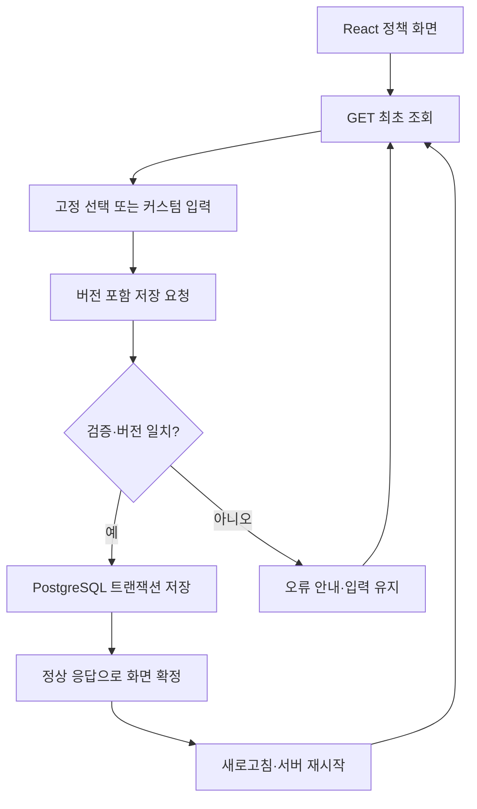

# T01~T04 구현 계약

> 이 문서는 PR #1 시점의 범위를 기록합니다. 후속 DEC 채택·업로드·삭제의 현재 계약은 [DEC 구현 문서](DEC_IMPLEMENTATION.md)를 따릅니다.

## 요청과 응답

| 메서드·경로 | 입력 | 성공 |
|---|---|---|
| GET `/api/policy` | 없음 | 200, 정책 전체, `ETag: "버전"`, `Cache-Control: no-store` |
| PUT `/api/policy/fixed/exe` | `If-Match: "0"`, `{"enabled":true}` | 200, 저장 후 정책 전체 |
| POST `/api/policy/custom` | 최신 If-Match, `{"extension":"sh"}` | 201, 저장 후 정책 전체 |

```json
{"version":0,"fixed":[{"id":1,"extension":"bat","enabled":false}],"custom":[],"customCount":0,"maxCount":200,"maxLength":20}
```

위 fixed 배열은 구조 설명용 축약입니다. 실제 응답은 7개 모두 포함합니다. PUT은 토글 명령이 아니라 원하는 최종 enabled 값을 전달합니다. 저장 트랜잭션이 끝난 정상 응답만 화면에 확정합니다.

오류는 `{"error":{"code":"...","message":"...","requestId":"..."}}`입니다. 잘못된 입력은 400, 미지원 고정 이름은 404, 중복·고정 이름 충돌·커스텀 한도는 409, 오래된 버전은 412, 버전 누락은 428, DB 장애는 503입니다. 5xx/네트워크 실패에서는 저장 여부를 추측하지 않고 최신 조회 전까지 수정을 잠급니다. 입력값은 실패 시 남깁니다. HTTP 응답을 받지 못한 쓰기를 자동 재시도하지 않습니다.

## 정책 상태: DEC 확정 전 임시안

과제의 고정 7종, 초기 미선택, 20자·커스텀 200개, 저장 지속성을 우선 구현했습니다. 다음은 최소 시험에서 검토할 **임시 구현 선택**이며 별도 DEC 승인으로 보지 않습니다.

| 항목 | 현재 구현 | 후속 결정 시 확인 |
|---|---|---|
| 입력 | 앞뒤 공백 제거, 선행 점 1개 제거, 소문자화, ASCII 영숫자 1~20자 | 유니코드·복합 확장자 허용 여부 |
| 중복 | 정규화 후 동일 이름 409 | 중복을 성공으로 취급할지 |
| 고정 이름의 커스텀 입력 | 409, 고정 체크 자동 변경 없음 | 화면 안내 문구와 업무 기대 |
| 한도 | 커스텀만 200개; 한도 검사 전 중복 판정 | 200번째/201번째 및 경쟁 시험은 후속 범위 |
| 정책 범위 | 로컬 단일 공용 정책 | 인증·조직/사용자별 권한 모델 |
| 동시 편집 | 행 잠금 + 버전 비교, 오래된 화면은 재조회 | 다중 탭 UX와 충돌 정책 |

## 영역별 고려와 구현 위치

| 영역 | 적용 | 현재 한계·다음 시험 |
|---|---|---|
| DB | unique(policy_id,extension), 이름/종류 CHECK, Flyway 최초 seed | 백업·복구, 200개 경쟁 추가는 후속 검증 |
| 서버 | 입력 검증, 준비된 파라미터, 원자적 변경·버전 증가 | 인증·인가·요청 제한은 공개 전 필요 |
| 프론트 | 로딩 Skeleton, 44px 컨트롤, 키보드·모바일, 상태 공지 | 읽기 장애·장시간 지연·다중 탭 UX 후속 |
| 배포 | 볼륨 유지, DB 비공개, loopback 바인딩, 비루트 Java | 공개 배포·TLS·실제 컨테이너 재생성 시험은 후속 |
| GitHub | PR 단위 코드·시험, Actions 결과·아티팩트 | 브랜치 보호 설정 변경은 이번 범위 아님 |

실제 업로드·삭제 API와 파일 저장소는 아직 없습니다. 확장자 UI를 구현한 것이 악성 파일 검사나 업로드 보안을 완성했다는 뜻은 아닙니다.

## 데이터 흐름


