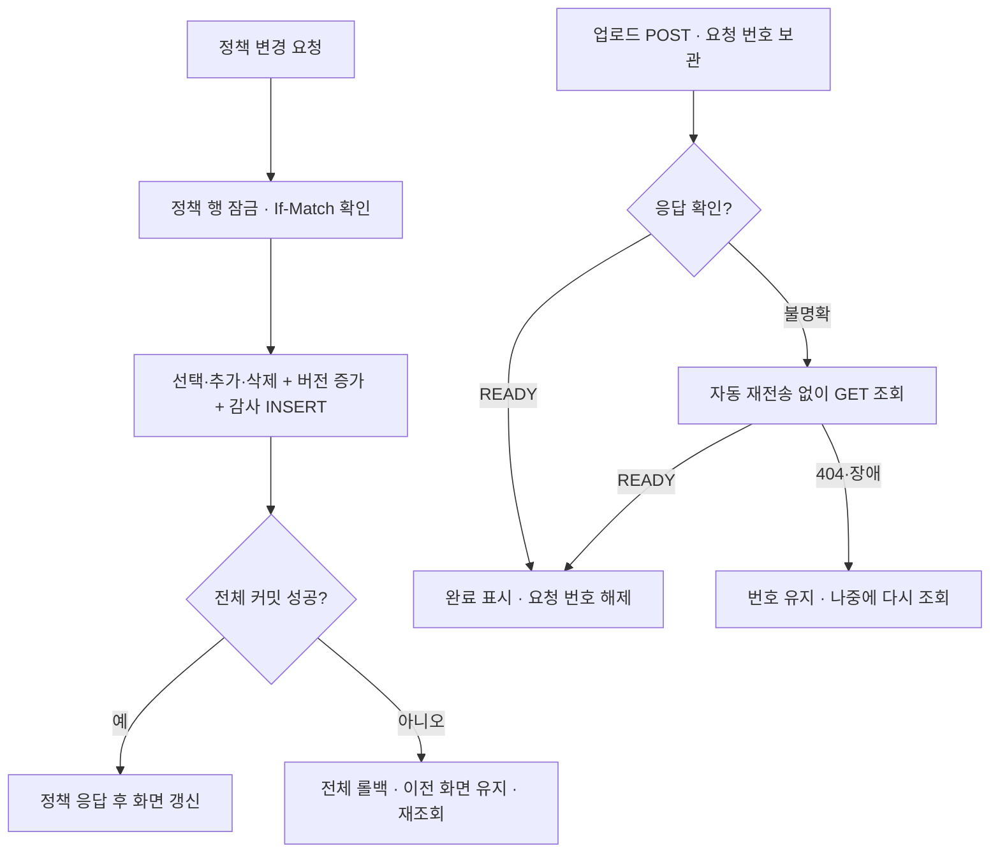

# UX·예외 권장초안 적용

사용자 요청: 가이드 UX·예외 관점의 DB·서버 필수/권장 항목, 프론트엔드 8.1의 FE-U01~06을 구현하고 PR을 작성한다. **FE-U07은 이번 신규 구현·완료 판정에서 제외한다.** 기존 label·버튼 이름·기존 회귀 시험을 삭제하는 의미로 해석하지 않는다.

핵심: 저장 실패를 성공으로 표시하지 않고, 불명확한 업로드는 재전송 대신 요청 번호로 조회하며, 정책 변경·버전·감사 기록을 함께 저장한다.

## 채택한 계약과 항목별 근거

| ID | 채택·구현 | 검증 근거 |
|---|---|---|
| DB-U01 필수 | 기존 V1의 고정 7행 false 초기값 유지. V3 추가 마이그레이션은 기존 선택·업로드 ID를 초기화하지 않음 | PolicyApiTest.initialPolicy, 재시작 T01~T04 |
| DB-U02 권장 | 정책/버전/감사 저장 중 오류가 나면 롤백, 503이며 성공 응답 없음 | 감사 INSERT·버전 UPDATE 장애 주입 뒤 기존 값 확인 |
| DB-U03 권장 | 최신 버전으로 같은 커스텀 ID 재삭제 시 404 CUSTOM_NOT_FOUND. 버전·감사 증가 없음. 오래된 버전은 먼저 412 | 재삭제 계약 시험 |
| DB-U04 권장 | 고정 변경·추가·삭제와 버전 증가·policy_change 감사 INSERT를 하나의 트랜잭션으로 처리 | 감사 실패 때 세 종류 변경 모두 롤백 |
| BE-U01 필수 | 422 EXTENSION_BLOCKED, 판단 확장자와 적용 정책 버전 제공 | 실제 정책 EXE 차단·해제 API/브라우저 회귀 |
| BE-U02 권장 | 400 INVALID_EXTENSION에 field=extension과 영문·숫자 1~20자 안내 | 공백 입력 계약 시험 |
| BE-U03 권장 | 201번째 커스텀 추가 409 CUSTOM_LIMIT_REACHED, 중복/고정 충돌은 별도 코드 | 기존 200개 한도·1910개 경쟁 시험 |
| BE-U04 권장 | Nginx·multipart·서비스 크기 오류는 413 UPLOAD_SIZE_LIMIT과 같은 일반 안내. 내부 경로 없음 | 실제 앱 HTTP 10 MiB 경계 + 별도 실제 Nginx 요청 헤더 12 MiB+1 거부 시험 |
| BE-U05 권장 | 내부 예외는 서버에 기록, 응답은 일반 안내·오류 추적 ID. 업로드 읽기 예외도 일반 오류로 변환 | 파일 읽기/이동 장애 및 DB 감사 장애의 응답 정보 비노출 검사 |
| BE-U06 권장 | 업로드 전에 클라이언트 UUID 요청 번호 생성. 응답 불명확 시 GET 조회, 자동 POST 재전송 금지. 15초 클라이언트 제한 | 실제 저장 후 응답 차단 → 새로고침 → 동일 결과 GET 조회, POST 1회 확인 |
| FE-U01 필수 | 조회 전 체크박스 편집 불가, 조회한 true 그대로 표시 | 지연된 최초 true 응답 시험 |
| FE-U02 권장 | 저장 중 편집 비활성화·저장 중 안내, 중복 쓰기 잠금 | 빠른 재클릭에도 요청 1회 |
| FE-U03 권장 | 성공 응답 후 상태 확정, 실패는 이전 값 유지. 결과 불명확 시 재조회 | 기존 저장 503 시험 |
| FE-U04 권장 | 추가 실패 입력 보존, 입력 바로 아래 오류 안내 | 기존 중복 실패 시험에 필드 근처 안내 검증 추가 |
| FE-U05 필수 | 삭제 성공 후 제거, 실패 시 태그·개수 유지 | 실패 503 후 유지·재조회 시험 + 실서버 삭제 유지 |
| FE-U06 권장 | 조회 중·조회 실패·빈 목록을 구별하고 재조회 제공 | 최초 조회 실패에서 빈 목록 문구 미표시, 재조회 성공 뒤 빈 목록 표시 |
| FE-U07 제외 | 신규 키보드·화면 읽기 기능 작업은 제외 | 기존 동작·기존 모바일 회귀 시험은 유지 |

## DB 변경

V3 `policy_change`: 정책 ID(FK), 변경 후 버전, 동작, 확장자, enabled, 시각을 기록한다. `(policy_id, policy_version)` 유일 제약의 선두 열로 FK 검색도 지원한다. 공개 사용자 인증이 없으므로 사용자 주체를 지어내어 기록하지 않는다. PR 이전 변경 이력을 소급 생성하지 않는다. 보관 기간·총량의 공개 운영 결정은 별도로 남는다.

V3 `upload_record.request_id`: 기존 행은 자신의 파일 ID로 채우고 NOT NULL·UNIQUE를 추가한다. 파일 ID와 실제 UUID.bin은 바꾸지 않는다. 원래 파일명이나 본문을 조회 키로 사용하지 않는다.

## 응답 유실 계약

1. 화면이 UUID를 생성해 `X-Upload-Request-Id` 헤더로 POST한다. 헤더 없는 기존 호출은 서버가 UUID를 생성한다. 성공 본문은 `requestId`를 함께 반환한다.
2. 화면은 요청 전 번호를 sessionStorage에 보관한다. 네트워크 오류·5xx·잘못된 성공 응답·이미 사용된 번호 409는 결과 불명확으로 유지한다. 이 번호는 오류 추적용 `error.requestId`와 구분한다.
3. **GET `/api/uploads/status/{requestId}`**는 커밋된 READY 메타데이터만 반환한다. 파일 본문과 내부 경로는 제공하지 않는다. 성공·오류 모두 no-store다.
4. 404 `UPLOAD_NOT_CONFIRMED`는 처리 중·실패·미도착을 구별할 수 없으므로 실패 확정이나 자동 재전송 근거가 아니다. 조회 오류도 요청 번호를 유지한다. 새로고침 후에도 조회할 수 있다.
5. 동일 요청 번호로 재업로드하면 409다. DB UNIQUE는 경쟁 요청도 보호하고 알려진 롤백에서는 해당 시도의 파일을 정리한다. 자동 재시도·덮어쓰기 기능은 추가하지 않았다.
6. 사용자가 미확인 요청을 닫으려면 이전 업로드가 뒤늦게 저장될 수 있음을 확인하고 새 업로드를 준비한다. sessionStorage가 차단되면 새로고침 복원은 제한되지만 현재 화면의 번호로 수동 조회할 수 있다. 브라우저를 닫은 뒤 복원은 보장하지 않는다.

## 실행·시험 범위

- 로컬: `node --test frontend/src/lib/api.test.js` 10개 통과. 로컬 Docker 엔진이 연결되지 않아 PostgreSQL·Nginx·브라우저 시험은 실행하지 못했다.
- CI 대상: 서버 210개(정책 11 + 업로드 서비스 2 + 업로드 API 16), Node 10개, 브라우저 11개, 실제 두 JVM 재시작 T01~T04, Vite build, Compose config, Nginx 413 계약. 최종 실행의 실제 결과·URL은 이번 PR 본문과 Checks에서 확인한다. 이 수치는 실행 전 구성 수이며 통과 선언이 아니다.
- 새 실제 Nginx 시험은 같은 nginx.conf·동일 이미지 태그를 사용해 과대 Content-Length의 JSON 413을 검사한다. 앱 10 MiB 경계와 별개다. 전체 앱의 Docker 이미지 빌드·Compose 기동·컨테이너 재생성 또는 공개 배포 시험으로 확대 해석하지 않는다.
- 강제 종료·불명확한 DB 커밋·디스크 정리 실패는 기존 수동 DB/파일 대조 절차를 따른다. 인증·악성코드 검사·공개 배포·보관/총량 정책은 이번 범위 밖이다.

## 변경 흐름

