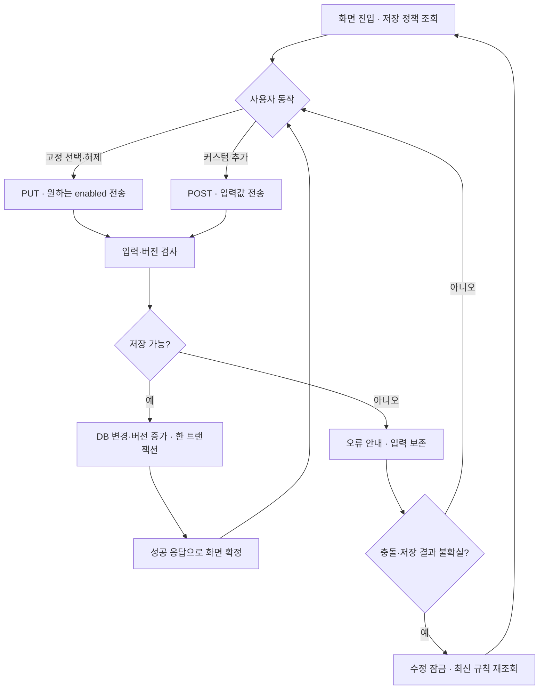
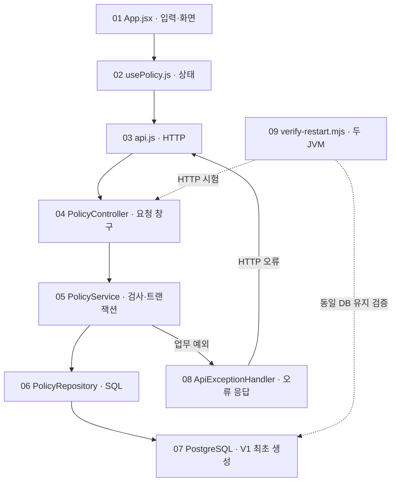
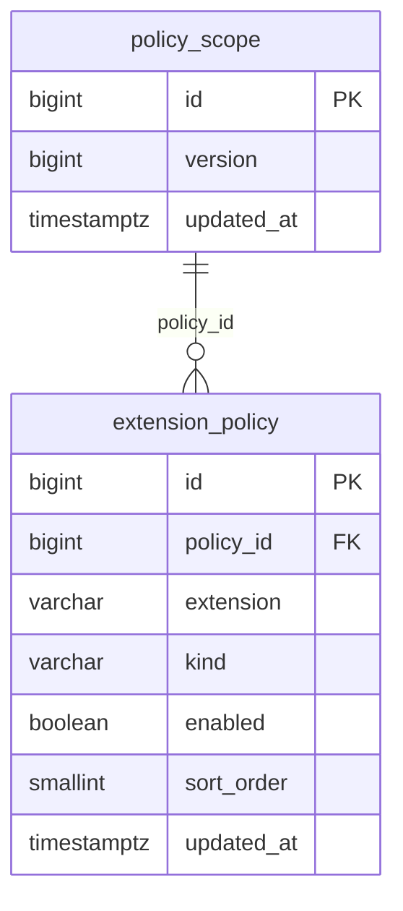

# PR #1 구현 결과 보고서

**구현 핵심 1줄:** 고정 확장자 선택과 커스텀 추가를 PostgreSQL에 저장하고, 새로고침·서버 재시작 후에도 같은 규칙을 유지하도록 구현했습니다.

## 진행 과정 3줄

1. 먼저 DB에 고정 확장자 7종을 모두 미선택으로 만들고, React 화면에서 서버에 저장된 값을 불러오게 했습니다.
2. 사용자가 체크하거나 sh를 추가하면 Spring Boot가 입력·버전을 검사해 DB에 저장하고, 성공 응답을 받은 뒤 화면을 바꾸게 했습니다.
3. 마지막으로 새로고침과 실제 서버 재시작을 실행해 값이 남는지 확인하고, 오류·모바일 동작까지 CI에서 시험했습니다.

| 대상 | 기준·읽는 방법 |
|---|---|
| 구현 범위 | T01~T04 · [PR #1](https://github.com/feed-mina/flow_fileupload_AI/pull/1) |
| 분석 기준 | PR의 최종 구현 커밋 `7e0ec56389e5cfa740fa3153dbfcb62af08208c8`. PR은 현재 병합 완료 상태이며, 아래 링크는 당시 코드로 고정했습니다. |
| 보고서 활용 | 흐름도 → 번호별 소스 → 시험 결과 순서로 읽습니다. |
| 클릭형 관계도 | 함께 제공한 HTML에서 오른쪽 노드를 누르면 왼쪽 소스·함수·설명이 바뀝니다. Markdown은 아래 GitHub 링크 표를 사용합니다. |

## 1. 사용자의 동작이 저장되는 흐름

정상 응답은 정책 전체를 돌려줍니다. 저장 성공 시 화면이 갱신되고, 커스텀 입력칸은 비워집니다. 네트워크·5xx·응답 구조 오류 또는 412·428에서는 최신 조회가 끝날 때까지 편집을 막습니다. 단순 입력·중복 오류는 입력을 보존해 수정할 수 있습니다.

## 2. 관련 소스 연결

실선은 주요 호출·오류 전달 관계, 점선은 시험의 검증 관계입니다. 정상 정책 응답은 Repository → Service → Controller → api → usePolicy → App 순서로 돌아옵니다. V1 파일은 최초 생성 규칙이며, 매 요청에서 실행되는 파일이 아닙니다.

### 번호별 GitHub 소스 위치

| 번호·역할 | GitHub 소스·함수 | 구현 핵심 |
|---|---|---|
| 01 · 선택·입력을 받는 화면 | [App.jsx](https://github.com/feed-mina/flow_fileupload_AI/blob/7e0ec56389e5cfa740fa3153dbfcb62af08208c8/frontend/src/App.jsx#L5-L14) · `App / submit` | 고정 체크박스와 커스텀 입력칸을 그립니다. 화면 값은 서버에서 받은 정책을 따릅니다. |
| 02 · 저장 중·성공·실패를 관리 | [usePolicy.js](https://github.com/feed-mina/flow_fileupload_AI/blob/7e0ec56389e5cfa740fa3153dbfcb62af08208c8/frontend/src/usePolicy.js#L42-L67) · `usePolicy / refresh / mutate` | 조회와 저장을 묶고 화면 상태를 관리합니다. 서버 성공 응답 전에는 체크값을 확정하지 않습니다. |
| 03 · HTTP 요청·응답을 변환 | [api.js](https://github.com/feed-mina/flow_fileupload_AI/blob/7e0ec56389e5cfa740fa3153dbfcb62af08208c8/frontend/src/lib/api.js#L26-L38) · `request / getPolicy / setFixed / addCustom` | 화면 요청을 서버가 읽을 JSON으로 바꾸고, 실패 응답을 오류로 전달합니다. |
| 04 · 서버 요청 창구 | [PolicyController.java](https://github.com/feed-mina/flow_fileupload_AI/blob/7e0ec56389e5cfa740fa3153dbfcb62af08208c8/backend/src/main/java/dev/mina/flow/policy/PolicyController.java#L16-L33) · `get / setFixed / addCustom / response` | URL과 요청 내용을 서비스 함수로 연결하고 HTTP 상태·버전 헤더를 붙입니다. |
| 05 · 저장 조건과 트랜잭션 | [PolicyService.java](https://github.com/feed-mina/flow_fileupload_AI/blob/7e0ec56389e5cfa740fa3153dbfcb62af08208c8/backend/src/main/java/dev/mina/flow/policy/PolicyService.java#L32-L50) · `get / setFixed / addCustom / checkVersion` | 고정 이름·입력·중복·한도와 최신 버전을 검사한 뒤, 변경과 버전 증가를 한 번에 저장합니다. |
| 06 · SQL로 DB를 읽고 변경 | [PolicyRepository.java](https://github.com/feed-mina/flow_fileupload_AI/blob/7e0ec56389e5cfa740fa3153dbfcb62af08208c8/backend/src/main/java/dev/mina/flow/policy/PolicyRepository.java#L29-L49) · `snapshot / lockVersion / setFixed / addCustom / advanceVersion` | 실제 SQL을 실행합니다. 프론트 입력을 SQL 문자열에 직접 붙이지 않고 파라미터로 전달합니다. |
| 07 · 최초 데이터와 저장 구조 | [V1__policy_schema.sql](https://github.com/feed-mina/flow_fileupload_AI/blob/7e0ec56389e5cfa740fa3153dbfcb62af08208c8/backend/src/main/resources/db/migration/V1__policy_schema.sql#L22-L30) · `policy_scope / extension_policy / V1 migration` | Flyway가 새 DB에 테이블과 최초 데이터를 한 번 생성합니다. 다시 켤 때 기존 선택을 초기화하지 않습니다. |
| 08 · 오류를 일관되게 응답 | [ApiExceptionHandler.java](https://github.com/feed-mina/flow_fileupload_AI/blob/7e0ec56389e5cfa740fa3153dbfcb62af08208c8/backend/src/main/java/dev/mina/flow/policy/ApiExceptionHandler.java#L18-L35) · `policy / invalid / database` | 업무 오류·입력 오류·DB 질의 오류에 코드와 안내 문구를 붙여 돌려줍니다. |
| 09 · 실제 재시작을 시험 | [verify-restart.mjs](https://github.com/feed-mina/flow_fileupload_AI/blob/7e0ec56389e5cfa740fa3153dbfcb62af08208c8/scripts/verify-restart.mjs#L81-L96) · `start / stop / T01~T04 assertions` | 시험용 동일 PostgreSQL에 두 Java 프로세스를 차례로 연결해 저장 지속성을 확인합니다. |

## 3. 값 하나가 화면·서버·DB를 오가는 방식

| 화면에서 한 일 | 보낸 값 | 저장 처리 | 다시 표시하는 값 |
|---|---|---|---|
| exe 체크 | PUT `/api/policy/fixed/exe`, `{"enabled":true}`, 최신 If-Match | `extension_policy.enabled` 변경, `policy_scope.version` 증가 | `fixed`에서 exe의 `enabled` → 체크박스 |
| sh 추가 | POST `/api/policy/custom`, `{"extension":"sh"}`, 최신 If-Match | CUSTOM 행 INSERT, enabled=true, version 증가 | `custom` → 태그, `customCount` → 1/200 |
| 새로고침 | GET `/api/policy` | 기존 DB 조회 | fixed·custom·개수 재표시 |
| 서버 재시작 | 다시 GET `/api/policy` | Flyway 적용 이력 확인, 기존 행 조회 | 재시작 전의 선택·커스텀 유지 |

If-Match는 “이 버전을 보고 수정했다”는 요청 헤더입니다. 저장은 정책 행을 잠그고 현재 버전과 비교하므로 오래된 화면이 최신 값을 덮어쓰지 못합니다. 요청 헤더는 `"0"`처럼 따옴표가 있는 버전 문자열입니다.

## 4. 함수별 입력·처리·결과

### 01 · 선택·입력을 받는 화면

고정 체크박스와 커스텀 입력칸을 그립니다. 화면 값은 서버에서 받은 정책을 따릅니다.

- 소스: [frontend/src/App.jsx](https://github.com/feed-mina/flow_fileupload_AI/blob/7e0ec56389e5cfa740fa3153dbfcb62af08208c8/frontend/src/App.jsx#L5-L14)
- 입력: usePolicy의 policy·loading·pending·error, 사용자가 쓴 extension
- 처리: 체크 변경은 updateFixed에 전달하고, 추가는 createCustom을 기다립니다. 성공할 때만 입력칸을 비웁니다.
- 반환·부수 효과: 함수는 화면 요소를 반환합니다. submit의 부수 효과는 성공 후 입력값 초기화입니다.
- 화면 연결: 체크 상태·sh 태그·개수·오류 안내

### 02 · 저장 중·성공·실패를 관리

조회와 저장을 묶고 화면 상태를 관리합니다. 서버 성공 응답 전에는 체크값을 확정하지 않습니다.

- 소스: [frontend/src/usePolicy.js](https://github.com/feed-mina/flow_fileupload_AI/blob/7e0ec56389e5cfa740fa3153dbfcb62af08208c8/frontend/src/usePolicy.js#L42-L67)
- 입력: 고정 이름과 원하는 enabled 값, 또는 커스텀 입력값; 현재 policy.version
- 처리: 조회 취소·중복 쓰기 차단 → 요청 → 성공 정책 반영. 네트워크/5xx/응답 오류와 412·428에서는 재조회 전 수정을 잠급니다.
- 반환·부수 효과: 상태와 실행 함수를 가진 객체. mutate는 성공 true, 실패·실행 불가 false를 반환합니다.
- 화면 연결: 로딩 표시·저장 안내·수정 잠금·재조회 버튼

### 03 · HTTP 요청·응답을 변환

화면 요청을 서버가 읽을 JSON으로 바꾸고, 실패 응답을 오류로 전달합니다.

- 소스: [frontend/src/lib/api.js](https://github.com/feed-mina/flow_fileupload_AI/blob/7e0ec56389e5cfa740fa3153dbfcb62af08208c8/frontend/src/lib/api.js#L26-L38)
- 입력: extension, enabled, version 또는 조회 취소 signal
- 처리: GET/PUT/POST 수행. 쓰기에 If-Match를 붙이고 JSON·HTTP 상태와 정책 응답의 기본 구조를 검사합니다.
- 반환·부수 효과: 정책 객체의 Promise. 실패하면 status·code를 가진 ApiError를 던집니다.
- 화면 연결: usePolicy가 정상 값과 오류를 구분하는 근거

### 04 · 서버 요청 창구

URL과 요청 내용을 서비스 함수로 연결하고 HTTP 상태·버전 헤더를 붙입니다.

- 소스: [backend/src/main/java/dev/mina/flow/policy/PolicyController.java](https://github.com/feed-mina/flow_fileupload_AI/blob/7e0ec56389e5cfa740fa3153dbfcb62af08208c8/backend/src/main/java/dev/mina/flow/policy/PolicyController.java#L16-L33)
- 입력: 경로 extension, JSON enabled 또는 extension, If-Match 헤더
- 처리: 고정 enabled 누락을 검증하고 PolicyService 호출. 응답에 ETag와 no-store를 추가합니다.
- 반환·부수 효과: ResponseEntity<PolicyView>. 조회·고정 변경 200, 커스텀 생성 201.
- 화면 연결: API 클라이언트가 받는 정책 전체 응답

### 05 · 저장 조건과 트랜잭션

고정 이름·입력·중복·한도와 최신 버전을 검사한 뒤, 변경과 버전 증가를 한 번에 저장합니다.

- 소스: [backend/src/main/java/dev/mina/flow/policy/PolicyService.java](https://github.com/feed-mina/flow_fileupload_AI/blob/7e0ec56389e5cfa740fa3153dbfcb62af08208c8/backend/src/main/java/dev/mina/flow/policy/PolicyService.java#L32-L50)
- 입력: 고정 이름·최종 enabled 또는 커스텀 문자열; ifMatch
- 처리: 공용 정책 행 잠금 → 버전 비교 → 변경 → 버전 증가 → 전체 조회. 커스텀은 정규화 후 고정 충돌·중복·200개 한도를 검사합니다.
- 반환·부수 효과: PolicyView. 실패 시 PolicyException으로 트랜잭션을 되돌립니다. 조회는 REPEATABLE_READ입니다.
- 화면 연결: 성공 응답을 통해 체크·태그·카운트 갱신

### 06 · SQL로 DB를 읽고 변경

실제 SQL을 실행합니다. 프론트 입력을 SQL 문자열에 직접 붙이지 않고 파라미터로 전달합니다.

- 소스: [backend/src/main/java/dev/mina/flow/policy/PolicyRepository.java](https://github.com/feed-mina/flow_fileupload_AI/blob/7e0ec56389e5cfa740fa3153dbfcb62af08208c8/backend/src/main/java/dev/mina/flow/policy/PolicyRepository.java#L29-L49)
- 입력: 서비스가 검증한 확장자·활성값
- 처리: policy_scope 버전 잠금·증가, extension_policy UPDATE/INSERT, 고정·커스텀 목록 조회.
- 반환·부수 효과: snapshot은 PolicyView, lockVersion은 long, 변경 메서드는 void이며 DB 변경이 부수 효과입니다.
- 화면 연결: fixed·custom·customCount의 실제 저장 근거

### 07 · 최초 데이터와 저장 구조

Flyway가 새 DB에 테이블과 최초 데이터를 한 번 생성합니다. 다시 켤 때 기존 선택을 초기화하지 않습니다.

- 소스: [backend/src/main/resources/db/migration/V1__policy_schema.sql](https://github.com/feed-mina/flow_fileupload_AI/blob/7e0ec56389e5cfa740fa3153dbfcb62af08208c8/backend/src/main/resources/db/migration/V1__policy_schema.sql#L22-L30)
- 입력: 새 DB와 아직 적용되지 않은 V1 마이그레이션
- 처리: 정책 1행·고정 7행(false) 생성. policy_id 외래키, 이름 UNIQUE, 종류·확장자 CHECK 제약 적용.
- 반환·부수 효과: 영속 테이블·초기 행 생성. SQL 실행 자체는 화면 데이터 객체를 반환하지 않습니다.
- 화면 연결: 첫 화면의 7개 미선택과 재시작 후 저장 값 유지

### 08 · 오류를 일관되게 응답

업무 오류·입력 오류·DB 질의 오류에 코드와 안내 문구를 붙여 돌려줍니다.

- 소스: [backend/src/main/java/dev/mina/flow/policy/ApiExceptionHandler.java](https://github.com/feed-mina/flow_fileupload_AI/blob/7e0ec56389e5cfa740fa3153dbfcb62af08208c8/backend/src/main/java/dev/mina/flow/policy/ApiExceptionHandler.java#L18-L35)
- 입력: PolicyException / BindException / HttpMessageNotReadableException / DataAccessException
- 처리: 업무 상태 그대로, 입력 오류 400, DataAccessException 503. DB 상세 예외는 서버 로그에 남깁니다.
- 반환·부수 효과: error.code·message·requestId를 담은 ResponseEntity<Failure>. 모든 예외를 이 클래스가 처리하는 것은 아닙니다.
- 화면 연결: API → usePolicy → App의 오류 안내와 입력 보존

### 09 · 실제 재시작을 시험

시험용 동일 PostgreSQL에 두 Java 프로세스를 차례로 연결해 저장 지속성을 확인합니다.

- 소스: [scripts/verify-restart.mjs](https://github.com/feed-mina/flow_fileupload_AI/blob/7e0ec56389e5cfa740fa3153dbfcb62af08208c8/scripts/verify-restart.mjs#L81-L96)
- 입력: 격리된 flow_smoke DB, 빌드된 flow-policy.jar
- 처리: 최초 값 → exe=true → exe=false와 scr=true 저장 → 종료·재실행 → 버전·행 ID 비교 → sh 추가·재조회.
- 반환·부수 효과: PASS T01~T04 로그, JSON·서버 로그. 조건이 다르면 assert 실패.
- 화면 연결: 화면 표시가 아니라 CI 검증 근거를 생성

## 5. DB 관계와 재시작 유지

정책 1행에 여러 확장자 행이 연결됩니다. `policy_id`는 실제 외래키이며, `(policy_id, extension)`은 UNIQUE입니다. `kind`는 FIXED/CUSTOM을 구분하고, `enabled`는 고정 체크 상태입니다. 커스텀 행은 활성 상태로 생성됩니다.

재시작 시 초기값으로 전부 리셋되는 버그는 `exe=false`만 검사하면 놓칠 수 있습니다. 따라서 시험은 `scr=true`도 함께 남기고, 정책 버전과 고정 행 ID까지 비교합니다. Docker Compose에는 DB 볼륨 유지 설정이 있지만, 이번 성공 근거는 실제 두 Java 프로세스 재시작 시험입니다.

## 6. 구현 결과와 시험 근거

| 시나리오 | 실행 | 확인한 결과 | 상태 |
|---|---|---|---|
| T01 | 새 DB로 최초 진입 | 고정 7종 모두 false, 커스텀 0개 | PASS |
| T02 | exe 선택 → 새로고침·재조회 | exe=true 유지, DB 저장 확인 | PASS |
| T03 | exe 해제·scr 선택 → 서버 종료·재실행 | exe=false, scr=true, 버전·행 ID 유지 | PASS |
| T04 | sh 추가 → 재조회·새로고침 | sh 목록 유지, customCount=1 | PASS |

[최종 GitHub Actions 실행](https://github.com/feed-mina/flow_fileupload_AI/actions/runs/39890503757)에서 PostgreSQL 통합 6개, API 클라이언트 4개, Chromium 브라우저 4개와 실제 재시작 T01~T04가 통과했습니다. 빌드와 Docker Compose 구성 문법 검사도 성공했습니다. 이 보고서 작성 중 앱 시험을 새로 실행한 것은 아니며, PR의 기존 실행 결과를 확인했습니다.

브라우저 첫 시험은 실제 서버·별도 DB를 사용합니다. 나머지 세 시험은 API 응답을 모킹해 저장 503, 중복 409, 좁은 화면의 키보드 조작을 검증합니다. 통합 시험 skip 0, 브라우저 retry 0입니다.

| 관련 파일 | GitHub에서 확인 | 범위 |
|---|---|---|
| API 통합 시험 | [backend/src/test/java/dev/mina/flow/policy/PolicyApiTest.java](https://github.com/feed-mina/flow_fileupload_AI/blob/7e0ec56389e5cfa740fa3153dbfcb62af08208c8/backend/src/test/java/dev/mina/flow/policy/PolicyApiTest.java) | 실제 PostgreSQL + Testcontainers, 6개 |
| 브라우저 시험 | [frontend/e2e/policy.spec.js](https://github.com/feed-mina/flow_fileupload_AI/blob/7e0ec56389e5cfa740fa3153dbfcb62af08208c8/frontend/e2e/policy.spec.js) | 실서버 경로 1개 + 오류·모바일 모킹 경로 3개 |
| API 클라이언트 시험 | [frontend/src/lib/api.test.js](https://github.com/feed-mina/flow_fileupload_AI/blob/7e0ec56389e5cfa740fa3153dbfcb62af08208c8/frontend/src/lib/api.test.js) | 요청·HTTP 오류·깨진 응답 4개 |
| 응답 필드 정의 | [backend/src/main/java/dev/mina/flow/policy/PolicyView.java](https://github.com/feed-mina/flow_fileupload_AI/blob/7e0ec56389e5cfa740fa3153dbfcb62af08208c8/backend/src/main/java/dev/mina/flow/policy/PolicyView.java) | version·fixed·custom·customCount·maxCount·maxLength |
| Docker 구성 | [compose.yml](https://github.com/feed-mina/flow_fileupload_AI/blob/7e0ec56389e5cfa740fa3153dbfcb62af08208c8/compose.yml) | DB 볼륨과 서비스 연결; 실제 기동은 미검증 |
| 자동 시험 실행 | [.github/workflows/ci.yml](https://github.com/feed-mina/flow_fileupload_AI/blob/7e0ec56389e5cfa740fa3153dbfcb62af08208c8/.github/workflows/ci.yml) | 빌드·DB·재시작·브라우저 시험과 결과 업로드 |

## 7. 남은 범위와 유지보수 확인

- 실제 파일 업로드 차단·커스텀 삭제·인증은 PR #1의 구현 범위 밖입니다.
- 입력 정규화·중복·동시 편집의 세부 정책은 DEC 확정 전 임시안입니다.
- 실제 Docker 이미지 빌드·Compose 기동·컨테이너 재생성은 미검증입니다.
- 체크가 돌아오면 `App → usePolicy → api → Controller → Service → Repository` 순서로 응답과 버전을 확인합니다.
- 재시작 후 값이 바뀌면 DB 연결 대상·Flyway 이력·DB 볼륨을 확인하고, 미선택 기본값만으로 성공을 판정하지 않습니다.
