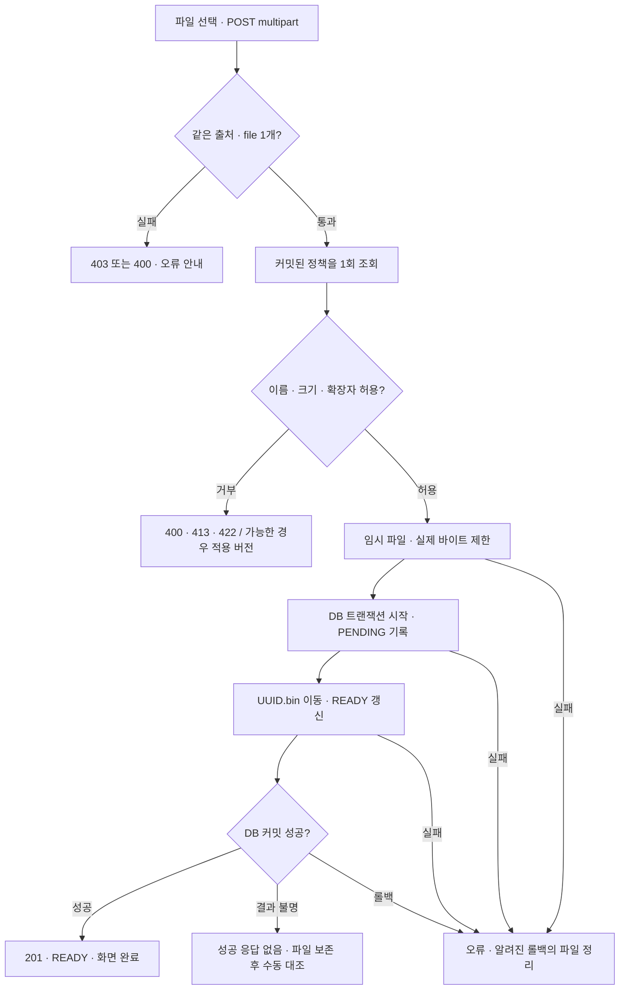
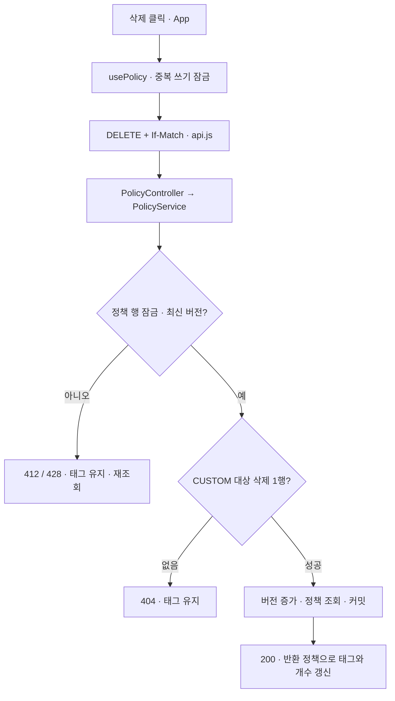
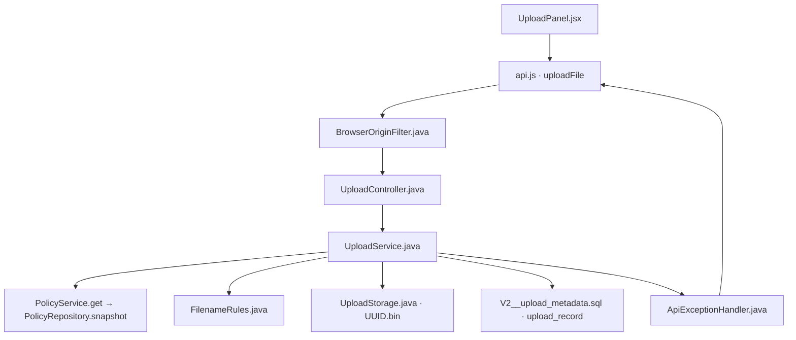
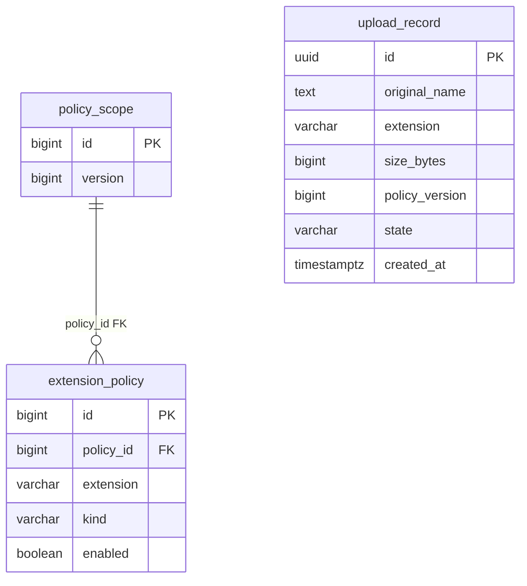

# PR #2 구현 결과 보고서

- 대상: [PR #2](https://github.com/feed-mina/flow_fileupload_AI/pull/2) · 확인 시점 병합 완료 (2026-10-23)
- 소스 기준: `65f2db5bcedac8b38698e29da25c22a48a98eb5c` · 모든 소스 링크는 이 커밋으로 고정
- 실행 근거: [최종 Actions 실행](https://github.com/feed-mina/flow_fileupload_AI/actions/runs/39898997556) · completed / success

## 구현 핵심 · 1줄

서버가 파일명·크기·차단 확장자를 검사해 안전한 경로에 저장하고, 커스텀 삭제까지 최신 정책 버전에 맞춰 처리하도록 구현했습니다.

## 진행 과정 · 3줄

1. DEC 권장초안을 파일 1개·10 MiB·파일명 규칙으로 구체화하고, React 업로드 화면과 커스텀 삭제 버튼을 연결했습니다.
2. Spring Boot가 저장된 정책으로 파일을 검사하고 UUID 파일과 적용 버전을 기록하며, DB 커밋이 끝난 뒤에만 완료를 알려주게 했습니다.
3. 크기 초과·DB/파일 장애·정책 충돌을 시험하며 문제를 수정하고, 기존 재시작 시나리오를 포함한 최종 CI 통과 후 PR #2에 반영했습니다.

## PR1에서 PR2로 바뀐 부분

PR1의 정책 선택·저장·재시작 유지·커스텀 추가를 유지하면서, 실제 업로드 검증·저장과 커스텀 삭제를 추가했습니다. 기존 입력 검증·충돌 처리는 재사용하고 Unicode 검사 순서, 프록시 Host 전달, 크기 초과 오류 처리를 보완했습니다.

기술 스택: React + Ant Design / Spring Boot + JDBC·Flyway / PostgreSQL / Docker·Nginx 구성 / Git·GitHub Actions.

## 파일 업로드 플로우차트

## 커스텀 삭제 플로우차트

## 업로드 소스 관계 다이어그램

다이어그램의 파일명에 대응하는 실제 위치는 아래 표에서 클릭할 수 있습니다. 클릭형 HTML에서는 **오른쪽 노드를 누르면 왼쪽에 파일·함수·입력·처리·결과·실제 코드와 GitHub 링크**가 표시됩니다.

## 소스 위치 · 클릭해서 코드 보기

| 역할 | 실제 소스·줄 위치 | 함수·클래스 |
|---|---|---|
| 파일 선택·업로드 화면 | [frontend/src/UploadPanel.jsx L10–24](https://github.com/feed-mina/flow_fileupload_AI/blob/65f2db5bcedac8b38698e29da25c22a48a98eb5c/frontend/src/UploadPanel.jsx#L10-L24) | `UploadPanel / submit` |
| 업로드·삭제 HTTP 요청 | [frontend/src/lib/api.js L42–53](https://github.com/feed-mina/flow_fileupload_AI/blob/65f2db5bcedac8b38698e29da25c22a48a98eb5c/frontend/src/lib/api.js#L42-L53) | `uploadFile / deleteCustom / request` |
| 브라우저 출처 검사 | [backend/src/main/java/dev/mina/flow/BrowserOriginFilter.java L17–28](https://github.com/feed-mina/flow_fileupload_AI/blob/65f2db5bcedac8b38698e29da25c22a48a98eb5c/backend/src/main/java/dev/mina/flow/BrowserOriginFilter.java#L17-L28) | `doFilterInternal` |
| multipart 요청 구조 검사 | [backend/src/main/java/dev/mina/flow/upload/UploadController.java L19–32](https://github.com/feed-mina/flow_fileupload_AI/blob/65f2db5bcedac8b38698e29da25c22a48a98eb5c/backend/src/main/java/dev/mina/flow/upload/UploadController.java#L19-L32) | `upload` |
| 정책 판정·저장 조율 | [backend/src/main/java/dev/mina/flow/upload/UploadService.java L51–69](https://github.com/feed-mina/flow_fileupload_AI/blob/65f2db5bcedac8b38698e29da25c22a48a98eb5c/backend/src/main/java/dev/mina/flow/upload/UploadService.java#L51-L69) | `upload / transactions.execute / cleanup` |
| 파일명·확장자 규칙 | [backend/src/main/java/dev/mina/flow/upload/FilenameRules.java L9–27](https://github.com/feed-mina/flow_fileupload_AI/blob/65f2db5bcedac8b38698e29da25c22a48a98eb5c/backend/src/main/java/dev/mina/flow/upload/FilenameRules.java#L9-L27) | `extension` |
| UUID 파일 저장 | [backend/src/main/java/dev/mina/flow/upload/UploadStorage.java L20–43](https://github.com/feed-mina/flow_fileupload_AI/blob/65f2db5bcedac8b38698e29da25c22a48a98eb5c/backend/src/main/java/dev/mina/flow/upload/UploadStorage.java#L20-L43) | `temporary / destination / copy / publish` |
| 업로드 메타데이터 | [backend/src/main/resources/db/migration/V2__upload_metadata.sql L1–11](https://github.com/feed-mina/flow_fileupload_AI/blob/65f2db5bcedac8b38698e29da25c22a48a98eb5c/backend/src/main/resources/db/migration/V2__upload_metadata.sql#L1-L11) | `upload_record` |
| 일관된 오류 응답 | [backend/src/main/java/dev/mina/flow/policy/ApiExceptionHandler.java L31–38](https://github.com/feed-mina/flow_fileupload_AI/blob/65f2db5bcedac8b38698e29da25c22a48a98eb5c/backend/src/main/java/dev/mina/flow/policy/ApiExceptionHandler.java#L31-L38) | `database / upload / tooLarge` |
| 커스텀 삭제 버튼 | [frontend/src/App.jsx L46–49](https://github.com/feed-mina/flow_fileupload_AI/blob/65f2db5bcedac8b38698e29da25c22a48a98eb5c/frontend/src/App.jsx#L46-L49) | `App / removeCustom 연결` |
| 성공 후 화면 갱신 | [frontend/src/usePolicy.js L42–66](https://github.com/feed-mina/flow_fileupload_AI/blob/65f2db5bcedac8b38698e29da25c22a48a98eb5c/frontend/src/usePolicy.js#L42-L66) | `mutate / removeCustom` |
| 삭제 API 입구 | [backend/src/main/java/dev/mina/flow/policy/PolicyController.java L32–39](https://github.com/feed-mina/flow_fileupload_AI/blob/65f2db5bcedac8b38698e29da25c22a48a98eb5c/backend/src/main/java/dev/mina/flow/policy/PolicyController.java#L32-L39) | `deleteCustom / response` |
| 버전 확인·삭제 트랜잭션 | [backend/src/main/java/dev/mina/flow/policy/PolicyService.java L50–59](https://github.com/feed-mina/flow_fileupload_AI/blob/65f2db5bcedac8b38698e29da25c22a48a98eb5c/backend/src/main/java/dev/mina/flow/policy/PolicyService.java#L50-L59) | `deleteCustom / checkVersion / normalize` |
| 조건을 제한한 삭제 SQL | [backend/src/main/java/dev/mina/flow/policy/PolicyRepository.java L50–52](https://github.com/feed-mina/flow_fileupload_AI/blob/65f2db5bcedac8b38698e29da25c22a48a98eb5c/backend/src/main/java/dev/mina/flow/policy/PolicyRepository.java#L50-L52) | `deleteCustom / lockVersion / snapshot` |
| 정책 DB와 기존 저장 유지 | [backend/src/main/resources/db/migration/V1__policy_schema.sql L1–16](https://github.com/feed-mina/flow_fileupload_AI/blob/65f2db5bcedac8b38698e29da25c22a48a98eb5c/backend/src/main/resources/db/migration/V1__policy_schema.sql#L1-L16) | `policy_scope / extension_policy` |
| 프록시 제한·출처 일치 | [frontend/nginx.conf L5–15](https://github.com/feed-mina/flow_fileupload_AI/blob/65f2db5bcedac8b38698e29da25c22a48a98eb5c/frontend/nginx.conf#L5-L15) | `client_max_body_size / proxy_set_header` |
| 서버 크기 한도 | [backend/src/main/resources/application.yml L23–32](https://github.com/feed-mina/flow_fileupload_AI/blob/65f2db5bcedac8b38698e29da25c22a48a98eb5c/backend/src/main/resources/application.yml#L23-L32) | `multipart / tomcat` |
| DB·파일 볼륨 구성 | [compose.yml L15–35](https://github.com/feed-mina/flow_fileupload_AI/blob/65f2db5bcedac8b38698e29da25c22a48a98eb5c/compose.yml#L15-L35) | `backend / volumes / loopback ports` |
| 서버 검증·장애 주입 | [backend/src/test/java/dev/mina/flow/upload/UploadApiTest.java L34–47](https://github.com/feed-mina/flow_fileupload_AI/blob/65f2db5bcedac8b38698e29da25c22a48a98eb5c/backend/src/test/java/dev/mina/flow/upload/UploadApiTest.java#L34-L47) | `UploadApiTest` |
| 화면 동작 검증 | [frontend/e2e/policy.spec.js L17–28](https://github.com/feed-mina/flow_fileupload_AI/blob/65f2db5bcedac8b38698e29da25c22a48a98eb5c/frontend/e2e/policy.spec.js#L17-L28) | `Playwright policy scenarios` |
| 재시작 회귀 검증 | [scripts/verify-restart.mjs L81–96](https://github.com/feed-mina/flow_fileupload_AI/blob/65f2db5bcedac8b38698e29da25c22a48a98eb5c/scripts/verify-restart.mjs#L81-L96) | `T01~T04 assertions` |
| 자동 검사·증거 수집 | [.github/workflows/ci.yml L13–27](https://github.com/feed-mina/flow_fileupload_AI/blob/65f2db5bcedac8b38698e29da25c22a48a98eb5c/.github/workflows/ci.yml#L13-L27) | `policy-tests workflow` |

## 입력 → 처리 → 결과

| 영역 | 입력 | 처리 | 결과·화면 |
|---|---|---|---|
| [파일 선택·업로드 화면](https://github.com/feed-mina/flow_fileupload_AI/blob/65f2db5bcedac8b38698e29da25c22a48a98eb5c/frontend/src/UploadPanel.jsx#L10-L24) | 파일 1개, disabled 상태 | 0바이트·10 MiB 초과를 먼저 안내하고 전송 중 재클릭을 막습니다. 결과가 불명확하면 자동 재전송하지 않습니다. | 화면 요소와 상태 변경. 성공 응답의 이름·바이트·정책 버전·ID 표시. 업로드 대기 → 전송 중 → 완료 또는 오류 |
| [업로드·삭제 HTTP 요청](https://github.com/feed-mina/flow_fileupload_AI/blob/65f2db5bcedac8b38698e29da25c22a48a98eb5c/frontend/src/lib/api.js#L42-L53) | File 또는 커스텀 ID와 policy.version | FormData의 file 필드로 POST합니다. multipart Content-Type은 브라우저가 만듭니다. 삭제는 If-Match 헤더를 보냅니다. | 검증된 응답 Promise. READY가 아닌 업로드 응답은 ApiError. 정상 응답이 있어야 완료·목록 변경 |
| [브라우저 출처 검사](https://github.com/feed-mina/flow_fileupload_AI/blob/65f2db5bcedac8b38698e29da25c22a48a98eb5c/backend/src/main/java/dev/mina/flow/BrowserOriginFilter.java#L17-L28) | /api/ POST·PUT·DELETE의 Origin, Host, Sec-Fetch-Site | Origin과 현재 scheme://Host를 비교하고 cross-site 요청을 거부합니다. | 통과 시 다음 필터, 거부 시 403 JSON·requestId. Origin 없는 직접 API는 허용하므로 인증이 아닙니다. 다른 출처 요청은 오류 안내 |
| [multipart 요청 구조 검사](https://github.com/feed-mina/flow_fileupload_AI/blob/65f2db5bcedac8b38698e29da25c22a48a98eb5c/backend/src/main/java/dev/mina/flow/upload/UploadController.java#L19-L32) | HttpServletRequest의 모든 Part | 파일이 1개인지, 필드명이 file인지, 추가 필드가 없는지 확인한 뒤 스트림을 서비스에 전달합니다. | ResponseEntity<UploadResult>: 저장 성공 후 201, Cache-Control no-store. 파일 누락·복수 파일은 400 |
| [정책 판정·저장 조율](https://github.com/feed-mina/flow_fileupload_AI/blob/65f2db5bcedac8b38698e29da25c22a48a98eb5c/backend/src/main/java/dev/mina/flow/upload/UploadService.java#L51-L69) | 원본 이름, 신고 크기, InputStream | 커밋된 정책을 한 번 조회하고 파일명·크기·차단 확장자를 검사합니다. 실제 바이트를 복사한 뒤 DB 트랜잭션 안에서 PENDING 기록 → 파일 이동 → READY 갱신을 수행합니다. | execute가 커밋 후 UploadResult를 반환합니다. 알려진 롤백은 최종 파일 정리, 임시 파일은 finally에서 정리합니다. 허용이면 201 완료, 차단이면 422와 적용 버전 |
| [파일명·확장자 규칙](https://github.com/feed-mina/flow_fileupload_AI/blob/65f2db5bcedac8b38698e29da25c22a48a98eb5c/backend/src/main/java/dev/mina/flow/upload/FilenameRules.java#L9-L27) | 원본 파일명, 정책 버전 | 경로 문자·콜론·제어문자, 255 UTF-8바이트 초과, 무확장자·끝 점·단독 숨김 이름을 거부합니다. 마지막 확장자의 원래 ASCII 영숫자를 검사한 뒤 소문자로 만듭니다. | 정규화한 마지막 확장자 또는 UploadException. report.exe.txt는 txt, archive.tar.gz는 gz. 한글 이름 앞부분은 허용, Unicode 확장자는 거부 |
| [UUID 파일 저장](https://github.com/feed-mina/flow_fileupload_AI/blob/65f2db5bcedac8b38698e29da25c22a48a98eb5c/backend/src/main/java/dev/mina/flow/upload/UploadStorage.java#L20-L43) | UUID, InputStream, 임시 파일 경로 | 정적 웹 루트 밖에 임시 파일을 만들고 8 KiB씩 읽어 실제 크기를 제한합니다. UUID.bin으로 이동하며 원본명은 물리 경로에 쓰지 않습니다. | 실제 바이트 수·Path, 또는 IOException. 이동은 ATOMIC_MOVE 우선이며 미지원 시 일반 이동. 직접 다운로드 URL을 제공하지 않음 |
| [업로드 메타데이터](https://github.com/feed-mina/flow_fileupload_AI/blob/65f2db5bcedac8b38698e29da25c22a48a98eb5c/backend/src/main/resources/db/migration/V2__upload_metadata.sql#L1-L11) | UUID, 원본명, 확장자, 실제 바이트, 적용 정책 버전, 상태 | DB CHECK로 이름 바이트·크기·확장자·상태를 제한합니다. 본문은 파일시스템에 별도 저장합니다. | 메타데이터 테이블. policy_version은 당시 값의 복사이며 현재 정책 버전의 FK가 아닙니다. 완료 결과의 이름·크기·정책 버전 근거 |
| [일관된 오류 응답](https://github.com/feed-mina/flow_fileupload_AI/blob/65f2db5bcedac8b38698e29da25c22a48a98eb5c/backend/src/main/java/dev/mina/flow/policy/ApiExceptionHandler.java#L31-L38) | 업무·DB·트랜잭션·multipart 용량 예외 | DB 내부 오류는 서버에 기록하고 사용자에게 503과 requestId를 보냅니다. 업로드 업무 예외에는 가능한 경우 정책 버전·확장자도 담습니다. | 400/413/422/500/503 등 JSON 오류. 모든 종류의 예외를 잡는 클래스는 아닙니다. 실패 이유 표시, 불명확한 저장은 재조회 안내 |
| [커스텀 삭제 버튼](https://github.com/feed-mina/flow_fileupload_AI/blob/65f2db5bcedac8b38698e29da25c22a48a98eb5c/frontend/src/App.jsx#L46-L49) | 조회한 policy.custom 항목과 ID | 삭제 버튼을 removeCustom(item.id)에 연결하고 저장·조회 중 또는 재조회 필요 시 비활성화합니다. 입력은 선행 점 + 정규화 후 20자를 위해 최대 21자를 받습니다. | React 화면. 삭제 결과는 usePolicy가 성공 응답을 반영한 뒤 갱신. 태그 옆 × 버튼과 개수 |
| [성공 후 화면 갱신](https://github.com/feed-mina/flow_fileupload_AI/blob/65f2db5bcedac8b38698e29da25c22a48a98eb5c/frontend/src/usePolicy.js#L42-L66) | 정책 버전과 삭제 함수 | 중복 쓰기를 막고 서버가 반환한 정책 전체를 적용합니다. 412·428 또는 결과 불명확 시 최신 규칙 재조회까지 편집을 잠급니다. | mutate는 성공 true·실패 false, 상태 객체와 액션을 반환. 삭제 실패 시 기존 태그 유지, 재조회 안내 |
| [삭제 API 입구](https://github.com/feed-mina/flow_fileupload_AI/blob/65f2db5bcedac8b38698e29da25c22a48a98eb5c/backend/src/main/java/dev/mina/flow/policy/PolicyController.java#L32-L39) | 경로의 long ID, If-Match | 삭제 서비스를 호출하고 변경 후 정책을 응답합니다. | 200 PolicyView, ETag·no-store. 클라이언트가 삭제 후 전체 목록을 받음 |
| [버전 확인·삭제 트랜잭션](https://github.com/feed-mina/flow_fileupload_AI/blob/65f2db5bcedac8b38698e29da25c22a48a98eb5c/backend/src/main/java/dev/mina/flow/policy/PolicyService.java#L50-L59) | 커스텀 ID, 최신 If-Match | 정책 행을 잠그고 버전을 확인합니다. CUSTOM 대상 1개 삭제 후 버전을 올리고 전체 정책을 조회합니다. 정규화는 소문자 변환 전에 원래 ASCII 입력을 확인합니다. | PolicyView. 대상 없음 404, 버전 누락 428, 불일치 412, 형식 오류 400. 성공한 삭제만 태그 제거 |
| [조건을 제한한 삭제 SQL](https://github.com/feed-mina/flow_fileupload_AI/blob/65f2db5bcedac8b38698e29da25c22a48a98eb5c/backend/src/main/java/dev/mina/flow/policy/PolicyRepository.java#L50-L52) | ID와 정책 범위 1 | 바인딩한 파라미터로 policy_id=1, kind=CUSTOM인 행만 삭제합니다. 고정 확장자는 이 SQL로 삭제할 수 없습니다. | 삭제 행 수 int. 기타 조회는 PolicyView/버전 반환. 고정 영역과 커스텀 영역 분리 유지 |
| [정책 DB와 기존 저장 유지](https://github.com/feed-mina/flow_fileupload_AI/blob/65f2db5bcedac8b38698e29da25c22a48a98eb5c/backend/src/main/resources/db/migration/V1__policy_schema.sql#L1-L16) | Flyway V1 마이그레이션 | policy_scope와 확장자 행을 FK로 연결하고 이름 중복·형식 CHECK를 둡니다. 최초 고정 7개 미선택은 기존 PR1 동작을 유지합니다. | 정책 테이블·초기 데이터. 재시작마다 초기화하지 않습니다. 체크·커스텀·버전의 영속성 |

## 검증·보안 규칙

| 항목 | 실제 구현 |
|---|---|
| 커스텀 입력 | 앞뒤 공백 제거 → 선행 점 1개 제거 → 원래 ASCII 영숫자 1~20자 검사 → 소문자. K·전각·내부 공백·tar.gz 거부. |
| 파일 이름 | 한글 앞부분 허용, UTF-8 255바이트 이하. 경로·콜론·제어문자·무확장자·끝 점·단독 숨김 이름 거부. |
| 확장자 판정 | 마지막 점 뒤만 비교. report.exe.txt → txt, archive.tar.gz → gz. 선택된 고정 확장자 또는 커스텀 확장자만 차단. |
| 크기·개수 | file 필드의 파일 1개, 다른 필드 없음. 1~10,485,760바이트, 전체 multipart 12 MiB. 실제 복사 바이트도 재검사. |
| 정책 시점 | multipart 구조 확인 뒤 응용 검증 시작 시 커밋된 스냅샷 1회 조회. 복사 중 정책이 바뀌어도 이 파일에는 조회한 버전 적용. |
| 저장·완료 | 원본명은 메타데이터, 본문은 UUID.bin. 한 DB 트랜잭션 안에서 PENDING → 파일 이동 → READY, 커밋 후 201. |
| 실패·화면 | 알려진 롤백은 파일 정리. 불명확한 업로드는 자동 재전송 없음. 삭제는 성공 응답 후에만 화면 갱신. |
| 출처·범위 | 브라우저의 다른 출처 쓰기 403. Origin 없는 직접 API는 허용. 로컬 단일 정책이며 인증·악성코드 검사는 미구현. |

## 데이터 관계

정책 테이블끼리의 FK만 연결했습니다. 업로드의 policy_version과 물리 파일은 위 주의 설명처럼 별도 관계입니다.

## 실제 시험 결과

아래는 최종 구현 커밋의 [CI 로그](https://github.com/feed-mina/flow_fileupload_AI/actions/runs/39898997556/job/120235949975)에서 확인한 결과입니다.

| 검사 | 결과 | 범위 |
|---|---|---|
| 서버 | 24개 PASS · skip 0 | 정책 8 + 업로드 서비스 2 + 업로드 API 14 |
| API 클라이언트 | 6개 PASS | 삭제 헤더·multipart·READY 응답 판정 |
| 브라우저 | 5개 PASS · retry 0 | 실서버 2개 + mock 3개, Chrome 155.0.8059.39 |
| 실제 재시작 | T01~T04 PASS | 같은 PostgreSQL과 순차 실행한 두 JVM |
| 설치·빌드·설정 | PASS | npm ci · Vite build · Docker Compose config |
| Docker 실행·배포 | 미검증 / 미실행 | 실제 이미지 빌드·Compose 기동·컨테이너 재생성·공개 배포 |

서버는 실제 HTTP 10 MiB−1 / 정확히 / +1바이트에서 201 / 201 / 413과 JSON 오류 코드를 확인했습니다. 파일 이동·READY 갱신 장애의 롤백과 정리, 복사 중 정책 변경의 이전 스냅샷 유지, 정책 199개 상태의 경쟁 추가도 검증했습니다. 증거는 Actions의 `policy-test-evidence` 아티팩트(JUnit·재시작 JSON/서버 로그·Playwright 보고서)에 있습니다.

## 시험에서 발견하고 수정한 부분

| 문제 | 원인·수정 | 확인 |
|---|---|---|
| 초과 업로드가 JSON 413 대신 연결 종료 | Tomcat 거부 본문 소비 한도를 유한한 12MB로 조정 | 실제 HTTP 크기 경계 통과 |
| 정상 브라우저 요청의 출처 거부 | Vite 문자열 프록시가 Host 변경 → 객체 설정의 changeOrigin:false | 실서버 브라우저 경로 통과 |
| K가 k로 변환되어 ASCII 검사를 통과할 수 있음 | 소문자 변환 전에 원래 ASCII 입력을 검사 | 최종 API 회귀 통과 |
| CI 외부 브라우저 의존성 설치 지연 | runner에 제공되는 Chrome 채널 사용 | 동일 브라우저 시험 5개 통과 |

## 운영·유지보수 범위

- DB와 디스크는 하나의 원자적 트랜잭션이 아닙니다. PENDING과 READY는 같은 DB 트랜잭션 안의 단계입니다. 강제 종료·커밋 결과 불명·파일 정리 실패는 자동 복구가 아니라 DB/파일 수동 대조 대상입니다.
- upload_record.policy_version은 적용 시점의 숫자 복사이며 현재 policy_scope.version을 참조하는 외래키가 아닙니다. 파일 이름 UUID.bin과 upload_record.id는 UUID로 대응하지만 DB 외래키 관계는 아닙니다.
- DEC-02~11을 기준으로 구현했고 DEC-12는 기존 잠금파일·버전을 유지했습니다. DEC-01 공개 권한·격리와 DEC-13 보관 기간·총량·초기화는 미결정입니다.
- 내용·악성코드 검사, 인증·인가, 공개 배포는 포함하지 않았습니다. 파일 확장자가 허용되었다는 결과만으로 파일 내용의 안전성을 판단할 수 없습니다.
- 이번 보고서는 최종 커밋과 기존 CI 증거를 검토해 작성했습니다. 애플리케이션 시험을 새로 실행한 결과로 표기하지 않았습니다.

근거 문서: [DEC 적용 기준](https://github.com/feed-mina/flow_fileupload_AI/blob/65f2db5bcedac8b38698e29da25c22a48a98eb5c/docs/DEC_IMPLEMENTATION.md), [시험 이력](https://github.com/feed-mina/flow_fileupload_AI/blob/65f2db5bcedac8b38698e29da25c22a48a98eb5c/docs/TEST_RESULTS.md), [실행 방법](https://github.com/feed-mina/flow_fileupload_AI/blob/65f2db5bcedac8b38698e29da25c22a48a98eb5c/README.md).

장애 점검 순서: 업로드 중지·DB/파일 함께 백업 → upload_record의 ID·state·size_bytes와 UUID.bin 대조 → 남은 임시 파일·DB 없는 파일·파일 없는 READY를 격리하고 원인 확인 → 복구·삭제 판단. 보관 기간·총량 확정 전 자동 만료 삭제를 추가하지 않습니다.
