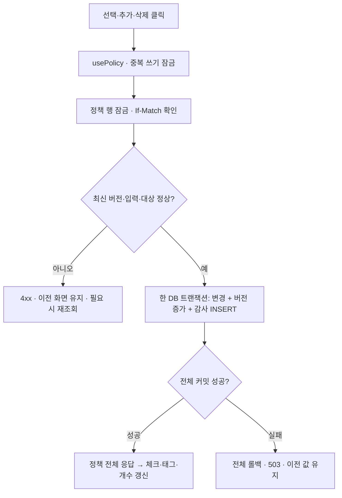
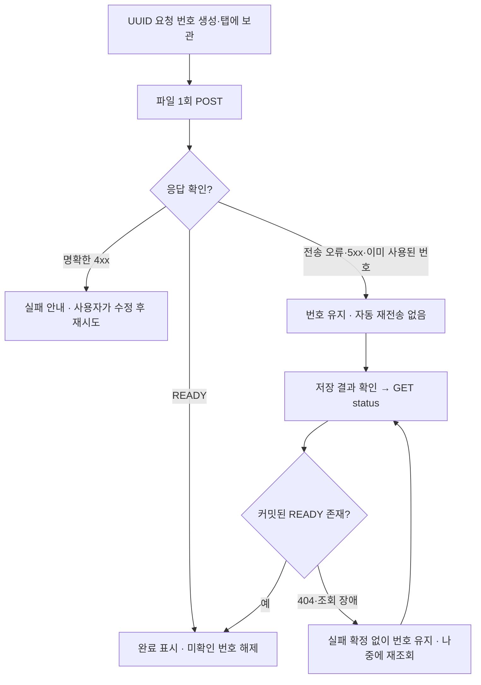
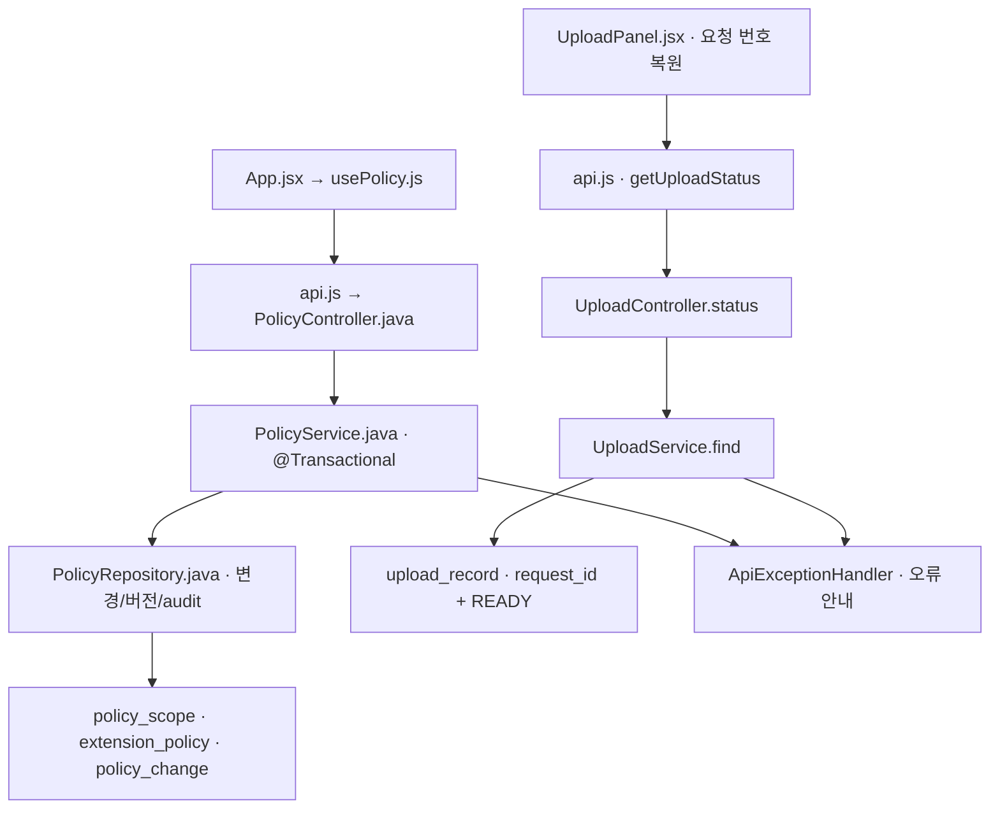
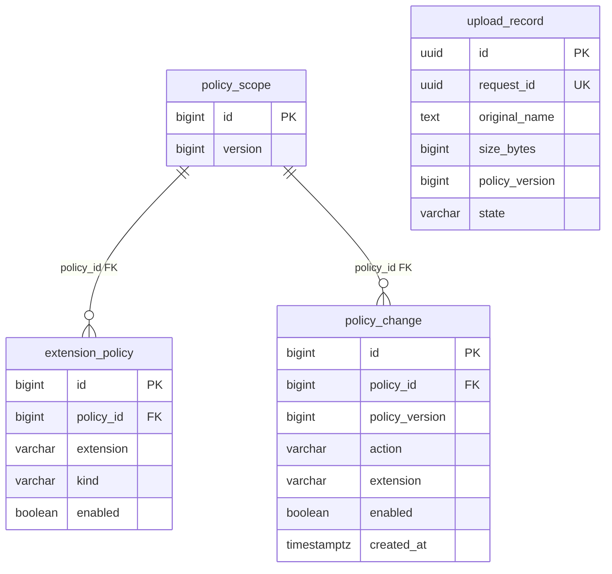

# PR #3 구현 결과 보고서

대상: [PR #3](https://github.com/feed-mina/flow_fileupload_AI/pull/3) · 병합 완료 확인 · 구현 기준 `6450a8924ef7fc0d459717ea119a884a0eb5759c`
실제 시험 근거: [최종 CI](https://github.com/feed-mina/flow_fileupload_AI/actions/runs/39903138964) · 모든 소스 링크는 이 커밋과 실제 줄 위치로 고정한다.

## 구현 핵심 · 1줄

정책 변경·감사 기록을 함께 저장하고, 응답이 끊긴 업로드는 재전송 없이 조회하며 실패 이유를 화면에 분명히 알리도록 구현했습니다.

## 진행 과정 · 3줄

1. 가이드에서 DB·서버의 필수/권장과 프론트엔드 FE-U01~06을 골라 기존 기능과 비교하고, 부족한 오류·조회 흐름을 정리했습니다.
2. 정책·버전·감사 기록을 한 번에 저장하고, 업로드 전에 요청 번호를 보관해 응답이 끊겨도 파일을 다시 보내지 않고 결과를 조회하게 했습니다.
3. 입력 오류·삭제 실패·조회 중·빈 목록을 구분한 뒤, 서버 30개·API 10개·브라우저 11개와 실제 재시작·Nginx 검사로 확인했습니다.

## 이전 PR에서 이어진 변화

| 단계 | 구현 범위 |
|---|---|
| PR1 | 고정 정책 저장·재시작 유지·커스텀 추가 |
| PR2 | 실제 파일 검증·UUID 저장·커스텀 삭제 |
| PR3 | 실패·응답 유실 복구 안내·조회·감사 트랜잭션 |

기술 스택: React·Ant Design / Spring Boot·JDBC·Flyway / PostgreSQL / Docker·Nginx 구성 / Git·GitHub Actions.

용어: UX(User Experience, 사용 경험), API(Application Programming Interface, 요청·응답 창구), DB(Database, 데이터베이스), UUID(Universally Unique Identifier, 충돌 가능성이 매우 낮은 식별 번호).

## 채택 범위

| 항목 | 실제 적용 |
|---|---|
| DB-U01~04 | 초기값 유지·롤백·재삭제 계약·정책/버전/감사 함께 저장 |
| BE-U01~06 | 차단·입력·한도·413·내부 오류 안내와 응답 유실 조회 |
| FE-U01~06 | 최초 조회·중복 클릭·실패 유지·입력 근처 오류·삭제·빈 목록 상태 |
| FE-U07 제외 | 신규 키보드·화면 읽기 작업과 완료 판정 제외. 기존 label·버튼 이름·모바일 회귀는 유지. |

## 정책·감사 기록을 함께 저장하는 흐름

## 응답이 끊긴 업로드 결과를 확인하는 흐름

## 화면과 소스의 관계

HTML에서는 오른쪽 다이어그램의 노드를 클릭하면 왼쪽에 해당 소스·함수·입력·처리·결과·코드가 표시됩니다. Markdown에서는 아래 소스 링크로 GitHub의 해당 줄을 열 수 있습니다.

## 역할별 소스 위치

| 역할 | GitHub 소스·줄 위치 | 함수·클래스 |
|---|---|---|
| 입력·조회 상태 안내 | [frontend/src/App.jsx L24–34](https://github.com/feed-mina/flow_fileupload_AI/blob/6450a8924ef7fc0d459717ea119a884a0eb5759c/frontend/src/App.jsx#L24-L34) | `App / submit` |
| 실패 때 이전 화면 유지 | [frontend/src/usePolicy.js L44–72](https://github.com/feed-mina/flow_fileupload_AI/blob/6450a8924ef7fc0d459717ea119a884a0eb5759c/frontend/src/usePolicy.js#L44-L72) | `usePolicy / mutate / refresh` |
| 15초 제한·응답 판정 | [frontend/src/lib/api.js L11–37](https://github.com/feed-mina/flow_fileupload_AI/blob/6450a8924ef7fc0d459717ea119a884a0eb5759c/frontend/src/lib/api.js#L11-L37) | `request / readyUpload / getUploadStatus` |
| 정책 변경 요청 입구 | [backend/src/main/java/dev/mina/flow/policy/PolicyController.java L32–43](https://github.com/feed-mina/flow_fileupload_AI/blob/6450a8924ef7fc0d459717ea119a884a0eb5759c/backend/src/main/java/dev/mina/flow/policy/PolicyController.java#L32-L43) | `setFixed / addCustom / deleteCustom` |
| 정책·버전·감사 저장 | [backend/src/main/java/dev/mina/flow/policy/PolicyService.java L52–62](https://github.com/feed-mina/flow_fileupload_AI/blob/6450a8924ef7fc0d459717ea119a884a0eb5759c/backend/src/main/java/dev/mina/flow/policy/PolicyService.java#L52-L62) | `setFixed / addCustom / deleteCustom` |
| 변경·감사 SQL | [backend/src/main/java/dev/mina/flow/policy/PolicyRepository.java L59–63](https://github.com/feed-mina/flow_fileupload_AI/blob/6450a8924ef7fc0d459717ea119a884a0eb5759c/backend/src/main/java/dev/mina/flow/policy/PolicyRepository.java#L59-L63) | `customExtension / audit / advanceVersion` |
| 감사·요청 번호 제약 | [backend/src/main/resources/db/migration/V3__ux_audit_and_upload_lookup.sql L1–16](https://github.com/feed-mina/flow_fileupload_AI/blob/6450a8924ef7fc0d459717ea119a884a0eb5759c/backend/src/main/resources/db/migration/V3__ux_audit_and_upload_lookup.sql#L1-L16) | `policy_change / upload_record.request_id` |
| 내부 정보 없는 오류 | [backend/src/main/java/dev/mina/flow/policy/ApiExceptionHandler.java L32–40](https://github.com/feed-mina/flow_fileupload_AI/blob/6450a8924ef7fc0d459717ea119a884a0eb5759c/backend/src/main/java/dev/mina/flow/policy/ApiExceptionHandler.java#L32-L40) | `policy / database / upload / tooLarge` |
| 미확인 업로드 조회 | [frontend/src/UploadPanel.jsx L42–59](https://github.com/feed-mina/flow_fileupload_AI/blob/6450a8924ef7fc0d459717ea119a884a0eb5759c/frontend/src/UploadPanel.jsx#L42-L59) | `submit / checkResult / restoredRequest` |
| 요청 번호로 완료 조회 | [backend/src/main/java/dev/mina/flow/upload/UploadController.java L36–49](https://github.com/feed-mina/flow_fileupload_AI/blob/6450a8924ef7fc0d459717ea119a884a0eb5759c/backend/src/main/java/dev/mina/flow/upload/UploadController.java#L36-L49) | `upload / status / parseId` |
| 완료 메타데이터 조회 | [backend/src/main/java/dev/mina/flow/upload/UploadService.java L35–46](https://github.com/feed-mina/flow_fileupload_AI/blob/6450a8924ef7fc0d459717ea119a884a0eb5759c/backend/src/main/java/dev/mina/flow/upload/UploadService.java#L35-L46) | `find / upload` |
| 기존 파일 저장 경로 유지 | [backend/src/main/java/dev/mina/flow/upload/UploadStorage.java L21–42](https://github.com/feed-mina/flow_fileupload_AI/blob/6450a8924ef7fc0d459717ea119a884a0eb5759c/backend/src/main/java/dev/mina/flow/upload/UploadStorage.java#L21-L42) | `copy / publish / destination` |
| 정책 롤백·재삭제 시험 | [backend/src/test/java/dev/mina/flow/policy/PolicyApiTest.java L154–176](https://github.com/feed-mina/flow_fileupload_AI/blob/6450a8924ef7fc0d459717ea119a884a0eb5759c/backend/src/test/java/dev/mina/flow/policy/PolicyApiTest.java#L154-L176) | `auditFailureRollsBackFixedAddAndDeleteIncludingVersion` |
| 조회·중복 번호 시험 | [backend/src/test/java/dev/mina/flow/upload/UploadApiTest.java L97–118](https://github.com/feed-mina/flow_fileupload_AI/blob/6450a8924ef7fc0d459717ea119a884a0eb5759c/backend/src/test/java/dev/mina/flow/upload/UploadApiTest.java#L97-L118) | `lostResponseCanBeLookedUpWithoutSendingFileAgain / concurrentSameRequestIdSavesOnlyOneFile` |
| 응답 유실·화면 상태 시험 | [frontend/e2e/policy.spec.js L115–130](https://github.com/feed-mina/flow_fileupload_AI/blob/6450a8924ef7fc0d459717ea119a884a0eb5759c/frontend/e2e/policy.spec.js#L115-L130) | `Playwright UX scenarios` |
| 전송·타임아웃 시험 | [frontend/src/lib/api.test.js L62–74](https://github.com/feed-mina/flow_fileupload_AI/blob/6450a8924ef7fc0d459717ea119a884a0eb5759c/frontend/src/lib/api.test.js#L62-L74) | `Node API client tests` |
| 프록시 크기 오류 안내 | [frontend/nginx.conf L5–15](https://github.com/feed-mina/flow_fileupload_AI/blob/6450a8924ef7fc0d459717ea119a884a0eb5759c/frontend/nginx.conf#L5-L15) | `client_max_body_size / @too_large` |
| 실제 Nginx 413 시험 | [scripts/verify-proxy.mjs L7–22](https://github.com/feed-mina/flow_fileupload_AI/blob/6450a8924ef7fc0d459717ea119a884a0eb5759c/scripts/verify-proxy.mjs#L7-L22) | `HTTP request / evidence assertions` |
| 기존 재시작 동작 유지 | [scripts/verify-restart.mjs L81–96](https://github.com/feed-mina/flow_fileupload_AI/blob/6450a8924ef7fc0d459717ea119a884a0eb5759c/scripts/verify-restart.mjs#L81-L96) | `T01~T04 assertions` |
| 자동 검사·증거 수집 | [.github/workflows/ci.yml L68–83](https://github.com/feed-mina/flow_fileupload_AI/blob/6450a8924ef7fc0d459717ea119a884a0eb5759c/.github/workflows/ci.yml#L68-L83) | `verify job` |

## 입력·처리·결과를 쉽게 따라가기

| 역할 | 입력 | 처리 | 결과·화면 |
|---|---|---|---|
| [입력·조회 상태 안내](https://github.com/feed-mina/flow_fileupload_AI/blob/6450a8924ef7fc0d459717ea119a884a0eb5759c/frontend/src/App.jsx#L24-L34) | policy, loading, error, fieldError, 사용자 입력 | 조회 실패를 빈 목록으로 표시하지 않습니다. 추가 성공 때만 입력을 비우고, 실패 안내는 입력 바로 아래에도 표시합니다. 삭제는 removeCustom에 연결합니다. | React 화면 요소. submit의 부수 효과는 성공 후 입력 초기화입니다. 최초 조회 실패 카드·필드 근처 오류·성공 후 태그 갱신 |
| [실패 때 이전 화면 유지](https://github.com/feed-mina/flow_fileupload_AI/blob/6450a8924ef7fc0d459717ea119a884a0eb5759c/frontend/src/usePolicy.js#L44-L72) | 작업 키, 현재 정책 버전, 비동기 저장 함수 | 중복 쓰기를 잠그고 성공 응답만 policy에 반영합니다. 412·428·결과 불명확은 재조회까지 편집을 잠그고, 추가 실패는 fieldError도 설정합니다. | mutate는 성공 true·실패 false. usePolicy는 상태와 액션 객체를 반환합니다. 삭제 실패 태그 유지·저장 중 안내·재조회 |
| [15초 제한·응답 판정](https://github.com/feed-mina/flow_fileupload_AI/blob/6450a8924ef7fc0d459717ea119a884a0eb5759c/frontend/src/lib/api.js#L11-L37) | URL, 요청 옵션, 예상 응답 판정 함수 | AbortController로 15초 뒤 중단하고 자동 재시도하지 않습니다. 413은 JSON/HTML에 상관없이 같은 안내로 바꿉니다. 조회 결과는 READY와 요청 번호 일치까지 검사합니다. | 정상 응답 Promise 또는 ApiError/전송 예외. 타이머·이벤트는 finally에서 정리합니다. 전송 오류를 성공으로 확정하지 않음 |
| [정책 변경 요청 입구](https://github.com/feed-mina/flow_fileupload_AI/blob/6450a8924ef7fc0d459717ea119a884a0eb5759c/backend/src/main/java/dev/mina/flow/policy/PolicyController.java#L32-L43) | 고정 이름 또는 커스텀 ID, 요청 본문, If-Match | 서버 서비스에 변경을 전달하고 응답에 ETag·no-store를 붙입니다. | ResponseEntity<PolicyView>. 변경 결과 전체 정책. 성공 응답이 도착한 뒤 체크·태그·개수 변경 |
| [정책·버전·감사 저장](https://github.com/feed-mina/flow_fileupload_AI/blob/6450a8924ef7fc0d459717ea119a884a0eb5759c/backend/src/main/java/dev/mina/flow/policy/PolicyService.java#L52-L62) | 대상 ID/확장자, enabled, If-Match | 공통 정책 행 잠금 → 버전 확인 → 변경 → 버전 증가 → audit → 정책 조회를 @Transactional로 묶습니다. 어느 저장이든 실패하면 롤백합니다. | PolicyView 또는 PolicyException. 최신 버전의 재삭제는 404이며 새 버전·감사 기록을 만들지 않습니다. 저장 완료 또는 이전 값 유지 |
| [변경·감사 SQL](https://github.com/feed-mina/flow_fileupload_AI/blob/6450a8924ef7fc0d459717ea119a884a0eb5759c/backend/src/main/java/dev/mina/flow/policy/PolicyRepository.java#L59-L63) | 동작 이름, 확장자, enabled | 바인딩 SQL로 정책을 수정합니다. audit는 현재 증가한 버전을 같은 트랜잭션에서 policy_change에 기록합니다. | audit는 void이며 DB INSERT가 부수 효과입니다. customExtension은 문자열 또는 null입니다. 감사 저장 실패도 전체 변경 실패로 연결 |
| [감사·요청 번호 제약](https://github.com/feed-mina/flow_fileupload_AI/blob/6450a8924ef7fc0d459717ea119a884a0eb5759c/backend/src/main/resources/db/migration/V3__ux_audit_and_upload_lookup.sql#L1-L16) | Flyway V3 마이그레이션 | 감사 이력에 정책 FK와 정책별 버전 UNIQUE를 둡니다. 기존 업로드는 request_id를 기존 id로 채운 뒤 NOT NULL·UNIQUE를 추가합니다. | 새 테이블·컬럼·제약. 기존 파일 ID·본문을 바꾸거나 과거 감사 기록을 만들어 넣지 않습니다. 새로고침 조회 근거와 변경 이력 |
| [내부 정보 없는 오류](https://github.com/feed-mina/flow_fileupload_AI/blob/6450a8924ef7fc0d459717ea119a884a0eb5759c/backend/src/main/java/dev/mina/flow/policy/ApiExceptionHandler.java#L32-L40) | 입력·DB·업로드 예외 | 입력 오류는 field와 허용 규칙, 내부 실패는 일반 메시지·추적 번호로 보냅니다. 오류 응답에도 no-store를 붙입니다. | HTTP 오류 JSON. 내부 경로·스택은 응답에 넣지 않습니다. 모든 프레임워크 오류를 이 클래스가 처리하는 것은 아닙니다. 오류 이유·추적 번호 표시 |
| [미확인 업로드 조회](https://github.com/feed-mina/flow_fileupload_AI/blob/6450a8924ef7fc0d459717ea119a884a0eb5759c/frontend/src/UploadPanel.jsx#L42-L59) | File, disabled, sessionStorage의 미확인 요청 번호 | POST 전에 UUID를 보관합니다. 응답 불명확 시 번호를 유지하고 저장 결과 확인 버튼은 GET만 보냅니다. 404·조회 장애는 번호를 지우지 않습니다. | 화면 상태 변경. READY 조회 성공 때 완료 표시와 번호 해제. 탭 저장 공간이 막히면 복원이 제한됩니다. 미확인 요청 번호·저장 결과 확인·새로고침 복원 |
| [요청 번호로 완료 조회](https://github.com/feed-mina/flow_fileupload_AI/blob/6450a8924ef7fc0d459717ea119a884a0eb5759c/backend/src/main/java/dev/mina/flow/upload/UploadController.java#L36-L49) | X-Upload-Request-Id 또는 경로 requestId | UUID 형식을 검사합니다. POST 헤더가 없으면 서버가 번호를 만듭니다. GET은 service.find로 완료 메타데이터만 조회합니다. | 200 READY 또는 404 UPLOAD_NOT_CONFIRMED. 404는 처리 중·실패·미도착을 구별하지 못합니다. 조회 없음은 자동 재전송 근거가 아님 |
| [완료 메타데이터 조회](https://github.com/feed-mina/flow_fileupload_AI/blob/6450a8924ef7fc0d459717ea119a884a0eb5759c/backend/src/main/java/dev/mina/flow/upload/UploadService.java#L35-L46) | UUID 요청 번호 또는 파일 이름·크기·스트림 | find는 request_id와 state=READY인 행만 읽고 파일을 복사하지 않습니다. POST는 기존 번호 검사와 DB UNIQUE로 중복을 막습니다. | find는 UploadResult 또는 null. 같은 번호 재업로드는 409. 알려진 롤백은 그 시도의 파일을 정리합니다. 한 파일의 결과를 재전송 없이 확인 |
| [기존 파일 저장 경로 유지](https://github.com/feed-mina/flow_fileupload_AI/blob/6450a8924ef7fc0d459717ea119a884a0eb5759c/backend/src/main/java/dev/mina/flow/upload/UploadStorage.java#L21-L42) | InputStream, UUID, 임시 파일 | PR2의 제한 스트리밍·UUID.bin 저장을 재사용합니다. 결과 조회 GET은 이 파일 저장 로직을 다시 실행하지 않습니다. | 실제 바이트 수·경로 또는 IOException. 파일 본문은 웹 루트 밖에 있습니다. 조회 버튼을 눌러도 저장 파일이 늘지 않음 |

## 서로 다른 세 가지 번호

| 이름 | 역할 |
|---|---|
| 업로드 조회 requestId | 클라이언트가 POST 전에 만든 UUID. X-Upload-Request-Id → upload_record.request_id → GET status의 조회 키. |
| 파일 id | 서버가 만든 파일 식별자. upload_record.id와 UUID.bin이 같은 UUID로 대응하며 물리 파일 경로는 응답하지 않음. |
| 오류 error.requestId | 서버 오류 추적 번호. 미확인 업로드의 조회 번호와 다른 역할이며 서로 바꾸어 쓰지 않음. |

설명용 예시: 같은 요청 번호로 파일을 두 번 보내려 하면 첫 저장 201, 중복 번호 409가 됩니다. 반대로 저장 결과 확인은 GET이므로 파일을 다시 보내지 않습니다.

## DB 관계

policy_change의 UNIQUE는 (policy_id, policy_version)의 묶음입니다. upload_record.request_id에는 별도의 UNIQUE가 있습니다. 위 ERD 선은 실제 FK만 나타냅니다.

## 실제 시험 결과

| 검사 | 결과 | 범위 |
|---|---|---|
| 서버 | 30개 PASS · skip 0 | 정책 11 + 업로드 서비스 2 + 업로드 API 17 |
| API 클라이언트 | 10개 PASS | 로컬·CI · fetch/타이머 모킹 |
| 브라우저 | 11개 PASS · retry 0 | 실서버 3개 + 응답 모킹 8개 · Chrome 155.0.8059.39 |
| 실제 재시작 | T01~T04 PASS | 같은 PostgreSQL·두 JVM |
| 실제 Nginx | 413 계약 PASS | 12 MiB+1 Content-Length 헤더 거부 |
| 설치·빌드·구성 | PASS | npm ci · Vite build · Compose config |

[실행 로그와 아티팩트](https://github.com/feed-mina/flow_fileupload_AI/actions/runs/39903138964/job/120248975950): `policy-test-evidence`에는 JUnit·재시작 JSON/서버 로그·Playwright 보고서·proxy-evidence.json이 있습니다.

감사 INSERT·버전 UPDATE 장애 때 변경 전체 롤백, 같은 요청 번호 경쟁의 201/409와 파일·DB 각각 1개, 실제 저장 뒤 응답만 차단한 후 새로고침·GET 조회·POST 1회를 확인했습니다. 기존 10 MiB 경계와 199개 상태의 경쟁 추가도 포함합니다.

## 반복 시험에서 수정한 부분

첫 구현 실행은 전체 통과했으나, 중간 반복 실행은 브라우저 9/11에서 멈췄습니다. 최종 화면 기록에서 로딩 아이콘이 버튼의 접근 가능한 이름을 `loading 저장 결과 확인`, `loading 파일 업로드`로 바꾸는 것을 확인했습니다. 표시 문구로 버튼을 찾고 활성 상태를 기다리도록 시험을 보완해 11/11을 통과했습니다. 요청 수·실제 저장·삭제·자동 재전송 금지 검증과 retry 0은 유지했습니다.

보고서 정리 과정에서 기존 UX 계약의 숫자 표기 `210개`·`1910개`를 발견했습니다. 실제 로그·소스에 맞는 서버 30개와 199개 경쟁 시험으로 문서만 정정하며, 이 보고서의 숫자는 실행 로그를 따릅니다.

## 유지보수 때 확인할 점

- 404 조회 없음은 아직 처리 중·미도착·저장 실패를 구별하지 못합니다. 자동 재전송하거나 실패로 확정하지 않습니다. 미확인 요청을 닫고 새 파일을 보내는 것은 사용자의 명시적 선택입니다.
- sessionStorage는 같은 탭의 새로고침 복원을 위한 저장 공간입니다. 저장 차단이나 탭 종료 후의 번호 복원은 보장하지 않습니다.
- policy_change.policy_id는 policy_scope.id를 참조하는 실제 FK입니다. policy_version은 당시 숫자 기록입니다. 업로드 policy_version은 현재 정책 버전의 FK가 아니고 파일 본문도 DB FK로 연결되지 않습니다.
- 감사 기록은 PR3부터 남기며 과거 변경·인증되지 않은 사용자 주체를 지어내어 채우지 않습니다. V3는 기존 업로드 request_id를 id로 백필하지만 파일 ID·본문은 바꾸지 않습니다.
- DB와 디스크는 하나의 원자적 트랜잭션이 아닙니다. 알려진 롤백 파일 정리는 유지하며 강제 종료·커밋 결과 불명·정리 실패는 DB/파일 수동 대조 대상입니다.
- 실제 Nginx 단독 검사는 전체 앱 이미지 빌드·Compose 기동·컨테이너 재생성·공개 배포 검증과 구분합니다. 인증·공개 격리·보관/총량 정책·악성코드 검사는 이번 범위에 포함하지 않았습니다.
- 이 보고서는 PR3 최종 소스와 기존 CI 로그를 확인한 문서입니다. 문서 작성 중 새로 실행한 앱 시험으로 표기하지 않았습니다.

상세 계약: [UX_IMPLEMENTATION.md](https://github.com/feed-mina/flow_fileupload_AI/blob/6450a8924ef7fc0d459717ea119a884a0eb5759c/docs/UX_IMPLEMENTATION.md) · [보고서 전체 목록](../README.md). 과거 문서는 당시 기록이며 현재 시험 숫자는 이 보고서와 해당 CI를 우선합니다.
